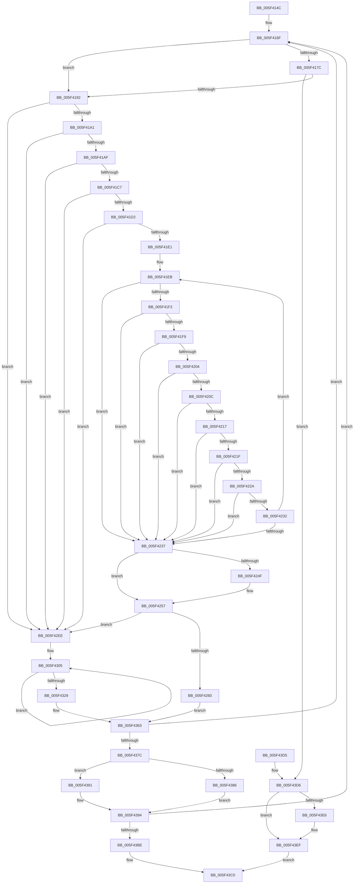

# deflate_rle

- RVA: `0x005F414C`–`0x005F4424` (길이 `728` bytes)
- VA: `0x00000001405F414C`
- 실행 섹션: `.text`
- PDB 이름 있음: `예`; PDB Function 태그: `예`
- unwind 정보 RVA: `0x000D0454`
- 디코드: `179`개 명령, `728/728` bytes 표시
- 미해석 바이트: `0` (있으면 어셈블리에 `.byte`로 보존)

> 이 문서는 커널 이미지의 기계어와 PDB 기호를 분석해 생성했습니다. 4번과 5번은 함수 원형과 자료형을 바이너리 사용 방식에서 추정한 C 해석이며 원본 소스 복구 결과는 아닙니다.

## 1. Dependencies

- 직접 호출 지점: **5**; 고유 호출 대상: **3**
- 직접 호출자로 확인된 함수: **1**
- RIP 상대 이미지 참조: **1**

### Outgoing calls
- `0x005F417F` → [fill_window](fill_window_function_005F4EF0.md) (function, `0x005F4EF0`)
- `0x005F439D` → [tr_flush_block](../60/tr_flush_block_function_00600AF8.md) (function, `0x00600AF8`)
- `0x005F43AD` → [flush_pending](flush_pending_function_005F5258.md) (function, `0x005F5258`)
- `0x005F43FE` → [tr_flush_block](../60/tr_flush_block_function_00600AF8.md) (function, `0x00600AF8`)
- `0x005F440E` → [flush_pending](flush_pending_function_005F5258.md) (function, `0x005F5258`)

### Direct callers
- [deflate](deflate_function_005F35C8.md) at `0x005F37D8`

### Static image references
- `0x005F42AE` → RVA `0x00036720` (`.rdata`; read)

## 2. Other-region calls and transfers

- 다른 실행 섹션으로 향하는 call: **0**
- 별도 외부 분기/꼬리 이동을 확인하지 못했습니다.

## 3. Assembly (complete function range)

```asm
005F414C  48 89 5C 24 08                  mov qword ptr [rsp + 8], rbx
005F4151  48 89 6C 24 10                  mov qword ptr [rsp + 0x10], rbp
005F4156  48 89 74 24 18                  mov qword ptr [rsp + 0x18], rsi
005F415B  57                              push rdi
005F415C  48 83 EC 20                     sub rsp, 0x20
005F4160  33 FF                           xor edi, edi
005F4162  48 8D B1 E4 00 00 00            lea rsi, [rcx + 0xe4]
005F4169  48 8B D9                        mov rbx, rcx
005F416C  8D 6F 01                        lea ebp, [rdi + 1]
005F416F  8B 83 EC 00 00 00               mov eax, dword ptr [rbx + 0xec]
005F4175  3D 02 01 00 00                  cmp eax, 0x102
005F417A  77 16                           ja 0x1405f4192
005F417C  48 8B CB                        mov rcx, rbx
005F417F  E8 6C 0D 00 00                  call 0x1405f4ef0
005F4184  8B 83 EC 00 00 00               mov eax, dword ptr [rbx + 0xec]
005F418A  85 C0                           test eax, eax
005F418C  0F 84 44 02 00 00               je 0x1405f43d6
005F4192  89 BB D8 00 00 00               mov dword ptr [rbx + 0xd8], edi
005F4198  83 F8 03                        cmp eax, 3
005F419B  0F 82 4D 01 00 00               jb 0x1405f42ee
005F41A1  8B 83 E4 00 00 00               mov eax, dword ptr [rbx + 0xe4]
005F41A7  85 C0                           test eax, eax
005F41A9  0F 84 3F 01 00 00               je 0x1405f42ee
005F41AF  4C 8B 83 A0 00 00 00            mov r8, qword ptr [rbx + 0xa0]
005F41B6  8B D0                           mov edx, eax
005F41B8  41 8A 4C 00 FF                  mov cl, byte ptr [r8 + rax - 1]
005F41BD  41 3A 0C 00                     cmp cl, byte ptr [r8 + rax]
005F41C1  0F 85 27 01 00 00               jne 0x1405f42ee
005F41C7  41 3A 4C 00 01                  cmp cl, byte ptr [r8 + rax + 1]
005F41CC  0F 85 1C 01 00 00               jne 0x1405f42ee
005F41D2  49 8D 40 02                     lea rax, [r8 + 2]
005F41D6  48 03 C2                        add rax, rdx
005F41D9  3A 08                           cmp cl, byte ptr [rax]
005F41DB  0F 85 0D 01 00 00               jne 0x1405f42ee
005F41E1  4D 8D 88 02 01 00 00            lea r9, [r8 + 0x102]
005F41E8  4C 03 CA                        add r9, rdx
005F41EB  48 FF C0                        inc rax
005F41EE  3A 08                           cmp cl, byte ptr [rax]
005F41F0  75 45                           jne 0x1405f4237
005F41F2  48 FF C0                        inc rax
005F41F5  3A 08                           cmp cl, byte ptr [rax]
005F41F7  75 3E                           jne 0x1405f4237
005F41F9  48 8D 50 01                     lea rdx, [rax + 1]
005F41FD  48 8B C2                        mov rax, rdx
005F4200  3A 0A                           cmp cl, byte ptr [rdx]
005F4202  75 33                           jne 0x1405f4237
005F4204  48 8D 42 01                     lea rax, [rdx + 1]
005F4208  3A 08                           cmp cl, byte ptr [rax]
005F420A  75 2B                           jne 0x1405f4237
005F420C  48 8D 50 01                     lea rdx, [rax + 1]
005F4210  48 8B C2                        mov rax, rdx
005F4213  3A 0A                           cmp cl, byte ptr [rdx]
005F4215  75 20                           jne 0x1405f4237
005F4217  48 8D 42 01                     lea rax, [rdx + 1]
005F421B  3A 08                           cmp cl, byte ptr [rax]
005F421D  75 18                           jne 0x1405f4237
005F421F  48 8D 50 01                     lea rdx, [rax + 1]
005F4223  48 8B C2                        mov rax, rdx
005F4226  3A 0A                           cmp cl, byte ptr [rdx]
005F4228  75 0D                           jne 0x1405f4237
005F422A  48 8D 42 01                     lea rax, [rdx + 1]
005F422E  3A 08                           cmp cl, byte ptr [rax]
005F4230  75 05                           jne 0x1405f4237
005F4232  49 3B C1                        cmp rax, r9
005F4235  72 B4                           jb 0x1405f41eb
005F4237  8B 8B EC 00 00 00               mov ecx, dword ptr [rbx + 0xec]
005F423D  41 2B C1                        sub eax, r9d
005F4240  05 02 01 00 00                  add eax, 0x102
005F4245  89 83 D8 00 00 00               mov dword ptr [rbx + 0xd8], eax
005F424B  3B C1                           cmp eax, ecx
005F424D  76 08                           jbe 0x1405f4257
005F424F  89 8B D8 00 00 00               mov dword ptr [rbx + 0xd8], ecx
005F4255  8B C1                           mov eax, ecx
005F4257  83 F8 03                        cmp eax, 3
005F425A  0F 82 8E 00 00 00               jb 0x1405f42ee
005F4260  8B 8B 44 17 00 00               mov ecx, dword ptr [rbx + 0x1744]
005F4266  48 8D B3 E4 00 00 00            lea rsi, [rbx + 0xe4]
005F426D  8A 93 D8 00 00 00               mov dl, byte ptr [rbx + 0xd8]
005F4273  48 8B 83 38 17 00 00            mov rax, qword ptr [rbx + 0x1738]
005F427A  80 EA 03                        sub dl, 3
005F427D  40 88 2C 01                     mov byte ptr [rcx + rax], bpl
005F4281  01 AB 44 17 00 00               add dword ptr [rbx + 0x1744], ebp
005F4287  8B 8B 44 17 00 00               mov ecx, dword ptr [rbx + 0x1744]
005F428D  48 8B 83 38 17 00 00            mov rax, qword ptr [rbx + 0x1738]
005F4294  40 88 3C 01                     mov byte ptr [rcx + rax], dil
005F4298  01 AB 44 17 00 00               add dword ptr [rbx + 0x1744], ebp
005F429E  8B 8B 44 17 00 00               mov ecx, dword ptr [rbx + 0x1744]
005F42A4  48 8B 83 38 17 00 00            mov rax, qword ptr [rbx + 0x1738]
005F42AB  88 14 01                        mov byte ptr [rcx + rax], dl
005F42AE  48 8D 0D 6B 24 A4 FF            lea rcx, [rip - 0x5bdb95]
005F42B5  01 AB 44 17 00 00               add dword ptr [rbx + 0x1744], ebp
005F42BB  0F B6 C2                        movzx eax, dl
005F42BE  0F B6 0C 08                     movzx ecx, byte ptr [rax + rcx]
005F42C2  66 01 AC 8B 10 05 00 00         add word ptr [rbx + rcx*4 + 0x510], bp
005F42CA  66 01 AB 00 0A 00 00            add word ptr [rbx + 0xa00], bp
005F42D1  8B 8B D8 00 00 00               mov ecx, dword ptr [rbx + 0xd8]
005F42D7  44 8B 06                        mov r8d, dword ptr [rsi]
005F42DA  29 8B EC 00 00 00               sub dword ptr [rbx + 0xec], ecx
005F42E0  44 03 C1                        add r8d, ecx
005F42E3  89 BB D8 00 00 00               mov dword ptr [rbx + 0xd8], edi
005F42E9  44 89 06                        mov dword ptr [rsi], r8d
005F42EC  EB 75                           jmp 0x1405f4363
005F42EE  8B 8B E4 00 00 00               mov ecx, dword ptr [rbx + 0xe4]
005F42F4  BA 02 00 00 00                  mov edx, 2
005F42F9  48 8B 83 A0 00 00 00            mov rax, qword ptr [rbx + 0xa0]
005F4300  44 0F B6 04 01                  movzx r8d, byte ptr [rcx + rax]
005F4305  48 8B 83 38 17 00 00            mov rax, qword ptr [rbx + 0x1738]
005F430C  8B 8B 44 17 00 00               mov ecx, dword ptr [rbx + 0x1744]
005F4312  40 88 3C 01                     mov byte ptr [rcx + rax], dil
005F4316  8B 83 44 17 00 00               mov eax, dword ptr [rbx + 0x1744]
005F431C  FF C0                           inc eax
005F431E  89 83 44 17 00 00               mov dword ptr [rbx + 0x1744], eax
005F4324  48 2B D5                        sub rdx, rbp
005F4327  75 DC                           jne 0x1405f4305
005F4329  8B C8                           mov ecx, eax
005F432B  48 8D B3 E4 00 00 00            lea rsi, [rbx + 0xe4]
005F4332  48 8B 83 38 17 00 00            mov rax, qword ptr [rbx + 0x1738]
005F4339  44 88 04 01                     mov byte ptr [rcx + rax], r8b
005F433D  01 AB 44 17 00 00               add dword ptr [rbx + 0x1744], ebp
005F4343  66 42 01 AC 83 0C 01 00 00      add word ptr [rbx + r8*4 + 0x10c], bp
005F434C  44 8B 83 E4 00 00 00            mov r8d, dword ptr [rbx + 0xe4]
005F4353  FF 8B EC 00 00 00               dec dword ptr [rbx + 0xec]
005F4359  41 FF C0                        inc r8d
005F435C  44 89 83 E4 00 00 00            mov dword ptr [rbx + 0xe4], r8d
005F4363  8B 83 48 17 00 00               mov eax, dword ptr [rbx + 0x1748]
005F4369  8B CF                           mov ecx, edi
005F436B  39 83 44 17 00 00               cmp dword ptr [rbx + 0x1744], eax
005F4371  0F 94 C1                        sete cl
005F4374  85 C9                           test ecx, ecx
005F4376  0F 84 F3 FD FF FF               je 0x1405f416f
005F437C  8B 83 D4 00 00 00               mov eax, dword ptr [rbx + 0xd4]
005F4382  85 C0                           test eax, eax
005F4384  78 0B                           js 0x1405f4391
005F4386  8B D0                           mov edx, eax
005F4388  48 03 93 A0 00 00 00            add rdx, qword ptr [rbx + 0xa0]
005F438F  EB 03                           jmp 0x1405f4394
005F4391  48 8B D7                        mov rdx, rdi
005F4394  44 2B C0                        sub r8d, eax
005F4397  45 33 C9                        xor r9d, r9d
005F439A  48 8B CB                        mov rcx, rbx
005F439D  E8 56 C7 00 00                  call 0x140600af8
005F43A2  8B 06                           mov eax, dword ptr [rsi]
005F43A4  48 8B 0B                        mov rcx, qword ptr [rbx]
005F43A7  89 83 D4 00 00 00               mov dword ptr [rbx + 0xd4], eax
005F43AD  E8 A6 0E 00 00                  call 0x1405f5258
005F43B2  48 8B 03                        mov rax, qword ptr [rbx]
005F43B5  39 78 18                        cmp dword ptr [rax + 0x18], edi
005F43B8  0F 85 B1 FD FF FF               jne 0x1405f416f
005F43BE  33 C0                           xor eax, eax
005F43C0  48 8B 5C 24 30                  mov rbx, qword ptr [rsp + 0x30]
005F43C5  48 8B 6C 24 38                  mov rbp, qword ptr [rsp + 0x38]
005F43CA  48 8B 74 24 40                  mov rsi, qword ptr [rsp + 0x40]
005F43CF  48 83 C4 20                     add rsp, 0x20
005F43D3  5F                              pop rdi
005F43D4  C3                              ret
005F43D5  CC                              int3
005F43D6  8B 83 D4 00 00 00               mov eax, dword ptr [rbx + 0xd4]
005F43DC  89 BB 58 17 00 00               mov dword ptr [rbx + 0x1758], edi
005F43E2  85 C0                           test eax, eax
005F43E4  78 09                           js 0x1405f43ef
005F43E6  8B F8                           mov edi, eax
005F43E8  48 03 BB A0 00 00 00            add rdi, qword ptr [rbx + 0xa0]
005F43EF  44 8B 06                        mov r8d, dword ptr [rsi]
005F43F2  44 8B CD                        mov r9d, ebp
005F43F5  44 2B C0                        sub r8d, eax
005F43F8  48 8B D7                        mov rdx, rdi
005F43FB  48 8B CB                        mov rcx, rbx
005F43FE  E8 F5 C6 00 00                  call 0x140600af8
005F4403  8B 06                           mov eax, dword ptr [rsi]
005F4405  48 8B 0B                        mov rcx, qword ptr [rbx]
005F4408  89 83 D4 00 00 00               mov dword ptr [rbx + 0xd4], eax
005F440E  E8 45 0E 00 00                  call 0x1405f5258
005F4413  48 8B 03                        mov rax, qword ptr [rbx]
005F4416  8B 48 18                        mov ecx, dword ptr [rax + 0x18]
005F4419  F7 D9                           neg ecx
005F441B  1B C0                           sbb eax, eax
005F441D  F7 D8                           neg eax
005F441F  83 C0 02                        add eax, 2
005F4422  EB 9C                           jmp 0x1405f43c0
```

## 4. C-style interpretation (structured pseudocode)

```c
__int64 __fastcall deflate_rle(__int64 a1)
{
    __int64 result;
    __int64 v_rdi;
    __int64 v_rsp;
    unsigned __int64 v_stack_p10;
    unsigned __int64 v_stack_p18;
    unsigned __int64 v_stack_p8;

    v_stack_p8 = v_rbx;
    v_stack_p10 = v_rbp;
    v_stack_p18 = v_rsi;
    v_rsp = (v_rsp) - (32);
    v_rdi = 0;
loc_005F416F:
    if (((unsigned int)((unsigned int)(*(unsigned int *)(a1 + 236)))) > 258) goto loc_005F4192;
    result = fill_window(a1, a2, a3, a4);
    if ((unsigned int)((unsigned int)(*(unsigned int *)(a1 + 236))) == 0) goto loc_005F43D6;
loc_005F4192:
    *(unsigned int *)(a1 + 216) = 0;
    if (((unsigned int)((unsigned int)(*(unsigned int *)(a1 + 236)))) < 3) goto loc_005F42EE;
    if ((unsigned int)((unsigned int)(*(unsigned int *)(a1 + 228))) == 0) goto loc_005F42EE;
    if (((unsigned __int8)(*(unsigned __int8 *)(*(unsigned __int64 *)(a1 + 160) + (unsigned int)(*(unsigned int *)(a1 + 228)) * 1 - 1))) != (*(unsigned __int8 *)(*(unsigned __int64 *)(a1 + 160) + (unsigned int)(*(unsigned int *)(a1 + 228)) * 1))) goto loc_005F42EE;
    if (((unsigned __int8)(*(unsigned __int8 *)(*(unsigned __int64 *)(a1 + 160) + (unsigned int)(*(unsigned int *)(a1 + 228)) * 1 - 1))) != (*(unsigned __int8 *)(*(unsigned __int64 *)(a1 + 160) + (unsigned int)(*(unsigned int *)(a1 + 228)) * 1 + 1))) goto loc_005F42EE;
    result = (*(unsigned __int64 *)(a1 + 160) + 2) + ((unsigned int)((unsigned int)((unsigned int)(*(unsigned int *)(a1 + 228)))));
    if (((unsigned __int8)(*(unsigned __int8 *)(*(unsigned __int64 *)(a1 + 160) + (unsigned int)(*(unsigned int *)(a1 + 228)) * 1 - 1))) != (*(unsigned __int8 *)(result))) goto loc_005F42EE;
    a4 = (*(unsigned __int64 *)(a1 + 160) + 258) + ((unsigned int)((unsigned int)((unsigned int)(*(unsigned int *)(a1 + 228)))));
loc_005F41EB:
    result = (result) + 1;
    if (((unsigned __int8)(*(unsigned __int8 *)(*(unsigned __int64 *)(a1 + 160) + (unsigned int)(*(unsigned int *)(a1 + 228)) * 1 - 1))) != (*(unsigned __int8 *)(result))) goto loc_005F4237;
    result = (result) + 1;
    if (((unsigned __int8)(*(unsigned __int8 *)(*(unsigned __int64 *)(a1 + 160) + (unsigned int)(*(unsigned int *)(a1 + 228)) * 1 - 1))) != (*(unsigned __int8 *)(result))) goto loc_005F4237;
    if (((unsigned __int8)(*(unsigned __int8 *)(*(unsigned __int64 *)(a1 + 160) + (unsigned int)(*(unsigned int *)(a1 + 228)) * 1 - 1))) != (*(unsigned __int8 *)(result + 1))) goto loc_005F4237;
    if (((unsigned __int8)(*(unsigned __int8 *)(*(unsigned __int64 *)(a1 + 160) + (unsigned int)(*(unsigned int *)(a1 + 228)) * 1 - 1))) != (*(unsigned __int8 *)(result + 1 + 1))) goto loc_005F4237;
    if (((unsigned __int8)(*(unsigned __int8 *)(*(unsigned __int64 *)(a1 + 160) + (unsigned int)(*(unsigned int *)(a1 + 228)) * 1 - 1))) != (*(unsigned __int8 *)(result + 1 + 1 + 1))) goto loc_005F4237;
    if (((unsigned __int8)(*(unsigned __int8 *)(*(unsigned __int64 *)(a1 + 160) + (unsigned int)(*(unsigned int *)(a1 + 228)) * 1 - 1))) != (*(unsigned __int8 *)(result + 1 + 1 + 1 + 1))) goto loc_005F4237;
    if (((unsigned __int8)(*(unsigned __int8 *)(*(unsigned __int64 *)(a1 + 160) + (unsigned int)(*(unsigned int *)(a1 + 228)) * 1 - 1))) != (*(unsigned __int8 *)(result + 1 + 1 + 1 + 1 + 1))) goto loc_005F4237;
    if (((unsigned __int8)(*(unsigned __int8 *)(*(unsigned __int64 *)(a1 + 160) + (unsigned int)(*(unsigned int *)(a1 + 228)) * 1 - 1))) != (*(unsigned __int8 *)(result + 1 + 1 + 1 + 1 + 1 + 1))) goto loc_005F4237;
    if ((result + 1 + 1 + 1 + 1 + 1 + 1) < a4) goto loc_005F41EB;
loc_005F4237:
    result = (unsigned int)((result + 1 + 1 + 1 + 1 + 1 + 1) - ((unsigned int)(a4)));
    result = (unsigned int)((result) + (258));
    *(unsigned int *)(a1 + 216) = (unsigned int)(result);
    if (((unsigned int)(result)) >= = ((unsigned int)((unsigned int)(*(unsigned int *)(a1 + 236))))) {
        *(unsigned int *)(a1 + 216) = (unsigned int)((unsigned int)(*(unsigned int *)(a1 + 236)));
        result = (unsigned int)((unsigned int)(*(unsigned int *)(a1 + 236)));
    }
    if (((unsigned int)(result)) < 3) goto loc_005F42EE;
    a2 = (unsigned __int8)((*(unsigned __int8 *)(a1 + 216)) - (3));
    *(unsigned __int8 *)((unsigned int)(*(unsigned int *)(a1 + 5956)) + *(unsigned __int64 *)(a1 + 5944) * 1) = (unsigned __int8)(v_rdi + 1);
    *(unsigned __int8 *)((unsigned int)(*(unsigned int *)(a1 + 5956)) + *(unsigned __int64 *)(a1 + 5944) * 1) = 0;
    *(unsigned __int8 *)((unsigned int)(*(unsigned int *)(a1 + 5956)) + *(unsigned __int64 *)(a1 + 5944) * 1) = (unsigned __int8)(a2);
    a3 = (unsigned int)(((unsigned int)(*(unsigned int *)(a1 + 228))) + ((unsigned int)((unsigned int)(*(unsigned int *)(a1 + 216)))));
    *(unsigned int *)(a1 + 216) = 0;
    *(unsigned int *)(a1 + 228) = (unsigned int)(a3);
    goto loc_005F4363;
loc_005F42EE:
loc_005F4305:
    *(unsigned __int8 *)((unsigned int)(*(unsigned int *)(a1 + 5956)) + *(unsigned __int64 *)(a1 + 5944) * 1) = 0;
    result = (unsigned int)(((unsigned int)(*(unsigned int *)(a1 + 5956))) + 1);
    *(unsigned int *)(a1 + 5956) = (unsigned int)(result);
    a2 = (2) - (v_rdi + 1);
    if (condition_is_not_equal) goto loc_005F4305;
    *(unsigned __int8 *)((unsigned int)((unsigned int)(result)) + *(unsigned __int64 *)(a1 + 5944) * 1) = (unsigned __int8)(*(unsigned __int8 *)((unsigned int)(*(unsigned int *)(a1 + 228)) + *(unsigned __int64 *)(a1 + 160) * 1));
    a3 = (unsigned int)(((unsigned int)(*(unsigned int *)(a1 + 228))) + 1);
    *(unsigned int *)(a1 + 228) = (unsigned int)(a3);
loc_005F4363:
    a1 = ((*(unsigned int *)(a1 + 5956)) == ((unsigned int)((unsigned int)(*(unsigned int *)(a1 + 5960))))) ? 1 : 0;
    if ((unsigned int)(a1) == 0) goto loc_005F416F;
    if (sign_flag) goto loc_005F4391;
    a2 = ((unsigned int)((unsigned int)((unsigned int)(*(unsigned int *)(a1 + 212))))) + (*(unsigned __int64 *)(a1 + 160));
    goto loc_005F4394;
loc_005F4391:
loc_005F4394:
    a3 = (unsigned int)((a3) - ((unsigned int)((unsigned int)(*(unsigned int *)(a1 + 212)))));
    a4 = 0;
    result = tr_flush_block(a1, 0, a3, a4);
    *(unsigned int *)(a1 + 212) = (unsigned int)((unsigned int)(*(unsigned int *)(a1 + 228)));
    result = flush_pending(*(unsigned __int64 *)(a1), 0, a3, a4);
    if ((*(unsigned int *)(*(unsigned __int64 *)(a1) + 24)) != 0) goto loc_005F416F;
    result = 0;
loc_005F43C0:
    v_rsp = (v_rsp) + (32);
    return result;
loc_005F43D6:
    *(unsigned int *)(v_stack_p8 + 5976) = 0;
    if (!(sign_flag)) {
        v_rdi = (unsigned int)((unsigned int)(*(unsigned int *)(v_stack_p8 + 212)));
        v_rdi = (v_rdi) + (*(unsigned __int64 *)(v_stack_p8 + 160));
    }
    a3 = (unsigned int)(((unsigned int)(*(unsigned int *)(v_stack_p18))) - ((unsigned int)((unsigned int)(*(unsigned int *)(v_stack_p8 + 212)))));
    result = tr_flush_block(v_stack_p8, v_rdi, a3, (unsigned int)((unsigned int)(v_stack_p10)));
    *(unsigned int *)(v_stack_p8 + 212) = (unsigned int)((unsigned int)(*(unsigned int *)(v_stack_p18)));
    result = flush_pending(*(unsigned __int64 *)(v_stack_p8), v_rdi, a3, (unsigned int)((unsigned int)(v_stack_p10)));
    a1 = (unsigned int)(-((unsigned int)(*(unsigned int *)(*(unsigned __int64 *)(v_stack_p8) + 24))));
    result = (unsigned int)(-(*(unsigned __int64 *)(v_stack_p8)));
    result = (unsigned int)((result) + (2));
    goto loc_005F43C0;
}
```

## 5. (Beta) C Style

```c
int64_t deflate_rle(void *Arg1)
{
    uint8_t *arg1 = (uint8_t *)Arg1;

    int64_t result;
    int64_t local_rdi;
    int64_t local_rsp;
    uint64_t v_stack_p10;
    uint64_t v_stack_p18;
    uint64_t v_stack_p8;

    v_stack_p8 = local_rbx;
    v_stack_p10 = local_rbp;
    v_stack_p18 = local_rsi;
    local_rsp = (local_rsp) - (32);
    local_rdi = 0;
loc_005F416F:
    if (((uint32_t)((uint32_t)(*(uint32_t *)(arg1 + 0xEC)))) > 258) goto loc_005F4192;
    result = fill_window(Arg1, a2, a3, a4);
    if ((uint32_t)((uint32_t)(*(uint32_t *)(arg1 + 0xEC))) == 0) goto loc_005F43D6;
loc_005F4192:
    *(uint32_t *)(arg1 + 0xD8) = 0;
    if (((uint32_t)((uint32_t)(*(uint32_t *)(arg1 + 0xEC)))) < 3) goto loc_005F42EE;
    if ((uint32_t)((uint32_t)(*(uint32_t *)(arg1 + 0xE4))) == 0) goto loc_005F42EE;
    if (((uint8_t)(*(uint8_t *)(*(uint64_t *)(arg1 + 0xA0) + (uint32_t)(*(uint32_t *)(arg1 + 0xE4)) * 1 - 0x1))) != (*(uint8_t *)(*(uint64_t *)(arg1 + 0xA0) + (uint32_t)(*(uint32_t *)(arg1 + 0xE4)) * 1))) goto loc_005F42EE;
    if (((uint8_t)(*(uint8_t *)(*(uint64_t *)(arg1 + 0xA0) + (uint32_t)(*(uint32_t *)(arg1 + 0xE4)) * 1 - 0x1))) != (*(uint8_t *)(*(uint64_t *)(arg1 + 0xA0) + (uint32_t)(*(uint32_t *)(arg1 + 0xE4)) * 1 + 0x1))) goto loc_005F42EE;
    result = (*(uint64_t *)(arg1 + 0xA0) + 2) + ((uint32_t)((uint32_t)((uint32_t)(*(uint32_t *)(arg1 + 0xE4)))));
    if (((uint8_t)(*(uint8_t *)(*(uint64_t *)(arg1 + 0xA0) + (uint32_t)(*(uint32_t *)(arg1 + 0xE4)) * 1 - 0x1))) != (*(uint8_t *)(result))) goto loc_005F42EE;
    a4 = (*(uint64_t *)(arg1 + 0xA0) + 258) + ((uint32_t)((uint32_t)((uint32_t)(*(uint32_t *)(arg1 + 0xE4)))));
loc_005F41EB:
    result = (result) + 1;
    if (((uint8_t)(*(uint8_t *)(*(uint64_t *)(arg1 + 0xA0) + (uint32_t)(*(uint32_t *)(arg1 + 0xE4)) * 1 - 0x1))) != (*(uint8_t *)(result))) goto loc_005F4237;
    result = (result) + 1;
    if (((uint8_t)(*(uint8_t *)(*(uint64_t *)(arg1 + 0xA0) + (uint32_t)(*(uint32_t *)(arg1 + 0xE4)) * 1 - 0x1))) != (*(uint8_t *)(result))) goto loc_005F4237;
    if (((uint8_t)(*(uint8_t *)(*(uint64_t *)(arg1 + 0xA0) + (uint32_t)(*(uint32_t *)(arg1 + 0xE4)) * 1 - 0x1))) != (*(uint8_t *)(result + 0x1))) goto loc_005F4237;
    if (((uint8_t)(*(uint8_t *)(*(uint64_t *)(arg1 + 0xA0) + (uint32_t)(*(uint32_t *)(arg1 + 0xE4)) * 1 - 0x1))) != (*(uint8_t *)(result + 0x1 + 0x1))) goto loc_005F4237;
    if (((uint8_t)(*(uint8_t *)(*(uint64_t *)(arg1 + 0xA0) + (uint32_t)(*(uint32_t *)(arg1 + 0xE4)) * 1 - 0x1))) != (*(uint8_t *)(result + 0x1 + 0x1 + 0x1))) goto loc_005F4237;
    if (((uint8_t)(*(uint8_t *)(*(uint64_t *)(arg1 + 0xA0) + (uint32_t)(*(uint32_t *)(arg1 + 0xE4)) * 1 - 0x1))) != (*(uint8_t *)(result + 0x1 + 0x1 + 0x1 + 0x1))) goto loc_005F4237;
    if (((uint8_t)(*(uint8_t *)(*(uint64_t *)(arg1 + 0xA0) + (uint32_t)(*(uint32_t *)(arg1 + 0xE4)) * 1 - 0x1))) != (*(uint8_t *)(result + 0x1 + 0x1 + 0x1 + 0x1 + 0x1))) goto loc_005F4237;
    if (((uint8_t)(*(uint8_t *)(*(uint64_t *)(arg1 + 0xA0) + (uint32_t)(*(uint32_t *)(arg1 + 0xE4)) * 1 - 0x1))) != (*(uint8_t *)(result + 0x1 + 0x1 + 0x1 + 0x1 + 0x1 + 0x1))) goto loc_005F4237;
    if ((result + 1 + 1 + 1 + 1 + 1 + 1) < a4) goto loc_005F41EB;
loc_005F4237:
    result = (uint32_t)((result + 1 + 1 + 1 + 1 + 1 + 1) - ((uint32_t)(a4)));
    result = (uint32_t)((result) + (258));
    *(uint32_t *)(arg1 + 0xD8) = (uint32_t)(result);
    if (((uint32_t)(result)) >= = ((uint32_t)((uint32_t)(*(uint32_t *)(arg1 + 0xEC))))) {
        *(uint32_t *)(arg1 + 0xD8) = (uint32_t)((uint32_t)(*(uint32_t *)(arg1 + 0xEC)));
        result = (uint32_t)((uint32_t)(*(uint32_t *)(arg1 + 0xEC)));
    }
    if (((uint32_t)(result)) < 3) goto loc_005F42EE;
    a2 = (uint8_t)((*(uint8_t *)(arg1 + 0xD8)) - (3));
    *(uint8_t *)((uint32_t)(*(uint32_t *)(arg1 + 0x1744)) + *(uint64_t *)(arg1 + 0x1738) * 1) = (uint8_t)(local_rdi + 1);
    *(uint8_t *)((uint32_t)(*(uint32_t *)(arg1 + 0x1744)) + *(uint64_t *)(arg1 + 0x1738) * 1) = 0;
    *(uint8_t *)((uint32_t)(*(uint32_t *)(arg1 + 0x1744)) + *(uint64_t *)(arg1 + 0x1738) * 1) = (uint8_t)(a2);
    a3 = (uint32_t)(((uint32_t)(*(uint32_t *)(arg1 + 0xE4))) + ((uint32_t)((uint32_t)(*(uint32_t *)(arg1 + 0xD8)))));
    *(uint32_t *)(arg1 + 0xD8) = 0;
    *(uint32_t *)(arg1 + 0xE4) = (uint32_t)(a3);
    goto loc_005F4363;
loc_005F42EE:
loc_005F4305:
    *(uint8_t *)((uint32_t)(*(uint32_t *)(arg1 + 0x1744)) + *(uint64_t *)(arg1 + 0x1738) * 1) = 0;
    result = (uint32_t)(((uint32_t)(*(uint32_t *)(arg1 + 0x1744))) + 1);
    *(uint32_t *)(arg1 + 0x1744) = (uint32_t)(result);
    a2 = (2) - (local_rdi + 1);
    if (condition_is_not_equal) goto loc_005F4305;
    *(uint8_t *)((uint32_t)((uint32_t)(result)) + *(uint64_t *)(arg1 + 0x1738) * 1) = (uint8_t)(*(uint8_t *)((uint32_t)(*(uint32_t *)(arg1 + 0xE4)) + *(uint64_t *)(arg1 + 0xA0) * 1));
    a3 = (uint32_t)(((uint32_t)(*(uint32_t *)(arg1 + 0xE4))) + 1);
    *(uint32_t *)(arg1 + 0xE4) = (uint32_t)(a3);
loc_005F4363:
    Arg1 = ((*(uint32_t *)(arg1 + 0x1744)) == ((uint32_t)((uint32_t)(*(uint32_t *)(arg1 + 0x1748))))) ? 1 : 0;
    if ((uint32_t)(Arg1) == 0) goto loc_005F416F;
    if (sign_flag) goto loc_005F4391;
    a2 = ((uint32_t)((uint32_t)((uint32_t)(*(uint32_t *)(arg1 + 0xD4))))) + (*(uint64_t *)(arg1 + 0xA0));
    goto loc_005F4394;
loc_005F4391:
loc_005F4394:
    a3 = (uint32_t)((a3) - ((uint32_t)((uint32_t)(*(uint32_t *)(arg1 + 0xD4)))));
    a4 = 0;
    result = tr_flush_block(Arg1, 0, a3, a4);
    *(uint32_t *)(arg1 + 0xD4) = (uint32_t)((uint32_t)(*(uint32_t *)(arg1 + 0xE4)));
    result = flush_pending(*(uint64_t *)(arg1), 0, a3, a4);
    if ((*(uint32_t *)(*(uint64_t *)(arg1) + 0x18)) != 0) goto loc_005F416F;
    result = 0;
loc_005F43C0:
    local_rsp = (local_rsp) + (32);
    return result;
loc_005F43D6:
    *(uint32_t *)(v_stack_p8 + 0x1758) = 0;
    if (!(sign_flag)) {
        local_rdi = (uint32_t)((uint32_t)(*(uint32_t *)(v_stack_p8 + 0xD4)));
        local_rdi = (local_rdi) + (*(uint64_t *)(v_stack_p8 + 0xA0));
    }
    a3 = (uint32_t)(((uint32_t)(*(uint32_t *)(v_stack_p18))) - ((uint32_t)((uint32_t)(*(uint32_t *)(v_stack_p8 + 0xD4)))));
    result = tr_flush_block(v_stack_p8, local_rdi, a3, (uint32_t)((uint32_t)(v_stack_p10)));
    *(uint32_t *)(v_stack_p8 + 0xD4) = (uint32_t)((uint32_t)(*(uint32_t *)(v_stack_p18)));
    result = flush_pending(*(uint64_t *)(v_stack_p8), local_rdi, a3, (uint32_t)((uint32_t)(v_stack_p10)));
    Arg1 = (uint32_t)(-((uint32_t)(*(uint32_t *)(*(uint64_t *)(v_stack_p8) + 0x18))));
    result = (uint32_t)(-(*(uint64_t *)(v_stack_p8)));
    result = (uint32_t)((result) + (2));
    goto loc_005F43C0;
}
```

### 관측된 메모리 오프셋

구조체 형식이 확인되지 않은 접근은 인자 기준의 오프셋으로만 기록했습니다.

| 기준 인자 | 오프셋 표현 | 폭 (bit) | 접근 |
|---|---:|---:|---|
| `Arg1` | `+ 0x0` | `32` | `R` |
| `Arg1` | `+ 0x0` | `32` | `W` |
| `Arg1` | `+ 0x0` | `64` | `R` |
| `Arg1` | `+ 0xA0` | `64` | `R` |
| `Arg1` | `+ 0xD4` | `32` | `R` |
| `Arg1` | `+ 0xD4` | `32` | `W` |
| `Arg1` | `+ 0xD8` | `8` | `R` |
| `Arg1` | `+ 0xD8` | `32` | `R` |
| `Arg1` | `+ 0xD8` | `32` | `W` |
| `Arg1` | `+ 0xE4` | `32` | `R` |
| `Arg1` | `+ 0xE4` | `32` | `W` |
| `Arg1` | `+ 0xE4` | `64` | `R` |
| `Arg1` | `+ 0xEC` | `32` | `R` |
| `Arg1` | `+ 0xEC` | `32` | `R/W` |
| `Arg1` | `+ 0x10C + r8*4` | `16` | `R/W` |
| `Arg1` | `+ 0x510 + rcx*4` | `16` | `R/W` |
| `Arg1` | `+ 0xA00` | `16` | `R/W` |
| `Arg1` | `+ 0x1738` | `64` | `R` |
| `Arg1` | `+ 0x1744` | `32` | `R` |
| `Arg1` | `+ 0x1744` | `32` | `R/W` |
| `Arg1` | `+ 0x1744` | `32` | `W` |
| `Arg1` | `+ 0x1748` | `32` | `R` |
| `Arg1` | `+ 0x1758` | `32` | `W` |

## 6. Execution-region graph

[열기: 2D/3D 그래프와 함수 탐색 컨트롤 패널](../../../control-panel.html?section=text&rva=0x005F414C&view=graph)

- 2D 그래프는 위에서 아래로 흐르고, 3D 그래프는 빈 공간을 드래그해 회전합니다. Shift+드래그는 이동, 휠은 확대·축소, 함수 노드 선택은 대상 보고서 이동입니다.

### Static fallback


