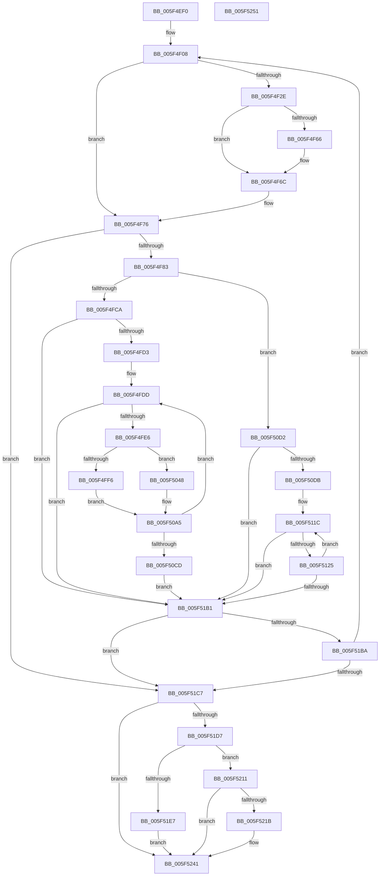

# fill_window

- RVA: `0x005F4EF0`–`0x005F5252` (길이 `866` bytes)
- VA: `0x00000001405F4EF0`
- 실행 섹션: `.text`
- PDB 이름 있음: `예`; PDB Function 태그: `예`
- unwind 정보 RVA: `0x00060BC4`
- 디코드: `189`개 명령, `866/866` bytes 표시
- 미해석 바이트: `0` (있으면 어셈블리에 `.byte`로 보존)

> 이 문서는 커널 이미지의 기계어와 PDB 기호를 분석해 생성했습니다. 4번과 5번은 함수 원형과 자료형을 바이너리 사용 방식에서 추정한 C 해석이며 원본 소스 복구 결과는 아닙니다.

## 1. Dependencies

- 직접 호출 지점: **5**; 고유 호출 대상: **4**
- 직접 호출자로 확인된 함수: **4**
- RIP 상대 이미지 참조: **1**

### Outgoing calls
- `0x005F4F3F` → [memcpy](../6C/memcpy_function_006C6840.md) (function, `0x006C6840`)
- `0x005F4F6F` → [slide_hash](slide_hash_function_005F55E0.md) (function, `0x005F55E0`)
- `0x005F4F9C` → [read_buf](read_buf_function_005F555C.md) (function, `0x005F555C`)
- `0x005F5201` → [memset](../6C/memset_function_006C6C40.md) (function, `0x006C6C40`)
- `0x005F5236` → [memset](../6C/memset_function_006C6C40.md) (function, `0x006C6C40`)

### Direct callers
- [deflate_fast](deflate_fast_function_005F3A80.md) at `0x005F3ABD`
- [deflate_huff](deflate_huff_function_005F3FDC.md) at `0x005F3FFE`
- [deflate_rle](deflate_rle_function_005F414C.md) at `0x005F417F`
- [deflate_slow](deflate_slow_function_005F4430.md) at `0x005F4478`

### Static image references
- `0x005F4FE6` → RVA `0x00E67B40` (`.data`; read)

## 2. Other-region calls and transfers

- 다른 실행 섹션으로 향하는 call: **0**
- 별도 외부 분기/꼬리 이동을 확인하지 못했습니다.

## 3. Assembly (complete function range)

```asm
005F4EF0  48 89 5C 24 08                  mov qword ptr [rsp + 8], rbx
005F4EF5  48 89 74 24 10                  mov qword ptr [rsp + 0x10], rsi
005F4EFA  57                              push rdi
005F4EFB  48 83 EC 20                     sub rsp, 0x20
005F4EFF  8B B1 94 00 00 00               mov esi, dword ptr [rcx + 0x94]
005F4F05  48 8B F9                        mov rdi, rcx
005F4F08  8B 97 E4 00 00 00               mov edx, dword ptr [rdi + 0xe4]
005F4F0E  8B 9F A8 00 00 00               mov ebx, dword ptr [rdi + 0xa8]
005F4F14  2B 9F EC 00 00 00               sub ebx, dword ptr [rdi + 0xec]
005F4F1A  8B 8F 94 00 00 00               mov ecx, dword ptr [rdi + 0x94]
005F4F20  2B DA                           sub ebx, edx
005F4F22  81 C1 FA FE FF FF               add ecx, 0xfffffefa
005F4F28  03 CE                           add ecx, esi
005F4F2A  3B D1                           cmp edx, ecx
005F4F2C  72 48                           jb 0x1405f4f76
005F4F2E  48 8B 8F A0 00 00 00            mov rcx, qword ptr [rdi + 0xa0]
005F4F35  44 8B C6                        mov r8d, esi
005F4F38  44 2B C3                        sub r8d, ebx
005F4F3B  48 8D 14 31                     lea rdx, [rcx + rsi]
005F4F3F  E8 FC 18 0D 00                  call 0x1406c6840
005F4F44  8B 87 E4 00 00 00               mov eax, dword ptr [rdi + 0xe4]
005F4F4A  29 B7 E8 00 00 00               sub dword ptr [rdi + 0xe8], esi
005F4F50  2B C6                           sub eax, esi
005F4F52  29 B7 D4 00 00 00               sub dword ptr [rdi + 0xd4], esi
005F4F58  89 87 E4 00 00 00               mov dword ptr [rdi + 0xe4], eax
005F4F5E  39 87 58 17 00 00               cmp dword ptr [rdi + 0x1758], eax
005F4F64  76 06                           jbe 0x1405f4f6c
005F4F66  89 87 58 17 00 00               mov dword ptr [rdi + 0x1758], eax
005F4F6C  48 8B CF                        mov rcx, rdi
005F4F6F  E8 6C 06 00 00                  call 0x1405f55e0
005F4F74  03 DE                           add ebx, esi
005F4F76  48 8B 0F                        mov rcx, qword ptr [rdi]
005F4F79  83 79 08 00                     cmp dword ptr [rcx + 8], 0
005F4F7D  0F 84 44 02 00 00               je 0x1405f51c7
005F4F83  8B 97 EC 00 00 00               mov edx, dword ptr [rdi + 0xec]
005F4F89  44 8B C3                        mov r8d, ebx
005F4F8C  8B 87 E4 00 00 00               mov eax, dword ptr [rdi + 0xe4]
005F4F92  48 03 D0                        add rdx, rax
005F4F95  48 03 97 A0 00 00 00            add rdx, qword ptr [rdi + 0xa0]
005F4F9C  E8 BB 05 00 00                  call 0x1405f555c
005F4FA1  44 8B 8F EC 00 00 00            mov r9d, dword ptr [rdi + 0xec]
005F4FA8  44 8B 97 58 17 00 00            mov r10d, dword ptr [rdi + 0x1758]
005F4FAF  44 03 C8                        add r9d, eax
005F4FB2  83 BF 68 17 00 00 00            cmp dword ptr [rdi + 0x1768], 0
005F4FB9  44 89 8F EC 00 00 00            mov dword ptr [rdi + 0xec], r9d
005F4FC0  43 8D 04 11                     lea eax, [r9 + r10]
005F4FC4  0F 84 08 01 00 00               je 0x1405f50d2
005F4FCA  83 F8 03                        cmp eax, 3
005F4FCD  0F 86 DE 01 00 00               jbe 0x1405f51b1
005F4FD3  44 8B 9F E4 00 00 00            mov r11d, dword ptr [rdi + 0xe4]
005F4FDA  45 2B DA                        sub r11d, r10d
005F4FDD  45 85 D2                        test r10d, r10d
005F4FE0  0F 84 CB 01 00 00               je 0x1405f51b1
005F4FE6  83 3D 53 2B 87 00 00            cmp dword ptr [rip + 0x872b53], 0
005F4FED  48 8B 87 A0 00 00 00            mov rax, qword ptr [rdi + 0xa0]
005F4FF4  74 52                           je 0x1405f5048
005F4FF6  45 0F B7 C3                     movzx r8d, r11w
005F4FFA  41 8B 14 00                     mov edx, dword ptr [r8 + rax]
005F4FFE  8B CA                           mov ecx, edx
005F5000  81 E1 FF FF FF 00               and ecx, 0xffffff
005F5006  83 BF FC 00 00 00 06            cmp dword ptr [rdi + 0xfc], 6
005F500D  0F 4C CA                        cmovl ecx, edx
005F5010  33 C0                           xor eax, eax
005F5012  F2 0F 38 F1 C1                  crc32 eax, ecx
005F5017  8B C8                           mov ecx, eax
005F5019  8B 87 CC 00 00 00               mov eax, dword ptr [rdi + 0xcc]
005F501F  48 23 C8                        and rcx, rax
005F5022  48 8B 87 B8 00 00 00            mov rax, qword ptr [rdi + 0xb8]
005F5029  0F B7 14 48                     movzx edx, word ptr [rax + rcx*2]
005F502D  66 44 89 04 48                  mov word ptr [rax + rcx*2], r8w
005F5032  8B 8F 9C 00 00 00               mov ecx, dword ptr [rdi + 0x9c]
005F5038  48 8B 87 B0 00 00 00            mov rax, qword ptr [rdi + 0xb0]
005F503F  49 23 C8                        and rcx, r8
005F5042  66 89 14 48                     mov word ptr [rax + rcx*2], dx
005F5046  EB 5D                           jmp 0x1405f50a5
005F5048  44 8B 87 C0 00 00 00            mov r8d, dword ptr [rdi + 0xc0]
005F504F  8B 8F D0 00 00 00               mov ecx, dword ptr [rdi + 0xd0]
005F5055  8B 97 9C 00 00 00               mov edx, dword ptr [rdi + 0x9c]
005F505B  41 D3 E0                        shl r8d, cl
005F505E  48 8B 8F B0 00 00 00            mov rcx, qword ptr [rdi + 0xb0]
005F5065  45 0F B7 CB                     movzx r9d, r11w
005F5069  41 0F B6 44 01 02               movzx eax, byte ptr [r9 + rax + 2]
005F506F  44 33 C0                        xor r8d, eax
005F5072  48 8B 87 B8 00 00 00            mov rax, qword ptr [rdi + 0xb8]
005F5079  44 23 87 CC 00 00 00            and r8d, dword ptr [rdi + 0xcc]
005F5080  44 89 87 C0 00 00 00            mov dword ptr [rdi + 0xc0], r8d
005F5087  49 23 D1                        and rdx, r9
005F508A  42 0F B7 04 40                  movzx eax, word ptr [rax + r8*2]
005F508F  66 89 04 51                     mov word ptr [rcx + rdx*2], ax
005F5093  8B 8F C0 00 00 00               mov ecx, dword ptr [rdi + 0xc0]
005F5099  48 8B 87 B8 00 00 00            mov rax, qword ptr [rdi + 0xb8]
005F50A0  66 44 89 0C 48                  mov word ptr [rax + rcx*2], r9w
005F50A5  44 8B 97 58 17 00 00            mov r10d, dword ptr [rdi + 0x1758]
005F50AC  41 FF C3                        inc r11d
005F50AF  44 8B 8F EC 00 00 00            mov r9d, dword ptr [rdi + 0xec]
005F50B6  41 FF CA                        dec r10d
005F50B9  44 89 97 58 17 00 00            mov dword ptr [rdi + 0x1758], r10d
005F50C0  43 8D 04 11                     lea eax, [r9 + r10]
005F50C4  83 F8 03                        cmp eax, 3
005F50C7  0F 87 10 FF FF FF               ja 0x1405f4fdd
005F50CD  E9 DF 00 00 00                  jmp 0x1405f51b1
005F50D2  83 F8 03                        cmp eax, 3
005F50D5  0F 82 D6 00 00 00               jb 0x1405f51b1
005F50DB  44 8B 9F E4 00 00 00            mov r11d, dword ptr [rdi + 0xe4]
005F50E2  48 8B 97 A0 00 00 00            mov rdx, qword ptr [rdi + 0xa0]
005F50E9  45 2B DA                        sub r11d, r10d
005F50EC  8B 8F D0 00 00 00               mov ecx, dword ptr [rdi + 0xd0]
005F50F2  45 0F B6 04 13                  movzx r8d, byte ptr [r11 + rdx]
005F50F7  41 8D 43 01                     lea eax, [r11 + 1]
005F50FB  44 89 87 C0 00 00 00            mov dword ptr [rdi + 0xc0], r8d
005F5102  41 8D 5B 02                     lea ebx, [r11 + 2]
005F5106  0F B6 04 10                     movzx eax, byte ptr [rax + rdx]
005F510A  41 D3 E0                        shl r8d, cl
005F510D  41 33 C0                        xor eax, r8d
005F5110  23 87 CC 00 00 00               and eax, dword ptr [rdi + 0xcc]
005F5116  89 87 C0 00 00 00               mov dword ptr [rdi + 0xc0], eax
005F511C  45 85 D2                        test r10d, r10d
005F511F  0F 84 8C 00 00 00               je 0x1405f51b1
005F5125  48 8B 87 A0 00 00 00            mov rax, qword ptr [rdi + 0xa0]
005F512C  8B 8F D0 00 00 00               mov ecx, dword ptr [rdi + 0xd0]
005F5132  48 8B 97 B8 00 00 00            mov rdx, qword ptr [rdi + 0xb8]
005F5139  44 8B 87 9C 00 00 00            mov r8d, dword ptr [rdi + 0x9c]
005F5140  44 0F B6 0C 03                  movzx r9d, byte ptr [rbx + rax]
005F5145  FF C3                           inc ebx
005F5147  8B 87 C0 00 00 00               mov eax, dword ptr [rdi + 0xc0]
005F514D  D3 E0                           shl eax, cl
005F514F  48 8B 8F B0 00 00 00            mov rcx, qword ptr [rdi + 0xb0]
005F5156  44 33 C8                        xor r9d, eax
005F5159  44 23 8F CC 00 00 00            and r9d, dword ptr [rdi + 0xcc]
005F5160  44 89 8F C0 00 00 00            mov dword ptr [rdi + 0xc0], r9d
005F5167  41 8B C3                        mov eax, r11d
005F516A  4C 23 C0                        and r8, rax
005F516D  42 0F B7 04 4A                  movzx eax, word ptr [rdx + r9*2]
005F5172  66 42 89 04 41                  mov word ptr [rcx + r8*2], ax
005F5177  48 8B 87 B8 00 00 00            mov rax, qword ptr [rdi + 0xb8]
005F517E  8B 8F C0 00 00 00               mov ecx, dword ptr [rdi + 0xc0]
005F5184  66 44 89 1C 48                  mov word ptr [rax + rcx*2], r11w
005F5189  41 FF C3                        inc r11d
005F518C  44 8B 97 58 17 00 00            mov r10d, dword ptr [rdi + 0x1758]
005F5193  44 8B 8F EC 00 00 00            mov r9d, dword ptr [rdi + 0xec]
005F519A  41 FF CA                        dec r10d
005F519D  44 89 97 58 17 00 00            mov dword ptr [rdi + 0x1758], r10d
005F51A4  43 8D 04 11                     lea eax, [r9 + r10]
005F51A8  83 F8 03                        cmp eax, 3
005F51AB  0F 83 6B FF FF FF               jae 0x1405f511c
005F51B1  41 81 F9 06 01 00 00            cmp r9d, 0x106
005F51B8  73 0D                           jae 0x1405f51c7
005F51BA  48 8B 07                        mov rax, qword ptr [rdi]
005F51BD  83 78 08 00                     cmp dword ptr [rax + 8], 0
005F51C1  0F 85 41 FD FF FF               jne 0x1405f4f08
005F51C7  8B 8F 64 17 00 00               mov ecx, dword ptr [rdi + 0x1764]
005F51CD  8B 9F A8 00 00 00               mov ebx, dword ptr [rdi + 0xa8]
005F51D3  3B CB                           cmp ecx, ebx
005F51D5  73 6A                           jae 0x1405f5241
005F51D7  8B B7 E4 00 00 00               mov esi, dword ptr [rdi + 0xe4]
005F51DD  03 B7 EC 00 00 00               add esi, dword ptr [rdi + 0xec]
005F51E3  3B CE                           cmp ecx, esi
005F51E5  73 2A                           jae 0x1405f5211
005F51E7  2B DE                           sub ebx, esi
005F51E9  8B CE                           mov ecx, esi
005F51EB  B8 02 01 00 00                  mov eax, 0x102
005F51F0  3B D8                           cmp ebx, eax
005F51F2  0F 47 D8                        cmova ebx, eax
005F51F5  48 03 8F A0 00 00 00            add rcx, qword ptr [rdi + 0xa0]
005F51FC  44 8B C3                        mov r8d, ebx
005F51FF  33 D2                           xor edx, edx
005F5201  E8 3A 1A 0D 00                  call 0x1406c6c40
005F5206  8D 04 33                        lea eax, [rbx + rsi]
005F5209  89 87 64 17 00 00               mov dword ptr [rdi + 0x1764], eax
005F520F  EB 30                           jmp 0x1405f5241
005F5211  8D 86 02 01 00 00               lea eax, [rsi + 0x102]
005F5217  3B C8                           cmp ecx, eax
005F5219  73 26                           jae 0x1405f5241
005F521B  2B D9                           sub ebx, ecx
005F521D  2B F1                           sub esi, ecx
005F521F  8D 86 02 01 00 00               lea eax, [rsi + 0x102]
005F5225  3B C3                           cmp eax, ebx
005F5227  0F 46 D8                        cmovbe ebx, eax
005F522A  48 03 8F A0 00 00 00            add rcx, qword ptr [rdi + 0xa0]
005F5231  44 8B C3                        mov r8d, ebx
005F5234  33 D2                           xor edx, edx
005F5236  E8 05 1A 0D 00                  call 0x1406c6c40
005F523B  01 9F 64 17 00 00               add dword ptr [rdi + 0x1764], ebx
005F5241  48 8B 5C 24 30                  mov rbx, qword ptr [rsp + 0x30]
005F5246  48 8B 74 24 38                  mov rsi, qword ptr [rsp + 0x38]
005F524B  48 83 C4 20                     add rsp, 0x20
005F524F  5F                              pop rdi
005F5250  C3                              ret
005F5251  CC                              int3
```

## 4. C-style interpretation (structured pseudocode)

```c
__int64 __fastcall fill_window(__int64 a1)
{
    __int64 result;
    __int64 v_r10;
    __int64 v_r11;
    __int64 v_rbx;
    __int64 v_rsi;
    __int64 v_rsp;
    unsigned __int64 v_stack_p10;
    unsigned __int64 v_stack_p8;

    v_stack_p8 = v_rbx;
    v_stack_p10 = v_rsi;
    v_rsp = (v_rsp) - (32);
loc_005F4F08:
    v_rbx = (unsigned int)(((unsigned int)(*(unsigned int *)(a1 + 168))) - (*(unsigned int *)(a1 + 236)));
    v_rbx = (unsigned int)((v_rbx) - ((unsigned int)((unsigned int)(*(unsigned int *)(a1 + 228)))));
    a1 = (unsigned int)(((unsigned int)(*(unsigned int *)(a1 + 148))) + (0xFFFFFEFAULL));
    a1 = (unsigned int)((a1) + ((unsigned int)((unsigned int)(*(unsigned int *)(a1 + 148)))));
    if (((unsigned int)((unsigned int)(*(unsigned int *)(a1 + 228)))) < ((unsigned int)(a1))) goto loc_005F4F76;
    a3 = (unsigned int)(((unsigned int)((unsigned int)((unsigned int)(*(unsigned int *)(a1 + 148))))) - ((unsigned int)(v_rbx)));
    result = memcpy(*(unsigned __int64 *)(a1 + 160), *(unsigned __int64 *)(a1 + 160) + (unsigned int)(*(unsigned int *)(a1 + 148)) * 1, a3, a4);
    result = (unsigned int)(((unsigned int)(*(unsigned int *)(a1 + 228))) - ((unsigned int)((unsigned int)(*(unsigned int *)(a1 + 148)))));
    *(unsigned int *)(a1 + 228) = (unsigned int)(result);
    if ((*(unsigned int *)(a1 + 5976)) >= = ((unsigned int)(result))) {
        *(unsigned int *)(a1 + 5976) = (unsigned int)(result);
    }
    result = slide_hash(a1, *(unsigned __int64 *)(a1 + 160) + (unsigned int)(*(unsigned int *)(a1 + 148)) * 1, a3, a4);
    v_rbx = (unsigned int)((v_rbx) + ((unsigned int)((unsigned int)(*(unsigned int *)(a1 + 148)))));
loc_005F4F76:
    if ((*(unsigned int *)(*(unsigned __int64 *)(a1) + 8)) == 0) goto loc_005F51C7;
    a2 = ((unsigned int)(*(unsigned int *)(a1 + 236))) + ((unsigned int)(*(unsigned int *)(a1 + 228)));
    a2 = (a2) + (*(unsigned __int64 *)(a1 + 160));
    result = read_buf(*(unsigned __int64 *)(a1), a2, (unsigned int)((unsigned int)(v_rbx)), a4);
    a4 = (unsigned int)(((unsigned int)(*(unsigned int *)(a1 + 236))) + ((unsigned int)(result)));
    *(unsigned int *)(a1 + 236) = (unsigned int)(a4);
    if ((*(unsigned int *)(a1 + 5992)) == 0) goto loc_005F50D2;
    if (((unsigned int)(a4 + (unsigned int)(*(unsigned int *)(a1 + 5976)) * 1)) <= 3) goto loc_005F51B1;
    v_r11 = (unsigned int)(((unsigned int)(*(unsigned int *)(a1 + 228))) - ((unsigned int)((unsigned int)(*(unsigned int *)(a1 + 5976)))));
loc_005F4FDD:
    if ((unsigned int)((unsigned int)(*(unsigned int *)(a1 + 5976))) == 0) goto loc_005F51B1;
    if ((*(unsigned int *)(v_rip + 8858451)) == 0) goto loc_005F5048;
    a1 = (unsigned int)(((unsigned int)((unsigned int)((unsigned int)(*(unsigned int *)((unsigned __int16)(v_r11) + *(unsigned __int64 *)(a1 + 160) * 1))))) & (0xFFFFFFULL));
    if ((*(unsigned int *)(a1 + 252)) < 6) { a1 = (unsigned int)((unsigned int)(*(unsigned int *)((unsigned __int16)(v_r11) + *(unsigned __int64 *)(a1 + 160) * 1))); }
    result = 0;
    a1 = (0) & ((unsigned int)(*(unsigned int *)(a1 + 204)));
    *(unsigned __int16 *)(*(unsigned __int64 *)(a1 + 184) + a1 * 2) = (unsigned __int16)((unsigned __int16)(v_r11));
    a1 = ((unsigned int)(*(unsigned int *)(a1 + 156))) & ((unsigned __int16)(v_r11));
    *(unsigned __int16 *)(*(unsigned __int64 *)(a1 + 176) + a1 * 2) = (unsigned __int16)(*(unsigned __int16 *)(*(unsigned __int64 *)(a1 + 184) + a1 * 2));
    goto loc_005F50A5;
loc_005F5048:
    a3 = (unsigned int)(((unsigned int)(*(unsigned int *)(a1 + 192))) << ((unsigned __int8)((unsigned int)(*(unsigned int *)(a1 + 208)))));
    a3 = (unsigned int)((a3) ^ ((unsigned int)(*(unsigned __int8 *)((unsigned __int16)(v_r11) + *(unsigned __int64 *)(a1 + 176) * 1 + 2))));
    a3 = (unsigned int)((a3) & (*(unsigned int *)(a1 + 204)));
    *(unsigned int *)(a1 + 192) = (unsigned int)(a3);
    a2 = ((unsigned int)(*(unsigned int *)(a1 + 156))) & ((unsigned __int16)(v_r11));
    *(unsigned __int16 *)(*(unsigned __int64 *)(a1 + 176) + a2 * 2) = (unsigned __int16)(*(unsigned __int16 *)(*(unsigned __int64 *)(a1 + 184) + a3 * 2));
    *(unsigned __int16 *)(*(unsigned __int64 *)(a1 + 184) + (unsigned int)(*(unsigned int *)(a1 + 192)) * 2) = (unsigned __int16)((unsigned __int16)(v_r11));
loc_005F50A5:
    v_r11 = (unsigned int)((v_r11) + 1);
    v_r10 = (unsigned int)(((unsigned int)(*(unsigned int *)(a1 + 5976))) - 1);
    *(unsigned int *)(a1 + 5976) = (unsigned int)(v_r10);
    if (((unsigned int)((unsigned int)(*(unsigned int *)(a1 + 236)) + v_r10 * 1)) > 3) goto loc_005F4FDD;
    goto loc_005F51B1;
loc_005F50D2:
    if (((unsigned int)((unsigned int)(*(unsigned int *)(a1 + 236)) + v_r10 * 1)) < 3) goto loc_005F51B1;
    v_r11 = (unsigned int)(((unsigned int)(*(unsigned int *)(a1 + 228))) - ((unsigned int)(v_r10)));
    *(unsigned int *)(a1 + 192) = (unsigned int)(*(unsigned __int8 *)(v_r11 + *(unsigned __int64 *)(a1 + 160) * 1));
    a3 = (unsigned int)((*(unsigned __int8 *)(v_r11 + *(unsigned __int64 *)(a1 + 160) * 1)) << ((unsigned __int8)((unsigned int)(*(unsigned int *)(a1 + 208)))));
    result = (unsigned int)((*(unsigned __int8 *)(v_r11 + 1 + *(unsigned __int64 *)(a1 + 160) * 1)) ^ ((unsigned int)(a3)));
    result = (unsigned int)((result) & (*(unsigned int *)(a1 + 204)));
    *(unsigned int *)(a1 + 192) = (unsigned int)(result);
loc_005F511C:
    if ((unsigned int)(v_r10) == 0) goto loc_005F51B1;
    v_rbx = (unsigned int)((v_r11 + 2) + 1);
    result = (unsigned int)(((unsigned int)(*(unsigned int *)(a1 + 192))) << ((unsigned __int8)((unsigned int)(*(unsigned int *)(a1 + 208)))));
    a4 = (unsigned int)((*(unsigned __int8 *)(v_r11 + 2 + *(unsigned __int64 *)(a1 + 160) * 1)) ^ ((unsigned int)(result)));
    a4 = (unsigned int)((a4) & (*(unsigned int *)(a1 + 204)));
    *(unsigned int *)(a1 + 192) = (unsigned int)(a4);
    a3 = ((unsigned int)(*(unsigned int *)(a1 + 156))) & ((unsigned int)((unsigned int)(v_r11)));
    *(unsigned __int16 *)(*(unsigned __int64 *)(a1 + 176) + a3 * 2) = (unsigned __int16)(*(unsigned __int16 *)(*(unsigned __int64 *)(a1 + 184) + a4 * 2));
    *(unsigned __int16 *)(*(unsigned __int64 *)(a1 + 184) + (unsigned int)(*(unsigned int *)(a1 + 192)) * 2) = (unsigned __int16)(v_r11);
    v_r11 = (unsigned int)((v_r11) + 1);
    v_r10 = (unsigned int)(((unsigned int)(*(unsigned int *)(a1 + 5976))) - 1);
    *(unsigned int *)(a1 + 5976) = (unsigned int)(v_r10);
    if (((unsigned int)((unsigned int)(*(unsigned int *)(a1 + 236)) + v_r10 * 1)) >= 3) goto loc_005F511C;
loc_005F51B1:
    if (((unsigned int)((unsigned int)(*(unsigned int *)(a1 + 236)))) >= 262) goto loc_005F51C7;
    if ((*(unsigned int *)(*(unsigned __int64 *)(a1) + 8)) != 0) goto loc_005F4F08;
loc_005F51C7:
    if (((unsigned int)((unsigned int)(*(unsigned int *)(a1 + 5988)))) >= ((unsigned int)((unsigned int)(*(unsigned int *)(a1 + 168))))) goto loc_005F5241;
    v_rsi = (unsigned int)(((unsigned int)(*(unsigned int *)(a1 + 228))) + (*(unsigned int *)(a1 + 236)));
    if (((unsigned int)((unsigned int)(*(unsigned int *)(a1 + 5988)))) >= ((unsigned int)(v_rsi))) goto loc_005F5211;
    v_rbx = (unsigned int)(((unsigned int)(*(unsigned int *)(a1 + 168))) - ((unsigned int)(v_rsi)));
    if (((unsigned int)(v_rbx)) > 258) { v_rbx = 258; }
    a1 = ((unsigned int)((unsigned int)(v_rsi))) + (*(unsigned __int64 *)(a1 + 160));
    a2 = 0;
    result = memset(a1, a2, (unsigned int)((unsigned int)(v_rbx)), (unsigned int)(*(unsigned int *)(a1 + 236)));
    *(unsigned int *)(a1 + 5988) = (unsigned int)(v_rbx + v_rsi * 1);
    goto loc_005F5241;
loc_005F5211:
    result = v_rsi + 258;
    if (((unsigned int)(a1)) < ((unsigned int)(v_rsi + 258))) {
        v_rbx = (unsigned int)((v_rbx) - ((unsigned int)(a1)));
        v_rsi = (unsigned int)((v_rsi) - ((unsigned int)(a1)));
        result = v_rsi + 258;
        if (((unsigned int)(result)) <= ((unsigned int)(v_rbx))) { v_rbx = (unsigned int)(result); }
        a1 = (a1) + (*(unsigned __int64 *)(a1 + 160));
        a3 = (unsigned int)(v_rbx);
        a2 = 0;
        result = memset(a1, a2, a3, (unsigned int)(*(unsigned int *)(a1 + 236)));
    }
    v_rsp = (v_rsp) + (32);
    return result;
}
```

## 5. (Beta) C Style

```c
int64_t fill_window(void *Arg1)
{
    uint8_t *arg1 = (uint8_t *)Arg1;

    int64_t result;
    int64_t local_r10;
    int64_t local_r11;
    int64_t local_rbx;
    int64_t local_rsi;
    int64_t local_rsp;
    uint64_t v_stack_p10;
    uint64_t v_stack_p8;

    v_stack_p8 = local_rbx;
    v_stack_p10 = local_rsi;
    local_rsp = (local_rsp) - (32);
loc_005F4F08:
    local_rbx = (uint32_t)(((uint32_t)(*(uint32_t *)(arg1 + 0xA8))) - (*(uint32_t *)(arg1 + 0xEC)));
    local_rbx = (uint32_t)((local_rbx) - ((uint32_t)((uint32_t)(*(uint32_t *)(arg1 + 0xE4)))));
    Arg1 = (uint32_t)(((uint32_t)(*(uint32_t *)(arg1 + 0x94))) + (0xFFFFFEFAULL));
    Arg1 = (uint32_t)((Arg1) + ((uint32_t)((uint32_t)(*(uint32_t *)(arg1 + 0x94)))));
    if (((uint32_t)((uint32_t)(*(uint32_t *)(arg1 + 0xE4)))) < ((uint32_t)(Arg1))) goto loc_005F4F76;
    a3 = (uint32_t)(((uint32_t)((uint32_t)((uint32_t)(*(uint32_t *)(arg1 + 0x94))))) - ((uint32_t)(local_rbx)));
    result = memcpy(*(uint64_t *)(arg1 + 0xA0), *(uint64_t *)(arg1 + 0xA0) + (uint32_t)(*(uint32_t *)(arg1 + 0x94)) * 1, a3, a4);
    result = (uint32_t)(((uint32_t)(*(uint32_t *)(arg1 + 0xE4))) - ((uint32_t)((uint32_t)(*(uint32_t *)(arg1 + 0x94)))));
    *(uint32_t *)(arg1 + 0xE4) = (uint32_t)(result);
    if ((*(uint32_t *)(arg1 + 0x1758)) >= = ((uint32_t)(result))) {
        *(uint32_t *)(arg1 + 0x1758) = (uint32_t)(result);
    }
    result = slide_hash(Arg1, *(uint64_t *)(arg1 + 0xA0) + (uint32_t)(*(uint32_t *)(arg1 + 0x94)) * 1, a3, a4);
    local_rbx = (uint32_t)((local_rbx) + ((uint32_t)((uint32_t)(*(uint32_t *)(arg1 + 0x94)))));
loc_005F4F76:
    if ((*(uint32_t *)(*(uint64_t *)(arg1) + 0x8)) == 0) goto loc_005F51C7;
    a2 = ((uint32_t)(*(uint32_t *)(arg1 + 0xEC))) + ((uint32_t)(*(uint32_t *)(arg1 + 0xE4)));
    a2 = (a2) + (*(uint64_t *)(arg1 + 0xA0));
    result = read_buf(*(uint64_t *)(arg1), a2, (uint32_t)((uint32_t)(local_rbx)), a4);
    a4 = (uint32_t)(((uint32_t)(*(uint32_t *)(arg1 + 0xEC))) + ((uint32_t)(result)));
    *(uint32_t *)(arg1 + 0xEC) = (uint32_t)(a4);
    if ((*(uint32_t *)(arg1 + 0x1768)) == 0) goto loc_005F50D2;
    if (((uint32_t)(a4 + (uint32_t)(*(uint32_t *)(arg1 + 0x1758)) * 1)) <= 3) goto loc_005F51B1;
    local_r11 = (uint32_t)(((uint32_t)(*(uint32_t *)(arg1 + 0xE4))) - ((uint32_t)((uint32_t)(*(uint32_t *)(arg1 + 0x1758)))));
loc_005F4FDD:
    if ((uint32_t)((uint32_t)(*(uint32_t *)(arg1 + 0x1758))) == 0) goto loc_005F51B1;
    if ((*(uint32_t *)(v_rip + 0x872B53)) == 0) goto loc_005F5048;
    Arg1 = (uint32_t)(((uint32_t)((uint32_t)((uint32_t)(*(uint32_t *)((uint16_t)(local_r11) + *(uint64_t *)(arg1 + 0xA0) * 1))))) & (0xFFFFFFULL));
    if ((*(uint32_t *)(arg1 + 0xFC)) < 6) { Arg1 = (uint32_t)((uint32_t)(*(uint32_t *)((uint16_t)(local_r11) + *(uint64_t *)(arg1 + 0xA0) * 1))); }
    result = 0;
    Arg1 = (0) & ((uint32_t)(*(uint32_t *)(arg1 + 0xCC)));
    *(uint16_t *)(*(uint64_t *)(arg1 + 0xB8) + arg1 * 2) = (uint16_t)((uint16_t)(local_r11));
    Arg1 = ((uint32_t)(*(uint32_t *)(arg1 + 0x9C))) & ((uint16_t)(local_r11));
    *(uint16_t *)(*(uint64_t *)(arg1 + 0xB0) + arg1 * 2) = (uint16_t)(*(uint16_t *)(*(uint64_t *)(arg1 + 0xB8) + arg1 * 2));
    goto loc_005F50A5;
loc_005F5048:
    a3 = (uint32_t)(((uint32_t)(*(uint32_t *)(arg1 + 0xC0))) << ((uint8_t)((uint32_t)(*(uint32_t *)(arg1 + 0xD0)))));
    a3 = (uint32_t)((a3) ^ ((uint32_t)(*(uint8_t *)((uint16_t)(local_r11) + *(uint64_t *)(arg1 + 0xB0) * 1 + 0x2))));
    a3 = (uint32_t)((a3) & (*(uint32_t *)(arg1 + 0xCC)));
    *(uint32_t *)(arg1 + 0xC0) = (uint32_t)(a3);
    a2 = ((uint32_t)(*(uint32_t *)(arg1 + 0x9C))) & ((uint16_t)(local_r11));
    *(uint16_t *)(*(uint64_t *)(arg1 + 0xB0) + a2 * 2) = (uint16_t)(*(uint16_t *)(*(uint64_t *)(arg1 + 0xB8) + a3 * 2));
    *(uint16_t *)(*(uint64_t *)(arg1 + 0xB8) + (uint32_t)(*(uint32_t *)(arg1 + 0xC0)) * 2) = (uint16_t)((uint16_t)(local_r11));
loc_005F50A5:
    local_r11 = (uint32_t)((local_r11) + 1);
    local_r10 = (uint32_t)(((uint32_t)(*(uint32_t *)(arg1 + 0x1758))) - 1);
    *(uint32_t *)(arg1 + 0x1758) = (uint32_t)(local_r10);
    if (((uint32_t)((uint32_t)(*(uint32_t *)(arg1 + 0xEC)) + local_r10 * 1)) > 3) goto loc_005F4FDD;
    goto loc_005F51B1;
loc_005F50D2:
    if (((uint32_t)((uint32_t)(*(uint32_t *)(arg1 + 0xEC)) + local_r10 * 1)) < 3) goto loc_005F51B1;
    local_r11 = (uint32_t)(((uint32_t)(*(uint32_t *)(arg1 + 0xE4))) - ((uint32_t)(local_r10)));
    *(uint32_t *)(arg1 + 0xC0) = (uint32_t)(*(uint8_t *)(local_r11 + *(uint64_t *)(arg1 + 0xA0) * 1));
    a3 = (uint32_t)((*(uint8_t *)(local_r11 + *(uint64_t *)(arg1 + 0xA0) * 1)) << ((uint8_t)((uint32_t)(*(uint32_t *)(arg1 + 0xD0)))));
    result = (uint32_t)((*(uint8_t *)(local_r11 + 0x1 + *(uint64_t *)(arg1 + 0xA0) * 1)) ^ ((uint32_t)(a3)));
    result = (uint32_t)((result) & (*(uint32_t *)(arg1 + 0xCC)));
    *(uint32_t *)(arg1 + 0xC0) = (uint32_t)(result);
loc_005F511C:
    if ((uint32_t)(local_r10) == 0) goto loc_005F51B1;
    local_rbx = (uint32_t)((local_r11 + 2) + 1);
    result = (uint32_t)(((uint32_t)(*(uint32_t *)(arg1 + 0xC0))) << ((uint8_t)((uint32_t)(*(uint32_t *)(arg1 + 0xD0)))));
    a4 = (uint32_t)((*(uint8_t *)(local_r11 + 0x2 + *(uint64_t *)(arg1 + 0xA0) * 1)) ^ ((uint32_t)(result)));
    a4 = (uint32_t)((a4) & (*(uint32_t *)(arg1 + 0xCC)));
    *(uint32_t *)(arg1 + 0xC0) = (uint32_t)(a4);
    a3 = ((uint32_t)(*(uint32_t *)(arg1 + 0x9C))) & ((uint32_t)((uint32_t)(local_r11)));
    *(uint16_t *)(*(uint64_t *)(arg1 + 0xB0) + a3 * 2) = (uint16_t)(*(uint16_t *)(*(uint64_t *)(arg1 + 0xB8) + a4 * 2));
    *(uint16_t *)(*(uint64_t *)(arg1 + 0xB8) + (uint32_t)(*(uint32_t *)(arg1 + 0xC0)) * 2) = (uint16_t)(local_r11);
    local_r11 = (uint32_t)((local_r11) + 1);
    local_r10 = (uint32_t)(((uint32_t)(*(uint32_t *)(arg1 + 0x1758))) - 1);
    *(uint32_t *)(arg1 + 0x1758) = (uint32_t)(local_r10);
    if (((uint32_t)((uint32_t)(*(uint32_t *)(arg1 + 0xEC)) + local_r10 * 1)) >= 3) goto loc_005F511C;
loc_005F51B1:
    if (((uint32_t)((uint32_t)(*(uint32_t *)(arg1 + 0xEC)))) >= 262) goto loc_005F51C7;
    if ((*(uint32_t *)(*(uint64_t *)(arg1) + 0x8)) != 0) goto loc_005F4F08;
loc_005F51C7:
    if (((uint32_t)((uint32_t)(*(uint32_t *)(arg1 + 0x1764)))) >= ((uint32_t)((uint32_t)(*(uint32_t *)(arg1 + 0xA8))))) goto loc_005F5241;
    local_rsi = (uint32_t)(((uint32_t)(*(uint32_t *)(arg1 + 0xE4))) + (*(uint32_t *)(arg1 + 0xEC)));
    if (((uint32_t)((uint32_t)(*(uint32_t *)(arg1 + 0x1764)))) >= ((uint32_t)(local_rsi))) goto loc_005F5211;
    local_rbx = (uint32_t)(((uint32_t)(*(uint32_t *)(arg1 + 0xA8))) - ((uint32_t)(local_rsi)));
    if (((uint32_t)(local_rbx)) > 258) { local_rbx = 258; }
    Arg1 = ((uint32_t)((uint32_t)(local_rsi))) + (*(uint64_t *)(arg1 + 0xA0));
    a2 = 0;
    result = memset(Arg1, a2, (uint32_t)((uint32_t)(local_rbx)), (uint32_t)(*(uint32_t *)(arg1 + 0xEC)));
    *(uint32_t *)(arg1 + 0x1764) = (uint32_t)(local_rbx + local_rsi * 1);
    goto loc_005F5241;
loc_005F5211:
    result = local_rsi + 258;
    if (((uint32_t)(Arg1)) < ((uint32_t)(local_rsi + 258))) {
        local_rbx = (uint32_t)((local_rbx) - ((uint32_t)(Arg1)));
        local_rsi = (uint32_t)((local_rsi) - ((uint32_t)(Arg1)));
        result = local_rsi + 258;
        if (((uint32_t)(result)) <= ((uint32_t)(local_rbx))) { local_rbx = (uint32_t)(result); }
        Arg1 = (Arg1) + (*(uint64_t *)(arg1 + 0xA0));
        a3 = (uint32_t)(local_rbx);
        a2 = 0;
        result = memset(Arg1, a2, a3, (uint32_t)(*(uint32_t *)(arg1 + 0xEC)));
    }
    local_rsp = (local_rsp) + (32);
    return result;
}
```

### 관측된 메모리 오프셋

구조체 형식이 확인되지 않은 접근은 인자 기준의 오프셋으로만 기록했습니다.

| 기준 인자 | 오프셋 표현 | 폭 (bit) | 접근 |
|---|---:|---:|---|
| `Arg1` | `+ 0x0` | `64` | `R` |
| `Arg1` | `+ 0x94` | `32` | `R` |
| `Arg1` | `+ 0x9C` | `32` | `R` |
| `Arg1` | `+ 0xA0` | `64` | `R` |
| `Arg1` | `+ 0xA8` | `32` | `R` |
| `Arg1` | `+ 0xB0` | `64` | `R` |
| `Arg1` | `+ 0xB8` | `64` | `R` |
| `Arg1` | `+ 0xC0` | `32` | `R` |
| `Arg1` | `+ 0xC0` | `32` | `W` |
| `Arg1` | `+ 0xCC` | `32` | `R` |
| `Arg1` | `+ 0xD0` | `32` | `R` |
| `Arg1` | `+ 0xD4` | `32` | `R/W` |
| `Arg1` | `+ 0xE4` | `32` | `R` |
| `Arg1` | `+ 0xE4` | `32` | `W` |
| `Arg1` | `+ 0xE8` | `32` | `R/W` |
| `Arg1` | `+ 0xEC` | `32` | `R` |
| `Arg1` | `+ 0xEC` | `32` | `W` |
| `Arg1` | `+ 0xFC` | `32` | `R` |
| `Arg1` | `+ 0x1758` | `32` | `R` |
| `Arg1` | `+ 0x1758` | `32` | `W` |
| `Arg1` | `+ 0x1764` | `32` | `R` |
| `Arg1` | `+ 0x1764` | `32` | `R/W` |
| `Arg1` | `+ 0x1764` | `32` | `W` |
| `Arg1` | `+ 0x1768` | `32` | `R` |

## 6. Execution-region graph

[열기: 2D/3D 그래프와 함수 탐색 컨트롤 패널](../../../control-panel.html?section=text&rva=0x005F4EF0&view=graph)

- 2D 그래프는 위에서 아래로 흐르고, 3D 그래프는 빈 공간을 드래그해 회전합니다. Shift+드래그는 이동, 휠은 확대·축소, 함수 노드 선택은 대상 보고서 이동입니다.

### Static fallback


