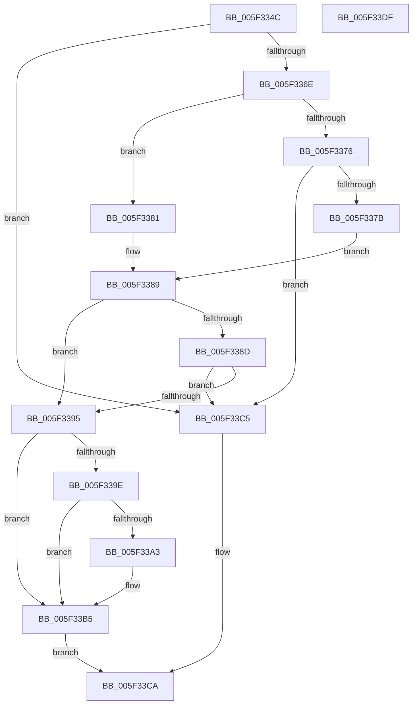

# inflateReset2

- RVA: `0x005F334C`–`0x005F33E0` (길이 `148` bytes)
- VA: `0x00000001405F334C`
- 실행 섹션: `.text`
- PDB 이름 있음: `예`; PDB Function 태그: `아니요`
- unwind 정보 RVA: `0x0005C954`
- 디코드: `48`개 명령, `148/148` bytes 표시
- 미해석 바이트: `0` (있으면 어셈블리에 `.byte`로 보존)

> 이 문서는 커널 이미지의 기계어와 PDB 기호를 분석해 생성했습니다. 4번과 5번은 함수 원형과 자료형을 바이너리 사용 방식에서 추정한 C 해석이며 원본 소스 복구 결과는 아닙니다.

## 1. Dependencies

- 직접 호출 지점: **3**; 고유 호출 대상: **3**
- 직접 호출자로 확인된 함수: **1**
- RIP 상대 이미지 참조: **0**

### Outgoing calls
- `0x005F3365` → [inflateStateCheck](inflateStateCheck_function_005F3478.md) (function, `0x005F3478`)
- `0x005F33AB` → [guard_dispatch_icall](../6B/guard_dispatch_icall_function_006BAAD0.md) (function, `0x006BAAD0`)
- `0x005F33BE` → [inflateReset](inflateReset_function_005F331C.md) (function, `0x005F331C`)

### Direct callers
- [RtlDecompressBufferDeflateInternal](RtlDecompressBufferDeflateInternal_function_005F0858.md) at `0x005F08F2`

### Static image references
- 디코드된 RIP-relative 메모리 참조가 없습니다.

## 2. Other-region calls and transfers

- 다른 실행 섹션으로 향하는 call: **0**
- 별도 외부 분기/꼬리 이동을 확인하지 못했습니다.

## 3. Assembly (complete function range)

```asm
005F334C  48 89 5C 24 08                  mov qword ptr [rsp + 8], rbx
005F3351  48 89 6C 24 10                  mov qword ptr [rsp + 0x10], rbp
005F3356  48 89 74 24 18                  mov qword ptr [rsp + 0x18], rsi
005F335B  57                              push rdi
005F335C  48 83 EC 20                     sub rsp, 0x20
005F3360  8B DA                           mov ebx, edx
005F3362  48 8B E9                        mov rbp, rcx
005F3365  E8 0E 01 00 00                  call 0x1405f3478
005F336A  85 C0                           test eax, eax
005F336C  75 57                           jne 0x1405f33c5
005F336E  48 8B 71 28                     mov rsi, qword ptr [rcx + 0x28]
005F3372  85 D2                           test edx, edx
005F3374  79 0B                           jns 0x1405f3381
005F3376  83 FA F1                        cmp edx, -0xf
005F3379  7C 4A                           jl 0x1405f33c5
005F337B  33 FF                           xor edi, edi
005F337D  F7 DB                           neg ebx
005F337F  EB 08                           jmp 0x1405f3389
005F3381  8B FB                           mov edi, ebx
005F3383  C1 EF 04                        shr edi, 4
005F3386  83 C7 05                        add edi, 5
005F3389  85 DB                           test ebx, ebx
005F338B  74 08                           je 0x1405f3395
005F338D  8D 43 F8                        lea eax, [rbx - 8]
005F3390  83 F8 07                        cmp eax, 7
005F3393  77 30                           ja 0x1405f33c5
005F3395  48 8B 56 40                     mov rdx, qword ptr [rsi + 0x40]
005F3399  48 85 D2                        test rdx, rdx
005F339C  74 17                           je 0x1405f33b5
005F339E  39 5E 30                        cmp dword ptr [rsi + 0x30], ebx
005F33A1  74 12                           je 0x1405f33b5
005F33A3  48 8B 41 38                     mov rax, qword ptr [rcx + 0x38]
005F33A7  48 8B 49 40                     mov rcx, qword ptr [rcx + 0x40]
005F33AB  E8 20 77 0C 00                  call 0x1406baad0
005F33B0  48 83 66 40 00                  and qword ptr [rsi + 0x40], 0
005F33B5  48 8B CD                        mov rcx, rbp
005F33B8  89 7E 10                        mov dword ptr [rsi + 0x10], edi
005F33BB  89 5E 30                        mov dword ptr [rsi + 0x30], ebx
005F33BE  E8 59 FF FF FF                  call 0x1405f331c
005F33C3  EB 05                           jmp 0x1405f33ca
005F33C5  B8 FE FF FF FF                  mov eax, 0xfffffffe
005F33CA  48 8B 5C 24 30                  mov rbx, qword ptr [rsp + 0x30]
005F33CF  48 8B 6C 24 38                  mov rbp, qword ptr [rsp + 0x38]
005F33D4  48 8B 74 24 40                  mov rsi, qword ptr [rsp + 0x40]
005F33D9  48 83 C4 20                     add rsp, 0x20
005F33DD  5F                              pop rdi
005F33DE  C3                              ret
005F33DF  CC                              int3
```

## 4. C-style interpretation (structured pseudocode)

```c
__int64 __fastcall inflateReset2(__int64 a1, int a2)
{
    __int64 result;
    __int64 v_rbx;
    __int64 v_rdi;
    __int64 v_rsp;
    unsigned __int64 v_stack_p10;
    unsigned __int64 v_stack_p18;
    unsigned __int64 v_stack_p8;

    v_stack_p8 = v_rbx;
    v_stack_p10 = v_rbp;
    v_stack_p18 = v_rsi;
    v_rsp = (v_rsp) - (32);
    result = inflateStateCheck(a1, a2, a3, a4);
    if ((unsigned int)(result) != 0) goto loc_005F33C5;
    if (!sign_flag) goto loc_005F3381;
    if (a2 < -15) goto loc_005F33C5;
    v_rdi = 0;
    v_rbx = (unsigned int)(-((unsigned int)(a2)));
    goto loc_005F3389;
loc_005F3381:
    v_rdi = (unsigned int)(((unsigned int)((unsigned int)(v_rbx))) >> (4));
    v_rdi = (unsigned int)((v_rdi) + (5));
loc_005F3389:
    if ((unsigned int)(v_rbx) == 0) goto loc_005F3395;
    if (((unsigned int)(v_rbx - 8)) > 7) goto loc_005F33C5;
loc_005F3395:
    if (*(unsigned __int64 *)(*(unsigned __int64 *)(a1 + 40) + 64) == 0) goto loc_005F33B5;
    result = v_rbx - 8;
    if ((*(unsigned int *)(*(unsigned __int64 *)(a1 + 40) + 48)) != ((unsigned int)(v_rbx))) {
        result = *(unsigned __int64 *)(a1 + 56);
        a1 = *(unsigned __int64 *)(a1 + 64);
        result = guard_dispatch_icall(a1, *(unsigned __int64 *)(*(unsigned __int64 *)(a1 + 40) + 64), a3, a4);
    }
    *(unsigned int *)(*(unsigned __int64 *)(a1 + 40) + 16) = (unsigned int)(v_rdi);
    *(unsigned int *)(*(unsigned __int64 *)(a1 + 40) + 48) = (unsigned int)(v_rbx);
    result = inflateReset(a1, *(unsigned __int64 *)(*(unsigned __int64 *)(a1 + 40) + 64), a3, a4);
    goto loc_005F33CA;
loc_005F33C5:
loc_005F33CA:
    v_rsp = (v_rsp) + (32);
    return (unsigned int)(0xFFFFFFFEULL);
}
```

## 5. (Beta) C Style

```c
int64_t inflateReset2(int64_t Arg1, int32_t Arg2)
{
    int64_t result;
    int64_t local_rbx;
    int64_t local_rdi;
    int64_t local_rsp;
    uint64_t v_stack_p10;
    uint64_t v_stack_p18;
    uint64_t v_stack_p8;

    v_stack_p8 = local_rbx;
    v_stack_p10 = local_rbp;
    v_stack_p18 = local_rsi;
    local_rsp = (local_rsp) - (32);
    result = inflateStateCheck(Arg1, Arg2, a3, a4);
    if ((uint32_t)(result) != 0) goto loc_005F33C5;
    if (!sign_flag) goto loc_005F3381;
    if (Arg2 < -15) goto loc_005F33C5;
    local_rdi = 0;
    local_rbx = (uint32_t)(-((uint32_t)(Arg2)));
    goto loc_005F3389;
loc_005F3381:
    local_rdi = (uint32_t)(((uint32_t)((uint32_t)(local_rbx))) >> (4));
    local_rdi = (uint32_t)((local_rdi) + (5));
loc_005F3389:
    if ((uint32_t)(local_rbx) == 0) goto loc_005F3395;
    if (((uint32_t)(local_rbx - 8)) > 7) goto loc_005F33C5;
loc_005F3395:
    if (*(uint64_t *)(*(uint64_t *)(Arg1 + 0x28) + 0x40) == 0) goto loc_005F33B5;
    result = local_rbx - 8;
    if ((*(uint32_t *)(*(uint64_t *)(Arg1 + 0x28) + 0x30)) != ((uint32_t)(local_rbx))) {
        result = *(uint64_t *)(Arg1 + 0x38);
        Arg1 = *(uint64_t *)(Arg1 + 0x40);
        result = guard_dispatch_icall(Arg1, *(uint64_t *)(*(uint64_t *)(Arg1 + 0x28) + 0x40), a3, a4);
    }
    *(uint32_t *)(*(uint64_t *)(Arg1 + 0x28) + 0x10) = (uint32_t)(local_rdi);
    *(uint32_t *)(*(uint64_t *)(Arg1 + 0x28) + 0x30) = (uint32_t)(local_rbx);
    result = inflateReset(Arg1, *(uint64_t *)(*(uint64_t *)(Arg1 + 0x28) + 0x40), a3, a4);
    goto loc_005F33CA;
loc_005F33C5:
loc_005F33CA:
    local_rsp = (local_rsp) + (32);
    return (uint32_t)(0xFFFFFFFEULL);
}
```

## 6. Execution-region graph

[열기: 2D/3D 그래프와 함수 탐색 컨트롤 패널](../../../control-panel.html?section=text&rva=0x005F334C&view=graph)

- 2D 그래프는 위에서 아래로 흐르고, 3D 그래프는 빈 공간을 드래그해 회전합니다. Shift+드래그는 이동, 휠은 확대·축소, 함수 노드 선택은 대상 보고서 이동입니다.

### Static fallback


