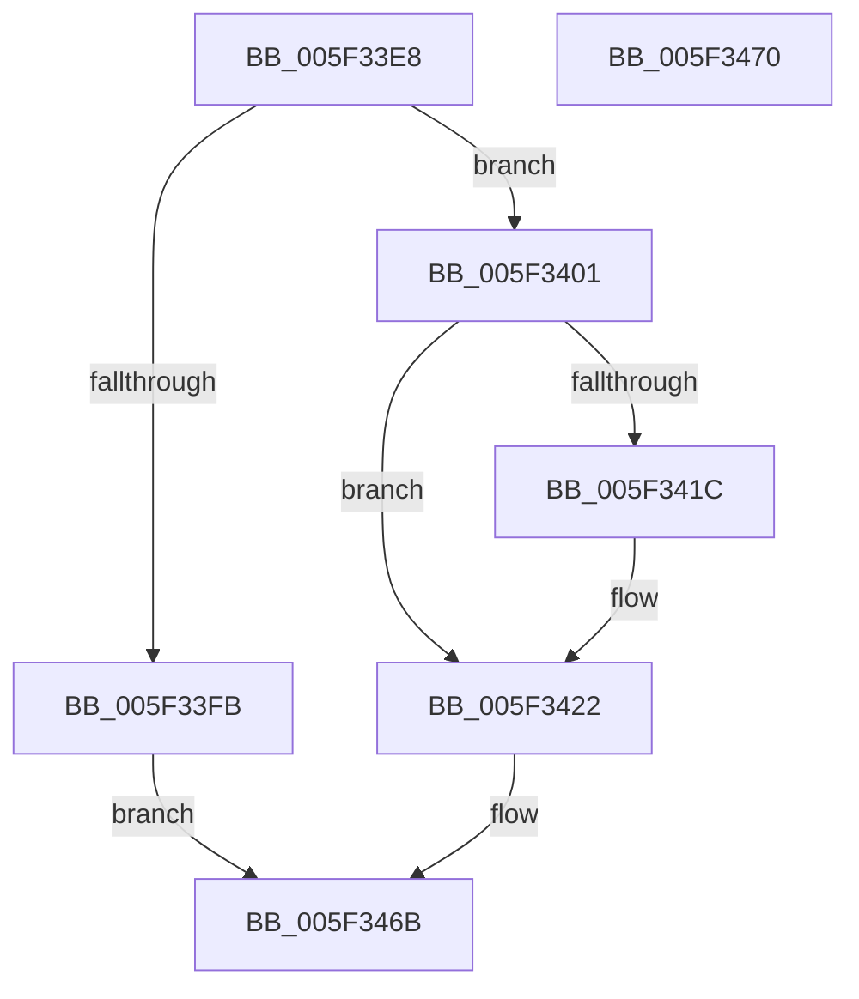

# inflateResetKeep

- RVA: `0x005F33E8`–`0x005F3471` (길이 `137` bytes)
- VA: `0x00000001405F33E8`
- 실행 섹션: `.text`
- PDB 이름 있음: `예`; PDB Function 태그: `아니요`
- unwind 정보 RVA: `0x0005C788`
- 디코드: `35`개 명령, `137/137` bytes 표시
- 미해석 바이트: `0` (있으면 어셈블리에 `.byte`로 보존)

> 이 문서는 커널 이미지의 기계어와 PDB 기호를 분석해 생성했습니다. 4번과 5번은 함수 원형과 자료형을 바이너리 사용 방식에서 추정한 C 해석이며 원본 소스 복구 결과는 아닙니다.

## 1. Dependencies

- 직접 호출 지점: **1**; 고유 호출 대상: **1**
- 직접 호출자로 확인된 함수: **1**
- RIP 상대 이미지 참조: **0**

### Outgoing calls
- `0x005F33EF` → [inflateStateCheck](inflateStateCheck_function_005F3478.md) (function, `0x005F3478`)

### Direct callers
- [inflateReset](inflateReset_function_005F331C.md) at `0x005F333B`

### Static image references
- 디코드된 RIP-relative 메모리 참조가 없습니다.

## 2. Other-region calls and transfers

- 다른 실행 섹션으로 향하는 call: **0**
- 별도 외부 분기/꼬리 이동을 확인하지 못했습니다.

## 3. Assembly (complete function range)

```asm
005F33E8  48 83 EC 28                     sub rsp, 0x28
005F33EC  48 8B D1                        mov rdx, rcx
005F33EF  E8 84 00 00 00                  call 0x1405f3478
005F33F4  45 33 C0                        xor r8d, r8d
005F33F7  85 C0                           test eax, eax
005F33F9  74 06                           je 0x1405f3401
005F33FB  41 8D 40 FE                     lea eax, [r8 - 2]
005F33FF  EB 6A                           jmp 0x1405f346b
005F3401  48 8B 49 28                     mov rcx, qword ptr [rcx + 0x28]
005F3405  44 89 41 24                     mov dword ptr [rcx + 0x24], r8d
005F3409  44 89 42 1C                     mov dword ptr [rdx + 0x1c], r8d
005F340D  44 89 42 0C                     mov dword ptr [rdx + 0xc], r8d
005F3411  4C 89 42 20                     mov qword ptr [rdx + 0x20], r8
005F3415  8B 41 10                        mov eax, dword ptr [rcx + 0x10]
005F3418  85 C0                           test eax, eax
005F341A  74 06                           je 0x1405f3422
005F341C  83 E0 01                        and eax, 1
005F341F  89 42 4C                        mov dword ptr [rdx + 0x4c], eax
005F3422  48 8D 81 50 05 00 00            lea rax, [rcx + 0x550]
005F3429  48 C7 41 08 34 3F 00 00         mov qword ptr [rcx + 8], 0x3f34
005F3431  83 CA FF                        or edx, 0xffffffff
005F3434  48 89 81 88 00 00 00            mov qword ptr [rcx + 0x88], rax
005F343B  48 89 41 68                     mov qword ptr [rcx + 0x68], rax
005F343F  48 89 41 60                     mov qword ptr [rcx + 0x60], rax
005F3443  33 C0                           xor eax, eax
005F3445  44 89 41 14                     mov dword ptr [rcx + 0x14], r8d
005F3449  89 51 18                        mov dword ptr [rcx + 0x18], edx
005F344C  C7 41 1C 00 80 00 00            mov dword ptr [rcx + 0x1c], 0x8000
005F3453  4C 89 41 28                     mov qword ptr [rcx + 0x28], r8
005F3457  4C 89 41 48                     mov qword ptr [rcx + 0x48], r8
005F345B  C7 81 60 23 00 00 01 00 00 00   mov dword ptr [rcx + 0x2360], 1
005F3465  89 91 64 23 00 00               mov dword ptr [rcx + 0x2364], edx
005F346B  48 83 C4 28                     add rsp, 0x28
005F346F  C3                              ret
005F3470  CC                              int3
```

## 4. C-style interpretation (structured pseudocode)

```c
__int64 __fastcall inflateResetKeep(__int64 a1, __int64 a2, int a3)
{
    __int64 result;
    __int64 v_rsp;

    v_rsp = (v_rsp) - (40);
    result = inflateStateCheck(a1, a1, a3, a4);
    a3 = 0;
    if ((unsigned int)(result) == 0) goto loc_005F3401;
    goto loc_005F346B;
loc_005F3401:
    *(unsigned int *)(*(unsigned __int64 *)(a1 + 40) + 36) = 0;
    *(unsigned int *)(a1 + 28) = 0;
    *(unsigned int *)(a1 + 12) = 0;
    *(unsigned __int64 *)(a1 + 32) = 0;
    result = (unsigned int)(*(unsigned int *)(*(unsigned __int64 *)(a1 + 40) + 16));
    if ((unsigned int)((unsigned int)(*(unsigned int *)(*(unsigned __int64 *)(a1 + 40) + 16))) != 0) {
        result = (unsigned int)(((unsigned int)(*(unsigned int *)(*(unsigned __int64 *)(a1 + 40) + 16))) & (1));
        *(unsigned int *)(a1 + 76) = (unsigned int)(result);
    }
    *(unsigned __int64 *)(*(unsigned __int64 *)(a1 + 40) + 8) = 0x3F34ULL;
    a2 = (unsigned int)((a1) | (0xFFFFFFFFULL));
    *(unsigned __int64 *)(*(unsigned __int64 *)(a1 + 40) + 136) = *(unsigned __int64 *)(a1 + 40) + 1360;
    *(unsigned __int64 *)(*(unsigned __int64 *)(a1 + 40) + 104) = *(unsigned __int64 *)(a1 + 40) + 1360;
    *(unsigned __int64 *)(*(unsigned __int64 *)(a1 + 40) + 96) = *(unsigned __int64 *)(a1 + 40) + 1360;
    result = 0;
    *(unsigned int *)(*(unsigned __int64 *)(a1 + 40) + 20) = 0;
    *(unsigned int *)(*(unsigned __int64 *)(a1 + 40) + 24) = (unsigned int)(a2);
    *(unsigned int *)(*(unsigned __int64 *)(a1 + 40) + 28) = 0x8000ULL;
    *(unsigned __int64 *)(*(unsigned __int64 *)(a1 + 40) + 40) = 0;
    *(unsigned __int64 *)(*(unsigned __int64 *)(a1 + 40) + 72) = 0;
    *(unsigned int *)(*(unsigned __int64 *)(a1 + 40) + 9056) = 1;
    *(unsigned int *)(*(unsigned __int64 *)(a1 + 40) + 9060) = (unsigned int)(a2);
loc_005F346B:
    v_rsp = (v_rsp) + (40);
    return result;
}
```

## 5. (Beta) C Style

```c
int64_t inflateResetKeep(int64_t Arg1, int64_t Arg2, int32_t Arg3)
{
    int64_t result;
    int64_t local_rsp;

    local_rsp = (local_rsp) - (40);
    result = inflateStateCheck(Arg1, Arg1, Arg3, a4);
    Arg3 = 0;
    if ((uint32_t)(result) == 0) goto loc_005F3401;
    goto loc_005F346B;
loc_005F3401:
    *(uint32_t *)(*(uint64_t *)(Arg1 + 0x28) + 0x24) = 0;
    *(uint32_t *)(Arg1 + 0x1C) = 0;
    *(uint32_t *)(Arg1 + 0xC) = 0;
    *(uint64_t *)(Arg1 + 0x20) = 0;
    result = (uint32_t)(*(uint32_t *)(*(uint64_t *)(Arg1 + 0x28) + 0x10));
    if ((uint32_t)((uint32_t)(*(uint32_t *)(*(uint64_t *)(Arg1 + 0x28) + 0x10))) != 0) {
        result = (uint32_t)(((uint32_t)(*(uint32_t *)(*(uint64_t *)(Arg1 + 0x28) + 0x10))) & (1));
        *(uint32_t *)(Arg1 + 0x4C) = (uint32_t)(result);
    }
    *(uint64_t *)(*(uint64_t *)(Arg1 + 0x28) + 0x8) = 0x3F34ULL;
    Arg2 = (uint32_t)((Arg1) | (0xFFFFFFFFULL));
    *(uint64_t *)(*(uint64_t *)(Arg1 + 0x28) + 0x88) = *(uint64_t *)(Arg1 + 0x28) + 1360;
    *(uint64_t *)(*(uint64_t *)(Arg1 + 0x28) + 0x68) = *(uint64_t *)(Arg1 + 0x28) + 1360;
    *(uint64_t *)(*(uint64_t *)(Arg1 + 0x28) + 0x60) = *(uint64_t *)(Arg1 + 0x28) + 1360;
    result = 0;
    *(uint32_t *)(*(uint64_t *)(Arg1 + 0x28) + 0x14) = 0;
    *(uint32_t *)(*(uint64_t *)(Arg1 + 0x28) + 0x18) = (uint32_t)(Arg2);
    *(uint32_t *)(*(uint64_t *)(Arg1 + 0x28) + 0x1C) = 0x8000ULL;
    *(uint64_t *)(*(uint64_t *)(Arg1 + 0x28) + 0x28) = 0;
    *(uint64_t *)(*(uint64_t *)(Arg1 + 0x28) + 0x48) = 0;
    *(uint32_t *)(*(uint64_t *)(Arg1 + 0x28) + 0x2360) = 1;
    *(uint32_t *)(*(uint64_t *)(Arg1 + 0x28) + 0x2364) = (uint32_t)(Arg2);
loc_005F346B:
    local_rsp = (local_rsp) + (40);
    return result;
}
```

## 6. Execution-region graph

[열기: 2D/3D 그래프와 함수 탐색 컨트롤 패널](../../../control-panel.html?section=text&rva=0x005F33E8&view=graph)

- 2D 그래프는 위에서 아래로 흐르고, 3D 그래프는 빈 공간을 드래그해 회전합니다. Shift+드래그는 이동, 휠은 확대·축소, 함수 노드 선택은 대상 보고서 이동입니다.

### Static fallback


