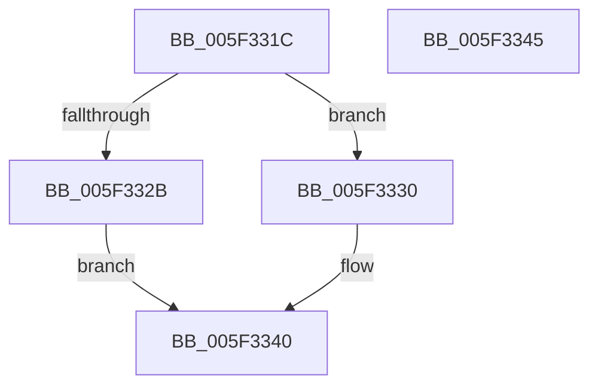

# inflateReset

- RVA: `0x005F331C`–`0x005F3346` (길이 `42` bytes)
- VA: `0x00000001405F331C`
- 실행 섹션: `.text`
- PDB 이름 있음: `예`; PDB Function 태그: `아니요`
- unwind 정보 RVA: `0x0005C788`
- 디코드: `14`개 명령, `42/42` bytes 표시
- 미해석 바이트: `0` (있으면 어셈블리에 `.byte`로 보존)

> 이 문서는 커널 이미지의 기계어와 PDB 기호를 분석해 생성했습니다. 4번과 5번은 함수 원형과 자료형을 바이너리 사용 방식에서 추정한 C 해석이며 원본 소스 복구 결과는 아닙니다.

## 1. Dependencies

- 직접 호출 지점: **2**; 고유 호출 대상: **2**
- 직접 호출자로 확인된 함수: **1**
- RIP 상대 이미지 참조: **0**

### Outgoing calls
- `0x005F3320` → [inflateStateCheck](inflateStateCheck_function_005F3478.md) (function, `0x005F3478`)
- `0x005F333B` → [inflateResetKeep](inflateResetKeep_function_005F33E8.md) (function, `0x005F33E8`)

### Direct callers
- [inflateReset2](inflateReset2_function_005F334C.md) at `0x005F33BE`

### Static image references
- 디코드된 RIP-relative 메모리 참조가 없습니다.

## 2. Other-region calls and transfers

- 다른 실행 섹션으로 향하는 call: **0**
- 별도 외부 분기/꼬리 이동을 확인하지 못했습니다.

## 3. Assembly (complete function range)

```asm
005F331C  48 83 EC 28                     sub rsp, 0x28
005F3320  E8 53 01 00 00                  call 0x1405f3478
005F3325  33 D2                           xor edx, edx
005F3327  85 C0                           test eax, eax
005F3329  74 05                           je 0x1405f3330
005F332B  8D 42 FE                        lea eax, [rdx - 2]
005F332E  EB 10                           jmp 0x1405f3340
005F3330  48 8B 41 28                     mov rax, qword ptr [rcx + 0x28]
005F3334  48 89 50 34                     mov qword ptr [rax + 0x34], rdx
005F3338  89 50 3C                        mov dword ptr [rax + 0x3c], edx
005F333B  E8 A8 00 00 00                  call 0x1405f33e8
005F3340  48 83 C4 28                     add rsp, 0x28
005F3344  C3                              ret
005F3345  CC                              int3
```

## 4. C-style interpretation (structured pseudocode)

```c
__int64 __fastcall inflateReset(__int64 a1, int a2)
{
    __int64 result;
    __int64 v_rsp;

    v_rsp = (v_rsp) - (40);
    result = inflateStateCheck(a1, a2, a3, a4);
    a2 = 0;
    if ((unsigned int)(result) == 0) goto loc_005F3330;
    goto loc_005F3340;
loc_005F3330:
    *(unsigned __int64 *)(*(unsigned __int64 *)(a1 + 40) + 52) = 0;
    *(unsigned int *)(*(unsigned __int64 *)(a1 + 40) + 60) = 0;
    result = inflateResetKeep(a1, a2, a3, a4);
loc_005F3340:
    v_rsp = (v_rsp) + (40);
    return result;
}
```

## 5. (Beta) C Style

```c
int64_t inflateReset(int64_t Arg1, int32_t Arg2)
{
    int64_t result;
    int64_t local_rsp;

    local_rsp = (local_rsp) - (40);
    result = inflateStateCheck(Arg1, Arg2, a3, a4);
    Arg2 = 0;
    if ((uint32_t)(result) == 0) goto loc_005F3330;
    goto loc_005F3340;
loc_005F3330:
    *(uint64_t *)(*(uint64_t *)(Arg1 + 0x28) + 0x34) = 0;
    *(uint32_t *)(*(uint64_t *)(Arg1 + 0x28) + 0x3C) = 0;
    result = inflateResetKeep(Arg1, Arg2, a3, a4);
loc_005F3340:
    local_rsp = (local_rsp) + (40);
    return result;
}
```

## 6. Execution-region graph

[열기: 2D/3D 그래프와 함수 탐색 컨트롤 패널](../../../control-panel.html?section=text&rva=0x005F331C&view=graph)

- 2D 그래프는 위에서 아래로 흐르고, 3D 그래프는 빈 공간을 드래그해 회전합니다. Shift+드래그는 이동, 휠은 확대·축소, 함수 노드 선택은 대상 보고서 이동입니다.

### Static fallback


