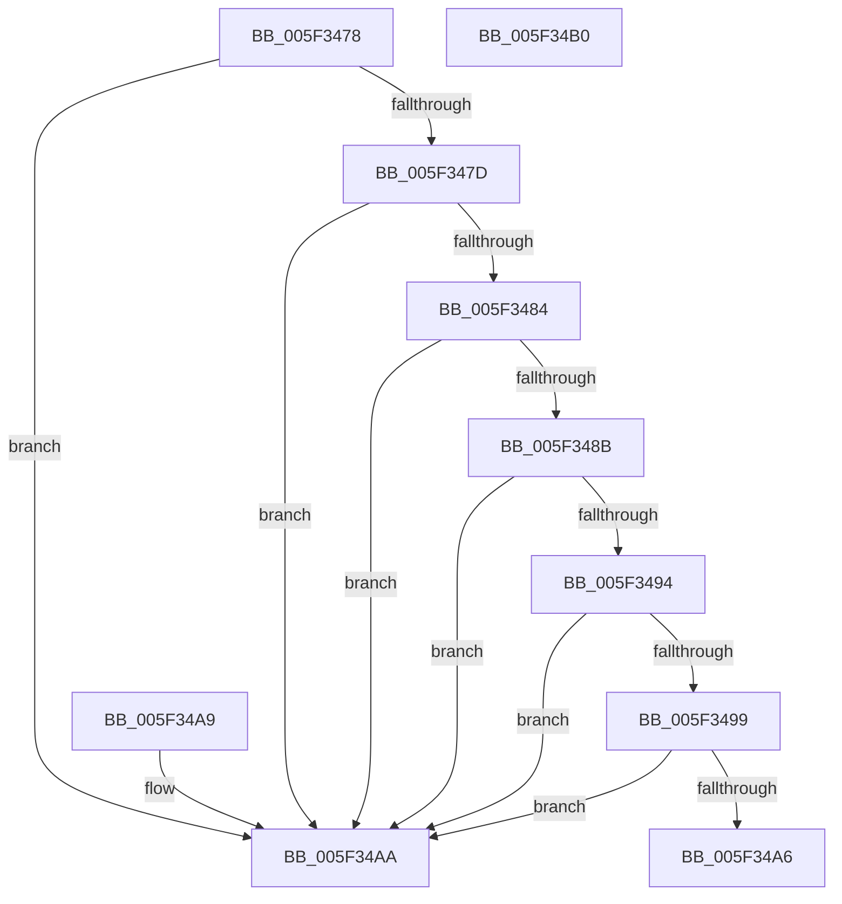

# inflateStateCheck

- RVA: `0x005F3478`–`0x005F34B1` (길이 `57` bytes)
- VA: `0x00000001405F3478`
- 실행 섹션: `.text`
- PDB 이름 있음: `예`; PDB Function 태그: `예`
- unwind 정보 RVA: `0x000DB714`
- 디코드: `21`개 명령, `57/57` bytes 표시
- 미해석 바이트: `0` (있으면 어셈블리에 `.byte`로 보존)

> 이 문서는 커널 이미지의 기계어와 PDB 기호를 분석해 생성했습니다. 4번과 5번은 함수 원형과 자료형을 바이너리 사용 방식에서 추정한 C 해석이며 원본 소스 복구 결과는 아닙니다.

## 1. Dependencies

- 직접 호출 지점: **0**; 고유 호출 대상: **0**
- 직접 호출자로 확인된 함수: **4**
- RIP 상대 이미지 참조: **0**

### Outgoing calls
- 직접 디코드된 call 명령이 없습니다.

### Direct callers
- [inflate](inflate_function_005F2280.md) at `0x005F229B`
- [inflateReset](inflateReset_function_005F331C.md) at `0x005F3320`
- [inflateReset2](inflateReset2_function_005F334C.md) at `0x005F3365`
- [inflateResetKeep](inflateResetKeep_function_005F33E8.md) at `0x005F33EF`

### Static image references
- 디코드된 RIP-relative 메모리 참조가 없습니다.

## 2. Other-region calls and transfers

- 다른 실행 섹션으로 향하는 call: **0**
- 별도 외부 분기/꼬리 이동을 확인하지 못했습니다.

## 3. Assembly (complete function range)

```asm
005F3478  48 85 C9                        test rcx, rcx
005F347B  74 2D                           je 0x1405f34aa
005F347D  48 83 79 30 00                  cmp qword ptr [rcx + 0x30], 0
005F3482  74 26                           je 0x1405f34aa
005F3484  48 83 79 38 00                  cmp qword ptr [rcx + 0x38], 0
005F3489  74 1F                           je 0x1405f34aa
005F348B  48 8B 41 28                     mov rax, qword ptr [rcx + 0x28]
005F348F  48 85 C0                        test rax, rax
005F3492  74 16                           je 0x1405f34aa
005F3494  48 39 08                        cmp qword ptr [rax], rcx
005F3497  75 11                           jne 0x1405f34aa
005F3499  8B 40 08                        mov eax, dword ptr [rax + 8]
005F349C  2D 34 3F 00 00                  sub eax, 0x3f34
005F34A1  83 F8 1F                        cmp eax, 0x1f
005F34A4  77 04                           ja 0x1405f34aa
005F34A6  33 C0                           xor eax, eax
005F34A8  C3                              ret
005F34A9  CC                              int3
005F34AA  B8 01 00 00 00                  mov eax, 1
005F34AF  C3                              ret
005F34B0  CC                              int3
```

## 4. C-style interpretation (structured pseudocode)

```c
__int64 __fastcall inflateStateCheck(__int64 a1)
{
    __int64 result;

    if (a1 == 0) goto loc_005F34AA;
    if ((*(unsigned __int64 *)(a1 + 48)) == 0) goto loc_005F34AA;
    if ((*(unsigned __int64 *)(a1 + 56)) == 0) goto loc_005F34AA;
    if (*(unsigned __int64 *)(a1 + 40) == 0) goto loc_005F34AA;
    if ((*(unsigned __int64 *)(*(unsigned __int64 *)(a1 + 40))) != a1) goto loc_005F34AA;
    result = (unsigned int)(((unsigned int)(*(unsigned int *)(*(unsigned __int64 *)(a1 + 40) + 8))) - (0x3F34ULL));
    if (((unsigned int)(result)) > 31) goto loc_005F34AA;
    result = 0;
    return result;
loc_005F34AA:
    return 1;
}
```

## 5. (Beta) C Style

```c
int64_t inflateStateCheck(int64_t Arg1)
{
    int64_t result;

    if (Arg1 == 0) goto loc_005F34AA;
    if ((*(uint64_t *)(Arg1 + 0x30)) == 0) goto loc_005F34AA;
    if ((*(uint64_t *)(Arg1 + 0x38)) == 0) goto loc_005F34AA;
    if (*(uint64_t *)(Arg1 + 0x28) == 0) goto loc_005F34AA;
    if ((*(uint64_t *)(*(uint64_t *)(Arg1 + 0x28))) != Arg1) goto loc_005F34AA;
    result = (uint32_t)(((uint32_t)(*(uint32_t *)(*(uint64_t *)(Arg1 + 0x28) + 0x8))) - (0x3F34ULL));
    if (((uint32_t)(result)) > 31) goto loc_005F34AA;
    result = 0;
    return result;
loc_005F34AA:
    return 1;
}
```

## 6. Execution-region graph

[열기: 2D/3D 그래프와 함수 탐색 컨트롤 패널](../../../control-panel.html?section=text&rva=0x005F3478&view=graph)

- 2D 그래프는 위에서 아래로 흐르고, 3D 그래프는 빈 공간을 드래그해 회전합니다. Shift+드래그는 이동, 휠은 확대·축소, 함수 노드 선택은 대상 보고서 이동입니다.

### Static fallback


