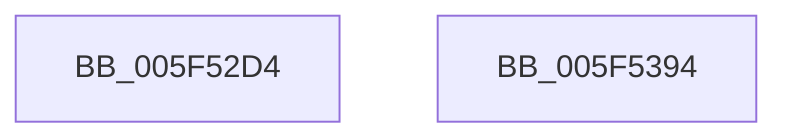

# lm_init

- RVA: `0x005F52D4`–`0x005F5395` (길이 `193` bytes)
- VA: `0x00000001405F52D4`
- 실행 섹션: `.text`
- PDB 이름 있음: `예`; PDB Function 태그: `예`
- unwind 정보 RVA: `0x0005CAAC`
- 디코드: `42`개 명령, `193/193` bytes 표시
- 미해석 바이트: `0` (있으면 어셈블리에 `.byte`로 보존)

> 이 문서는 커널 이미지의 기계어와 PDB 기호를 분석해 생성했습니다. 4번과 5번은 함수 원형과 자료형을 바이너리 사용 방식에서 추정한 C 해석이며 원본 소스 복구 결과는 아닙니다.

## 1. Dependencies

- 직접 호출 지점: **1**; 고유 호출 대상: **1**
- 직접 호출자로 확인된 함수: **1**
- RIP 상대 이미지 참조: **1**

### Outgoing calls
- `0x005F531A` → [memset](../6C/memset_function_006C6C40.md) (function, `0x006C6C40`)

### Direct callers
- [deflateReset](deflateReset_function_005F38FC.md) at `0x005F3918`

### Static image references
- `0x005F5326` → RVA `0x00009370` (`.rdata`; read)

## 2. Other-region calls and transfers

- 다른 실행 섹션으로 향하는 call: **0**
- 별도 외부 분기/꼬리 이동을 확인하지 못했습니다.

## 3. Assembly (complete function range)

```asm
005F52D4  48 89 5C 24 08                  mov qword ptr [rsp + 8], rbx
005F52D9  57                              push rdi
005F52DA  48 83 EC 20                     sub rsp, 0x20
005F52DE  8B 81 94 00 00 00               mov eax, dword ptr [rcx + 0x94]
005F52E4  48 8B D9                        mov rbx, rcx
005F52E7  8B 91 C4 00 00 00               mov edx, dword ptr [rcx + 0xc4]
005F52ED  03 C0                           add eax, eax
005F52EF  89 81 A8 00 00 00               mov dword ptr [rcx + 0xa8], eax
005F52F5  FF CA                           dec edx
005F52F7  48 8B 81 B8 00 00 00            mov rax, qword ptr [rcx + 0xb8]
005F52FE  33 FF                           xor edi, edi
005F5300  66 89 3C 50                     mov word ptr [rax + rdx*2], di
005F5304  33 D2                           xor edx, edx
005F5306  44 8B 81 C4 00 00 00            mov r8d, dword ptr [rcx + 0xc4]
005F530D  48 8B 89 B8 00 00 00            mov rcx, qword ptr [rcx + 0xb8]
005F5314  41 FF C8                        dec r8d
005F5317  4D 03 C0                        add r8, r8
005F531A  E8 21 19 0D 00                  call 0x1406c6c40
005F531F  48 63 8B FC 00 00 00            movsxd rcx, dword ptr [rbx + 0xfc]
005F5326  48 8D 15 43 40 A1 FF            lea rdx, [rip - 0x5ebfbd]
005F532D  48 03 C9                        add rcx, rcx
005F5330  0F B7 44 CA 02                  movzx eax, word ptr [rdx + rcx*8 + 2]
005F5335  89 83 F8 00 00 00               mov dword ptr [rbx + 0xf8], eax
005F533B  0F B7 04 CA                     movzx eax, word ptr [rdx + rcx*8]
005F533F  89 83 04 01 00 00               mov dword ptr [rbx + 0x104], eax
005F5345  0F B7 44 CA 04                  movzx eax, word ptr [rdx + rcx*8 + 4]
005F534A  89 83 08 01 00 00               mov dword ptr [rbx + 0x108], eax
005F5350  0F B7 44 CA 06                  movzx eax, word ptr [rdx + rcx*8 + 6]
005F5355  89 83 F4 00 00 00               mov dword ptr [rbx + 0xf4], eax
005F535B  8D 47 02                        lea eax, [rdi + 2]
005F535E  89 83 F0 00 00 00               mov dword ptr [rbx + 0xf0], eax
005F5364  89 83 D8 00 00 00               mov dword ptr [rbx + 0xd8], eax
005F536A  48 89 BB E0 00 00 00            mov qword ptr [rbx + 0xe0], rdi
005F5371  89 BB D4 00 00 00               mov dword ptr [rbx + 0xd4], edi
005F5377  89 BB EC 00 00 00               mov dword ptr [rbx + 0xec], edi
005F537D  89 BB 58 17 00 00               mov dword ptr [rbx + 0x1758], edi
005F5383  89 BB C0 00 00 00               mov dword ptr [rbx + 0xc0], edi
005F5389  48 8B 5C 24 30                  mov rbx, qword ptr [rsp + 0x30]
005F538E  48 83 C4 20                     add rsp, 0x20
005F5392  5F                              pop rdi
005F5393  C3                              ret
005F5394  CC                              int3
```

## 4. C-style interpretation (structured pseudocode)

```c
__int64 __fastcall lm_init(__int64 a1)
{
    __int64 result;
    __int64 v_rdi;
    __int64 v_rsp;
    unsigned __int64 v_stack_p8;

    v_stack_p8 = v_rbx;
    v_rsp = (v_rsp) - (32);
    result = (unsigned int)(((unsigned int)(*(unsigned int *)(a1 + 148))) + ((unsigned int)((unsigned int)(*(unsigned int *)(a1 + 148)))));
    *(unsigned int *)(a1 + 168) = (unsigned int)(result);
    a2 = (unsigned int)(((unsigned int)(*(unsigned int *)(a1 + 196))) - 1);
    v_rdi = 0;
    *(unsigned __int16 *)(*(unsigned __int64 *)(a1 + 184) + a2 * 2) = 0;
    a2 = 0;
    a3 = (unsigned int)(((unsigned int)(*(unsigned int *)(a1 + 196))) - 1);
    a3 = (a3) + (a3);
    result = memset(*(unsigned __int64 *)(a1 + 184), a2, a3, a4);
    a1 = ((int)(*(unsigned int *)(a1 + 252))) + ((int)(*(unsigned int *)(a1 + 252)));
    *(unsigned int *)(a1 + 248) = (unsigned int)(*(unsigned __int16 *)(v_rip - 6209469 + a1 * 8 + 2));
    *(unsigned int *)(a1 + 260) = (unsigned int)(*(unsigned __int16 *)(v_rip - 6209469 + a1 * 8));
    *(unsigned int *)(a1 + 264) = (unsigned int)(*(unsigned __int16 *)(v_rip - 6209469 + a1 * 8 + 4));
    *(unsigned int *)(a1 + 244) = (unsigned int)(*(unsigned __int16 *)(v_rip - 6209469 + a1 * 8 + 6));
    *(unsigned int *)(a1 + 240) = (unsigned int)(v_rdi + 2);
    *(unsigned int *)(a1 + 216) = (unsigned int)(v_rdi + 2);
    *(unsigned __int64 *)(a1 + 224) = 0;
    *(unsigned int *)(a1 + 212) = 0;
    *(unsigned int *)(a1 + 236) = 0;
    *(unsigned int *)(a1 + 5976) = 0;
    *(unsigned int *)(a1 + 192) = 0;
    v_rsp = (v_rsp) + (32);
    return v_rdi + 2;
}
```

## 5. (Beta) C Style

```c
int64_t lm_init(void *Arg1)
{
    uint8_t *arg1 = (uint8_t *)Arg1;

    int64_t result;
    int64_t local_rdi;
    int64_t local_rsp;
    uint64_t v_stack_p8;

    v_stack_p8 = local_rbx;
    local_rsp = (local_rsp) - (32);
    result = (uint32_t)(((uint32_t)(*(uint32_t *)(arg1 + 0x94))) + ((uint32_t)((uint32_t)(*(uint32_t *)(arg1 + 0x94)))));
    *(uint32_t *)(arg1 + 0xA8) = (uint32_t)(result);
    a2 = (uint32_t)(((uint32_t)(*(uint32_t *)(arg1 + 0xC4))) - 1);
    local_rdi = 0;
    *(uint16_t *)(*(uint64_t *)(arg1 + 0xB8) + a2 * 2) = 0;
    a2 = 0;
    a3 = (uint32_t)(((uint32_t)(*(uint32_t *)(arg1 + 0xC4))) - 1);
    a3 = (a3) + (a3);
    result = memset(*(uint64_t *)(arg1 + 0xB8), a2, a3, a4);
    Arg1 = ((int32_t)(*(uint32_t *)(arg1 + 0xFC))) + ((int32_t)(*(uint32_t *)(arg1 + 0xFC)));
    *(uint32_t *)(arg1 + 0xF8) = (uint32_t)(*(uint16_t *)(v_rip - 0x5EBFBD + arg1 * 8 + 0x2));
    *(uint32_t *)(arg1 + 0x104) = (uint32_t)(*(uint16_t *)(v_rip - 0x5EBFBD + arg1 * 8));
    *(uint32_t *)(arg1 + 0x108) = (uint32_t)(*(uint16_t *)(v_rip - 0x5EBFBD + arg1 * 8 + 0x4));
    *(uint32_t *)(arg1 + 0xF4) = (uint32_t)(*(uint16_t *)(v_rip - 0x5EBFBD + arg1 * 8 + 0x6));
    *(uint32_t *)(arg1 + 0xF0) = (uint32_t)(local_rdi + 2);
    *(uint32_t *)(arg1 + 0xD8) = (uint32_t)(local_rdi + 2);
    *(uint64_t *)(arg1 + 0xE0) = 0;
    *(uint32_t *)(arg1 + 0xD4) = 0;
    *(uint32_t *)(arg1 + 0xEC) = 0;
    *(uint32_t *)(arg1 + 0x1758) = 0;
    *(uint32_t *)(arg1 + 0xC0) = 0;
    local_rsp = (local_rsp) + (32);
    return local_rdi + 2;
}
```

### 관측된 메모리 오프셋

구조체 형식이 확인되지 않은 접근은 인자 기준의 오프셋으로만 기록했습니다.

| 기준 인자 | 오프셋 표현 | 폭 (bit) | 접근 |
|---|---:|---:|---|
| `Arg1` | `+ 0x94` | `32` | `R` |
| `Arg1` | `+ 0xA8` | `32` | `W` |
| `Arg1` | `+ 0xB8` | `64` | `R` |
| `Arg1` | `+ 0xC0` | `32` | `W` |
| `Arg1` | `+ 0xC4` | `32` | `R` |
| `Arg1` | `+ 0xD4` | `32` | `W` |
| `Arg1` | `+ 0xD8` | `32` | `W` |
| `Arg1` | `+ 0xE0` | `64` | `W` |
| `Arg1` | `+ 0xEC` | `32` | `W` |
| `Arg1` | `+ 0xF0` | `32` | `W` |
| `Arg1` | `+ 0xF4` | `32` | `W` |
| `Arg1` | `+ 0xF8` | `32` | `W` |
| `Arg1` | `+ 0xFC` | `32` | `R` |
| `Arg1` | `+ 0x104` | `32` | `W` |
| `Arg1` | `+ 0x108` | `32` | `W` |
| `Arg1` | `+ 0x1758` | `32` | `W` |

## 6. Execution-region graph

[열기: 2D/3D 그래프와 함수 탐색 컨트롤 패널](../../../control-panel.html?section=text&rva=0x005F52D4&view=graph)

- 2D 그래프는 위에서 아래로 흐르고, 3D 그래프는 빈 공간을 드래그해 회전합니다. Shift+드래그는 이동, 휠은 확대·축소, 함수 노드 선택은 대상 보고서 이동입니다.

### Static fallback


