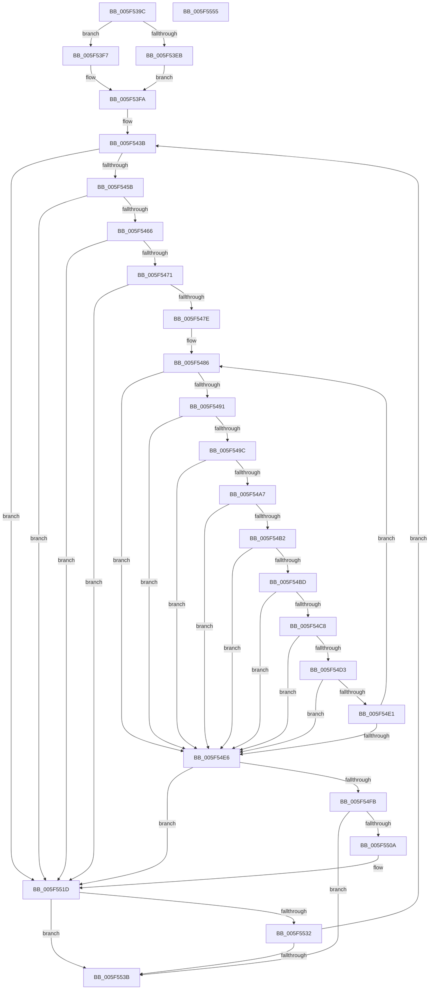

# longest_match

- RVA: `0x005F539C`–`0x005F5556` (길이 `442` bytes)
- VA: `0x00000001405F539C`
- 실행 섹션: `.text`
- PDB 이름 있음: `예`; PDB Function 태그: `예`
- unwind 정보 RVA: `0x000D048C`
- 디코드: `126`개 명령, `442/442` bytes 표시
- 미해석 바이트: `0` (있으면 어셈블리에 `.byte`로 보존)

> 이 문서는 커널 이미지의 기계어와 PDB 기호를 분석해 생성했습니다. 4번과 5번은 함수 원형과 자료형을 바이너리 사용 방식에서 추정한 C 해석이며 원본 소스 복구 결과는 아닙니다.

## 1. Dependencies

- 직접 호출 지점: **0**; 고유 호출 대상: **0**
- 직접 호출자로 확인된 함수: **2**
- RIP 상대 이미지 참조: **0**

### Outgoing calls
- 직접 디코드된 call 명령이 없습니다.

### Direct callers
- [deflate_fast](deflate_fast_function_005F3A80.md) at `0x005F3BD6`
- [deflate_slow](deflate_slow_function_005F4430.md) at `0x005F45C5`

### Static image references
- 디코드된 RIP-relative 메모리 참조가 없습니다.

## 2. Other-region calls and transfers

- 다른 실행 섹션으로 향하는 call: **0**
- 별도 외부 분기/꼬리 이동을 확인하지 못했습니다.

## 3. Assembly (complete function range)

```asm
005F539C  48 89 5C 24 20                  mov qword ptr [rsp + 0x20], rbx
005F53A1  55                              push rbp
005F53A2  56                              push rsi
005F53A3  57                              push rdi
005F53A4  41 54                           push r12
005F53A6  41 55                           push r13
005F53A8  41 56                           push r14
005F53AA  41 57                           push r15
005F53AC  44 8B 89 E4 00 00 00            mov r9d, dword ptr [rcx + 0xe4]
005F53B3  8B DA                           mov ebx, edx
005F53B5  4C 8B A1 A0 00 00 00            mov r12, qword ptr [rcx + 0xa0]
005F53BC  4C 8B D1                        mov r10, rcx
005F53BF  8B 91 F4 00 00 00               mov edx, dword ptr [rcx + 0xf4]
005F53C5  4C 63 99 F0 00 00 00            movsxd r11, dword ptr [rcx + 0xf0]
005F53CC  44 8B B9 08 01 00 00            mov r15d, dword ptr [rcx + 0x108]
005F53D3  8B 89 94 00 00 00               mov ecx, dword ptr [rcx + 0x94]
005F53D9  4B 8D 2C 21                     lea rbp, [r9 + r12]
005F53DD  4C 8B C5                        mov r8, rbp
005F53E0  8D 81 FA FE FF FF               lea eax, [rcx - 0x106]
005F53E6  44 3B C8                        cmp r9d, eax
005F53E9  76 0C                           jbe 0x1405f53f7
005F53EB  44 2B C9                        sub r9d, ecx
005F53EE  41 81 C1 06 01 00 00            add r9d, 0x106
005F53F5  EB 03                           jmp 0x1405f53fa
005F53F7  45 33 C9                        xor r9d, r9d
005F53FA  49 8B 82 B0 00 00 00            mov rax, qword ptr [r10 + 0xb0]
005F5401  8B F2                           mov esi, edx
005F5403  45 8A 6C 2B FF                  mov r13b, byte ptr [r11 + rbp - 1]
005F5408  C1 EE 02                        shr esi, 2
005F540B  45 3B 9A 04 01 00 00            cmp r11d, dword ptr [r10 + 0x104]
005F5412  48 89 44 24 50                  mov qword ptr [rsp + 0x50], rax
005F5417  41 8B 82 9C 00 00 00            mov eax, dword ptr [r10 + 0x9c]
005F541E  0F 42 F2                        cmovb esi, edx
005F5421  41 8B 92 EC 00 00 00            mov edx, dword ptr [r10 + 0xec]
005F5428  44 3B FA                        cmp r15d, edx
005F542B  89 44 24 40                     mov dword ptr [rsp + 0x40], eax
005F542F  41 8A 04 2B                     mov al, byte ptr [r11 + rbp]
005F5433  44 0F 47 FA                     cmova r15d, edx
005F5437  88 44 24 48                     mov byte ptr [rsp + 0x48], al
005F543B  40 8A 7C 24 48                  mov dil, byte ptr [rsp + 0x48]
005F5440  44 8B F3                        mov r14d, ebx
005F5443  49 63 C3                        movsxd rax, r11d
005F5446  4B 8D 0C 26                     lea rcx, [r14 + r12]
005F544A  40 38 3C 08                     cmp byte ptr [rax + rcx], dil
005F544E  48 8D BD 02 01 00 00            lea rdi, [rbp + 0x102]
005F5455  0F 85 C2 00 00 00               jne 0x1405f551d
005F545B  44 38 6C 08 FF                  cmp byte ptr [rax + rcx - 1], r13b
005F5460  0F 85 B7 00 00 00               jne 0x1405f551d
005F5466  41 8A 00                        mov al, byte ptr [r8]
005F5469  38 01                           cmp byte ptr [rcx], al
005F546B  0F 85 AC 00 00 00               jne 0x1405f551d
005F5471  41 8A 40 01                     mov al, byte ptr [r8 + 1]
005F5475  38 41 01                        cmp byte ptr [rcx + 1], al
005F5478  0F 85 9F 00 00 00               jne 0x1405f551d
005F547E  49 83 C0 02                     add r8, 2
005F5482  48 83 C1 02                     add rcx, 2
005F5486  8A 41 01                        mov al, byte ptr [rcx + 1]
005F5489  49 FF C0                        inc r8
005F548C  41 38 00                        cmp byte ptr [r8], al
005F548F  75 55                           jne 0x1405f54e6
005F5491  8A 41 02                        mov al, byte ptr [rcx + 2]
005F5494  49 FF C0                        inc r8
005F5497  41 38 00                        cmp byte ptr [r8], al
005F549A  75 4A                           jne 0x1405f54e6
005F549C  8A 41 03                        mov al, byte ptr [rcx + 3]
005F549F  49 FF C0                        inc r8
005F54A2  41 38 00                        cmp byte ptr [r8], al
005F54A5  75 3F                           jne 0x1405f54e6
005F54A7  8A 41 04                        mov al, byte ptr [rcx + 4]
005F54AA  49 FF C0                        inc r8
005F54AD  41 38 00                        cmp byte ptr [r8], al
005F54B0  75 34                           jne 0x1405f54e6
005F54B2  8A 41 05                        mov al, byte ptr [rcx + 5]
005F54B5  49 FF C0                        inc r8
005F54B8  41 38 00                        cmp byte ptr [r8], al
005F54BB  75 29                           jne 0x1405f54e6
005F54BD  8A 41 06                        mov al, byte ptr [rcx + 6]
005F54C0  49 FF C0                        inc r8
005F54C3  41 38 00                        cmp byte ptr [r8], al
005F54C6  75 1E                           jne 0x1405f54e6
005F54C8  8A 41 07                        mov al, byte ptr [rcx + 7]
005F54CB  49 FF C0                        inc r8
005F54CE  41 38 00                        cmp byte ptr [r8], al
005F54D1  75 13                           jne 0x1405f54e6
005F54D3  48 83 C1 08                     add rcx, 8
005F54D7  49 FF C0                        inc r8
005F54DA  8A 01                           mov al, byte ptr [rcx]
005F54DC  41 38 00                        cmp byte ptr [r8], al
005F54DF  75 05                           jne 0x1405f54e6
005F54E1  4C 3B C7                        cmp r8, rdi
005F54E4  72 A0                           jb 0x1405f5486
005F54E6  44 2B C7                        sub r8d, edi
005F54E9  49 63 C0                        movsxd rax, r8d
005F54EC  41 8D 88 02 01 00 00            lea ecx, [r8 + 0x102]
005F54F3  4C 8B C5                        mov r8, rbp
005F54F6  41 3B CB                        cmp ecx, r11d
005F54F9  7E 22                           jle 0x1405f551d
005F54FB  41 89 9A E8 00 00 00            mov dword ptr [r10 + 0xe8], ebx
005F5502  44 8B D9                        mov r11d, ecx
005F5505  41 3B CF                        cmp ecx, r15d
005F5508  7D 31                           jge 0x1405f553b
005F550A  44 8A 6C 38 FF                  mov r13b, byte ptr [rax + rdi - 1]
005F550F  48 63 C1                        movsxd rax, ecx
005F5512  8A 84 38 FE FE FF FF            mov al, byte ptr [rax + rdi - 0x102]
005F5519  88 44 24 48                     mov byte ptr [rsp + 0x48], al
005F551D  8B 4C 24 40                     mov ecx, dword ptr [rsp + 0x40]
005F5521  48 8B 44 24 50                  mov rax, qword ptr [rsp + 0x50]
005F5526  49 23 CE                        and rcx, r14
005F5529  0F B7 1C 48                     movzx ebx, word ptr [rax + rcx*2]
005F552D  41 3B D9                        cmp ebx, r9d
005F5530  76 09                           jbe 0x1405f553b
005F5532  83 C6 FF                        add esi, -1
005F5535  0F 85 00 FF FF FF               jne 0x1405f543b
005F553B  48 8B 5C 24 58                  mov rbx, qword ptr [rsp + 0x58]
005F5540  44 3B DA                        cmp r11d, edx
005F5543  41 0F 46 D3                     cmovbe edx, r11d
005F5547  8B C2                           mov eax, edx
005F5549  41 5F                           pop r15
005F554B  41 5E                           pop r14
005F554D  41 5D                           pop r13
005F554F  41 5C                           pop r12
005F5551  5F                              pop rdi
005F5552  5E                              pop rsi
005F5553  5D                              pop rbp
005F5554  C3                              ret
005F5555  CC                              int3
```

## 4. C-style interpretation (structured pseudocode)

```c
__int64 __fastcall longest_match(__int64 a1, int a2)
{
    __int64 v_r15;
    __int64 v_rsi;
    unsigned __int8 v_stack_p10;
    unsigned __int64 v_stack_p18;
    unsigned __int64 v_stack_p20;
    unsigned int v_stack_p8;

    v_stack_p20 = v_rbx;
    if (((unsigned int)((unsigned int)(*(unsigned int *)(a1 + 228)))) <= ((unsigned int)((unsigned int)(*(unsigned int *)(a1 + 148)) - 262))) goto loc_005F53F7;
    a4 = (unsigned int)(((unsigned int)(*(unsigned int *)(a1 + 228))) - ((unsigned int)((unsigned int)(*(unsigned int *)(a1 + 148)))));
    a4 = (unsigned int)((a4) + (262));
    goto loc_005F53FA;
loc_005F53F7:
    a4 = 0;
loc_005F53FA:
    v_rsi = (unsigned int)(((unsigned int)((unsigned int)((unsigned int)(*(unsigned int *)(a1 + 244))))) >> (2));
    v_stack_p18 = *(unsigned __int64 *)(a1 + 176);
    if (((unsigned int)((int)(*(unsigned int *)(a1 + 240)))) < (*(unsigned int *)(a1 + 260))) { v_rsi = (unsigned int)((unsigned int)(*(unsigned int *)(a1 + 244))); }
    v_stack_p8 = (unsigned int)((unsigned int)(*(unsigned int *)(a1 + 156)));
    v_r15 = (unsigned int)(*(unsigned int *)(a1 + 264));
    if (((unsigned int)((unsigned int)(*(unsigned int *)(a1 + 264)))) > ((unsigned int)((unsigned int)(*(unsigned int *)(a1 + 236))))) { v_r15 = (unsigned int)((unsigned int)(*(unsigned int *)(a1 + 236))); }
    v_stack_p10 = (unsigned __int8)(*(unsigned __int8 *)((int)(*(unsigned int *)(a1 + 240)) + (unsigned int)(*(unsigned int *)(a1 + 228)) + *(unsigned __int64 *)(a1 + 160) * 1 * 1));
loc_005F543B:
    if ((*(unsigned __int8 *)((int)((unsigned int)((int)(*(unsigned int *)(a1 + 240)))) + (unsigned int)((unsigned int)((unsigned int)(a2))) + *(unsigned __int64 *)(a1 + 160) * 1 * 1)) != ((unsigned __int8)(v_stack_p10))) goto loc_005F551D;
    if ((*(unsigned __int8 *)((int)((unsigned int)((int)(*(unsigned int *)(a1 + 240)))) + (unsigned int)((unsigned int)((unsigned int)(a2))) + *(unsigned __int64 *)(a1 + 160) * 1 * 1 - 1)) != ((unsigned __int8)(*(unsigned __int8 *)((int)(*(unsigned int *)(a1 + 240)) + (unsigned int)(*(unsigned int *)(a1 + 228)) + *(unsigned __int64 *)(a1 + 160) * 1 * 1 - 1)))) goto loc_005F551D;
    if ((*(unsigned __int8 *)((unsigned int)((unsigned int)((unsigned int)(a2))) + *(unsigned __int64 *)(a1 + 160) * 1)) != ((unsigned __int8)(*(unsigned __int8 *)((unsigned int)(*(unsigned int *)(a1 + 228)) + *(unsigned __int64 *)(a1 + 160) * 1)))) goto loc_005F551D;
    if ((*(unsigned __int8 *)((unsigned int)((unsigned int)((unsigned int)(a2))) + *(unsigned __int64 *)(a1 + 160) * 1 + 1)) != ((unsigned __int8)(*(unsigned __int8 *)((unsigned int)(*(unsigned int *)(a1 + 228)) + *(unsigned __int64 *)(a1 + 160) * 1 + 1)))) goto loc_005F551D;
    a3 = ((unsigned int)(*(unsigned int *)(a1 + 228)) + *(unsigned __int64 *)(a1 + 160) * 1) + (2);
    a1 = ((unsigned int)((unsigned int)((unsigned int)(a2))) + *(unsigned __int64 *)(a1 + 160) * 1) + (2);
loc_005F5486:
    a3 = (a3) + 1;
    if ((*(unsigned __int8 *)(a3)) != ((unsigned __int8)(*(unsigned __int8 *)(a1 + 1)))) goto loc_005F54E6;
    a3 = (a3) + 1;
    if ((*(unsigned __int8 *)(a3)) != ((unsigned __int8)(*(unsigned __int8 *)(a1 + 2)))) goto loc_005F54E6;
    a3 = (a3) + 1;
    if ((*(unsigned __int8 *)(a3)) != ((unsigned __int8)(*(unsigned __int8 *)(a1 + 3)))) goto loc_005F54E6;
    a3 = (a3) + 1;
    if ((*(unsigned __int8 *)(a3)) != ((unsigned __int8)(*(unsigned __int8 *)(a1 + 4)))) goto loc_005F54E6;
    a3 = (a3) + 1;
    if ((*(unsigned __int8 *)(a3)) != ((unsigned __int8)(*(unsigned __int8 *)(a1 + 5)))) goto loc_005F54E6;
    a3 = (a3) + 1;
    if ((*(unsigned __int8 *)(a3)) != ((unsigned __int8)(*(unsigned __int8 *)(a1 + 6)))) goto loc_005F54E6;
    a3 = (a3) + 1;
    if ((*(unsigned __int8 *)(a3)) != ((unsigned __int8)(*(unsigned __int8 *)(a1 + 7)))) goto loc_005F54E6;
    a1 = (a1) + (8);
    a3 = (a3) + 1;
    if ((*(unsigned __int8 *)(a3)) != ((unsigned __int8)(*(unsigned __int8 *)(a1)))) goto loc_005F54E6;
    if (a3 < ((unsigned int)(*(unsigned int *)(a1 + 228)) + *(unsigned __int64 *)(a1 + 160) * 1 + 258)) goto loc_005F5486;
loc_005F54E6:
    a3 = (unsigned int)((a3) - ((unsigned int)((unsigned int)(*(unsigned int *)(a1 + 228)) + *(unsigned __int64 *)(a1 + 160) * 1 + 258)));
    if (((unsigned int)(a3 + 258)) <= ((unsigned int)((int)(*(unsigned int *)(a1 + 240))))) goto loc_005F551D;
    *(unsigned int *)(a1 + 232) = (unsigned int)((unsigned int)(a2));
    if (((unsigned int)(a3 + 258)) >= ((unsigned int)(v_r15))) goto loc_005F553B;
    v_stack_p10 = (unsigned __int8)(*(unsigned __int8 *)((int)((unsigned int)(a3 + 258)) + (unsigned int)(*(unsigned int *)(a1 + 228)) + *(unsigned __int64 *)(a1 + 160) * 1 + 258 * 1 - 258));
loc_005F551D:
    a1 = ((unsigned int)(v_stack_p8)) & ((unsigned int)((unsigned int)((unsigned int)(a2))));
    if (((unsigned int)(*(unsigned __int16 *)(v_stack_p18 + a1 * 2))) <= 0) goto loc_005F553B;
    v_rsi = (unsigned int)((v_rsi) + (-1));
    if (condition_is_not_equal) goto loc_005F543B;
loc_005F553B:
    a2 = (unsigned int)(*(unsigned int *)(a1 + 236));
    if (((unsigned int)((unsigned int)((unsigned int)(a3 + 258)))) <= ((unsigned int)((unsigned int)(*(unsigned int *)(a1 + 236))))) { a2 = (unsigned int)((unsigned int)((unsigned int)(a3 + 258))); }
    return (unsigned int)(a2);
}
```

## 5. (Beta) C Style

```c
int64_t longest_match(void *Arg1, int32_t Arg2)
{
    uint8_t *arg1 = (uint8_t *)Arg1;

    int64_t local_r15;
    int64_t local_rsi;
    uint8_t v_stack_p10;
    uint64_t v_stack_p18;
    uint64_t v_stack_p20;
    uint32_t v_stack_p8;

    v_stack_p20 = local_rbx;
    if (((uint32_t)((uint32_t)(*(uint32_t *)(arg1 + 0xE4)))) <= ((uint32_t)((uint32_t)(*(uint32_t *)(arg1 + 0x94)) - 262))) goto loc_005F53F7;
    a4 = (uint32_t)(((uint32_t)(*(uint32_t *)(arg1 + 0xE4))) - ((uint32_t)((uint32_t)(*(uint32_t *)(arg1 + 0x94)))));
    a4 = (uint32_t)((a4) + (262));
    goto loc_005F53FA;
loc_005F53F7:
    a4 = 0;
loc_005F53FA:
    local_rsi = (uint32_t)(((uint32_t)((uint32_t)((uint32_t)(*(uint32_t *)(arg1 + 0xF4))))) >> (2));
    v_stack_p18 = *(uint64_t *)(arg1 + 0xB0);
    if (((uint32_t)((int32_t)(*(uint32_t *)(arg1 + 0xF0)))) < (*(uint32_t *)(arg1 + 0x104))) { local_rsi = (uint32_t)((uint32_t)(*(uint32_t *)(arg1 + 0xF4))); }
    v_stack_p8 = (uint32_t)((uint32_t)(*(uint32_t *)(arg1 + 0x9C)));
    local_r15 = (uint32_t)(*(uint32_t *)(arg1 + 0x108));
    if (((uint32_t)((uint32_t)(*(uint32_t *)(arg1 + 0x108)))) > ((uint32_t)((uint32_t)(*(uint32_t *)(arg1 + 0xEC))))) { local_r15 = (uint32_t)((uint32_t)(*(uint32_t *)(arg1 + 0xEC))); }
    v_stack_p10 = (uint8_t)(*(uint8_t *)((int32_t)(*(uint32_t *)(arg1 + 0xF0)) + (uint32_t)(*(uint32_t *)(arg1 + 0xE4)) + *(uint64_t *)(arg1 + 0xA0) * 1 * 1));
loc_005F543B:
    if ((*(uint8_t *)((int32_t)((uint32_t)((int32_t)(*(uint32_t *)(arg1 + 0xF0)))) + (uint32_t)((uint32_t)((uint32_t)(Arg2))) + *(uint64_t *)(arg1 + 0xA0) * 1 * 1)) != ((uint8_t)(v_stack_p10))) goto loc_005F551D;
    if ((*(uint8_t *)((int32_t)((uint32_t)((int32_t)(*(uint32_t *)(arg1 + 0xF0)))) + (uint32_t)((uint32_t)((uint32_t)(Arg2))) + *(uint64_t *)(arg1 + 0xA0) * 1 * 1 - 0x1)) != ((uint8_t)(*(uint8_t *)((int32_t)(*(uint32_t *)(arg1 + 0xF0)) + (uint32_t)(*(uint32_t *)(arg1 + 0xE4)) + *(uint64_t *)(arg1 + 0xA0) * 1 * 1 - 0x1)))) goto loc_005F551D;
    if ((*(uint8_t *)((uint32_t)((uint32_t)((uint32_t)(Arg2))) + *(uint64_t *)(arg1 + 0xA0) * 1)) != ((uint8_t)(*(uint8_t *)((uint32_t)(*(uint32_t *)(arg1 + 0xE4)) + *(uint64_t *)(arg1 + 0xA0) * 1)))) goto loc_005F551D;
    if ((*(uint8_t *)((uint32_t)((uint32_t)((uint32_t)(Arg2))) + *(uint64_t *)(arg1 + 0xA0) * 1 + 0x1)) != ((uint8_t)(*(uint8_t *)((uint32_t)(*(uint32_t *)(arg1 + 0xE4)) + *(uint64_t *)(arg1 + 0xA0) * 1 + 0x1)))) goto loc_005F551D;
    a3 = ((uint32_t)(*(uint32_t *)(arg1 + 0xE4)) + *(uint64_t *)(arg1 + 0xA0) * 1) + (2);
    Arg1 = ((uint32_t)((uint32_t)((uint32_t)(Arg2))) + *(uint64_t *)(arg1 + 0xA0) * 1) + (2);
loc_005F5486:
    a3 = (a3) + 1;
    if ((*(uint8_t *)(a3)) != ((uint8_t)(*(uint8_t *)(arg1 + 0x1)))) goto loc_005F54E6;
    a3 = (a3) + 1;
    if ((*(uint8_t *)(a3)) != ((uint8_t)(*(uint8_t *)(arg1 + 0x2)))) goto loc_005F54E6;
    a3 = (a3) + 1;
    if ((*(uint8_t *)(a3)) != ((uint8_t)(*(uint8_t *)(arg1 + 0x3)))) goto loc_005F54E6;
    a3 = (a3) + 1;
    if ((*(uint8_t *)(a3)) != ((uint8_t)(*(uint8_t *)(arg1 + 0x4)))) goto loc_005F54E6;
    a3 = (a3) + 1;
    if ((*(uint8_t *)(a3)) != ((uint8_t)(*(uint8_t *)(arg1 + 0x5)))) goto loc_005F54E6;
    a3 = (a3) + 1;
    if ((*(uint8_t *)(a3)) != ((uint8_t)(*(uint8_t *)(arg1 + 0x6)))) goto loc_005F54E6;
    a3 = (a3) + 1;
    if ((*(uint8_t *)(a3)) != ((uint8_t)(*(uint8_t *)(arg1 + 0x7)))) goto loc_005F54E6;
    Arg1 = (Arg1) + (8);
    a3 = (a3) + 1;
    if ((*(uint8_t *)(a3)) != ((uint8_t)(*(uint8_t *)(arg1)))) goto loc_005F54E6;
    if (a3 < ((uint32_t)(*(uint32_t *)(arg1 + 0xE4)) + *(uint64_t *)(arg1 + 0xA0) * 1 + 258)) goto loc_005F5486;
loc_005F54E6:
    a3 = (uint32_t)((a3) - ((uint32_t)((uint32_t)(*(uint32_t *)(arg1 + 0xE4)) + *(uint64_t *)(arg1 + 0xA0) * 1 + 258)));
    if (((uint32_t)(a3 + 258)) <= ((uint32_t)((int32_t)(*(uint32_t *)(arg1 + 0xF0))))) goto loc_005F551D;
    *(uint32_t *)(arg1 + 0xE8) = (uint32_t)((uint32_t)(Arg2));
    if (((uint32_t)(a3 + 258)) >= ((uint32_t)(local_r15))) goto loc_005F553B;
    v_stack_p10 = (uint8_t)(*(uint8_t *)((int32_t)((uint32_t)(a3 + 0x102)) + (uint32_t)(*(uint32_t *)(arg1 + 0xE4)) + *(uint64_t *)(arg1 + 0xA0) * 1 + 0x102 * 1 - 0x102));
loc_005F551D:
    Arg1 = ((uint32_t)(v_stack_p8)) & ((uint32_t)((uint32_t)((uint32_t)(Arg2))));
    if (((uint32_t)(*(uint16_t *)(v_stack_p18 + arg1 * 2))) <= 0) goto loc_005F553B;
    local_rsi = (uint32_t)((local_rsi) + (-1));
    if (condition_is_not_equal) goto loc_005F543B;
loc_005F553B:
    Arg2 = (uint32_t)(*(uint32_t *)(arg1 + 0xEC));
    if (((uint32_t)((uint32_t)((uint32_t)(a3 + 258)))) <= ((uint32_t)((uint32_t)(*(uint32_t *)(arg1 + 0xEC))))) { Arg2 = (uint32_t)((uint32_t)((uint32_t)(a3 + 258))); }
    return (uint32_t)(Arg2);
}
```

### 관측된 메모리 오프셋

구조체 형식이 확인되지 않은 접근은 인자 기준의 오프셋으로만 기록했습니다.

| 기준 인자 | 오프셋 표현 | 폭 (bit) | 접근 |
|---|---:|---:|---|
| `Arg1` | `+ 0x94` | `32` | `R` |
| `Arg1` | `+ 0x9C` | `32` | `R` |
| `Arg1` | `+ 0xA0` | `64` | `R` |
| `Arg1` | `+ 0xB0` | `64` | `R` |
| `Arg1` | `+ 0xE4` | `32` | `R` |
| `Arg1` | `+ 0xE8` | `32` | `W` |
| `Arg1` | `+ 0xEC` | `32` | `R` |
| `Arg1` | `+ 0xF0` | `32` | `R` |
| `Arg1` | `+ 0xF4` | `32` | `R` |
| `Arg1` | `+ 0x104` | `32` | `R` |
| `Arg1` | `+ 0x108` | `32` | `R` |

## 6. Execution-region graph

[열기: 2D/3D 그래프와 함수 탐색 컨트롤 패널](../../../control-panel.html?section=text&rva=0x005F539C&view=graph)

- 2D 그래프는 위에서 아래로 흐르고, 3D 그래프는 빈 공간을 드래그해 회전합니다. Shift+드래그는 이동, 휠은 확대·축소, 함수 노드 선택은 대상 보고서 이동입니다.

### Static fallback


