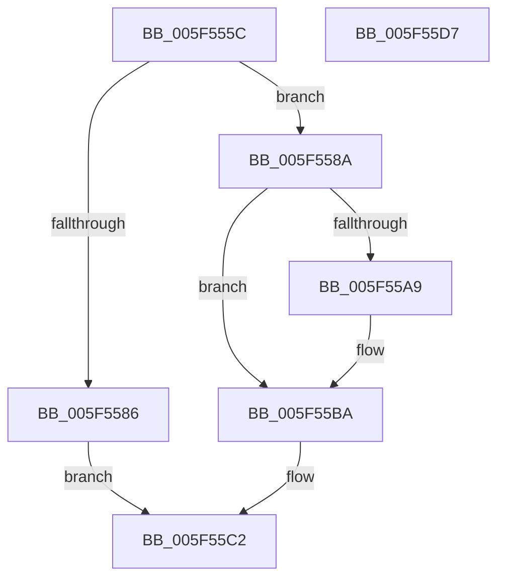

# read_buf

- RVA: `0x005F555C`–`0x005F55D8` (길이 `124` bytes)
- VA: `0x00000001405F555C`
- 실행 섹션: `.text`
- PDB 이름 있음: `예`; PDB Function 태그: `예`
- unwind 정보 RVA: `0x0005C954`
- 디코드: `40`개 명령, `124/124` bytes 표시
- 미해석 바이트: `0` (있으면 어셈블리에 `.byte`로 보존)

> 이 문서는 커널 이미지의 기계어와 PDB 기호를 분석해 생성했습니다. 4번과 5번은 함수 원형과 자료형을 바이너리 사용 방식에서 추정한 C 해석이며 원본 소스 복구 결과는 아닙니다.

## 1. Dependencies

- 직접 호출 지점: **2**; 고유 호출 대상: **2**
- 직접 호출자로 확인된 함수: **2**
- RIP 상대 이미지 참조: **0**

### Outgoing calls
- `0x005F559A` → [memcpy](../6C/memcpy_function_006C6840.md) (function, `0x006C6840`)
- `0x005F55B2` → [adler32_z](../60/adler32_z_function_00600344.md) (function, `0x00600344`)

### Direct callers
- [deflate_stored](deflate_stored_function_005F4A80.md) at `0x005F4C00`
- [deflate_stored](deflate_stored_function_005F4A80.md) at `0x005F4DE4`
- [fill_window](fill_window_function_005F4EF0.md) at `0x005F4F9C`

### Static image references
- 디코드된 RIP-relative 메모리 참조가 없습니다.

## 2. Other-region calls and transfers

- 다른 실행 섹션으로 향하는 call: **0**
- 별도 외부 분기/꼬리 이동을 확인하지 못했습니다.

## 3. Assembly (complete function range)

```asm
005F555C  48 89 5C 24 08                  mov qword ptr [rsp + 8], rbx
005F5561  48 89 6C 24 10                  mov qword ptr [rsp + 0x10], rbp
005F5566  48 89 74 24 18                  mov qword ptr [rsp + 0x18], rsi
005F556B  57                              push rdi
005F556C  48 83 EC 20                     sub rsp, 0x20
005F5570  8B 41 08                        mov eax, dword ptr [rcx + 8]
005F5573  48 8B EA                        mov rbp, rdx
005F5576  41 3B C0                        cmp eax, r8d
005F5579  8B F8                           mov edi, eax
005F557B  48 8B D9                        mov rbx, rcx
005F557E  41 0F 47 F8                     cmova edi, r8d
005F5582  85 FF                           test edi, edi
005F5584  75 04                           jne 0x1405f558a
005F5586  33 C0                           xor eax, eax
005F5588  EB 38                           jmp 0x1405f55c2
005F558A  48 8B 11                        mov rdx, qword ptr [rcx]
005F558D  2B C7                           sub eax, edi
005F558F  89 41 08                        mov dword ptr [rcx + 8], eax
005F5592  48 8B CD                        mov rcx, rbp
005F5595  44 8B C7                        mov r8d, edi
005F5598  8B F7                           mov esi, edi
005F559A  E8 A1 12 0D 00                  call 0x1406c6840
005F559F  48 8B 43 28                     mov rax, qword ptr [rbx + 0x28]
005F55A3  83 78 2C 01                     cmp dword ptr [rax + 0x2c], 1
005F55A7  75 11                           jne 0x1405f55ba
005F55A9  8B 4B 4C                        mov ecx, dword ptr [rbx + 0x4c]
005F55AC  44 8B C6                        mov r8d, esi
005F55AF  48 8B D5                        mov rdx, rbp
005F55B2  E8 8D AD 00 00                  call 0x140600344
005F55B7  89 43 4C                        mov dword ptr [rbx + 0x4c], eax
005F55BA  48 01 33                        add qword ptr [rbx], rsi
005F55BD  8B C7                           mov eax, edi
005F55BF  01 7B 0C                        add dword ptr [rbx + 0xc], edi
005F55C2  48 8B 5C 24 30                  mov rbx, qword ptr [rsp + 0x30]
005F55C7  48 8B 6C 24 38                  mov rbp, qword ptr [rsp + 0x38]
005F55CC  48 8B 74 24 40                  mov rsi, qword ptr [rsp + 0x40]
005F55D1  48 83 C4 20                     add rsp, 0x20
005F55D5  5F                              pop rdi
005F55D6  C3                              ret
005F55D7  CC                              int3
```

## 4. C-style interpretation (structured pseudocode)

```c
__int64 __fastcall read_buf(__int64 a1, __int64 a2, int a3)
{
    __int64 result;
    __int64 v_rdi;
    __int64 v_rsp;
    unsigned __int64 v_stack_p10;
    unsigned __int64 v_stack_p18;
    unsigned __int64 v_stack_p8;

    v_stack_p8 = v_rbx;
    v_stack_p10 = v_rbp;
    v_stack_p18 = v_rsi;
    v_rsp = (v_rsp) - (32);
    v_rdi = (unsigned int)((unsigned int)((unsigned int)(*(unsigned int *)(a1 + 8))));
    if (((unsigned int)((unsigned int)(*(unsigned int *)(a1 + 8)))) > a3) { v_rdi = a3; }
    if ((unsigned int)(v_rdi) != 0) goto loc_005F558A;
    result = 0;
    goto loc_005F55C2;
loc_005F558A:
    result = (unsigned int)((result) - ((unsigned int)(v_rdi)));
    *(unsigned int *)(a1 + 8) = (unsigned int)(result);
    result = memcpy(a2, *(unsigned __int64 *)(a1), (unsigned int)((unsigned int)(v_rdi)), a4);
    result = *(unsigned __int64 *)(a1 + 40);
    if ((*(unsigned int *)(*(unsigned __int64 *)(a1 + 40) + 44)) == 1) {
        a1 = *(unsigned int *)(a1 + 76);
        a3 = (unsigned int)((unsigned int)((unsigned int)(v_rdi)));
        a2 = a2;
        result = adler32_z(a1, a2, a3, a4);
        *(unsigned int *)(a1 + 76) = (unsigned int)(result);
    }
loc_005F55C2:
    v_rsp = (v_rsp) + (32);
    return (unsigned int)((unsigned int)(v_rdi));
}
```

## 5. (Beta) C Style

```c
int64_t read_buf(void *Arg1, int64_t Arg2, int32_t Arg3)
{
    uint8_t *arg1 = (uint8_t *)Arg1;

    int64_t result;
    int64_t local_rdi;
    int64_t local_rsp;
    uint64_t v_stack_p10;
    uint64_t v_stack_p18;
    uint64_t v_stack_p8;

    v_stack_p8 = local_rbx;
    v_stack_p10 = local_rbp;
    v_stack_p18 = local_rsi;
    local_rsp = (local_rsp) - (32);
    local_rdi = (uint32_t)((uint32_t)((uint32_t)(*(uint32_t *)(arg1 + 0x8))));
    if (((uint32_t)((uint32_t)(*(uint32_t *)(arg1 + 0x8)))) > Arg3) { local_rdi = Arg3; }
    if ((uint32_t)(local_rdi) != 0) goto loc_005F558A;
    result = 0;
    goto loc_005F55C2;
loc_005F558A:
    result = (uint32_t)((result) - ((uint32_t)(local_rdi)));
    *(uint32_t *)(arg1 + 0x8) = (uint32_t)(result);
    result = memcpy(Arg2, *(uint64_t *)(arg1), (uint32_t)((uint32_t)(local_rdi)), a4);
    result = *(uint64_t *)(arg1 + 0x28);
    if ((*(uint32_t *)(*(uint64_t *)(arg1 + 0x28) + 0x2C)) == 1) {
        Arg1 = *(uint32_t *)(arg1 + 0x4C);
        Arg3 = (uint32_t)((uint32_t)((uint32_t)(local_rdi)));
        Arg2 = Arg2;
        result = adler32_z(Arg1, Arg2, Arg3, a4);
        *(uint32_t *)(arg1 + 0x4C) = (uint32_t)(result);
    }
loc_005F55C2:
    local_rsp = (local_rsp) + (32);
    return (uint32_t)((uint32_t)(local_rdi));
}
```

### 관측된 메모리 오프셋

구조체 형식이 확인되지 않은 접근은 인자 기준의 오프셋으로만 기록했습니다.

| 기준 인자 | 오프셋 표현 | 폭 (bit) | 접근 |
|---|---:|---:|---|
| `Arg1` | `+ 0x0` | `64` | `R` |
| `Arg1` | `+ 0x0` | `64` | `R/W` |
| `Arg1` | `+ 0x8` | `32` | `R` |
| `Arg1` | `+ 0x8` | `32` | `W` |
| `Arg1` | `+ 0xC` | `32` | `R/W` |
| `Arg1` | `+ 0x28` | `64` | `R` |
| `Arg1` | `+ 0x4C` | `32` | `R` |
| `Arg1` | `+ 0x4C` | `32` | `W` |

## 6. Execution-region graph

[열기: 2D/3D 그래프와 함수 탐색 컨트롤 패널](../../../control-panel.html?section=text&rva=0x005F555C&view=graph)

- 2D 그래프는 위에서 아래로 흐르고, 3D 그래프는 빈 공간을 드래그해 회전합니다. Shift+드래그는 이동, 휠은 확대·축소, 함수 노드 선택은 대상 보고서 이동입니다.

### Static fallback


