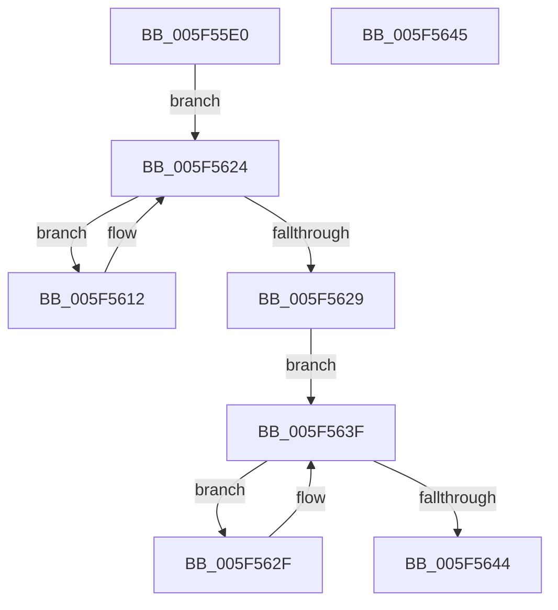

# slide_hash

- RVA: `0x005F55E0`–`0x005F5646` (길이 `102` bytes)
- VA: `0x00000001405F55E0`
- 실행 섹션: `.text`
- PDB 이름 있음: `예`; PDB Function 태그: `예`
- unwind 정보 RVA: `0x000DB714`
- 디코드: `26`개 명령, `102/102` bytes 표시
- 미해석 바이트: `0` (있으면 어셈블리에 `.byte`로 보존)

> 이 문서는 커널 이미지의 기계어와 PDB 기호를 분석해 생성했습니다. 4번과 5번은 함수 원형과 자료형을 바이너리 사용 방식에서 추정한 C 해석이며 원본 소스 복구 결과는 아닙니다.

## 1. Dependencies

- 직접 호출 지점: **0**; 고유 호출 대상: **0**
- 직접 호출자로 확인된 함수: **1**
- RIP 상대 이미지 참조: **0**

### Outgoing calls
- 직접 디코드된 call 명령이 없습니다.

### Direct callers
- [fill_window](fill_window_function_005F4EF0.md) at `0x005F4F6F`

### Static image references
- 디코드된 RIP-relative 메모리 참조가 없습니다.

## 2. Other-region calls and transfers

- 다른 실행 섹션으로 향하는 call: **0**
- 별도 외부 분기/꼬리 이동을 확인하지 못했습니다.

## 3. Assembly (complete function range)

```asm
005F55E0  44 8B 89 94 00 00 00            mov r9d, dword ptr [rcx + 0x94]
005F55E7  4C 8B 81 B8 00 00 00            mov r8, qword ptr [rcx + 0xb8]
005F55EE  48 8B 91 B0 00 00 00            mov rdx, qword ptr [rcx + 0xb0]
005F55F5  41 0F BF C1                     movsx eax, r9w
005F55F9  66 0F 6E C8                     movd xmm1, eax
005F55FD  8B 81 C4 00 00 00               mov eax, dword ptr [rcx + 0xc4]
005F5603  66 0F 61 C9                     punpcklwd xmm1, xmm1
005F5607  66 0F 70 C9 00                  pshufd xmm1, xmm1, 0
005F560C  49 8D 0C 40                     lea rcx, [r8 + rax*2]
005F5610  EB 12                           jmp 0x1405f5624
005F5612  F3 41 0F 6F 00                  movdqu xmm0, xmmword ptr [r8]
005F5617  66 0F D9 C1                     psubusw xmm0, xmm1
005F561B  F3 41 0F 7F 00                  movdqu xmmword ptr [r8], xmm0
005F5620  49 83 C0 10                     add r8, 0x10
005F5624  4C 3B C1                        cmp r8, rcx
005F5627  75 E9                           jne 0x1405f5612
005F5629  4A 8D 0C 4A                     lea rcx, [rdx + r9*2]
005F562D  EB 10                           jmp 0x1405f563f
005F562F  F3 0F 6F 02                     movdqu xmm0, xmmword ptr [rdx]
005F5633  66 0F D9 C1                     psubusw xmm0, xmm1
005F5637  F3 0F 7F 02                     movdqu xmmword ptr [rdx], xmm0
005F563B  48 83 C2 10                     add rdx, 0x10
005F563F  48 3B D1                        cmp rdx, rcx
005F5642  75 EB                           jne 0x1405f562f
005F5644  C3                              ret
005F5645  CC                              int3
```

## 4. C-style interpretation (structured pseudocode)

```c
__int64 __fastcall slide_hash(__int64 a1)
{
    goto loc_005F5624;
loc_005F5612:
    *(unsigned __int64 *)(*(unsigned __int64 *)(a1 + 184)) = v_xmm0;
    a3 = (*(unsigned __int64 *)(a1 + 184)) + (16);
loc_005F5624:
    if (a3 != (*(unsigned __int64 *)(a1 + 184) + (unsigned int)(*(unsigned int *)(a1 + 196)) * 2)) goto loc_005F5612;
    goto loc_005F563F;
loc_005F562F:
    *(unsigned __int64 *)(*(unsigned __int64 *)(a1 + 176)) = v_xmm0;
    a2 = (*(unsigned __int64 *)(a1 + 176)) + (16);
loc_005F563F:
    if (a2 != (*(unsigned __int64 *)(a1 + 176) + (unsigned int)(*(unsigned int *)(a1 + 148)) * 2)) goto loc_005F562F;
    return (unsigned int)(*(unsigned int *)(a1 + 196));
}
```

## 5. (Beta) C Style

```c
int64_t slide_hash(void *Arg1)
{
    uint8_t *arg1 = (uint8_t *)Arg1;

    goto loc_005F5624;
loc_005F5612:
    *(uint64_t *)(*(uint64_t *)(arg1 + 0xB8)) = v_xmm0;
    a3 = (*(uint64_t *)(arg1 + 0xB8)) + (16);
loc_005F5624:
    if (a3 != (*(uint64_t *)(arg1 + 0xB8) + (uint32_t)(*(uint32_t *)(arg1 + 0xC4)) * 2)) goto loc_005F5612;
    goto loc_005F563F;
loc_005F562F:
    *(uint64_t *)(*(uint64_t *)(arg1 + 0xB0)) = v_xmm0;
    a2 = (*(uint64_t *)(arg1 + 0xB0)) + (16);
loc_005F563F:
    if (a2 != (*(uint64_t *)(arg1 + 0xB0) + (uint32_t)(*(uint32_t *)(arg1 + 0x94)) * 2)) goto loc_005F562F;
    return (uint32_t)(*(uint32_t *)(arg1 + 0xC4));
}
```

### 관측된 메모리 오프셋

구조체 형식이 확인되지 않은 접근은 인자 기준의 오프셋으로만 기록했습니다.

| 기준 인자 | 오프셋 표현 | 폭 (bit) | 접근 |
|---|---:|---:|---|
| `Arg1` | `+ 0x94` | `32` | `R` |
| `Arg1` | `+ 0xB0` | `64` | `R` |
| `Arg1` | `+ 0xB8` | `64` | `R` |
| `Arg1` | `+ 0xC4` | `32` | `R` |

## 6. Execution-region graph

[열기: 2D/3D 그래프와 함수 탐색 컨트롤 패널](../../../control-panel.html?section=text&rva=0x005F55E0&view=graph)

- 2D 그래프는 위에서 아래로 흐르고, 3D 그래프는 빈 공간을 드래그해 회전합니다. Shift+드래그는 이동, 휠은 확대·축소, 함수 노드 선택은 대상 보고서 이동입니다.

### Static fallback


