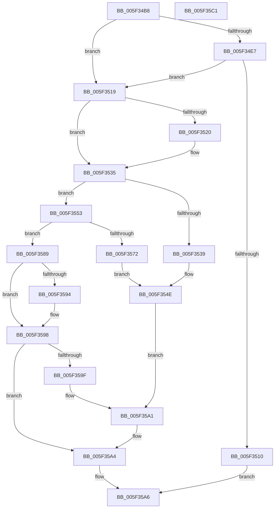

# updatewindow

- RVA: `0x005F34B8`–`0x005F35C2` (길이 `266` bytes)
- VA: `0x00000001405F34B8`
- 실행 섹션: `.text`
- PDB 이름 있음: `예`; PDB Function 태그: `예`
- unwind 정보 RVA: `0x0005E6B4`
- 디코드: `84`개 명령, `266/266` bytes 표시
- 미해석 바이트: `0` (있으면 어셈블리에 `.byte`로 보존)

> 이 문서는 커널 이미지의 기계어와 PDB 기호를 분석해 생성했습니다. 4번과 5번은 함수 원형과 자료형을 바이너리 사용 방식에서 추정한 C 해석이며 원본 소스 복구 결과는 아닙니다.

## 1. Dependencies

- 직접 호출 지점: **4**; 고유 호출 대상: **2**
- 직접 호출자로 확인된 함수: **1**
- RIP 상대 이미지 참조: **0**

### Outgoing calls
- `0x005F34FF` → [guard_dispatch_icall](../6B/guard_dispatch_icall_function_006BAAD0.md) (function, `0x006BAAD0`)
- `0x005F3545` → [memcpy](../6C/memcpy_function_006C6840.md) (function, `0x006C6840`)
- `0x005F3569` → [memcpy](../6C/memcpy_function_006C6840.md) (function, `0x006C6840`)
- `0x005F357F` → [memcpy](../6C/memcpy_function_006C6840.md) (function, `0x006C6840`)

### Direct callers
- [inflate](inflate_function_005F2280.md) at `0x005F327C`

### Static image references
- 디코드된 RIP-relative 메모리 참조가 없습니다.

## 2. Other-region calls and transfers

- 다른 실행 섹션으로 향하는 call: **0**
- 별도 외부 분기/꼬리 이동을 확인하지 못했습니다.

## 3. Assembly (complete function range)

```asm
005F34B8  48 8B C4                        mov rax, rsp
005F34BB  48 89 58 08                     mov qword ptr [rax + 8], rbx
005F34BF  48 89 68 10                     mov qword ptr [rax + 0x10], rbp
005F34C3  48 89 70 18                     mov qword ptr [rax + 0x18], rsi
005F34C7  48 89 78 20                     mov qword ptr [rax + 0x20], rdi
005F34CB  41 56                           push r14
005F34CD  48 83 EC 20                     sub rsp, 0x20
005F34D1  48 8B 59 28                     mov rbx, qword ptr [rcx + 0x28]
005F34D5  48 8B F2                        mov rsi, rdx
005F34D8  41 8B E8                        mov ebp, r8d
005F34DB  4C 8B D1                        mov r10, rcx
005F34DE  4C 8B 4B 40                     mov r9, qword ptr [rbx + 0x40]
005F34E2  4D 85 C9                        test r9, r9
005F34E5  75 32                           jne 0x1405f3519
005F34E7  8B 4B 30                        mov ecx, dword ptr [rbx + 0x30]
005F34EA  41 8D 51 01                     lea edx, [r9 + 1]
005F34EE  49 8B 42 30                     mov rax, qword ptr [r10 + 0x30]
005F34F2  45 8D 41 01                     lea r8d, [r9 + 1]
005F34F6  D3 E2                           shl edx, cl
005F34F8  49 8B 4A 40                     mov rcx, qword ptr [r10 + 0x40]
005F34FC  83 C2 10                        add edx, 0x10
005F34FF  E8 CC 75 0C 00                  call 0x1406baad0
005F3504  48 89 43 40                     mov qword ptr [rbx + 0x40], rax
005F3508  4C 8B C8                        mov r9, rax
005F350B  48 85 C0                        test rax, rax
005F350E  75 09                           jne 0x1405f3519
005F3510  41 8D 41 01                     lea eax, [r9 + 1]
005F3514  E9 8D 00 00 00                  jmp 0x1405f35a6
005F3519  8B 7B 34                        mov edi, dword ptr [rbx + 0x34]
005F351C  85 FF                           test edi, edi
005F351E  75 15                           jne 0x1405f3535
005F3520  8B 4B 30                        mov ecx, dword ptr [rbx + 0x30]
005F3523  BF 01 00 00 00                  mov edi, 1
005F3528  83 63 3C 00                     and dword ptr [rbx + 0x3c], 0
005F352C  D3 E7                           shl edi, cl
005F352E  83 63 38 00                     and dword ptr [rbx + 0x38], 0
005F3532  89 7B 34                        mov dword ptr [rbx + 0x34], edi
005F3535  3B EF                           cmp ebp, edi
005F3537  72 1A                           jb 0x1405f3553
005F3539  44 8B C7                        mov r8d, edi
005F353C  49 8B C9                        mov rcx, r9
005F353F  49 2B F0                        sub rsi, r8
005F3542  48 8B D6                        mov rdx, rsi
005F3545  E8 F6 32 0D 00                  call 0x1406c6840
005F354A  83 63 3C 00                     and dword ptr [rbx + 0x3c], 0
005F354E  8B 43 34                        mov eax, dword ptr [rbx + 0x34]
005F3551  EB 4E                           jmp 0x1405f35a1
005F3553  8B 4B 3C                        mov ecx, dword ptr [rbx + 0x3c]
005F3556  48 8B D6                        mov rdx, rsi
005F3559  2B F9                           sub edi, ecx
005F355B  3B FD                           cmp edi, ebp
005F355D  0F 47 FD                        cmova edi, ebp
005F3560  48 2B D5                        sub rdx, rbp
005F3563  44 8B C7                        mov r8d, edi
005F3566  49 03 C9                        add rcx, r9
005F3569  E8 D2 32 0D 00                  call 0x1406c6840
005F356E  2B EF                           sub ebp, edi
005F3570  74 17                           je 0x1405f3589
005F3572  48 8B 4B 40                     mov rcx, qword ptr [rbx + 0x40]
005F3576  44 8B C5                        mov r8d, ebp
005F3579  49 2B F0                        sub rsi, r8
005F357C  48 8B D6                        mov rdx, rsi
005F357F  E8 BC 32 0D 00                  call 0x1406c6840
005F3584  89 6B 3C                        mov dword ptr [rbx + 0x3c], ebp
005F3587  EB C5                           jmp 0x1405f354e
005F3589  01 7B 3C                        add dword ptr [rbx + 0x3c], edi
005F358C  8B 4B 34                        mov ecx, dword ptr [rbx + 0x34]
005F358F  39 4B 3C                        cmp dword ptr [rbx + 0x3c], ecx
005F3592  75 04                           jne 0x1405f3598
005F3594  83 63 3C 00                     and dword ptr [rbx + 0x3c], 0
005F3598  8B 43 38                        mov eax, dword ptr [rbx + 0x38]
005F359B  3B C1                           cmp eax, ecx
005F359D  73 05                           jae 0x1405f35a4
005F359F  03 C7                           add eax, edi
005F35A1  89 43 38                        mov dword ptr [rbx + 0x38], eax
005F35A4  33 C0                           xor eax, eax
005F35A6  48 8B 5C 24 30                  mov rbx, qword ptr [rsp + 0x30]
005F35AB  48 8B 6C 24 38                  mov rbp, qword ptr [rsp + 0x38]
005F35B0  48 8B 74 24 40                  mov rsi, qword ptr [rsp + 0x40]
005F35B5  48 8B 7C 24 48                  mov rdi, qword ptr [rsp + 0x48]
005F35BA  48 83 C4 20                     add rsp, 0x20
005F35BE  41 5E                           pop r14
005F35C0  C3                              ret
005F35C1  CC                              int3
```

## 4. C-style interpretation (structured pseudocode)

```c
__int64 __fastcall updatewindow(__int64 a1, __int64 a2, int a3)
{
    __int64 result;
    __int64 v_rbp;
    __int64 v_rdi;
    __int64 v_rsi;
    __int64 v_rsp;
    unsigned __int64 v_stack_p10;
    unsigned __int64 v_stack_p18;
    unsigned __int64 v_stack_p20;
    unsigned __int64 v_stack_p8;

    *(unsigned __int64 *)(v_rsp + 8) = v_rbx;
    *(unsigned __int64 *)(v_rsp + 16) = v_rbp;
    *(unsigned __int64 *)(v_rsp + 24) = v_rsi;
    *(unsigned __int64 *)(v_rsp + 32) = v_rdi;
    v_rsp = (v_rsp) - (32);
    if (*(unsigned __int64 *)(*(unsigned __int64 *)(a1 + 40) + 64) != 0) goto loc_005F3519;
    a2 = (unsigned int)((*(unsigned __int64 *)(*(unsigned __int64 *)(a1 + 40) + 64) + 1) << ((unsigned __int8)((unsigned int)(*(unsigned int *)(*(unsigned __int64 *)(a1 + 40) + 48)))));
    a2 = (unsigned int)((a2) + (16));
    result = guard_dispatch_icall(*(unsigned __int64 *)(a1 + 64), a2, *(unsigned __int64 *)(*(unsigned __int64 *)(a1 + 40) + 64) + 1, *(unsigned __int64 *)(*(unsigned __int64 *)(a1 + 40) + 64));
    *(unsigned __int64 *)(*(unsigned __int64 *)(a1 + 40) + 64) = result;
    if (result != 0) goto loc_005F3519;
    goto loc_005F35A6;
loc_005F3519:
    v_rdi = (unsigned int)(*(unsigned int *)(*(unsigned __int64 *)(a1 + 40) + 52));
    if ((unsigned int)((unsigned int)(*(unsigned int *)(*(unsigned __int64 *)(a1 + 40) + 52))) == 0) {
        a1 = *(unsigned int *)(*(unsigned __int64 *)(a1 + 40) + 48);
        v_rdi = 1;
        v_rdi = (unsigned int)((v_rdi) << ((unsigned __int8)(a1)));
        *(unsigned int *)(*(unsigned __int64 *)(a1 + 40) + 52) = (unsigned int)(v_rdi);
    }
    if (((unsigned int)((unsigned int)(a3))) < ((unsigned int)(v_rdi))) goto loc_005F3553;
    v_rsi = (a2) - ((unsigned int)((unsigned int)(v_rdi)));
    result = memcpy(result, v_rsi, (unsigned int)((unsigned int)(v_rdi)), result);
loc_005F354E:
    goto loc_005F35A1;
loc_005F3553:
    v_rdi = (unsigned int)((v_rdi) - ((unsigned int)((unsigned int)(*(unsigned int *)(*(unsigned __int64 *)(a1 + 40) + 60)))));
    if (((unsigned int)(v_rdi)) > ((unsigned int)((unsigned int)(a3)))) { v_rdi = (unsigned int)((unsigned int)(a3)); }
    a2 = (v_rsi) - ((unsigned int)(a3));
    a1 = ((unsigned int)(*(unsigned int *)(*(unsigned __int64 *)(a1 + 40) + 60))) + (result);
    result = memcpy(a1, a2, (unsigned int)((unsigned int)(v_rdi)), result);
    v_rbp = (unsigned int)(((unsigned int)(a3)) - ((unsigned int)(v_rdi)));
    if (condition_is_equal) goto loc_005F3589;
    v_rsi = (v_rsi) - ((unsigned int)((unsigned int)(v_rbp)));
    result = memcpy(*(unsigned __int64 *)(*(unsigned __int64 *)(a1 + 40) + 64), v_rsi, (unsigned int)((unsigned int)(v_rbp)), result);
    *(unsigned int *)(*(unsigned __int64 *)(a1 + 40) + 60) = (unsigned int)(v_rbp);
    goto loc_005F354E;
loc_005F3589:
    if ((*(unsigned int *)(*(unsigned __int64 *)(a1 + 40) + 60)) == ((unsigned int)((unsigned int)(*(unsigned int *)(*(unsigned __int64 *)(a1 + 40) + 52))))) {
    }
    if (((unsigned int)((unsigned int)(*(unsigned int *)(*(unsigned __int64 *)(a1 + 40) + 56)))) >= ((unsigned int)((unsigned int)(*(unsigned int *)(*(unsigned __int64 *)(a1 + 40) + 52))))) goto loc_005F35A4;
    result = (unsigned int)(((unsigned int)(*(unsigned int *)(*(unsigned __int64 *)(a1 + 40) + 56))) + ((unsigned int)(v_rdi)));
loc_005F35A1:
    *(unsigned int *)(*(unsigned __int64 *)(a1 + 40) + 56) = (unsigned int)(result);
loc_005F35A4:
    result = 0;
loc_005F35A6:
    v_rsp = (v_rsp) + (32);
    return result;
}
```

## 5. (Beta) C Style

```c
int64_t updatewindow(void *Arg1, int64_t Arg2, int32_t Arg3)
{
    uint8_t *arg1 = (uint8_t *)Arg1;

    int64_t result;
    int64_t local_rbp;
    int64_t local_rdi;
    int64_t local_rsi;
    int64_t local_rsp;
    uint64_t v_stack_p10;
    uint64_t v_stack_p18;
    uint64_t v_stack_p20;
    uint64_t v_stack_p8;

    *(uint64_t *)(local_rsp + 0x8) = local_rbx;
    *(uint64_t *)(local_rsp + 0x10) = local_rbp;
    *(uint64_t *)(local_rsp + 0x18) = local_rsi;
    *(uint64_t *)(local_rsp + 0x20) = local_rdi;
    local_rsp = (local_rsp) - (32);
    if (*(uint64_t *)(*(uint64_t *)(arg1 + 0x28) + 0x40) != 0) goto loc_005F3519;
    Arg2 = (uint32_t)((*(uint64_t *)(*(uint64_t *)(arg1 + 0x28) + 0x40) + 1) << ((uint8_t)((uint32_t)(*(uint32_t *)(*(uint64_t *)(arg1 + 0x28) + 0x30)))));
    Arg2 = (uint32_t)((Arg2) + (16));
    result = guard_dispatch_icall(*(uint64_t *)(arg1 + 0x40), Arg2, *(uint64_t *)(*(uint64_t *)(arg1 + 0x28) + 0x40) + 1, *(uint64_t *)(*(uint64_t *)(arg1 + 0x28) + 0x40));
    *(uint64_t *)(*(uint64_t *)(arg1 + 0x28) + 0x40) = result;
    if (result != 0) goto loc_005F3519;
    goto loc_005F35A6;
loc_005F3519:
    local_rdi = (uint32_t)(*(uint32_t *)(*(uint64_t *)(arg1 + 0x28) + 0x34));
    if ((uint32_t)((uint32_t)(*(uint32_t *)(*(uint64_t *)(arg1 + 0x28) + 0x34))) == 0) {
        Arg1 = *(uint32_t *)(*(uint64_t *)(arg1 + 0x28) + 0x30);
        local_rdi = 1;
        local_rdi = (uint32_t)((local_rdi) << ((uint8_t)(Arg1)));
        *(uint32_t *)(*(uint64_t *)(arg1 + 0x28) + 0x34) = (uint32_t)(local_rdi);
    }
    if (((uint32_t)((uint32_t)(Arg3))) < ((uint32_t)(local_rdi))) goto loc_005F3553;
    local_rsi = (Arg2) - ((uint32_t)((uint32_t)(local_rdi)));
    result = memcpy(result, local_rsi, (uint32_t)((uint32_t)(local_rdi)), result);
loc_005F354E:
    goto loc_005F35A1;
loc_005F3553:
    local_rdi = (uint32_t)((local_rdi) - ((uint32_t)((uint32_t)(*(uint32_t *)(*(uint64_t *)(arg1 + 0x28) + 0x3C)))));
    if (((uint32_t)(local_rdi)) > ((uint32_t)((uint32_t)(Arg3)))) { local_rdi = (uint32_t)((uint32_t)(Arg3)); }
    Arg2 = (local_rsi) - ((uint32_t)(Arg3));
    Arg1 = ((uint32_t)(*(uint32_t *)(*(uint64_t *)(arg1 + 0x28) + 0x3C))) + (result);
    result = memcpy(Arg1, Arg2, (uint32_t)((uint32_t)(local_rdi)), result);
    local_rbp = (uint32_t)(((uint32_t)(Arg3)) - ((uint32_t)(local_rdi)));
    if (condition_is_equal) goto loc_005F3589;
    local_rsi = (local_rsi) - ((uint32_t)((uint32_t)(local_rbp)));
    result = memcpy(*(uint64_t *)(*(uint64_t *)(arg1 + 0x28) + 0x40), local_rsi, (uint32_t)((uint32_t)(local_rbp)), result);
    *(uint32_t *)(*(uint64_t *)(arg1 + 0x28) + 0x3C) = (uint32_t)(local_rbp);
    goto loc_005F354E;
loc_005F3589:
    if ((*(uint32_t *)(*(uint64_t *)(arg1 + 0x28) + 0x3C)) == ((uint32_t)((uint32_t)(*(uint32_t *)(*(uint64_t *)(arg1 + 0x28) + 0x34))))) {
    }
    if (((uint32_t)((uint32_t)(*(uint32_t *)(*(uint64_t *)(arg1 + 0x28) + 0x38)))) >= ((uint32_t)((uint32_t)(*(uint32_t *)(*(uint64_t *)(arg1 + 0x28) + 0x34))))) goto loc_005F35A4;
    result = (uint32_t)(((uint32_t)(*(uint32_t *)(*(uint64_t *)(arg1 + 0x28) + 0x38))) + ((uint32_t)(local_rdi)));
loc_005F35A1:
    *(uint32_t *)(*(uint64_t *)(arg1 + 0x28) + 0x38) = (uint32_t)(result);
loc_005F35A4:
    result = 0;
loc_005F35A6:
    local_rsp = (local_rsp) + (32);
    return result;
}
```

### 관측된 메모리 오프셋

구조체 형식이 확인되지 않은 접근은 인자 기준의 오프셋으로만 기록했습니다.

| 기준 인자 | 오프셋 표현 | 폭 (bit) | 접근 |
|---|---:|---:|---|
| `Arg1` | `+ 0x28` | `64` | `R` |
| `Arg1` | `+ 0x30` | `64` | `R` |
| `Arg1` | `+ 0x40` | `64` | `R` |

## 6. Execution-region graph

[열기: 2D/3D 그래프와 함수 탐색 컨트롤 패널](../../../control-panel.html?section=text&rva=0x005F34B8&view=graph)

- 2D 그래프는 위에서 아래로 흐르고, 3D 그래프는 빈 공간을 드래그해 회전합니다. Shift+드래그는 이동, 휠은 확대·축소, 함수 노드 선택은 대상 보고서 이동입니다.

### Static fallback


