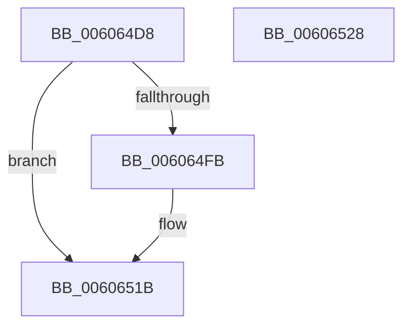

# BCryptCloseAlgorithmProvider

- RVA: `0x006064D8`–`0x00606529` (길이 `81` bytes)
- VA: `0x00000001406064D8`
- 실행 섹션: `.text`
- PDB 이름 있음: `예`; PDB Function 태그: `아니요`
- unwind 정보 RVA: `0x0005CAAC`
- 디코드: `23`개 명령, `81/81` bytes 표시
- 미해석 바이트: `0` (있으면 어셈블리에 `.byte`로 보존)

> 이 문서는 커널 이미지의 기계어와 PDB 기호를 분석해 생성했습니다. 4번과 5번은 함수 원형과 자료형을 바이너리 사용 방식에서 추정한 C 해석이며 원본 소스 복구 결과는 아닙니다.

## 1. Dependencies

- 직접 호출 지점: **3**; 고유 호출 대상: **3**
- 직접 호출자로 확인된 함수: **5**
- RIP 상대 이미지 참조: **1**

### Outgoing calls
- `0x006064F1` → [ExGetExtensionTable](../42/ExGetExtensionTable_function_00428814.md) (function, `0x00428814`)
- `0x00606504` → [guard_dispatch_icall](../6B/guard_dispatch_icall_function_006BAAD0.md) (function, `0x006BAAD0`)
- `0x00606516` → [ExReleaseRundownProtection](../34/ExReleaseRundownProtection_function_00349E80.md) (function, `0x00349E80`)

### Direct callers
- [SecureDump_EncryptSymmetricKeyWithPublicKey](../5A/SecureDump_EncryptSymmetricKeyWithPublicKey_function_005A27A4.md) at `0x005A29CA`
- [SecureDump_Init](../5A/SecureDump_Init_function_005A2CC4.md) at `0x005A2D74`
- [SecureDump_ReInitialize](../5A/SecureDump_ReInitialize_function_005A348C.md) at `0x005A34EF`
- [SecureDump_ReInitialize](../5A/SecureDump_ReInitialize_function_005A348C.md) at `0x005A35C9`
- [SmCrEncCleanup](../../page/A9/SmCrEncCleanup_function_00A90A64.md) at `0x00A90ABC`
- [RtlGenerateClass5Guid](../../page/AC/RtlGenerateClass5Guid_function_00AC4510.md) at `0x00AC46E5`

### Static image references
- `0x006064EA` → RVA `0x00F04E30` (`.data`; read)

## 2. Other-region calls and transfers

- 다른 실행 섹션으로 향하는 call: **0**
- 별도 외부 분기/꼬리 이동을 확인하지 못했습니다.

## 3. Assembly (complete function range)

```asm
006064D8  48 89 5C 24 08                  mov qword ptr [rsp + 8], rbx
006064DD  57                              push rdi
006064DE  48 83 EC 20                     sub rsp, 0x20
006064E2  48 8B F9                        mov rdi, rcx
006064E5  BB 02 00 00 C0                  mov ebx, 0xc0000002
006064EA  48 8B 0D 3F E9 8F 00            mov rcx, qword ptr [rip + 0x8fe93f]
006064F1  E8 1E 23 E2 FF                  call 0x140428814
006064F6  48 85 C0                        test rax, rax
006064F9  74 20                           je 0x14060651b
006064FB  48 8B 40 20                     mov rax, qword ptr [rax + 0x20]
006064FF  33 D2                           xor edx, edx
00606501  48 8B CF                        mov rcx, rdi
00606504  E8 C7 45 0B 00                  call 0x1406baad0
00606509  48 8B 0D 20 E9 8F 00            mov rcx, qword ptr [rip + 0x8fe920]
00606510  8B D8                           mov ebx, eax
00606512  48 83 C1 58                     add rcx, 0x58
00606516  E8 65 39 D4 FF                  call 0x140349e80
0060651B  8B C3                           mov eax, ebx
0060651D  48 8B 5C 24 30                  mov rbx, qword ptr [rsp + 0x30]
00606522  48 83 C4 20                     add rsp, 0x20
00606526  5F                              pop rdi
00606527  C3                              ret
00606528  CC                              int3
```

## 4. C-style interpretation (structured pseudocode)

```c
__int64 __fastcall BCryptCloseAlgorithmProvider(__int64 a1, int a2)
{
    __int64 result;
    __int64 v_rbx;
    __int64 v_rsp;
    unsigned __int64 v_stack_p8;

    v_stack_p8 = v_rbx;
    v_rsp = (v_rsp) - (32);
    result = ExGetExtensionTable(*(unsigned __int64 *)(v_rip + 9431359), a2, a3, a4);
    v_rbx = (unsigned int)(0xC0000002ULL);
    if (result != 0) {
        result = *(unsigned __int64 *)(result + 32);
        a2 = 0;
        a1 = a1;
        result = guard_dispatch_icall(a1, a2, a3, a4);
        a1 = *(unsigned __int64 *)(v_rip + 9431328);
        v_rbx = (unsigned int)(result);
        a1 = (a1) + (88);
        result = ExReleaseRundownProtection(a1, a2, a3, a4);
    }
    v_rsp = (v_rsp) + (32);
    return (unsigned int)((unsigned int)(v_rbx));
}
```

## 5. (Beta) C Style

```c
int64_t BCryptCloseAlgorithmProvider(int64_t Arg1, int32_t Arg2)
{
    int64_t result;
    int64_t local_rbx;
    int64_t local_rsp;
    uint64_t v_stack_p8;

    v_stack_p8 = local_rbx;
    local_rsp = (local_rsp) - (32);
    result = ExGetExtensionTable(*(uint64_t *)(v_rip + 0x8FE93F), Arg2, a3, a4);
    local_rbx = (uint32_t)(0xC0000002ULL);
    if (result != 0) {
        result = *(uint64_t *)(result + 0x20);
        Arg2 = 0;
        Arg1 = Arg1;
        result = guard_dispatch_icall(Arg1, Arg2, a3, a4);
        Arg1 = *(uint64_t *)(v_rip + 0x8FE920);
        local_rbx = (uint32_t)(result);
        Arg1 = (Arg1) + (88);
        result = ExReleaseRundownProtection(Arg1, Arg2, a3, a4);
    }
    local_rsp = (local_rsp) + (32);
    return (uint32_t)((uint32_t)(local_rbx));
}
```

## 6. Execution-region graph

[열기: 2D/3D 그래프와 함수 탐색 컨트롤 패널](../../../control-panel.html?section=text&rva=0x006064D8&view=graph)

- 2D 그래프는 위에서 아래로 흐르고, 3D 그래프는 빈 공간을 드래그해 회전합니다. Shift+드래그는 이동, 휠은 확대·축소, 함수 노드 선택은 대상 보고서 이동입니다.

### Static fallback


