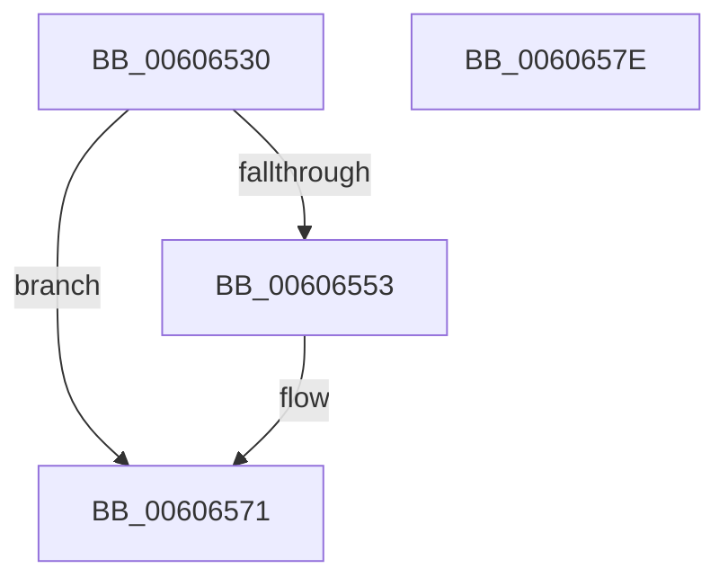

# BCryptDestroyKey

- RVA: `0x00606530`–`0x0060657F` (길이 `79` bytes)
- VA: `0x0000000140606530`
- 실행 섹션: `.text`
- PDB 이름 있음: `예`; PDB Function 태그: `아니요`
- unwind 정보 RVA: `0x0005CAAC`
- 디코드: `22`개 명령, `79/79` bytes 표시
- 미해석 바이트: `0` (있으면 어셈블리에 `.byte`로 보존)

> 이 문서는 커널 이미지의 기계어와 PDB 기호를 분석해 생성했습니다. 4번과 5번은 함수 원형과 자료형을 바이너리 사용 방식에서 추정한 C 해석이며 원본 소스 복구 결과는 아닙니다.

## 1. Dependencies

- 직접 호출 지점: **3**; 고유 호출 대상: **3**
- 직접 호출자로 확인된 함수: **4**
- RIP 상대 이미지 참조: **1**

### Outgoing calls
- `0x00606549` → [ExGetExtensionTable](../42/ExGetExtensionTable_function_00428814.md) (function, `0x00428814`)
- `0x0060655A` → [guard_dispatch_icall](../6B/guard_dispatch_icall_function_006BAAD0.md) (function, `0x006BAAD0`)
- `0x0060656C` → [ExReleaseRundownProtection](../34/ExReleaseRundownProtection_function_00349E80.md) (function, `0x00349E80`)

### Direct callers
- [SecureDump_EncryptSymmetricKeyWithPublicKey](../5A/SecureDump_EncryptSymmetricKeyWithPublicKey_function_005A27A4.md) at `0x005A29D8`
- [SecureDump_Init](../5A/SecureDump_Init_function_005A2CC4.md) at `0x005A2D8D`
- [SecureDump_ReInitialize](../5A/SecureDump_ReInitialize_function_005A348C.md) at `0x005A3507`
- [SecureDump_ReInitialize](../5A/SecureDump_ReInitialize_function_005A348C.md) at `0x005A35E1`
- [SmCrEncCleanup](../../page/A9/SmCrEncCleanup_function_00A90A64.md) at `0x00A90AA7`

### Static image references
- `0x00606542` → RVA `0x00F04E30` (`.data`; read)

## 2. Other-region calls and transfers

- 다른 실행 섹션으로 향하는 call: **0**
- 별도 외부 분기/꼬리 이동을 확인하지 못했습니다.

## 3. Assembly (complete function range)

```asm
00606530  48 89 5C 24 08                  mov qword ptr [rsp + 8], rbx
00606535  57                              push rdi
00606536  48 83 EC 20                     sub rsp, 0x20
0060653A  48 8B F9                        mov rdi, rcx
0060653D  BB 02 00 00 C0                  mov ebx, 0xc0000002
00606542  48 8B 0D E7 E8 8F 00            mov rcx, qword ptr [rip + 0x8fe8e7]
00606549  E8 C6 22 E2 FF                  call 0x140428814
0060654E  48 85 C0                        test rax, rax
00606551  74 1E                           je 0x140606571
00606553  48 8B 40 40                     mov rax, qword ptr [rax + 0x40]
00606557  48 8B CF                        mov rcx, rdi
0060655A  E8 71 45 0B 00                  call 0x1406baad0
0060655F  48 8B 0D CA E8 8F 00            mov rcx, qword ptr [rip + 0x8fe8ca]
00606566  8B D8                           mov ebx, eax
00606568  48 83 C1 58                     add rcx, 0x58
0060656C  E8 0F 39 D4 FF                  call 0x140349e80
00606571  8B C3                           mov eax, ebx
00606573  48 8B 5C 24 30                  mov rbx, qword ptr [rsp + 0x30]
00606578  48 83 C4 20                     add rsp, 0x20
0060657C  5F                              pop rdi
0060657D  C3                              ret
0060657E  CC                              int3
```

## 4. C-style interpretation (structured pseudocode)

```c
__int64 __fastcall BCryptDestroyKey(__int64 a1)
{
    __int64 result;
    __int64 v_rbx;
    __int64 v_rsp;
    unsigned __int64 v_stack_p8;

    v_stack_p8 = v_rbx;
    v_rsp = (v_rsp) - (32);
    result = ExGetExtensionTable(*(unsigned __int64 *)(v_rip + 9431271), a2, a3, a4);
    v_rbx = (unsigned int)(0xC0000002ULL);
    if (result != 0) {
        result = *(unsigned __int64 *)(result + 64);
        a1 = a1;
        result = guard_dispatch_icall(a1, a2, a3, a4);
        a1 = *(unsigned __int64 *)(v_rip + 9431242);
        v_rbx = (unsigned int)(result);
        a1 = (a1) + (88);
        result = ExReleaseRundownProtection(a1, a2, a3, a4);
    }
    v_rsp = (v_rsp) + (32);
    return (unsigned int)((unsigned int)(v_rbx));
}
```

## 5. (Beta) C Style

```c
int64_t BCryptDestroyKey(int64_t Arg1)
{
    int64_t result;
    int64_t local_rbx;
    int64_t local_rsp;
    uint64_t v_stack_p8;

    v_stack_p8 = local_rbx;
    local_rsp = (local_rsp) - (32);
    result = ExGetExtensionTable(*(uint64_t *)(v_rip + 0x8FE8E7), a2, a3, a4);
    local_rbx = (uint32_t)(0xC0000002ULL);
    if (result != 0) {
        result = *(uint64_t *)(result + 0x40);
        Arg1 = Arg1;
        result = guard_dispatch_icall(Arg1, a2, a3, a4);
        Arg1 = *(uint64_t *)(v_rip + 0x8FE8CA);
        local_rbx = (uint32_t)(result);
        Arg1 = (Arg1) + (88);
        result = ExReleaseRundownProtection(Arg1, a2, a3, a4);
    }
    local_rsp = (local_rsp) + (32);
    return (uint32_t)((uint32_t)(local_rbx));
}
```

## 6. Execution-region graph

[열기: 2D/3D 그래프와 함수 탐색 컨트롤 패널](../../../control-panel.html?section=text&rva=0x00606530&view=graph)

- 2D 그래프는 위에서 아래로 흐르고, 3D 그래프는 빈 공간을 드래그해 회전합니다. Shift+드래그는 이동, 휠은 확대·축소, 함수 노드 선택은 대상 보고서 이동입니다.

### Static fallback


