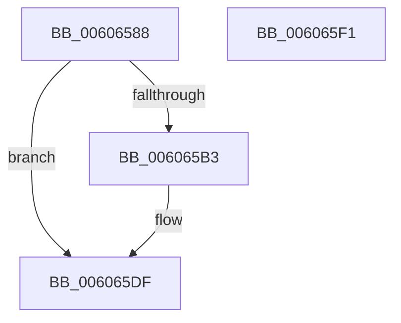

# BCryptGenRandom

- RVA: `0x00606588`–`0x006065F2` (길이 `106` bytes)
- VA: `0x0000000140606588`
- 실행 섹션: `.text`
- PDB 이름 있음: `예`; PDB Function 태그: `아니요`
- unwind 정보 RVA: `0x000794E0`
- 디코드: `28`개 명령, `106/106` bytes 표시
- 미해석 바이트: `0` (있으면 어셈블리에 `.byte`로 보존)

> 이 문서는 커널 이미지의 기계어와 PDB 기호를 분석해 생성했습니다. 4번과 5번은 함수 원형과 자료형을 바이너리 사용 방식에서 추정한 C 해석이며 원본 소스 복구 결과는 아닙니다.

## 1. Dependencies

- 직접 호출 지점: **3**; 고유 호출 대상: **3**
- 직접 호출자로 확인된 함수: **2**
- RIP 상대 이미지 참조: **1**

### Outgoing calls
- `0x006065A9` → [ExGetExtensionTable](../42/ExGetExtensionTable_function_00428814.md) (function, `0x00428814`)
- `0x006065C8` → [guard_dispatch_icall](../6B/guard_dispatch_icall_function_006BAAD0.md) (function, `0x006BAAD0`)
- `0x006065DA` → [ExReleaseRundownProtection](../34/ExReleaseRundownProtection_function_00349E80.md) (function, `0x00349E80`)

### Direct callers
- [SecureDump_SymmetricEncryptionSetup](../5A/SecureDump_SymmetricEncryptionSetup_function_005A3774.md) at `0x005A37E6`
- [SmCrGenRandom](../61/SmCrGenRandom_function_006114A4.md) at `0x006114AE`

### Static image references
- `0x00606597` → RVA `0x00F04E30` (`.data`; read)

## 2. Other-region calls and transfers

- 다른 실행 섹션으로 향하는 call: **0**
- 별도 외부 분기/꼬리 이동을 확인하지 못했습니다.

## 3. Assembly (complete function range)

```asm
00606588  48 89 5C 24 08                  mov qword ptr [rsp + 8], rbx
0060658D  48 89 74 24 10                  mov qword ptr [rsp + 0x10], rsi
00606592  57                              push rdi
00606593  48 83 EC 30                     sub rsp, 0x30
00606597  48 8B 0D 92 E8 8F 00            mov rcx, qword ptr [rip + 0x8fe892]
0060659E  41 8B F8                        mov edi, r8d
006065A1  48 8B F2                        mov rsi, rdx
006065A4  BB 02 00 00 C0                  mov ebx, 0xc0000002
006065A9  E8 66 22 E2 FF                  call 0x140428814
006065AE  48 85 C0                        test rax, rax
006065B1  74 2C                           je 0x1406065df
006065B3  48 8B 80 A0 00 00 00            mov rax, qword ptr [rax + 0xa0]
006065BA  41 B9 02 00 00 00               mov r9d, 2
006065C0  44 8B C7                        mov r8d, edi
006065C3  48 8B D6                        mov rdx, rsi
006065C6  33 C9                           xor ecx, ecx
006065C8  E8 03 45 0B 00                  call 0x1406baad0
006065CD  48 8B 0D 5C E8 8F 00            mov rcx, qword ptr [rip + 0x8fe85c]
006065D4  8B D8                           mov ebx, eax
006065D6  48 83 C1 58                     add rcx, 0x58
006065DA  E8 A1 38 D4 FF                  call 0x140349e80
006065DF  48 8B 74 24 48                  mov rsi, qword ptr [rsp + 0x48]
006065E4  8B C3                           mov eax, ebx
006065E6  48 8B 5C 24 40                  mov rbx, qword ptr [rsp + 0x40]
006065EB  48 83 C4 30                     add rsp, 0x30
006065EF  5F                              pop rdi
006065F0  C3                              ret
006065F1  CC                              int3
```

## 4. C-style interpretation (structured pseudocode)

```c
__int64 __fastcall BCryptGenRandom(__int64 a1, __int64 a2, int a3)
{
    __int64 result;
    __int64 v_rbx;
    __int64 v_rsp;
    unsigned __int64 v_stack_p10;
    unsigned __int64 v_stack_p8;

    v_stack_p8 = v_rbx;
    v_stack_p10 = v_rsi;
    v_rsp = (v_rsp) - (48);
    result = ExGetExtensionTable(*(unsigned __int64 *)(v_rip + 9431186), a2, a3, a4);
    v_rbx = (unsigned int)(0xC0000002ULL);
    if (result != 0) {
        result = *(unsigned __int64 *)(result + 160);
        a4 = 2;
        a3 = (unsigned int)((unsigned int)(a3));
        a2 = a2;
        a1 = 0;
        result = guard_dispatch_icall(a1, a2, a3, a4);
        a1 = *(unsigned __int64 *)(v_rip + 9431132);
        v_rbx = (unsigned int)(result);
        a1 = (a1) + (88);
        result = ExReleaseRundownProtection(a1, a2, a3, a4);
    }
    v_rsp = (v_rsp) + (48);
    return (unsigned int)((unsigned int)(v_rbx));
}
```

## 5. (Beta) C Style

```c
int64_t BCryptGenRandom(int64_t Arg1, int64_t Arg2, int32_t Arg3)
{
    int64_t result;
    int64_t local_rbx;
    int64_t local_rsp;
    uint64_t v_stack_p10;
    uint64_t v_stack_p8;

    v_stack_p8 = local_rbx;
    v_stack_p10 = local_rsi;
    local_rsp = (local_rsp) - (48);
    result = ExGetExtensionTable(*(uint64_t *)(v_rip + 0x8FE892), Arg2, Arg3, a4);
    local_rbx = (uint32_t)(0xC0000002ULL);
    if (result != 0) {
        result = *(uint64_t *)(result + 0xA0);
        a4 = 2;
        Arg3 = (uint32_t)((uint32_t)(Arg3));
        Arg2 = Arg2;
        Arg1 = 0;
        result = guard_dispatch_icall(Arg1, Arg2, Arg3, a4);
        Arg1 = *(uint64_t *)(v_rip + 0x8FE85C);
        local_rbx = (uint32_t)(result);
        Arg1 = (Arg1) + (88);
        result = ExReleaseRundownProtection(Arg1, Arg2, Arg3, a4);
    }
    local_rsp = (local_rsp) + (48);
    return (uint32_t)((uint32_t)(local_rbx));
}
```

## 6. Execution-region graph

[열기: 2D/3D 그래프와 함수 탐색 컨트롤 패널](../../../control-panel.html?section=text&rva=0x00606588&view=graph)

- 2D 그래프는 위에서 아래로 흐르고, 3D 그래프는 빈 공간을 드래그해 회전합니다. Shift+드래그는 이동, 휠은 확대·축소, 함수 노드 선택은 대상 보고서 이동입니다.

### Static fallback


