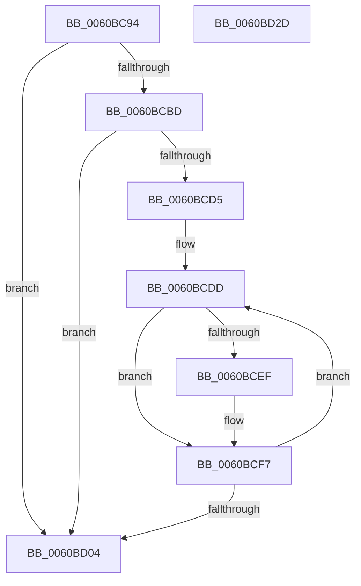

# B_TREE&lt;_SM_PAGE_KEY,SMKM_STORE_MGR&lt;SM_TRAITS&gt;::SMKM_FRONTEND_ENTRY,4096,B_TREE_DUMMY_NODE_POOL,B_TREE_KEY_COMPARATOR&lt;_SM_PAGE_KEY&gt; &gt;::BTreeNodeFree

- RVA: `0x0060BC94`–`0x0060BD2E` (길이 `154` bytes)
- VA: `0x000000014060BC94`
- 실행 섹션: `.text`
- PDB 이름 있음: `예`; PDB Function 태그: `아니요`
- unwind 정보 RVA: `0x0005FEF8`
- 디코드: `48`개 명령, `154/154` bytes 표시
- 미해석 바이트: `0` (있으면 어셈블리에 `.byte`로 보존)

> 이 문서는 커널 이미지의 기계어와 PDB 기호를 분석해 생성했습니다. 4번과 5번은 함수 원형과 자료형을 바이너리 사용 방식에서 추정한 C 해석이며 원본 소스 복구 결과는 아닙니다.

## 1. Dependencies

- 직접 호출 지점: **2**; 고유 호출 대상: **2**
- 직접 호출자로 확인된 함수: **3**
- RIP 상대 이미지 참조: **0**

### Outgoing calls
- `0x0060BCF2` → [B_TREE<_SM_PAGE_KEY,SMKM_STORE_MGR<SM_TRAITS>::SMKM_FRONTEND_ENTRY,4096,B_TREE_DUMMY_NODE_POOL,B_TREE_KEY_COMPARATOR<_SM_PAGE_KEY> >::BTreeNodeFree](B_TREE__SM_PAGE_KEY_SMKM_STORE_MGR_SM_TRAITS_SMKM_FRONTEND_ENTRY_4096_B_TREE_DUMMY_NODE_POOL_B_TREE__function_0060BC94.md) (function, `0x0060BC94`)
- `0x0060BD09` → [ExFreePoolWithTag](../../poolcode/B8/ExFreePoolWithTag_function_00B82870.md) (function, `0x00B82870`)

### Direct callers
- [B_TREE&lt;_SM_PAGE_KEY,SMKM_STORE_MGR&lt;SM_TRAITS&gt;::SMKM_FRONTEND_ENTRY,4096,B_TREE_DUMMY_NODE_POOL,B_TREE_KEY_COMPARATOR&lt;_SM_PAGE_KEY&gt; &gt;::BTreeNodeFree](B_TREE__SM_PAGE_KEY_SMKM_STORE_MGR_SM_TRAITS_SMKM_FRONTEND_ENTRY_4096_B_TREE_DUMMY_NODE_POOL_B_TREE__function_0060BC94.md) at `0x0060BCF2`
- [SMKM_STORE_MGR&lt;SM_TRAITS&gt;::SmCleanup](SMKM_STORE_MGR_SM_TRAITS_SmCleanup_function_0060C214.md) at `0x0060C231`
- [SMKM_STORE_MGR&lt;SM_TRAITS&gt;::SmFeEmpty](SMKM_STORE_MGR_SM_TRAITS_SmFeEmpty_function_0060C74C.md) at `0x0060C77B`

### Static image references
- 디코드된 RIP-relative 메모리 참조가 없습니다.

## 2. Other-region calls and transfers

- 다른 실행 섹션으로 향하는 call: **1**
  - `0x0060BD09` → [ExFreePoolWithTag](../../poolcode/B8/ExFreePoolWithTag_function_00B82870.md) (`.text` → `POOLCODE`)
- 별도 외부 분기/꼬리 이동을 확인하지 못했습니다.

## 3. Assembly (complete function range)

```asm
0060BC94  48 8B C4                        mov rax, rsp
0060BC97  48 89 58 08                     mov qword ptr [rax + 8], rbx
0060BC9B  48 89 68 10                     mov qword ptr [rax + 0x10], rbp
0060BC9F  48 89 70 18                     mov qword ptr [rax + 0x18], rsi
0060BCA3  48 89 78 20                     mov qword ptr [rax + 0x20], rdi
0060BCA7  41 54                           push r12
0060BCA9  41 56                           push r14
0060BCAB  41 57                           push r15
0060BCAD  48 83 EC 20                     sub rsp, 0x20
0060BCB1  80 7A 03 00                     cmp byte ptr [rdx + 3], 0
0060BCB5  48 8B DA                        mov rbx, rdx
0060BCB8  4C 8B F9                        mov r15, rcx
0060BCBB  75 47                           jne 0x14060bd04
0060BCBD  8B 02                           mov eax, dword ptr [rdx]
0060BCBF  4C 8D 72 10                     lea r14, [rdx + 0x10]
0060BCC3  0F B7 F0                        movzx esi, ax
0060BCC6  49 8B FE                        mov rdi, r14
0060BCC9  48 C1 E6 04                     shl rsi, 4
0060BCCD  49 03 F6                        add rsi, r14
0060BCD0  4C 3B F6                        cmp r14, rsi
0060BCD3  77 2F                           ja 0x14060bd04
0060BCD5  4C 8D 62 08                     lea r12, [rdx + 8]
0060BCD9  49 8D 6E F8                     lea rbp, [r14 - 8]
0060BCDD  49 3B FE                        cmp rdi, r14
0060BCE0  48 8B C5                        mov rax, rbp
0060BCE3  49 0F 46 C4                     cmovbe rax, r12
0060BCE7  48 8B 10                        mov rdx, qword ptr [rax]
0060BCEA  48 85 D2                        test rdx, rdx
0060BCED  74 08                           je 0x14060bcf7
0060BCEF  49 8B CF                        mov rcx, r15
0060BCF2  E8 9D FF FF FF                  call 0x14060bc94
0060BCF7  48 83 C7 10                     add rdi, 0x10
0060BCFB  48 83 C5 10                     add rbp, 0x10
0060BCFF  48 3B FE                        cmp rdi, rsi
0060BD02  76 D9                           jbe 0x14060bcdd
0060BD04  33 D2                           xor edx, edx
0060BD06  48 8B CB                        mov rcx, rbx
0060BD09  E8 62 6B 57 00                  call 0x140b82870
0060BD0E  48 8B 5C 24 40                  mov rbx, qword ptr [rsp + 0x40]
0060BD13  48 8B 6C 24 48                  mov rbp, qword ptr [rsp + 0x48]
0060BD18  48 8B 74 24 50                  mov rsi, qword ptr [rsp + 0x50]
0060BD1D  48 8B 7C 24 58                  mov rdi, qword ptr [rsp + 0x58]
0060BD22  48 83 C4 20                     add rsp, 0x20
0060BD26  41 5F                           pop r15
0060BD28  41 5E                           pop r14
0060BD2A  41 5C                           pop r12
0060BD2C  C3                              ret
0060BD2D  CC                              int3
```

## 4. C-style interpretation (structured pseudocode)

```c
__int64 __fastcall B_TREE__SM_PAGE_KEY_SMKM_STORE_MGR_SM_TRAITS___SMKM_FRONTEND_ENTRY_4096_B_TREE_DUMMY_NODE_POOL_B_TRE(__int64 a1, __int64 a2)
{
    __int64 result;
    __int64 v_rbp;
    __int64 v_rdi;
    __int64 v_rsi;
    __int64 v_rsp;
    unsigned __int64 v_stack_p10;
    unsigned __int64 v_stack_p18;
    unsigned __int64 v_stack_p20;
    unsigned __int64 v_stack_p8;

    *(unsigned __int64 *)(v_rsp + 8) = v_rbx;
    *(unsigned __int64 *)(v_rsp + 16) = v_rbp;
    *(unsigned __int64 *)(v_rsp + 24) = v_rsi;
    *(unsigned __int64 *)(v_rsp + 32) = v_rdi;
    v_rsp = (v_rsp) - (32);
    if ((*(unsigned __int8 *)(a2 + 3)) != 0) goto loc_0060BD04;
    v_rsi = ((unsigned __int16)((unsigned int)(*(unsigned int *)(a2)))) << (4);
    v_rsi = (v_rsi) + (a2 + 16);
    if ((a2 + 16) > v_rsi) goto loc_0060BD04;
loc_0060BCDD:
    result = a2 + 16 - 8;
    if ((a2 + 16) <= (a2 + 16)) { result = a2 + 8; }
    if (*(unsigned __int64 *)(result) != 0) {
        a1 = a1;
        result = B_TREE__SM_PAGE_KEY_SMKM_STORE_MGR_SM_TRAITS___SMKM_FRONTEND_ENTRY_4096_B_TREE_DUMMY_NODE_POOL_B_TRE(a1, *(unsigned __int64 *)(result), a3, a4);
    }
    v_rdi = (a2 + 16) + (16);
    v_rbp = (a2 + 16 - 8) + (16);
    if (v_rdi <= v_rsi) goto loc_0060BCDD;
loc_0060BD04:
    a2 = 0;
    result = ExFreePoolWithTag(0, a2, a3, a4);
    v_rsp = (v_rsp) + (32);
    return result;
}
```

## 5. (Beta) C Style

```c
int64_t B_TREE__SM_PAGE_KEY_SMKM_STORE_MGR_SM_TRAITS___SMKM_FRONTEND_ENTRY_4096_B_TREE_DUMMY_NODE_POOL_B_TRE(int64_t Arg1, void *Arg2)
{
    uint8_t *arg2 = (uint8_t *)Arg2;

    int64_t result;
    int64_t local_rbp;
    int64_t local_rdi;
    int64_t local_rsi;
    int64_t local_rsp;
    uint64_t v_stack_p10;
    uint64_t v_stack_p18;
    uint64_t v_stack_p20;
    uint64_t v_stack_p8;

    *(uint64_t *)(local_rsp + 0x8) = local_rbx;
    *(uint64_t *)(local_rsp + 0x10) = local_rbp;
    *(uint64_t *)(local_rsp + 0x18) = local_rsi;
    *(uint64_t *)(local_rsp + 0x20) = local_rdi;
    local_rsp = (local_rsp) - (32);
    if ((*(uint8_t *)(arg2 + 0x3)) != 0) goto loc_0060BD04;
    local_rsi = ((uint16_t)((uint32_t)(*(uint32_t *)(arg2)))) << (4);
    local_rsi = (local_rsi) + (Arg2 + 16);
    if ((Arg2 + 16) > local_rsi) goto loc_0060BD04;
loc_0060BCDD:
    result = Arg2 + 16 - 8;
    if ((Arg2 + 16) <= (Arg2 + 16)) { result = Arg2 + 8; }
    if (*(uint64_t *)(result) != 0) {
        Arg1 = Arg1;
        result = B_TREE__SM_PAGE_KEY_SMKM_STORE_MGR_SM_TRAITS___SMKM_FRONTEND_ENTRY_4096_B_TREE_DUMMY_NODE_POOL_B_TRE(Arg1, *(uint64_t *)(result), a3, a4);
    }
    local_rdi = (Arg2 + 16) + (16);
    local_rbp = (Arg2 + 16 - 8) + (16);
    if (local_rdi <= local_rsi) goto loc_0060BCDD;
loc_0060BD04:
    Arg2 = 0;
    result = ExFreePoolWithTag(0, Arg2, a3, a4);
    local_rsp = (local_rsp) + (32);
    return result;
}
```

### 관측된 메모리 오프셋

구조체 형식이 확인되지 않은 접근은 인자 기준의 오프셋으로만 기록했습니다.

| 기준 인자 | 오프셋 표현 | 폭 (bit) | 접근 |
|---|---:|---:|---|
| `Arg2` | `+ 0x0` | `32` | `R` |
| `Arg2` | `+ 0x3` | `8` | `R` |
| `Arg2` | `+ 0x8` | `64` | `R` |
| `Arg2` | `+ 0x10` | `64` | `R` |

## 6. Execution-region graph

[열기: 2D/3D 그래프와 함수 탐색 컨트롤 패널](../../../control-panel.html?section=text&rva=0x0060BC94&view=graph)

- 2D 그래프는 위에서 아래로 흐르고, 3D 그래프는 빈 공간을 드래그해 회전합니다. Shift+드래그는 이동, 휠은 확대·축소, 함수 노드 선택은 대상 보고서 이동입니다.

### Static fallback


