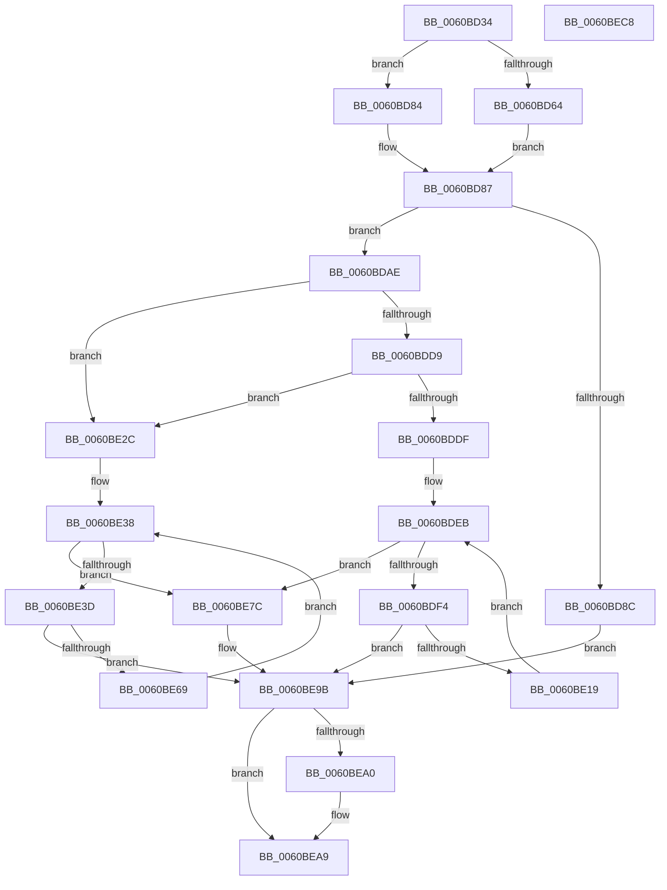

# B_TREE&lt;_SM_PAGE_KEY,ST_STORE&lt;SM_TRAITS&gt;::_ST_PAGE_ENTRY,4096,NP_CONTEXT,B_TREE_KEY_COMPARATOR&lt;_SM_PAGE_KEY&gt; &gt;::BTreeWalkPostOrderInternal

- RVA: `0x0060BD34`–`0x0060BEC9` (길이 `405` bytes)
- VA: `0x000000014060BD34`
- 실행 섹션: `.text`
- PDB 이름 있음: `예`; PDB Function 태그: `아니요`
- unwind 정보 RVA: `0x000D1914`
- 디코드: `120`개 명령, `405/405` bytes 표시
- 미해석 바이트: `0` (있으면 어셈블리에 `.byte`로 보존)

> 이 문서는 커널 이미지의 기계어와 PDB 기호를 분석해 생성했습니다. 4번과 5번은 함수 원형과 자료형을 바이너리 사용 방식에서 추정한 C 해석이며 원본 소스 복구 결과는 아닙니다.

## 1. Dependencies

- 직접 호출 지점: **5**; 고유 호출 대상: **3**
- 직접 호출자로 확인된 함수: **2**
- RIP 상대 이미지 참조: **0**

### Outgoing calls
- `0x0060BD76` → [memcpy](../6C/memcpy_function_006C6840.md) (function, `0x006C6840`)
- `0x0060BDA2` → [guard_dispatch_icall](../6B/guard_dispatch_icall_function_006BAAD0.md) (function, `0x006BAAD0`)
- `0x0060BE0A` → [guard_dispatch_icall](../6B/guard_dispatch_icall_function_006BAAD0.md) (function, `0x006BAAD0`)
- `0x0060BE5E` → [B_TREE<_SM_PAGE_KEY,ST_STORE<SM_TRAITS>::_ST_PAGE_ENTRY,4096,NP_CONTEXT,B_TREE_KEY_COMPARATOR<_SM_PAGE_KEY> >::BTreeWalkPostOrderInternal](B_TREE__SM_PAGE_KEY_ST_STORE_SM_TRAITS__ST_PAGE_ENTRY_4096_NP_CONTEXT_B_TREE_KEY_COMPARATOR__SM_PAGE_function_0060BD34.md) (function, `0x0060BD34`)
- `0x0060BE8D` → [guard_dispatch_icall](../6B/guard_dispatch_icall_function_006BAAD0.md) (function, `0x006BAAD0`)

### Direct callers
- [B_TREE&lt;_SM_PAGE_KEY,ST_STORE&lt;SM_TRAITS&gt;::_ST_PAGE_ENTRY,4096,NP_CONTEXT,B_TREE_KEY_COMPARATOR&lt;_SM_PAGE_KEY&gt; &gt;::BTreeWalkPostOrderInternal](B_TREE__SM_PAGE_KEY_ST_STORE_SM_TRAITS__ST_PAGE_ENTRY_4096_NP_CONTEXT_B_TREE_KEY_COMPARATOR__SM_PAGE_function_0060BD34.md) at `0x0060BE5E`
- [ST_STORE&lt;SM_TRAITS&gt;::StNpEnumBTreeNodes](ST_STORE_SM_TRAITS_StNpEnumBTreeNodes_function_0060E540.md) at `0x0060E57F`
- [ST_STORE&lt;SM_TRAITS&gt;::StNpEnumBTreeNodes](ST_STORE_SM_TRAITS_StNpEnumBTreeNodes_function_0060E540.md) at `0x0060E5AC`

### Static image references
- 디코드된 RIP-relative 메모리 참조가 없습니다.

## 2. Other-region calls and transfers

- 다른 실행 섹션으로 향하는 call: **0**
- 별도 외부 분기/꼬리 이동을 확인하지 못했습니다.

## 3. Assembly (complete function range)

```asm
0060BD34  48 8B C4                        mov rax, rsp
0060BD37  48 89 58 08                     mov qword ptr [rax + 8], rbx
0060BD3B  48 89 68 10                     mov qword ptr [rax + 0x10], rbp
0060BD3F  48 89 70 18                     mov qword ptr [rax + 0x18], rsi
0060BD43  4C 89 48 20                     mov qword ptr [rax + 0x20], r9
0060BD47  57                              push rdi
0060BD48  41 54                           push r12
0060BD4A  41 55                           push r13
0060BD4C  41 56                           push r14
0060BD4E  41 57                           push r15
0060BD50  48 83 EC 30                     sub rsp, 0x30
0060BD54  49 8B 38                        mov rdi, qword ptr [r8]
0060BD57  33 C0                           xor eax, eax
0060BD59  4D 8B F0                        mov r14, r8
0060BD5C  4C 8B E9                        mov r13, rcx
0060BD5F  48 85 FF                        test rdi, rdi
0060BD62  74 20                           je 0x14060bd84
0060BD64  48 8B 07                        mov rax, qword ptr [rdi]
0060BD67  48 8B CF                        mov rcx, rdi
0060BD6A  49 89 00                        mov qword ptr [r8], rax
0060BD6D  48 8B F7                        mov rsi, rdi
0060BD70  41 B8 00 10 00 00               mov r8d, 0x1000
0060BD76  E8 C5 AA 0B 00                  call 0x1406c6840
0060BD7B  4C 8B 4C 24 78                  mov r9, qword ptr [rsp + 0x78]
0060BD80  33 C0                           xor eax, eax
0060BD82  EB 03                           jmp 0x14060bd87
0060BD84  48 8B F2                        mov rsi, rdx
0060BD87  38 46 03                        cmp byte ptr [rsi + 3], al
0060BD8A  74 22                           je 0x14060bdae
0060BD8C  4C 8B 84 24 88 00 00 00         mov r8, qword ptr [rsp + 0x88]
0060BD94  48 8B CE                        mov rcx, rsi
0060BD97  48 8B 94 24 80 00 00 00         mov rdx, qword ptr [rsp + 0x80]
0060BD9F  49 8B C1                        mov rax, r9
0060BDA2  E8 29 ED 0A 00                  call 0x1406baad0
0060BDA7  8B C8                           mov ecx, eax
0060BDA9  E9 ED 00 00 00                  jmp 0x14060be9b
0060BDAE  8B 06                           mov eax, dword ptr [rsi]
0060BDB0  4C 8D 56 10                     lea r10, [rsi + 0x10]
0060BDB4  0F B7 E8                        movzx ebp, ax
0060BDB7  49 8D 4D 10                     lea rcx, [r13 + 0x10]
0060BDBB  48 C1 E5 04                     shl rbp, 4
0060BDBF  49 8B C5                        mov rax, r13
0060BDC2  49 03 EA                        add rbp, r10
0060BDC5  49 8B DA                        mov rbx, r10
0060BDC8  48 F7 D8                        neg rax
0060BDCB  48 1B C0                        sbb rax, rax
0060BDCE  48 23 C1                        and rax, rcx
0060BDD1  48 8B 00                        mov rax, qword ptr [rax]
0060BDD4  83 38 FF                        cmp dword ptr [rax], -1
0060BDD7  74 53                           je 0x14060be2c
0060BDD9  80 7E 02 02                     cmp byte ptr [rsi + 2], 2
0060BDDD  75 4D                           jne 0x14060be2c
0060BDDF  4C 8B A4 24 80 00 00 00         mov r12, qword ptr [rsp + 0x80]
0060BDE7  4D 8D 7A F8                     lea r15, [r10 - 8]
0060BDEB  48 3B DD                        cmp rbx, rbp
0060BDEE  0F 87 88 00 00 00               ja 0x14060be7c
0060BDF4  49 3B DA                        cmp rbx, r10
0060BDF7  48 8D 46 08                     lea rax, [rsi + 8]
0060BDFB  4D 8B C7                        mov r8, r15
0060BDFE  49 8B D4                        mov rdx, r12
0060BE01  4C 0F 46 C0                     cmovbe r8, rax
0060BE05  33 C9                           xor ecx, ecx
0060BE07  49 8B C1                        mov rax, r9
0060BE0A  E8 C1 EC 0A 00                  call 0x1406baad0
0060BE0F  8B C8                           mov ecx, eax
0060BE11  85 C0                           test eax, eax
0060BE13  0F 88 82 00 00 00               js 0x14060be9b
0060BE19  4C 8B 4C 24 78                  mov r9, qword ptr [rsp + 0x78]
0060BE1E  4C 8D 56 10                     lea r10, [rsi + 0x10]
0060BE22  48 83 C3 10                     add rbx, 0x10
0060BE26  49 83 C7 10                     add r15, 0x10
0060BE2A  EB BF                           jmp 0x14060bdeb
0060BE2C  4C 8B A4 24 80 00 00 00         mov r12, qword ptr [rsp + 0x80]
0060BE34  4D 8D 7A F8                     lea r15, [r10 - 8]
0060BE38  48 3B DD                        cmp rbx, rbp
0060BE3B  77 3F                           ja 0x14060be7c
0060BE3D  49 3B DA                        cmp rbx, r10
0060BE40  48 8D 46 08                     lea rax, [rsi + 8]
0060BE44  49 8B D7                        mov rdx, r15
0060BE47  4D 8B C6                        mov r8, r14
0060BE4A  48 0F 46 D0                     cmovbe rdx, rax
0060BE4E  49 8B CD                        mov rcx, r13
0060BE51  48 89 54 24 28                  mov qword ptr [rsp + 0x28], rdx
0060BE56  4C 89 64 24 20                  mov qword ptr [rsp + 0x20], r12
0060BE5B  48 8B 12                        mov rdx, qword ptr [rdx]
0060BE5E  E8 D1 FE FF FF                  call 0x14060bd34
0060BE63  8B C8                           mov ecx, eax
0060BE65  85 C0                           test eax, eax
0060BE67  78 32                           js 0x14060be9b
0060BE69  4C 8B 4C 24 78                  mov r9, qword ptr [rsp + 0x78]
0060BE6E  4C 8D 56 10                     lea r10, [rsi + 0x10]
0060BE72  48 83 C3 10                     add rbx, 0x10
0060BE76  49 83 C7 10                     add r15, 0x10
0060BE7A  EB BC                           jmp 0x14060be38
0060BE7C  4C 8B 84 24 88 00 00 00         mov r8, qword ptr [rsp + 0x88]
0060BE84  49 8B D4                        mov rdx, r12
0060BE87  48 8B CE                        mov rcx, rsi
0060BE8A  49 8B C1                        mov rax, r9
0060BE8D  E8 3E EC 0A 00                  call 0x1406baad0
0060BE92  8B C8                           mov ecx, eax
0060BE94  33 C0                           xor eax, eax
0060BE96  85 C9                           test ecx, ecx
0060BE98  0F 49 C8                        cmovns ecx, eax
0060BE9B  48 85 FF                        test rdi, rdi
0060BE9E  74 09                           je 0x14060bea9
0060BEA0  49 8B 06                        mov rax, qword ptr [r14]
0060BEA3  48 89 07                        mov qword ptr [rdi], rax
0060BEA6  49 89 3E                        mov qword ptr [r14], rdi
0060BEA9  48 8B 5C 24 60                  mov rbx, qword ptr [rsp + 0x60]
0060BEAE  8B C1                           mov eax, ecx
0060BEB0  48 8B 6C 24 68                  mov rbp, qword ptr [rsp + 0x68]
0060BEB5  48 8B 74 24 70                  mov rsi, qword ptr [rsp + 0x70]
0060BEBA  48 83 C4 30                     add rsp, 0x30
0060BEBE  41 5F                           pop r15
0060BEC0  41 5E                           pop r14
0060BEC2  41 5D                           pop r13
0060BEC4  41 5C                           pop r12
0060BEC6  5F                              pop rdi
0060BEC7  C3                              ret
0060BEC8  CC                              int3
```

## 4. C-style interpretation (structured pseudocode)

```c
__int64 __fastcall B_TREE__SM_PAGE_KEY_ST_STORE_SM_TRAITS____ST_PAGE_ENTRY_4096_NP_CONTEXT_B_TREE_KEY_COMPARATOR__SM_PA(__int64 a1, __int64 a2, __int64 a3, __int64 a4, __int64 a5, __int64 a6)
{
    __int64 result;
    __int64 v_r15;
    __int64 v_rbp;
    __int64 v_rbx;
    __int64 v_rsp;
    unsigned __int64 v_stack_m30;
    unsigned __int64 v_stack_m38;
    unsigned __int64 v_stack_p10;
    unsigned __int64 v_stack_p18;
    unsigned __int64 v_stack_p20;
    unsigned __int64 v_stack_p8;

    *(unsigned __int64 *)(v_rsp + 8) = v_rbx;
    *(unsigned __int64 *)(v_rsp + 16) = v_rbp;
    *(unsigned __int64 *)(v_rsp + 24) = v_rsi;
    *(unsigned __int64 *)(v_rsp + 32) = a4;
    v_rsp = (v_rsp) - (48);
    result = 0;
    if (*(unsigned __int64 *)(a3) == 0) goto loc_0060BD84;
    *(unsigned __int64 *)(a3) = *(unsigned __int64 *)(*(unsigned __int64 *)(a3));
    result = memcpy(*(unsigned __int64 *)(a3), a2, (unsigned int)(0x1000ULL), a4);
    result = 0;
    goto loc_0060BD87;
loc_0060BD84:
loc_0060BD87:
    if ((*(unsigned __int8 *)(a2 + 3)) == 0) goto loc_0060BDAE;
    result = guard_dispatch_icall(a2, a5, a6, v_stack_p20);
    goto loc_0060BE9B;
loc_0060BDAE:
    v_rbp = ((unsigned __int16)((unsigned int)(*(unsigned int *)(a2)))) << (4);
    v_rbp = (v_rbp) + (a2 + 16);
    result = -(a1);
    result = (result) & (a1 + 16);
    if ((*(unsigned int *)(*(unsigned __int64 *)(result))) == -1) goto loc_0060BE2C;
    if ((*(unsigned __int8 *)(a2 + 2)) != 2) goto loc_0060BE2C;
loc_0060BDEB:
    if ((a2 + 16) > v_rbp) goto loc_0060BE7C;
    a3 = a2 + 16 - 8;
    if ((a2 + 16) <= (a2 + 16)) { a3 = a2 + 8; }
    a1 = 0;
    result = guard_dispatch_icall(a1, a5, a3, v_stack_p20);
    if (sign_flag) goto loc_0060BE9B;
    v_rbx = (a2 + 16) + (16);
    v_r15 = (a2 + 16 - 8) + (16);
    goto loc_0060BDEB;
loc_0060BE2C:
loc_0060BE38:
    if (v_rbx > v_rbp) goto loc_0060BE7C;
    a2 = a2 + 16 - 8;
    if (v_rbx <= (a2 + 16)) { a2 = a2 + 8; }
    v_stack_m30 = a2;
    v_stack_m38 = a5;
    result = B_TREE__SM_PAGE_KEY_ST_STORE_SM_TRAITS____ST_PAGE_ENTRY_4096_NP_CONTEXT_B_TREE_KEY_COMPARATOR__SM_PA(0, *(unsigned __int64 *)(a2), a3, v_stack_p20);
    if (sign_flag) goto loc_0060BE9B;
    v_rbx = (v_rbx) + (16);
    v_r15 = (a2 + 16 - 8) + (16);
    goto loc_0060BE38;
loc_0060BE7C:
    result = guard_dispatch_icall(a2, a5, a6, v_stack_p20);
    result = 0;
    a1 = (unsigned int)((unsigned int)(result));
    if (!sign_flag) { a1 = 0; }
loc_0060BE9B:
    if (*(unsigned __int64 *)(a3) != 0) {
        result = *(unsigned __int64 *)(a3);
        *(unsigned __int64 *)(*(unsigned __int64 *)(a3)) = result;
        *(unsigned __int64 *)(a3) = *(unsigned __int64 *)(a3);
    }
    v_rsp = (v_rsp) + (48);
    return (unsigned int)((unsigned int)(a1));
}
```

## 5. (Beta) C Style

```c
int64_t B_TREE__SM_PAGE_KEY_ST_STORE_SM_TRAITS____ST_PAGE_ENTRY_4096_NP_CONTEXT_B_TREE_KEY_COMPARATOR__SM_PA(void *Arg1, int64_t Arg2, void *Arg3, int64_t Arg4, int64_t Arg5, int64_t Arg6)
{
    uint8_t *arg1 = (uint8_t *)Arg1;
    uint8_t *arg3 = (uint8_t *)Arg3;

    int64_t result;
    int64_t local_r15;
    int64_t local_rbp;
    int64_t local_rbx;
    int64_t local_rsp;
    uint64_t v_stack_m30;
    uint64_t v_stack_m38;
    uint64_t v_stack_p10;
    uint64_t v_stack_p18;
    uint64_t v_stack_p20;
    uint64_t v_stack_p8;

    *(uint64_t *)(local_rsp + 0x8) = local_rbx;
    *(uint64_t *)(local_rsp + 0x10) = local_rbp;
    *(uint64_t *)(local_rsp + 0x18) = local_rsi;
    *(uint64_t *)(local_rsp + 0x20) = Arg4;
    local_rsp = (local_rsp) - (48);
    result = 0;
    if (*(uint64_t *)(arg3) == 0) goto loc_0060BD84;
    *(uint64_t *)(arg3) = *(uint64_t *)(*(uint64_t *)(arg3));
    result = memcpy(*(uint64_t *)(arg3), Arg2, (uint32_t)(0x1000ULL), Arg4);
    result = 0;
    goto loc_0060BD87;
loc_0060BD84:
loc_0060BD87:
    if ((*(uint8_t *)(Arg2 + 0x3)) == 0) goto loc_0060BDAE;
    result = guard_dispatch_icall(Arg2, Arg5, Arg6, v_stack_p20);
    goto loc_0060BE9B;
loc_0060BDAE:
    local_rbp = ((uint16_t)((uint32_t)(*(uint32_t *)(Arg2)))) << (4);
    local_rbp = (local_rbp) + (Arg2 + 16);
    result = -(Arg1);
    result = (result) & (Arg1 + 16);
    if ((*(uint32_t *)(*(uint64_t *)(result))) == -1) goto loc_0060BE2C;
    if ((*(uint8_t *)(Arg2 + 0x2)) != 2) goto loc_0060BE2C;
loc_0060BDEB:
    if ((Arg2 + 16) > local_rbp) goto loc_0060BE7C;
    Arg3 = Arg2 + 16 - 8;
    if ((Arg2 + 16) <= (Arg2 + 16)) { Arg3 = Arg2 + 8; }
    Arg1 = 0;
    result = guard_dispatch_icall(Arg1, Arg5, Arg3, v_stack_p20);
    if (sign_flag) goto loc_0060BE9B;
    local_rbx = (Arg2 + 16) + (16);
    local_r15 = (Arg2 + 16 - 8) + (16);
    goto loc_0060BDEB;
loc_0060BE2C:
loc_0060BE38:
    if (local_rbx > local_rbp) goto loc_0060BE7C;
    Arg2 = Arg2 + 16 - 8;
    if (local_rbx <= (Arg2 + 16)) { Arg2 = Arg2 + 8; }
    v_stack_m30 = Arg2;
    v_stack_m38 = Arg5;
    result = B_TREE__SM_PAGE_KEY_ST_STORE_SM_TRAITS____ST_PAGE_ENTRY_4096_NP_CONTEXT_B_TREE_KEY_COMPARATOR__SM_PA(0, *(uint64_t *)(Arg2), Arg3, v_stack_p20);
    if (sign_flag) goto loc_0060BE9B;
    local_rbx = (local_rbx) + (16);
    local_r15 = (Arg2 + 16 - 8) + (16);
    goto loc_0060BE38;
loc_0060BE7C:
    result = guard_dispatch_icall(Arg2, Arg5, Arg6, v_stack_p20);
    result = 0;
    Arg1 = (uint32_t)((uint32_t)(result));
    if (!sign_flag) { Arg1 = 0; }
loc_0060BE9B:
    if (*(uint64_t *)(arg3) != 0) {
        result = *(uint64_t *)(arg3);
        *(uint64_t *)(*(uint64_t *)(arg3)) = result;
        *(uint64_t *)(arg3) = *(uint64_t *)(arg3);
    }
    local_rsp = (local_rsp) + (48);
    return (uint32_t)((uint32_t)(Arg1));
}
```

### 관측된 메모리 오프셋

구조체 형식이 확인되지 않은 접근은 인자 기준의 오프셋으로만 기록했습니다.

| 기준 인자 | 오프셋 표현 | 폭 (bit) | 접근 |
|---|---:|---:|---|
| `Arg1` | `+ 0x10` | `64` | `R` |
| `Arg3` | `+ 0x0` | `64` | `R` |
| `Arg3` | `+ 0x0` | `64` | `W` |

## 6. Execution-region graph

[열기: 2D/3D 그래프와 함수 탐색 컨트롤 패널](../../../control-panel.html?section=text&rva=0x0060BD34&view=graph)

- 2D 그래프는 위에서 아래로 흐르고, 3D 그래프는 빈 공간을 드래그해 회전합니다. Shift+드래그는 이동, 휠은 확대·축소, 함수 노드 선택은 대상 보고서 이동입니다.

### Static fallback


