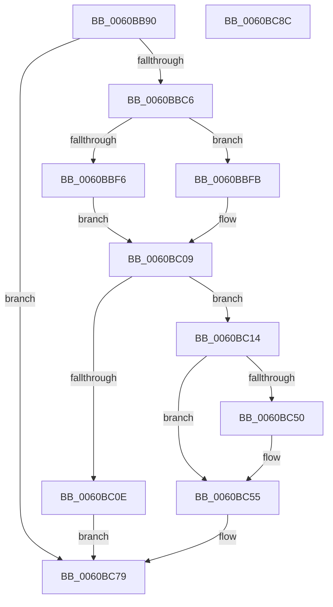

# B_TREE&lt;unsigned long,ST_STORE&lt;SM_TRAITS&gt;::_ST_HASH_ENTRY,4096,NP_CONTEXT,ST_STORE&lt;SM_TRAITS&gt;::ST_HASH_ENTRY_COMPARATOR&gt;::BTreeFindLeafSiblingEx

- RVA: `0x0060BB90`–`0x0060BC8D` (길이 `253` bytes)
- VA: `0x000000014060BB90`
- 실행 섹션: `.text`
- PDB 이름 있음: `예`; PDB Function 태그: `아니요`
- unwind 정보 RVA: `0x000733E4`
- 디코드: `76`개 명령, `253/253` bytes 표시
- 미해석 바이트: `0` (있으면 어셈블리에 `.byte`로 보존)

> 이 문서는 커널 이미지의 기계어와 PDB 기호를 분석해 생성했습니다. 4번과 5번은 함수 원형과 자료형을 바이너리 사용 방식에서 추정한 C 해석이며 원본 소스 복구 결과는 아닙니다.

## 1. Dependencies

- 직접 호출 지점: **5**; 고유 호출 대상: **4**
- 직접 호출자로 확인된 함수: **1**
- RIP 상대 이미지 참조: **0**

### Outgoing calls
- `0x0060BBB9` → [B_TREE<unsigned long,ST_STORE<SM_TRAITS>::_ST_HASH_ENTRY,4096,NP_CONTEXT,ST_STORE<SM_TRAITS>::ST_HASH_ENTRY_COMPARATOR>::BTreeFindSeperatorIndexEntry](../44/B_TREE_unsigned_long_ST_STORE_SM_TRAITS__ST_HASH_ENTRY_4096_NP_CONTEXT_ST_STORE_SM_TRAITS_ST_HASH_EN_function_00446330.md) (function, `0x00446330`)
- `0x0060BBCE` → [B_TREE<unsigned long,ST_STORE<SM_TRAITS>::_ST_HASH_ENTRY,4096,NP_CONTEXT,ST_STORE<SM_TRAITS>::ST_HASH_ENTRY_COMPARATOR>::BTreeDescendToSibling](B_TREE_unsigned_long_ST_STORE_SM_TRAITS__ST_HASH_ENTRY_4096_NP_CONTEXT_ST_STORE_SM_TRAITS_ST_HASH_EN_function_0060BB34.md) (function, `0x0060BB34`)
- `0x0060BC01` → [NP_CONTEXT::NpLeafRefInternal](../3A/NP_CONTEXT_NpLeafRefInternal_function_003AA340.md) (function, `0x003AA340`)
- `0x0060BC50` → [NP_CONTEXT::NpLeafDerefInternal](../3A/NP_CONTEXT_NpLeafDerefInternal_function_003A9A70.md) (function, `0x003A9A70`)
- `0x0060BC5D` → [B_TREE<unsigned long,ST_STORE<SM_TRAITS>::_ST_HASH_ENTRY,4096,NP_CONTEXT,ST_STORE<SM_TRAITS>::ST_HASH_ENTRY_COMPARATOR>::BTreeDescendToSibling](B_TREE_unsigned_long_ST_STORE_SM_TRAITS__ST_HASH_ENTRY_4096_NP_CONTEXT_ST_STORE_SM_TRAITS_ST_HASH_EN_function_0060BB34.md) (function, `0x0060BB34`)

### Direct callers
- [B_TREE&lt;unsigned long,ST_STORE&lt;SM_TRAITS&gt;::_ST_HASH_ENTRY,4096,NP_CONTEXT,ST_STORE&lt;SM_TRAITS&gt;::ST_HASH_ENTRY_COMPARATOR&gt;::BTreeFindLeafSibling](../43/B_TREE_unsigned_long_ST_STORE_SM_TRAITS__ST_HASH_ENTRY_4096_NP_CONTEXT_ST_STORE_SM_TRAITS_ST_HASH_EN_function_0043F728.md) at `0x0043F7EE`

### Static image references
- 디코드된 RIP-relative 메모리 참조가 없습니다.

## 2. Other-region calls and transfers

- 다른 실행 섹션으로 향하는 call: **0**
- 별도 외부 분기/꼬리 이동을 확인하지 못했습니다.

## 3. Assembly (complete function range)

```asm
0060BB90  48 8B C4                        mov rax, rsp
0060BB93  48 89 58 08                     mov qword ptr [rax + 8], rbx
0060BB97  48 89 70 10                     mov qword ptr [rax + 0x10], rsi
0060BB9B  57                              push rdi
0060BB9C  48 83 EC 30                     sub rsp, 0x30
0060BBA0  48 8B FA                        mov rdi, rdx
0060BBA3  4C 8D 40 E8                     lea r8, [rax - 0x18]
0060BBA7  48 8B F1                        mov rsi, rcx
0060BBAA  0F 57 C0                        xorps xmm0, xmm0
0060BBAD  33 DB                           xor ebx, ebx
0060BBAF  48 8B CF                        mov rcx, rdi
0060BBB2  0F 11 40 E8                     movups xmmword ptr [rax - 0x18], xmm0
0060BBB6  8D 53 01                        lea edx, [rbx + 1]
0060BBB9  E8 72 A7 E3 FF                  call 0x140446330
0060BBBE  85 C0                           test eax, eax
0060BBC0  0F 84 B3 00 00 00               je 0x14060bc79
0060BBC6  45 33 C0                        xor r8d, r8d
0060BBC9  48 8D 4C 24 20                  lea rcx, [rsp + 0x20]
0060BBCE  E8 61 FF FF FF                  call 0x14060bb34
0060BBD3  44 8B 47 20                     mov r8d, dword ptr [rdi + 0x20]
0060BBD7  48 8D 56 10                     lea rdx, [rsi + 0x10]
0060BBDB  41 83 E0 01                     and r8d, 1
0060BBDF  48 8B CE                        mov rcx, rsi
0060BBE2  45 03 C0                        add r8d, r8d
0060BBE5  48 F7 D9                        neg rcx
0060BBE8  4D 1B C9                        sbb r9, r9
0060BBEB  4C 23 CA                        and r9, rdx
0060BBEE  49 8B 09                        mov rcx, qword ptr [r9]
0060BBF1  83 39 FF                        cmp dword ptr [rcx], -1
0060BBF4  75 05                           jne 0x14060bbfb
0060BBF6  48 8B 18                        mov rbx, qword ptr [rax]
0060BBF9  EB 0E                           jmp 0x14060bc09
0060BBFB  48 8B D0                        mov rdx, rax
0060BBFE  49 8B C9                        mov rcx, r9
0060BC01  E8 3A E7 D9 FF                  call 0x1403aa340
0060BC06  48 8B D8                        mov rbx, rax
0060BC09  48 85 DB                        test rbx, rbx
0060BC0C  75 06                           jne 0x14060bc14
0060BC0E  48 83 CB FF                     or rbx, 0xffffffffffffffff
0060BC12  EB 65                           jmp 0x14060bc79
0060BC14  8B 47 18                        mov eax, dword ptr [rdi + 0x18]
0060BC17  83 E8 02                        sub eax, 2
0060BC1A  48 C1 E0 04                     shl rax, 4
0060BC1E  48 03 07                        add rax, qword ptr [rdi]
0060BC21  4C 8B 40 08                     mov r8, qword ptr [rax + 8]
0060BC25  48 8B 00                        mov rax, qword ptr [rax]
0060BC28  49 8D 50 F8                     lea rdx, [r8 - 8]
0060BC2C  48 8D 48 10                     lea rcx, [rax + 0x10]
0060BC30  48 83 C0 08                     add rax, 8
0060BC34  4C 3B C1                        cmp r8, rcx
0060BC37  48 0F 46 D0                     cmovbe rdx, rax
0060BC3B  48 8D 46 10                     lea rax, [rsi + 0x10]
0060BC3F  48 F7 DE                        neg rsi
0060BC42  48 1B C9                        sbb rcx, rcx
0060BC45  48 23 C8                        and rcx, rax
0060BC48  48 8B 01                        mov rax, qword ptr [rcx]
0060BC4B  83 38 FF                        cmp dword ptr [rax], -1
0060BC4E  74 05                           je 0x14060bc55
0060BC50  E8 1B DE D9 FF                  call 0x1403a9a70
0060BC55  4C 8B C7                        mov r8, rdi
0060BC58  48 8D 4C 24 20                  lea rcx, [rsp + 0x20]
0060BC5D  E8 D2 FE FF FF                  call 0x14060bb34
0060BC62  8B 57 18                        mov edx, dword ptr [rdi + 0x18]
0060BC65  48 8D 4B 10                     lea rcx, [rbx + 0x10]
0060BC69  FF CA                           dec edx
0060BC6B  48 C1 E2 04                     shl rdx, 4
0060BC6F  48 03 17                        add rdx, qword ptr [rdi]
0060BC72  48 89 1A                        mov qword ptr [rdx], rbx
0060BC75  48 89 4A 08                     mov qword ptr [rdx + 8], rcx
0060BC79  48 8B 74 24 48                  mov rsi, qword ptr [rsp + 0x48]
0060BC7E  48 8B C3                        mov rax, rbx
0060BC81  48 8B 5C 24 40                  mov rbx, qword ptr [rsp + 0x40]
0060BC86  48 83 C4 30                     add rsp, 0x30
0060BC8A  5F                              pop rdi
0060BC8B  C3                              ret
0060BC8C  CC                              int3
```

## 4. C-style interpretation (structured pseudocode)

```c
__int64 __fastcall B_TREE_unsigned_long_ST_STORE_SM_TRAITS____ST_HASH_ENTRY_4096_NP_CONTEXT_ST_STORE_SM_TRAITS___ST_HAS(__int64 a1, __int64 a2, __int64 a3, __int64 a4)
{
    __int64 result;
    __int64 v_rbx;
    __int64 v_rsi;
    __int64 v_rsp;
    unsigned __int64 v_stack_m18;
    unsigned __int64 v_stack_p10;
    unsigned __int64 v_stack_p8;

    *(unsigned __int64 *)(v_rsp + 8) = v_rbx;
    *(unsigned __int64 *)(v_rsp + 16) = v_rsi;
    v_rsp = (v_rsp) - (48);
    v_rbx = 0;
    *(unsigned __int64 *)(v_rsp - 24) = v_xmm0;
    result = B_TREE_unsigned_long_ST_STORE_SM_TRAITS____ST_HASH_ENTRY_4096_NP_CONTEXT_ST_STORE_SM_TRAITS___ST_HAS(a2, v_rbx + 1, v_rsp - 24, a4);
    if ((unsigned int)(result) == 0) goto loc_0060BC79;
    a3 = 0;
    result = B_TREE_unsigned_long_ST_STORE_SM_TRAITS____ST_HASH_ENTRY_4096_NP_CONTEXT_ST_STORE_SM_TRAITS___ST_HAS(v_stack_m18, v_rbx + 1, a3, a4);
    a3 = (unsigned int)(((unsigned int)(*(unsigned int *)(a2 + 32))) & (1));
    a3 = (unsigned int)((a3) + ((unsigned int)(a3)));
    a1 = -(a1);
    a4 = (a4) & (a1 + 16);
    if ((*(unsigned int *)(*(unsigned __int64 *)(a4))) != -1) goto loc_0060BBFB;
    goto loc_0060BC09;
loc_0060BBFB:
    result = NP_CONTEXT__NpLeafRefInternal(a4, result, a3, a4);
loc_0060BC09:
    if (result != 0) goto loc_0060BC14;
    v_rbx = (result) | (-1);
    goto loc_0060BC79;
loc_0060BC14:
    result = (unsigned int)(((unsigned int)(*(unsigned int *)(a2 + 24))) - (2));
    result = (result) << (4);
    result = (result) + (*(unsigned __int64 *)(a2));
    result = (*(unsigned __int64 *)(result)) + (8);
    a2 = *(unsigned __int64 *)(result + 8) - 8;
    if ((*(unsigned __int64 *)(result + 8)) <= (*(unsigned __int64 *)(result) + 16)) { a2 = result; }
    v_rsi = -(a1);
    a1 = (*(unsigned __int64 *)(result) + 16) & (a1 + 16);
    result = *(unsigned __int64 *)(a1);
    if ((*(unsigned int *)(*(unsigned __int64 *)(a1))) != -1) {
        result = NP_CONTEXT__NpLeafDerefInternal(a1, a2, *(unsigned __int64 *)(result + 8), a4);
    }
    result = B_TREE_unsigned_long_ST_STORE_SM_TRAITS____ST_HASH_ENTRY_4096_NP_CONTEXT_ST_STORE_SM_TRAITS___ST_HAS(v_stack_m18, a2, a2, a4);
    a2 = (unsigned int)(((unsigned int)(*(unsigned int *)(a2 + 24))) - 1);
    a2 = (a2) << (4);
    a2 = (a2) + (*(unsigned __int64 *)(a2));
    *(unsigned __int64 *)(a2) = v_rbx;
    *(unsigned __int64 *)(a2 + 8) = v_rbx + 16;
loc_0060BC79:
    v_rsp = (v_rsp) + (48);
    return v_rbx;
}
```

## 5. (Beta) C Style

```c
int64_t B_TREE_unsigned_long_ST_STORE_SM_TRAITS____ST_HASH_ENTRY_4096_NP_CONTEXT_ST_STORE_SM_TRAITS___ST_HAS(void *Arg1, void *Arg2, int64_t Arg3, int64_t Arg4)
{
    uint8_t *arg1 = (uint8_t *)Arg1;
    uint8_t *arg2 = (uint8_t *)Arg2;

    int64_t result;
    int64_t local_rbx;
    int64_t local_rsi;
    int64_t local_rsp;
    uint64_t v_stack_m18;
    uint64_t v_stack_p10;
    uint64_t v_stack_p8;

    *(uint64_t *)(local_rsp + 0x8) = local_rbx;
    *(uint64_t *)(local_rsp + 0x10) = local_rsi;
    local_rsp = (local_rsp) - (48);
    local_rbx = 0;
    *(uint64_t *)(local_rsp - 0x18) = v_xmm0;
    result = B_TREE_unsigned_long_ST_STORE_SM_TRAITS____ST_HASH_ENTRY_4096_NP_CONTEXT_ST_STORE_SM_TRAITS___ST_HAS(Arg2, local_rbx + 1, local_rsp - 24, Arg4);
    if ((uint32_t)(result) == 0) goto loc_0060BC79;
    Arg3 = 0;
    result = B_TREE_unsigned_long_ST_STORE_SM_TRAITS____ST_HASH_ENTRY_4096_NP_CONTEXT_ST_STORE_SM_TRAITS___ST_HAS(v_stack_m18, local_rbx + 1, Arg3, Arg4);
    Arg3 = (uint32_t)(((uint32_t)(*(uint32_t *)(arg2 + 0x20))) & (1));
    Arg3 = (uint32_t)((Arg3) + ((uint32_t)(Arg3)));
    Arg1 = -(Arg1);
    Arg4 = (Arg4) & (Arg1 + 16);
    if ((*(uint32_t *)(*(uint64_t *)(Arg4))) != -1) goto loc_0060BBFB;
    goto loc_0060BC09;
loc_0060BBFB:
    result = NP_CONTEXT__NpLeafRefInternal(Arg4, result, Arg3, Arg4);
loc_0060BC09:
    if (result != 0) goto loc_0060BC14;
    local_rbx = (result) | (-1);
    goto loc_0060BC79;
loc_0060BC14:
    result = (uint32_t)(((uint32_t)(*(uint32_t *)(arg2 + 0x18))) - (2));
    result = (result) << (4);
    result = (result) + (*(uint64_t *)(arg2));
    result = (*(uint64_t *)(result)) + (8);
    Arg2 = *(uint64_t *)(result + 0x8) - 8;
    if ((*(uint64_t *)(result + 0x8)) <= (*(uint64_t *)(result) + 16)) { Arg2 = result; }
    local_rsi = -(Arg1);
    Arg1 = (*(uint64_t *)(result) + 16) & (Arg1 + 16);
    result = *(uint64_t *)(arg1);
    if ((*(uint32_t *)(*(uint64_t *)(arg1))) != -1) {
        result = NP_CONTEXT__NpLeafDerefInternal(Arg1, Arg2, *(uint64_t *)(result + 0x8), Arg4);
    }
    result = B_TREE_unsigned_long_ST_STORE_SM_TRAITS____ST_HASH_ENTRY_4096_NP_CONTEXT_ST_STORE_SM_TRAITS___ST_HAS(v_stack_m18, Arg2, Arg2, Arg4);
    Arg2 = (uint32_t)(((uint32_t)(*(uint32_t *)(arg2 + 0x18))) - 1);
    Arg2 = (Arg2) << (4);
    Arg2 = (Arg2) + (*(uint64_t *)(arg2));
    *(uint64_t *)(arg2) = local_rbx;
    *(uint64_t *)(arg2 + 0x8) = local_rbx + 16;
loc_0060BC79:
    local_rsp = (local_rsp) + (48);
    return local_rbx;
}
```

### 관측된 메모리 오프셋

구조체 형식이 확인되지 않은 접근은 인자 기준의 오프셋으로만 기록했습니다.

| 기준 인자 | 오프셋 표현 | 폭 (bit) | 접근 |
|---|---:|---:|---|
| `Arg1` | `+ 0x10` | `64` | `R` |
| `Arg2` | `+ 0x0` | `64` | `R` |
| `Arg2` | `+ 0x18` | `32` | `R` |
| `Arg2` | `+ 0x20` | `32` | `R` |

## 6. Execution-region graph

[열기: 2D/3D 그래프와 함수 탐색 컨트롤 패널](../../../control-panel.html?section=text&rva=0x0060BB90&view=graph)

- 2D 그래프는 위에서 아래로 흐르고, 3D 그래프는 빈 공간을 드래그해 회전합니다. Shift+드래그는 이동, 휠은 확대·축소, 함수 노드 선택은 대상 보고서 이동입니다.

### Static fallback


