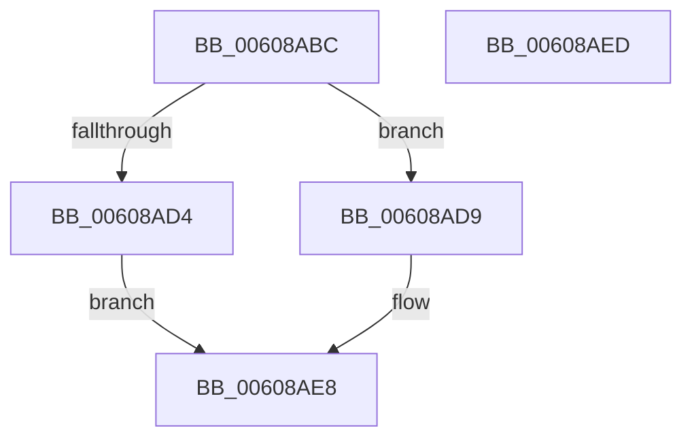

# Feature_LearningModeViolationLogWithSids__private_IsEnabledDeviceUsageNoInline

- RVA: `0x00608ABC`–`0x00608AEE` (길이 `50` bytes)
- VA: `0x0000000140608ABC`
- 실행 섹션: `.text`
- PDB 이름 있음: `예`; PDB Function 태그: `아니요`
- unwind 정보 RVA: `0x0005C788`
- 디코드: `14`개 명령, `50/50` bytes 표시
- 미해석 바이트: `0` (있으면 어셈블리에 `.byte`로 보존)

> 이 문서는 커널 이미지의 기계어와 PDB 기호를 분석해 생성했습니다. 4번과 5번은 함수 원형과 자료형을 바이너리 사용 방식에서 추정한 C 해석이며 원본 소스 복구 결과는 아닙니다.

## 1. Dependencies

- 직접 호출 지점: **1**; 고유 호출 대상: **1**
- 직접 호출자로 확인된 함수: **1**
- RIP 상대 이미지 참조: **1**

### Outgoing calls
- `0x00608AE3` → [Feature_LearningModeViolationLogWithSids__private_IsEnabledFallback](Feature_LearningModeViolationLogWithSids__private_IsEnabledFallback_function_00608AF4.md) (function, `0x00608AF4`)

### Direct callers
- [SeReportLearningModeViolation](SeReportLearningModeViolation_function_00608B50.md) at `0x00608C40`
- [SeReportLearningModeViolation](SeReportLearningModeViolation_function_00608B50.md) at `0x00608C9D`

### Static image references
- `0x00608AC6` → RVA `0x00FC4A30` (`.data`; read)

## 2. Other-region calls and transfers

- 다른 실행 섹션으로 향하는 call: **0**
- 별도 외부 분기/꼬리 이동을 확인하지 못했습니다.

## 3. Assembly (complete function range)

```asm
00608ABC  48 83 EC 28                     sub rsp, 0x28
00608AC0  48 83 64 24 30 00               and qword ptr [rsp + 0x30], 0
00608AC6  8B 05 64 BF 9B 00               mov eax, dword ptr [rip + 0x9bbf64]
00608ACC  89 44 24 30                     mov dword ptr [rsp + 0x30], eax
00608AD0  A8 10                           test al, 0x10
00608AD2  74 05                           je 0x140608ad9
00608AD4  83 E0 01                        and eax, 1
00608AD7  EB 0F                           jmp 0x140608ae8
00608AD9  48 8B 4C 24 30                  mov rcx, qword ptr [rsp + 0x30]
00608ADE  BA 03 00 00 00                  mov edx, 3
00608AE3  E8 0C 00 00 00                  call 0x140608af4
00608AE8  48 83 C4 28                     add rsp, 0x28
00608AEC  C3                              ret
00608AED  CC                              int3
```

## 4. C-style interpretation (structured pseudocode)

```c
__int64 __fastcall Feature_LearningModeViolationLogWithSids__private_IsEnabledDeviceUsageNoInline(void)
{
    __int64 result;
    __int64 v_rsp;
    unsigned __int64 v_stack_p8;

    v_rsp = (v_rsp) - (40);
    v_stack_p8 = (unsigned int)((unsigned int)(*(unsigned int *)(v_rip + 10207076)));
    if ((((unsigned __int8)((unsigned int)(*(unsigned int *)(v_rip + 10207076)))) & (16)) == 0) goto loc_00608AD9;
    result = (unsigned int)(((unsigned int)(*(unsigned int *)(v_rip + 10207076))) & (1));
    goto loc_00608AE8;
loc_00608AD9:
    result = Feature_LearningModeViolationLogWithSids__private_IsEnabledFallback(v_stack_p8, 3, a3, a4);
loc_00608AE8:
    v_rsp = (v_rsp) + (40);
    return result;
}
```

## 5. (Beta) C Style

```c
void Feature_LearningModeViolationLogWithSids__private_IsEnabledDeviceUsageNoInline(void)
{
    int64_t result;
    int64_t local_rsp;
    uint64_t v_stack_p8;

    local_rsp = (local_rsp) - (40);
    v_stack_p8 = (uint32_t)((uint32_t)(*(uint32_t *)(v_rip + 0x9BBF64)));
    if ((((uint8_t)((uint32_t)(*(uint32_t *)(v_rip + 0x9BBF64)))) & (16)) == 0) goto loc_00608AD9;
    result = (uint32_t)(((uint32_t)(*(uint32_t *)(v_rip + 0x9BBF64))) & (1));
    goto loc_00608AE8;
loc_00608AD9:
    result = Feature_LearningModeViolationLogWithSids__private_IsEnabledFallback(v_stack_p8, 3, a3, a4);
loc_00608AE8:
    local_rsp = (local_rsp) + (40);
    return result;
}
```

## 6. Execution-region graph

[열기: 2D/3D 그래프와 함수 탐색 컨트롤 패널](../../../control-panel.html?section=text&rva=0x00608ABC&view=graph)

- 2D 그래프는 위에서 아래로 흐르고, 3D 그래프는 빈 공간을 드래그해 회전합니다. Shift+드래그는 이동, 휠은 확대·축소, 함수 노드 선택은 대상 보고서 이동입니다.

### Static fallback


