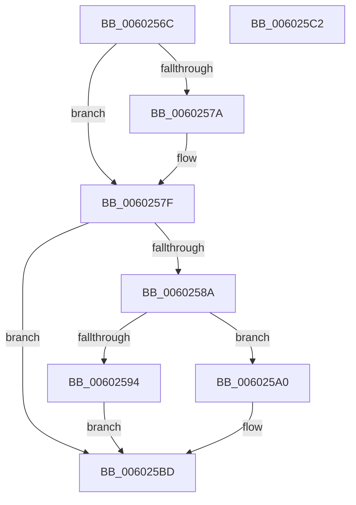

# HviEnterKernelAperture

- RVA: `0x0060256C`–`0x006025C3` (길이 `87` bytes)
- VA: `0x000000014060256C`
- 실행 섹션: `.text`
- PDB 이름 있음: `예`; PDB Function 태그: `아니요`
- unwind 정보 RVA: `0x0005C788`
- 디코드: `23`개 명령, `87/87` bytes 표시
- 미해석 바이트: `0` (있으면 어셈블리에 `.byte`로 보존)

> 이 문서는 커널 이미지의 기계어와 PDB 기호를 분석해 생성했습니다. 4번과 5번은 함수 원형과 자료형을 바이너리 사용 방식에서 추정한 C 해석이며 원본 소스 복구 결과는 아닙니다.

## 1. Dependencies

- 직접 호출 지점: **3**; 고유 호출 대상: **3**
- 직접 호출자로 확인된 함수: **2**
- RIP 상대 이미지 참조: **3**

### Outgoing calls
- `0x0060257A` → [HvipApertureDetectParameters](HvipApertureDetectParameters_function_0060268C.md) (function, `0x0060268C`)
- `0x00602599` → [HvipApertureVmfuncSwitchEptp](../6B/HvipApertureVmfuncSwitchEptp_function_006BBBD0.md) (function, `0x006BBBD0`)
- `0x006025B8` → [HvipApertureDirectHypercall](HvipApertureDirectHypercall_function_00602758.md) (function, `0x00602758`)

### Direct callers
- [HviCopyMemoryNonTemporal](../3C/HviCopyMemoryNonTemporal_function_003CC344.md) at `0x003CC37D`
- [HviCopyMemory](../3C/HviCopyMemory_function_003CC53C.md) at `0x003CC575`

### Static image references
- `0x00602570` → RVA `0x00E67B65` (`.data`; read)
- `0x00602581` → RVA `0x00E0CCA2` (`.data`; read)
- `0x0060258A` → RVA `0x00E67B66` (`.data`; read)

## 2. Other-region calls and transfers

- 다른 실행 섹션으로 향하는 call: **0**
- 별도 외부 분기/꼬리 이동을 확인하지 못했습니다.

## 3. Assembly (complete function range)

```asm
0060256C  48 83 EC 28                     sub rsp, 0x28
00602570  8A 05 EF 55 86 00               mov al, byte ptr [rip + 0x8655ef]
00602576  84 C0                           test al, al
00602578  75 05                           jne 0x14060257f
0060257A  E8 0D 01 00 00                  call 0x14060268c
0060257F  90                              nop
00602580  FA                              cli
00602581  80 3D 1A A7 80 00 00            cmp byte ptr [rip + 0x80a71a], 0
00602588  75 33                           jne 0x1406025bd
0060258A  8A 05 D6 55 86 00               mov al, byte ptr [rip + 0x8655d6]
00602590  84 C0                           test al, al
00602592  74 0C                           je 0x1406025a0
00602594  B9 01 00 00 00                  mov ecx, 1
00602599  E8 32 96 0B 00                  call 0x1406bbbd0
0060259E  EB 1D                           jmp 0x1406025bd
006025A0  48 83 64 24 30 00               and qword ptr [rsp + 0x30], 0
006025A6  BA 01 00 00 00                  mov edx, 1
006025AB  C7 44 24 30 06 00 00 00         mov dword ptr [rsp + 0x30], 6
006025B3  48 8B 4C 24 30                  mov rcx, qword ptr [rsp + 0x30]
006025B8  E8 9B 01 00 00                  call 0x140602758
006025BD  48 83 C4 28                     add rsp, 0x28
006025C1  C3                              ret
006025C2  CC                              int3
```

## 4. C-style interpretation (structured pseudocode)

```c
__int64 __fastcall HviEnterKernelAperture(void)
{
    __int64 result;
    __int64 v_rsp;
    unsigned __int64 v_stack_p8;

    v_rsp = (v_rsp) - (40);
    result = *(unsigned __int8 *)(v_rip + 8803823);
    if ((unsigned __int8)(*(unsigned __int8 *)(v_rip + 8803823)) == 0) {
        result = HvipApertureDetectParameters(a1, a2, a3, a4);
    }
    if ((*(unsigned __int8 *)(v_rip + 8431386)) != 0) goto loc_006025BD;
    if ((unsigned __int8)(*(unsigned __int8 *)(v_rip + 8803798)) == 0) goto loc_006025A0;
    result = HvipApertureVmfuncSwitchEptp(1, a2, a3, a4);
    goto loc_006025BD;
loc_006025A0:
    v_stack_p8 = 6;
    result = HvipApertureDirectHypercall(v_stack_p8, 1, a3, a4);
loc_006025BD:
    v_rsp = (v_rsp) + (40);
    return result;
}
```

## 5. (Beta) C Style

```c
void HviEnterKernelAperture(void)
{
    int64_t result;
    int64_t local_rsp;
    uint64_t v_stack_p8;

    local_rsp = (local_rsp) - (40);
    result = *(uint8_t *)(v_rip + 0x8655EF);
    if ((uint8_t)(*(uint8_t *)(v_rip + 0x8655EF)) == 0) {
        result = HvipApertureDetectParameters(a1, a2, a3, a4);
    }
    if ((*(uint8_t *)(v_rip + 0x80A71A)) != 0) goto loc_006025BD;
    if ((uint8_t)(*(uint8_t *)(v_rip + 0x8655D6)) == 0) goto loc_006025A0;
    result = HvipApertureVmfuncSwitchEptp(1, a2, a3, a4);
    goto loc_006025BD;
loc_006025A0:
    v_stack_p8 = 6;
    result = HvipApertureDirectHypercall(v_stack_p8, 1, a3, a4);
loc_006025BD:
    local_rsp = (local_rsp) + (40);
    return result;
}
```

## 6. Execution-region graph

[열기: 2D/3D 그래프와 함수 탐색 컨트롤 패널](../../../control-panel.html?section=text&rva=0x0060256C&view=graph)

- 2D 그래프는 위에서 아래로 흐르고, 3D 그래프는 빈 공간을 드래그해 회전합니다. Shift+드래그는 이동, 휠은 확대·축소, 함수 노드 선택은 대상 보고서 이동입니다.

### Static fallback


