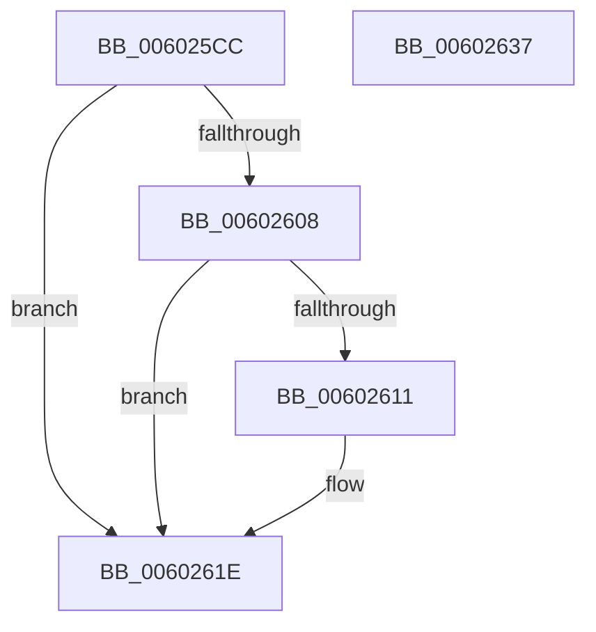

# HviIsKernelApertureAvailable

- RVA: `0x006025CC`–`0x00602638` (길이 `108` bytes)
- VA: `0x00000001406025CC`
- 실행 섹션: `.text`
- PDB 이름 있음: `예`; PDB Function 태그: `아니요`
- unwind 정보 RVA: `0x000606C0`
- 디코드: `31`개 명령, `108/108` bytes 표시
- 미해석 바이트: `0` (있으면 어셈블리에 `.byte`로 보존)

> 이 문서는 커널 이미지의 기계어와 PDB 기호를 분석해 생성했습니다. 4번과 5번은 함수 원형과 자료형을 바이너리 사용 방식에서 추정한 C 해석이며 원본 소스 복구 결과는 아닙니다.

## 1. Dependencies

- 직접 호출 지점: **3**; 고유 호출 대상: **3**
- 직접 호출자로 확인된 함수: **1**
- RIP 상대 이미지 참조: **1**

### Outgoing calls
- `0x006025F6` → [HviGetHypervisorFeatures](../66/HviGetHypervisorFeatures_function_00666630.md) (function, `0x00666630`)
- `0x00602608` → [HviIsHypervisorVendorMicrosoft](../66/HviIsHypervisorVendorMicrosoft_function_00666920.md) (function, `0x00666920`)
- `0x0060262C` → [_security_check_cookie](../6A/_security_check_cookie_function_006AC640.md) (function, `0x006AC640`)

### Direct callers
- [HvipApertureDetectParameters](HvipApertureDetectParameters_function_0060268C.md) at `0x006026F0`

### Static image references
- `0x006025D2` → RVA `0x00E0A740` (`.data`; read)

## 2. Other-region calls and transfers

- 다른 실행 섹션으로 향하는 call: **0**
- 별도 외부 분기/꼬리 이동을 확인하지 못했습니다.

## 3. Assembly (complete function range)

```asm
006025CC  40 53                           push rbx
006025CE  48 83 EC 50                     sub rsp, 0x50
006025D2  48 8B 05 67 81 80 00            mov rax, qword ptr [rip + 0x808167]
006025D9  48 33 C4                        xor rax, rsp
006025DC  48 89 44 24 40                  mov qword ptr [rsp + 0x40], rax
006025E1  0F 57 C0                        xorps xmm0, xmm0
006025E4  48 8D 4C 24 30                  lea rcx, [rsp + 0x30]
006025E9  0F 57 C9                        xorps xmm1, xmm1
006025EC  0F 11 44 24 20                  movups xmmword ptr [rsp + 0x20], xmm0
006025F1  0F 11 4C 24 30                  movups xmmword ptr [rsp + 0x30], xmm1
006025F6  E8 35 40 06 00                  call 0x140666630
006025FB  48 8B 44 24 30                  mov rax, qword ptr [rsp + 0x30]
00602600  48 C1 E8 2C                     shr rax, 0x2c
00602604  A8 01                           test al, 1
00602606  74 16                           je 0x14060261e
00602608  E8 13 43 06 00                  call 0x140666920
0060260D  84 C0                           test al, al
0060260F  74 0D                           je 0x14060261e
00602611  B8 07 00 00 40                  mov eax, 0x40000007
00602616  33 C9                           xor ecx, ecx
00602618  0F A2                           cpuid
0060261A  89 4C 24 28                     mov dword ptr [rsp + 0x28], ecx
0060261E  8A 44 24 28                     mov al, byte ptr [rsp + 0x28]
00602622  24 01                           and al, 1
00602624  48 8B 4C 24 40                  mov rcx, qword ptr [rsp + 0x40]
00602629  48 33 CC                        xor rcx, rsp
0060262C  E8 0F A0 0A 00                  call 0x1406ac640
00602631  48 83 C4 50                     add rsp, 0x50
00602635  5B                              pop rbx
00602636  C3                              ret
00602637  CC                              int3
```

## 4. C-style interpretation (structured pseudocode)

```c
__int64 __fastcall HviIsKernelApertureAvailable(void)
{
    __int64 result;
    __int64 v_rsp;
    unsigned __int64 v_stack_m18;
    unsigned __int64 v_stack_m28;
    unsigned int v_stack_m30;
    unsigned __int64 v_stack_m38;

    v_rsp = (v_rsp) - (80);
    result = (*(unsigned __int64 *)(v_rip + 8421735)) ^ (v_rsp);
    v_stack_m18 = result;
    v_stack_m38 = v_xmm0;
    v_stack_m28 = v_xmm1;
    result = HviGetHypervisorFeatures(v_stack_m28, a2, a3, a4);
    result = (v_stack_m28) >> (44);
    if ((((unsigned __int8)(result)) & (1)) == 0) goto loc_0060261E;
    result = HviIsHypervisorVendorMicrosoft(v_stack_m28, a2, a3, a4);
    if ((unsigned __int8)(result) != 0) {
        result = 0x40000007ULL;
        a1 = 0;
        v_stack_m30 = 0;
    }
    result = (unsigned __int8)((v_stack_m30) & (1));
    a1 = (v_stack_m18) ^ (v_rsp);
    result = _security_check_cookie(a1, a2, a3, a4);
    v_rsp = (v_rsp) + (80);
    return result;
}
```

## 5. (Beta) C Style

```c
void HviIsKernelApertureAvailable(void)
{
    int64_t result;
    int64_t local_rsp;
    uint64_t v_stack_m18;
    uint64_t v_stack_m28;
    uint32_t v_stack_m30;
    uint64_t v_stack_m38;

    local_rsp = (local_rsp) - (80);
    result = (*(uint64_t *)(v_rip + 0x808167)) ^ (local_rsp);
    v_stack_m18 = result;
    v_stack_m38 = v_xmm0;
    v_stack_m28 = v_xmm1;
    result = HviGetHypervisorFeatures(v_stack_m28, a2, a3, a4);
    result = (v_stack_m28) >> (44);
    if ((((uint8_t)(result)) & (1)) == 0) goto loc_0060261E;
    result = HviIsHypervisorVendorMicrosoft(v_stack_m28, a2, a3, a4);
    if ((uint8_t)(result) != 0) {
        result = 0x40000007ULL;
        a1 = 0;
        v_stack_m30 = 0;
    }
    result = (uint8_t)((v_stack_m30) & (1));
    a1 = (v_stack_m18) ^ (local_rsp);
    result = _security_check_cookie(a1, a2, a3, a4);
    local_rsp = (local_rsp) + (80);
    return result;
}
```

## 6. Execution-region graph

[열기: 2D/3D 그래프와 함수 탐색 컨트롤 패널](../../../control-panel.html?section=text&rva=0x006025CC&view=graph)

- 2D 그래프는 위에서 아래로 흐르고, 3D 그래프는 빈 공간을 드래그해 회전합니다. Shift+드래그는 이동, 휠은 확대·축소, 함수 노드 선택은 대상 보고서 이동입니다.

### Static fallback


