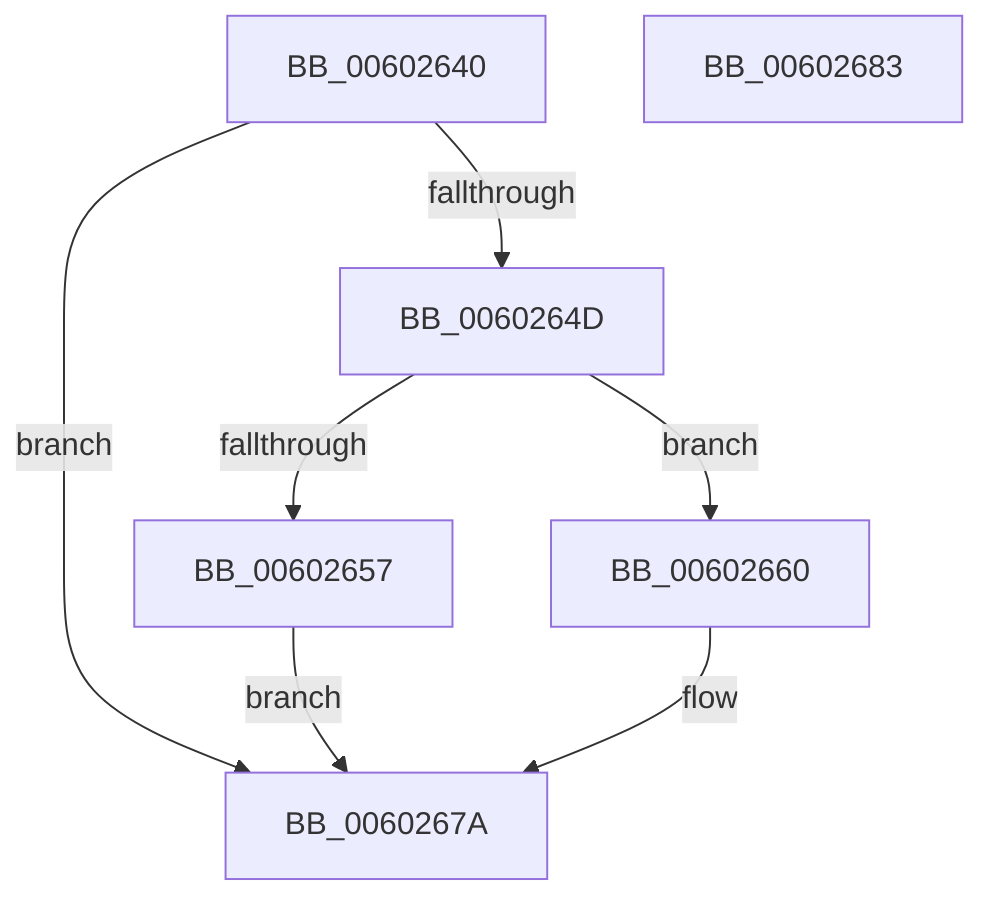

# HviLeaveKernelAperture

- RVA: `0x00602640`–`0x00602684` (길이 `68` bytes)
- VA: `0x0000000140602640`
- 실행 섹션: `.text`
- PDB 이름 있음: `예`; PDB Function 태그: `아니요`
- unwind 정보 RVA: `0x0005C788`
- 디코드: `19`개 명령, `68/68` bytes 표시
- 미해석 바이트: `0` (있으면 어셈블리에 `.byte`로 보존)

> 이 문서는 커널 이미지의 기계어와 PDB 기호를 분석해 생성했습니다. 4번과 5번은 함수 원형과 자료형을 바이너리 사용 방식에서 추정한 C 해석이며 원본 소스 복구 결과는 아닙니다.

## 1. Dependencies

- 직접 호출 지점: **2**; 고유 호출 대상: **2**
- 직접 호출자로 확인된 함수: **2**
- RIP 상대 이미지 참조: **2**

### Outgoing calls
- `0x00602659` → [HvipApertureVmfuncSwitchEptp](../6B/HvipApertureVmfuncSwitchEptp_function_006BBBD0.md) (function, `0x006BBBD0`)
- `0x00602675` → [HvipApertureDirectHypercall](HvipApertureDirectHypercall_function_00602758.md) (function, `0x00602758`)

### Direct callers
- [HviCopyMemoryNonTemporal](../3C/HviCopyMemoryNonTemporal_function_003CC344.md) at `0x003CC399`
- [HviCopyMemory](../3C/HviCopyMemory_function_003CC53C.md) at `0x003CC58A`

### Static image references
- `0x00602644` → RVA `0x00E0CCA2` (`.data`; read)
- `0x0060264D` → RVA `0x00E67B66` (`.data`; read)

## 2. Other-region calls and transfers

- 다른 실행 섹션으로 향하는 call: **0**
- 별도 외부 분기/꼬리 이동을 확인하지 못했습니다.

## 3. Assembly (complete function range)

```asm
00602640  48 83 EC 28                     sub rsp, 0x28
00602644  80 3D 57 A6 80 00 00            cmp byte ptr [rip + 0x80a657], 0
0060264B  75 2D                           jne 0x14060267a
0060264D  8A 05 13 55 86 00               mov al, byte ptr [rip + 0x865513]
00602653  84 C0                           test al, al
00602655  74 09                           je 0x140602660
00602657  33 C9                           xor ecx, ecx
00602659  E8 72 95 0B 00                  call 0x1406bbbd0
0060265E  EB 1A                           jmp 0x14060267a
00602660  48 83 64 24 30 00               and qword ptr [rsp + 0x30], 0
00602666  33 D2                           xor edx, edx
00602668  C7 44 24 30 06 00 00 00         mov dword ptr [rsp + 0x30], 6
00602670  48 8B 4C 24 30                  mov rcx, qword ptr [rsp + 0x30]
00602675  E8 DE 00 00 00                  call 0x140602758
0060267A  0F AE E8                        lfence
0060267D  FB                              sti
0060267E  48 83 C4 28                     add rsp, 0x28
00602682  C3                              ret
00602683  CC                              int3
```

## 4. C-style interpretation (structured pseudocode)

```c
__int64 __fastcall HviLeaveKernelAperture(int a1, int a2)
{
    __int64 result;
    __int64 v_rsp;
    unsigned __int64 v_stack_p8;

    v_rsp = (v_rsp) - (40);
    if ((*(unsigned __int8 *)(v_rip + 8431191)) != 0) goto loc_0060267A;
    if ((unsigned __int8)(*(unsigned __int8 *)(v_rip + 8803603)) == 0) goto loc_00602660;
    a1 = 0;
    result = HvipApertureVmfuncSwitchEptp(a1, a2, a3, a4);
    goto loc_0060267A;
loc_00602660:
    a2 = 0;
    v_stack_p8 = 6;
    result = HvipApertureDirectHypercall(v_stack_p8, a2, a3, a4);
loc_0060267A:
    v_rsp = (v_rsp) + (40);
    return result;
}
```

## 5. (Beta) C Style

```c
int64_t HviLeaveKernelAperture(int32_t Arg1, int32_t Arg2)
{
    int64_t result;
    int64_t local_rsp;
    uint64_t v_stack_p8;

    local_rsp = (local_rsp) - (40);
    if ((*(uint8_t *)(v_rip + 0x80A657)) != 0) goto loc_0060267A;
    if ((uint8_t)(*(uint8_t *)(v_rip + 0x865513)) == 0) goto loc_00602660;
    Arg1 = 0;
    result = HvipApertureVmfuncSwitchEptp(Arg1, Arg2, a3, a4);
    goto loc_0060267A;
loc_00602660:
    Arg2 = 0;
    v_stack_p8 = 6;
    result = HvipApertureDirectHypercall(v_stack_p8, Arg2, a3, a4);
loc_0060267A:
    local_rsp = (local_rsp) + (40);
    return result;
}
```

## 6. Execution-region graph

[열기: 2D/3D 그래프와 함수 탐색 컨트롤 패널](../../../control-panel.html?section=text&rva=0x00602640&view=graph)

- 2D 그래프는 위에서 아래로 흐르고, 3D 그래프는 빈 공간을 드래그해 회전합니다. Shift+드래그는 이동, 휠은 확대·축소, 함수 노드 선택은 대상 보고서 이동입니다.

### Static fallback


