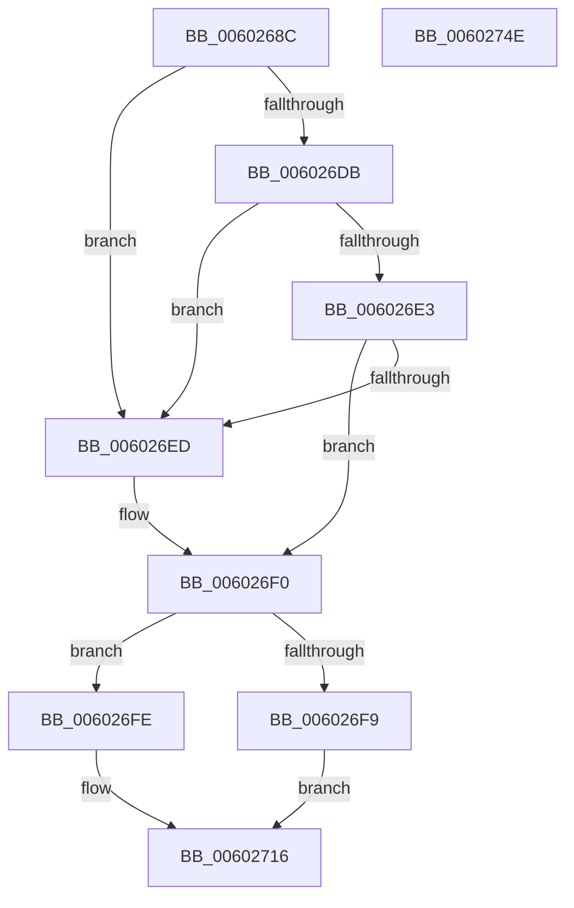

# HvipApertureDetectParameters

- RVA: `0x0060268C`–`0x0060274F` (길이 `195` bytes)
- VA: `0x000000014060268C`
- 실행 섹션: `.text`
- PDB 이름 있음: `예`; PDB Function 태그: `예`
- unwind 정보 RVA: `0x000C47B4`
- 디코드: `51`개 명령, `195/195` bytes 표시
- 미해석 바이트: `0` (있으면 어셈블리에 `.byte`로 보존)

> 이 문서는 커널 이미지의 기계어와 PDB 기호를 분석해 생성했습니다. 4번과 5번은 함수 원형과 자료형을 바이너리 사용 방식에서 추정한 C 해석이며 원본 소스 복구 결과는 아닙니다.

## 1. Dependencies

- 직접 호출 지점: **3**; 고유 호출 대상: **3**
- 직접 호출자로 확인된 함수: **1**
- RIP 상대 이미지 참조: **5**

### Outgoing calls
- `0x006026F0` → [HviIsKernelApertureAvailable](HviIsKernelApertureAvailable_function_006025CC.md) (function, `0x006025CC`)
- `0x00602706` → [HviGetHardwareFeatures](../4A/HviGetHardwareFeatures_function_004ADBC0.md) (function, `0x004ADBC0`)
- `0x00602739` → [_security_check_cookie](../6A/_security_check_cookie_function_006AC640.md) (function, `0x006AC640`)

### Direct callers
- [HviEnterKernelAperture](HviEnterKernelAperture_function_0060256C.md) at `0x0060257A`

### Static image references
- `0x0060269B` → RVA `0x00E0A740` (`.data`; read)
- `0x00602716` → RVA `0x00E67B64` (`.data`; write)
- `0x0060271C` → RVA `0x00E0CCA2` (`.data`; write)
- `0x00602723` → RVA `0x00E67B66` (`.data`; write)
- `0x0060272A` → RVA `0x00E67B65` (`.data`; write)

## 2. Other-region calls and transfers

- 다른 실행 섹션으로 향하는 call: **0**
- 별도 외부 분기/꼬리 이동을 확인하지 못했습니다.

## 3. Assembly (complete function range)

```asm
0060268C  48 89 5C 24 08                  mov qword ptr [rsp + 8], rbx
00602691  48 89 74 24 10                  mov qword ptr [rsp + 0x10], rsi
00602696  57                              push rdi
00602697  48 83 EC 50                     sub rsp, 0x50
0060269B  48 8B 05 9E 80 80 00            mov rax, qword ptr [rip + 0x80809e]
006026A2  48 33 C4                        xor rax, rsp
006026A5  48 89 44 24 40                  mov qword ptr [rsp + 0x40], rax
006026AA  33 C0                           xor eax, eax
006026AC  33 C9                           xor ecx, ecx
006026AE  0F A2                           cpuid
006026B0  0F 57 C0                        xorps xmm0, xmm0
006026B3  40 32 FF                        xor dil, dil
006026B6  0F 57 C9                        xorps xmm1, xmm1
006026B9  0F 11 44 24 20                  movups xmmword ptr [rsp + 0x20], xmm0
006026BE  89 44 24 20                     mov dword ptr [rsp + 0x20], eax
006026C2  89 5C 24 24                     mov dword ptr [rsp + 0x24], ebx
006026C6  89 4C 24 28                     mov dword ptr [rsp + 0x28], ecx
006026CA  89 54 24 2C                     mov dword ptr [rsp + 0x2c], edx
006026CE  0F 11 4C 24 30                  movups xmmword ptr [rsp + 0x30], xmm1
006026D3  81 FB 47 65 6E 75               cmp ebx, 0x756e6547
006026D9  75 12                           jne 0x1406026ed
006026DB  81 FA 69 6E 65 49               cmp edx, 0x49656e69
006026E1  75 0A                           jne 0x1406026ed
006026E3  B3 01                           mov bl, 1
006026E5  81 F9 6E 74 65 6C               cmp ecx, 0x6c65746e
006026EB  74 03                           je 0x1406026f0
006026ED  40 8A DF                        mov bl, dil
006026F0  E8 D7 FE FF FF                  call 0x1406025cc
006026F5  84 C0                           test al, al
006026F7  75 05                           jne 0x1406026fe
006026F9  40 B6 01                        mov sil, 1
006026FC  EB 18                           jmp 0x140602716
006026FE  48 8D 4C 24 30                  lea rcx, [rsp + 0x30]
00602703  40 8A F7                        mov sil, dil
00602706  E8 B5 B4 EA FF                  call 0x1404adbc0
0060270B  8B 7C 24 30                     mov edi, dword ptr [rsp + 0x30]
0060270F  C1 EF 0F                        shr edi, 0xf
00602712  40 80 E7 01                     and dil, 1
00602716  88 1D 48 54 86 00               mov byte ptr [rip + 0x865448], bl
0060271C  40 88 35 7F A5 80 00            mov byte ptr [rip + 0x80a57f], sil
00602723  40 88 3D 3C 54 86 00            mov byte ptr [rip + 0x86543c], dil
0060272A  C6 05 34 54 86 00 01            mov byte ptr [rip + 0x865434], 1
00602731  48 8B 4C 24 40                  mov rcx, qword ptr [rsp + 0x40]
00602736  48 33 CC                        xor rcx, rsp
00602739  E8 02 9F 0A 00                  call 0x1406ac640
0060273E  48 8B 5C 24 60                  mov rbx, qword ptr [rsp + 0x60]
00602743  48 8B 74 24 68                  mov rsi, qword ptr [rsp + 0x68]
00602748  48 83 C4 50                     add rsp, 0x50
0060274C  5F                              pop rdi
0060274D  C3                              ret
0060274E  CC                              int3
```

## 4. C-style interpretation (structured pseudocode)

```c
__int64 __fastcall HvipApertureDetectParameters(int a1, int a2)
{
    __int64 result;
    __int64 v_rbx;
    __int64 v_rdi;
    __int64 v_rsp;
    unsigned __int64 v_stack_m18;
    unsigned __int64 v_stack_m28;
    unsigned int v_stack_m2C;
    unsigned int v_stack_m30;
    unsigned int v_stack_m34;
    unsigned __int64 v_stack_m38;
    unsigned __int64 v_stack_p10;
    unsigned __int64 v_stack_p8;

    v_stack_p8 = v_rbx;
    v_stack_p10 = v_rsi;
    v_rsp = (v_rsp) - (80);
    result = (*(unsigned __int64 *)(v_rip + 8421534)) ^ (v_rsp);
    v_stack_m18 = result;
    result = 0;
    a1 = 0;
    v_rdi = 0;
    v_stack_m38 = v_xmm0;
    v_stack_m38 = 0;
    v_stack_m34 = (unsigned int)(v_rbx);
    v_stack_m30 = 0;
    v_stack_m2C = a2;
    v_stack_m28 = v_xmm1;
    if (((unsigned int)(v_rbx)) != 0x756E6547ULL) goto loc_006026ED;
    if (a2 != 0x49656E69ULL) goto loc_006026ED;
    v_rbx = 1;
    if (0 != 0x6C65746EULL) {
        v_rbx = 0;
    }
    result = HviIsKernelApertureAvailable(a1, a2, a3, a4);
    if ((unsigned __int8)(result) != 0) goto loc_006026FE;
    goto loc_00602716;
loc_006026FE:
    result = HviGetHardwareFeatures(v_stack_m28, a2, a3, a4);
    v_rdi = (unsigned int)(((unsigned int)(v_stack_m28)) >> (15));
    v_rdi = (unsigned __int8)((v_rdi) & (1));
loc_00602716:
    *(unsigned __int8 *)(v_rip + 8803400) = (unsigned __int8)(v_rbx);
    *(unsigned __int8 *)(v_rip + 8430975) = 0;
    *(unsigned __int8 *)(v_rip + 8803388) = (unsigned __int8)(v_rdi);
    *(unsigned __int8 *)(v_rip + 8803380) = 1;
    a1 = (v_stack_m18) ^ (v_rsp);
    result = _security_check_cookie(a1, a2, a3, a4);
    v_rsp = (v_rsp) + (80);
    return result;
}
```

## 5. (Beta) C Style

```c
int64_t HvipApertureDetectParameters(int32_t Arg1, int32_t Arg2)
{
    int64_t result;
    int64_t local_rbx;
    int64_t local_rdi;
    int64_t local_rsp;
    uint64_t v_stack_m18;
    uint64_t v_stack_m28;
    uint32_t v_stack_m2C;
    uint32_t v_stack_m30;
    uint32_t v_stack_m34;
    uint64_t v_stack_m38;
    uint64_t v_stack_p10;
    uint64_t v_stack_p8;

    v_stack_p8 = local_rbx;
    v_stack_p10 = local_rsi;
    local_rsp = (local_rsp) - (80);
    result = (*(uint64_t *)(v_rip + 0x80809E)) ^ (local_rsp);
    v_stack_m18 = result;
    result = 0;
    Arg1 = 0;
    local_rdi = 0;
    v_stack_m38 = v_xmm0;
    v_stack_m38 = 0;
    v_stack_m34 = (uint32_t)(local_rbx);
    v_stack_m30 = 0;
    v_stack_m2C = Arg2;
    v_stack_m28 = v_xmm1;
    if (((uint32_t)(local_rbx)) != 0x756E6547ULL) goto loc_006026ED;
    if (Arg2 != 0x49656E69ULL) goto loc_006026ED;
    local_rbx = 1;
    if (0 != 0x6C65746EULL) {
        local_rbx = 0;
    }
    result = HviIsKernelApertureAvailable(Arg1, Arg2, a3, a4);
    if ((uint8_t)(result) != 0) goto loc_006026FE;
    goto loc_00602716;
loc_006026FE:
    result = HviGetHardwareFeatures(v_stack_m28, Arg2, a3, a4);
    local_rdi = (uint32_t)(((uint32_t)(v_stack_m28)) >> (15));
    local_rdi = (uint8_t)((local_rdi) & (1));
loc_00602716:
    *(uint8_t *)(v_rip + 0x865448) = (uint8_t)(local_rbx);
    *(uint8_t *)(v_rip + 0x80A57F) = 0;
    *(uint8_t *)(v_rip + 0x86543C) = (uint8_t)(local_rdi);
    *(uint8_t *)(v_rip + 0x865434) = 1;
    Arg1 = (v_stack_m18) ^ (local_rsp);
    result = _security_check_cookie(Arg1, Arg2, a3, a4);
    local_rsp = (local_rsp) + (80);
    return result;
}
```

## 6. Execution-region graph

[열기: 2D/3D 그래프와 함수 탐색 컨트롤 패널](../../../control-panel.html?section=text&rva=0x0060268C&view=graph)

- 2D 그래프는 위에서 아래로 흐르고, 3D 그래프는 빈 공간을 드래그해 회전합니다. Shift+드래그는 이동, 휠은 확대·축소, 함수 노드 선택은 대상 보고서 이동입니다.

### Static fallback


