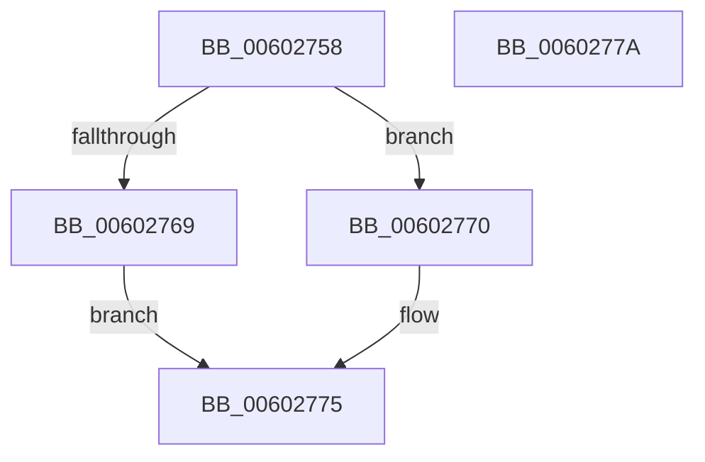

# HvipApertureDirectHypercall

- RVA: `0x00602758`–`0x0060277B` (길이 `35` bytes)
- VA: `0x0000000140602758`
- 실행 섹션: `.text`
- PDB 이름 있음: `예`; PDB Function 태그: `예`
- unwind 정보 RVA: `0x0005C788`
- 디코드: `11`개 명령, `35/35` bytes 표시
- 미해석 바이트: `0` (있으면 어셈블리에 `.byte`로 보존)

> 이 문서는 커널 이미지의 기계어와 PDB 기호를 분석해 생성했습니다. 4번과 5번은 함수 원형과 자료형을 바이너리 사용 방식에서 추정한 C 해석이며 원본 소스 복구 결과는 아닙니다.

## 1. Dependencies

- 직접 호출 지점: **2**; 고유 호출 대상: **2**
- 직접 호출자로 확인된 함수: **2**
- RIP 상대 이미지 참조: **1**

### Outgoing calls
- `0x00602769` → [HvipApertureIntelVmcall](../6B/HvipApertureIntelVmcall_function_006BBBE0.md) (function, `0x006BBBE0`)
- `0x00602770` → [HvipApertureAmdVmcall](../6B/HvipApertureAmdVmcall_function_006BBBF0.md) (function, `0x006BBBF0`)

### Direct callers
- [HviEnterKernelAperture](HviEnterKernelAperture_function_0060256C.md) at `0x006025B8`
- [HviLeaveKernelAperture](HviLeaveKernelAperture_function_00602640.md) at `0x00602675`

### Static image references
- `0x0060275C` → RVA `0x00E67B64` (`.data`; read)

## 2. Other-region calls and transfers

- 다른 실행 섹션으로 향하는 call: **0**
- 별도 외부 분기/꼬리 이동을 확인하지 못했습니다.

## 3. Assembly (complete function range)

```asm
00602758  48 83 EC 28                     sub rsp, 0x28
0060275C  8A 05 02 54 86 00               mov al, byte ptr [rip + 0x865402]
00602762  45 33 C0                        xor r8d, r8d
00602765  84 C0                           test al, al
00602767  74 07                           je 0x140602770
00602769  E8 72 94 0B 00                  call 0x1406bbbe0
0060276E  EB 05                           jmp 0x140602775
00602770  E8 7B 94 0B 00                  call 0x1406bbbf0
00602775  48 83 C4 28                     add rsp, 0x28
00602779  C3                              ret
0060277A  CC                              int3
```

## 4. C-style interpretation (structured pseudocode)

```c
__int64 __fastcall HvipApertureDirectHypercall(__int64 a1, __int64 a2, int a3)
{
    __int64 result;
    __int64 v_rsp;

    v_rsp = (v_rsp) - (40);
    a3 = 0;
    if ((unsigned __int8)(*(unsigned __int8 *)(v_rip + 8803330)) == 0) goto loc_00602770;
    result = HvipApertureIntelVmcall(a1, a2, a3, a4);
    goto loc_00602775;
loc_00602770:
    result = HvipApertureAmdVmcall(a1, a2, a3, a4);
loc_00602775:
    v_rsp = (v_rsp) + (40);
    return result;
}
```

## 5. (Beta) C Style

```c
int64_t HvipApertureDirectHypercall(int64_t Arg1, int64_t Arg2, int32_t Arg3)
{
    int64_t result;
    int64_t local_rsp;

    local_rsp = (local_rsp) - (40);
    Arg3 = 0;
    if ((uint8_t)(*(uint8_t *)(v_rip + 0x865402)) == 0) goto loc_00602770;
    result = HvipApertureIntelVmcall(Arg1, Arg2, Arg3, a4);
    goto loc_00602775;
loc_00602770:
    result = HvipApertureAmdVmcall(Arg1, Arg2, Arg3, a4);
loc_00602775:
    local_rsp = (local_rsp) + (40);
    return result;
}
```

## 6. Execution-region graph

[열기: 2D/3D 그래프와 함수 탐색 컨트롤 패널](../../../control-panel.html?section=text&rva=0x00602758&view=graph)

- 2D 그래프는 위에서 아래로 흐르고, 3D 그래프는 빈 공간을 드래그해 회전합니다. Shift+드래그는 이동, 휠은 확대·축소, 함수 노드 선택은 대상 보고서 이동입니다.

### Static fallback


