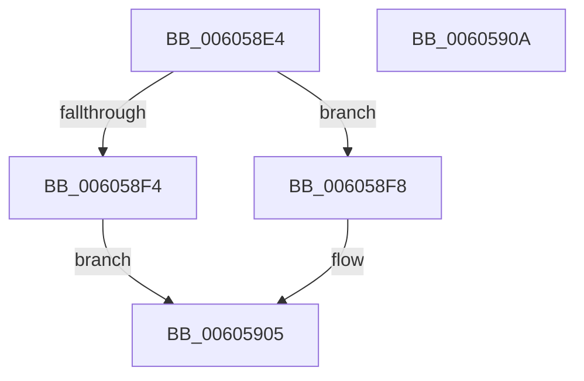

# McGenEventUnregister_EtwUnregister

- RVA: `0x006058E4`–`0x0060590B` (길이 `39` bytes)
- VA: `0x00000001406058E4`
- 실행 섹션: `.text`
- PDB 이름 있음: `예`; PDB Function 태그: `아니요`
- unwind 정보 RVA: `0x0005C788`
- 디코드: `11`개 명령, `39/39` bytes 표시
- 미해석 바이트: `0` (있으면 어셈블리에 `.byte`로 보존)

> 이 문서는 커널 이미지의 기계어와 PDB 기호를 분석해 생성했습니다. 4번과 5번은 함수 원형과 자료형을 바이너리 사용 방식에서 추정한 C 해석이며 원본 소스 복구 결과는 아닙니다.

## 1. Dependencies

- 직접 호출 지점: **1**; 고유 호출 대상: **1**
- 직접 호출자로 확인된 함수: **1**
- RIP 상대 이미지 참조: **2**

### Outgoing calls
- `0x006058F8` → [EtwUnregister](../../page/A7/EtwUnregister_function_00A723D0.md) (function, `0x00A723D0`)

### Direct callers
- [CarCleanup](../61/CarCleanup_function_0061850C.md) at `0x0061854A`

### Static image references
- `0x006058E8` → RVA `0x00E09080` (`.data`; read)
- `0x006058FD` → RVA `0x00E09080` (`.data`; read/write)

## 2. Other-region calls and transfers

- 다른 실행 섹션으로 향하는 call: **1**
  - `0x006058F8` → [EtwUnregister](../../page/A7/EtwUnregister_function_00A723D0.md) (`.text` → `PAGE`)
- 별도 외부 분기/꼬리 이동을 확인하지 못했습니다.

## 3. Assembly (complete function range)

```asm
006058E4  48 83 EC 28                     sub rsp, 0x28
006058E8  48 8B 0D 91 37 80 00            mov rcx, qword ptr [rip + 0x803791]
006058EF  48 85 C9                        test rcx, rcx
006058F2  75 04                           jne 0x1406058f8
006058F4  33 C0                           xor eax, eax
006058F6  EB 0D                           jmp 0x140605905
006058F8  E8 D3 CA 46 00                  call 0x140a723d0
006058FD  48 83 25 7B 37 80 00 00         and qword ptr [rip + 0x80377b], 0
00605905  48 83 C4 28                     add rsp, 0x28
00605909  C3                              ret
0060590A  CC                              int3
```

## 4. C-style interpretation (structured pseudocode)

```c
__int64 __fastcall McGenEventUnregister_EtwUnregister(void)
{
    __int64 result;
    __int64 v_rsp;

    v_rsp = (v_rsp) - (40);
    if (*(unsigned __int64 *)(v_rip + 8402833) != 0) goto loc_006058F8;
    result = 0;
    goto loc_00605905;
loc_006058F8:
    result = EtwUnregister(*(unsigned __int64 *)(v_rip + 8402833), a2, a3, a4);
loc_00605905:
    v_rsp = (v_rsp) + (40);
    return result;
}
```

## 5. (Beta) C Style

```c
void McGenEventUnregister_EtwUnregister(void)
{
    int64_t result;
    int64_t local_rsp;

    local_rsp = (local_rsp) - (40);
    if (*(uint64_t *)(v_rip + 0x803791) != 0) goto loc_006058F8;
    result = 0;
    goto loc_00605905;
loc_006058F8:
    result = EtwUnregister(*(uint64_t *)(v_rip + 0x803791), a2, a3, a4);
loc_00605905:
    local_rsp = (local_rsp) + (40);
    return result;
}
```

## 6. Execution-region graph

[열기: 2D/3D 그래프와 함수 탐색 컨트롤 패널](../../../control-panel.html?section=text&rva=0x006058E4&view=graph)

- 2D 그래프는 위에서 아래로 흐르고, 3D 그래프는 빈 공간을 드래그해 회전합니다. Shift+드래그는 이동, 휠은 확대·축소, 함수 노드 선택은 대상 보고서 이동입니다.

### Static fallback


