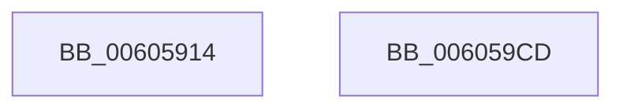

# McTemplateU0qqqqzr3_EtwWriteTransfer

- RVA: `0x00605914`–`0x006059CE` (길이 `186` bytes)
- VA: `0x0000000140605914`
- 실행 섹션: `.text`
- PDB 이름 있음: `예`; PDB Function 태그: `아니요`
- unwind 정보 RVA: `0x000B4EB4`
- 디코드: `42`개 명령, `186/186` bytes 표시
- 미해석 바이트: `0` (있으면 어셈블리에 `.byte`로 보존)

> 이 문서는 커널 이미지의 기계어와 PDB 기호를 분석해 생성했습니다. 4번과 5번은 함수 원형과 자료형을 바이너리 사용 방식에서 추정한 C 해석이며 원본 소스 복구 결과는 아닙니다.

## 1. Dependencies

- 직접 호출 지점: **2**; 고유 호출 대상: **2**
- 직접 호출자로 확인된 함수: **1**
- RIP 상대 이미지 참조: **3**

### Outgoing calls
- `0x006059B3` → [McGenEventWrite_EtwWriteTransfer](../42/McGenEventWrite_EtwWriteTransfer_function_00424FC8.md) (function, `0x00424FC8`)
- `0x006059BF` → [_security_check_cookie](../6A/_security_check_cookie_function_006AC640.md) (function, `0x006AC640`)

### Direct callers
- [Pdcv2EventWrite_ACTIVATION_CLIENT_REGISTER](Pdcv2EventWrite_ACTIVATION_CLIENT_REGISTER_function_00606018.md) at `0x00606060`

### Static image references
- `0x0060592B` → RVA `0x00E0A740` (`.data`; read)
- `0x0060594D` → RVA `0x00E08870` (`.data`; read)
- `0x00605978` → RVA `0x000377A8` (`.rdata`; read)

## 2. Other-region calls and transfers

- 다른 실행 섹션으로 향하는 call: **0**
- 별도 외부 분기/꼬리 이동을 확인하지 못했습니다.

## 3. Assembly (complete function range)

```asm
00605914  44 89 4C 24 20                  mov dword ptr [rsp + 0x20], r9d
00605919  44 89 44 24 18                  mov dword ptr [rsp + 0x18], r8d
0060591E  55                              push rbp
0060591F  48 8D 6C 24 C1                  lea rbp, [rsp - 0x3f]
00605924  48 81 EC B0 00 00 00            sub rsp, 0xb0
0060592B  48 8B 05 0E 4E 80 00            mov rax, qword ptr [rip + 0x804e0e]
00605932  48 33 C4                        xor rax, rsp
00605935  48 89 45 2F                     mov qword ptr [rbp + 0x2f], rax
00605939  33 D2                           xor edx, edx
0060593B  C7 45 BF 02 00 00 00            mov dword ptr [rbp - 0x41], 2
00605942  48 8D 45 5F                     lea rax, [rbp + 0x5f]
00605946  89 55 2B                        mov dword ptr [rbp + 0x2b], edx
00605949  48 89 45 DF                     mov qword ptr [rbp - 0x21], rax
0060594D  48 8D 0D 1C 2F 80 00            lea rcx, [rip + 0x802f1c]
00605954  48 8D 45 67                     lea rax, [rbp + 0x67]
00605958  48 C7 45 E7 04 00 00 00         mov qword ptr [rbp - 0x19], 4
00605960  48 89 45 EF                     mov qword ptr [rbp - 0x11], rax
00605964  44 8D 4A 06                     lea r9d, [rdx + 6]
00605968  48 8D 45 BF                     lea rax, [rbp - 0x41]
0060596C  48 C7 45 F7 04 00 00 00         mov qword ptr [rbp - 9], 4
00605974  48 89 45 FF                     mov qword ptr [rbp - 1], rax
00605978  48 8D 15 29 1E A3 FF            lea rdx, [rip - 0x5ce1d7]
0060597F  48 8D 45 77                     lea rax, [rbp + 0x77]
00605983  48 C7 45 07 04 00 00 00         mov qword ptr [rbp + 7], 4
0060598B  48 89 45 0F                     mov qword ptr [rbp + 0xf], rax
0060598F  45 33 C0                        xor r8d, r8d
00605992  48 8B 45 7F                     mov rax, qword ptr [rbp + 0x7f]
00605996  48 89 45 1F                     mov qword ptr [rbp + 0x1f], rax
0060599A  8B 45 77                        mov eax, dword ptr [rbp + 0x77]
0060599D  03 C0                           add eax, eax
0060599F  48 C7 45 17 04 00 00 00         mov qword ptr [rbp + 0x17], 4
006059A7  89 45 27                        mov dword ptr [rbp + 0x27], eax
006059AA  48 8D 45 CF                     lea rax, [rbp - 0x31]
006059AE  48 89 44 24 20                  mov qword ptr [rsp + 0x20], rax
006059B3  E8 10 F6 E1 FF                  call 0x140424fc8
006059B8  48 8B 4D 2F                     mov rcx, qword ptr [rbp + 0x2f]
006059BC  48 33 CC                        xor rcx, rsp
006059BF  E8 7C 6C 0A 00                  call 0x1406ac640
006059C4  48 81 C4 B0 00 00 00            add rsp, 0xb0
006059CB  5D                              pop rbp
006059CC  C3                              ret
006059CD  CC                              int3
```

## 4. C-style interpretation (structured pseudocode)

```c
__int64 __fastcall McTemplateU0qqqqzr3_EtwWriteTransfer(__int64 a1, int a2, int a3, int a4, __int64 a5, unsigned int a6, __int64 a7)
{
    __int64 result;
    __int64 v_rsp;
    unsigned __int64 v_stack_m18;
    unsigned int v_stack_m1C;
    unsigned int v_stack_m20;
    unsigned __int64 v_stack_m28;
    unsigned __int64 v_stack_m30;
    unsigned __int64 v_stack_m38;
    unsigned __int64 v_stack_m40;
    unsigned __int64 v_stack_m47;
    unsigned __int64 v_stack_m48;
    unsigned __int64 v_stack_m50;
    unsigned __int64 v_stack_m58;
    unsigned __int64 v_stack_m60;
    unsigned __int64 v_stack_m68;
    unsigned __int64 v_stack_m78;
    unsigned int v_stack_m88;
    unsigned __int64 v_stack_m98;
    unsigned int v_stack_p18;
    unsigned int v_stack_p20;

    v_stack_p20 = a4;
    v_stack_p18 = a3;
    v_rsp = (v_rsp) - (176);
    result = (*(unsigned __int64 *)(v_rip + 8408590)) ^ (v_rsp);
    v_stack_m18 = result;
    a2 = 0;
    v_stack_m88 = 2;
    v_stack_m1C = 0;
    v_stack_m68 = v_stack_p18;
    v_stack_m60 = 4;
    v_stack_m58 = v_stack_p20;
    v_stack_m50 = 4;
    v_stack_m48 = v_stack_m88;
    v_stack_m40 = 4;
    v_stack_m38 = a6;
    a3 = 0;
    v_stack_m28 = a7;
    result = (unsigned int)(((unsigned int)(a6)) + ((unsigned int)((unsigned int)(a6))));
    v_stack_m30 = 4;
    v_stack_m20 = (unsigned int)(result);
    v_stack_m98 = v_stack_m78;
    result = McGenEventWrite_EtwWriteTransfer(v_rip + 8400668, v_rip - 6087127, a3, a2 + 6);
    a1 = (v_stack_m18) ^ (v_rsp);
    result = _security_check_cookie(a1, v_rip - 6087127, a3, a2 + 6);
    v_rsp = (v_rsp) + (176);
    return result;
}
```

## 5. (Beta) C Style

```c
int64_t McTemplateU0qqqqzr3_EtwWriteTransfer(int64_t Arg1, int32_t Arg2, int32_t Arg3, int32_t Arg4, uint64_t Arg5, uint32_t Arg6, int64_t Arg7)
{
    int64_t result;
    int64_t local_rsp;
    uint64_t v_stack_m18;
    uint32_t v_stack_m1C;
    uint32_t v_stack_m20;
    uint64_t v_stack_m28;
    uint64_t v_stack_m30;
    uint64_t v_stack_m38;
    uint64_t v_stack_m40;
    uint64_t v_stack_m47;
    uint64_t v_stack_m48;
    uint64_t v_stack_m50;
    uint64_t v_stack_m58;
    uint64_t v_stack_m60;
    uint64_t v_stack_m68;
    uint64_t v_stack_m78;
    uint32_t v_stack_m88;
    uint64_t v_stack_m98;
    uint32_t v_stack_p18;
    uint32_t v_stack_p20;

    v_stack_p20 = Arg4;
    v_stack_p18 = Arg3;
    local_rsp = (local_rsp) - (176);
    result = (*(uint64_t *)(v_rip + 0x804E0E)) ^ (local_rsp);
    v_stack_m18 = result;
    Arg2 = 0;
    v_stack_m88 = 2;
    v_stack_m1C = 0;
    v_stack_m68 = v_stack_p18;
    v_stack_m60 = 4;
    v_stack_m58 = v_stack_p20;
    v_stack_m50 = 4;
    v_stack_m48 = v_stack_m88;
    v_stack_m40 = 4;
    v_stack_m38 = Arg6;
    Arg3 = 0;
    v_stack_m28 = Arg7;
    result = (uint32_t)(((uint32_t)(Arg6)) + ((uint32_t)((uint32_t)(Arg6))));
    v_stack_m30 = 4;
    v_stack_m20 = (uint32_t)(result);
    v_stack_m98 = v_stack_m78;
    result = McGenEventWrite_EtwWriteTransfer(v_rip + 8400668, v_rip - 6087127, Arg3, Arg2 + 6);
    Arg1 = (v_stack_m18) ^ (local_rsp);
    result = _security_check_cookie(Arg1, v_rip - 6087127, Arg3, Arg2 + 6);
    local_rsp = (local_rsp) + (176);
    return result;
}
```

## 6. Execution-region graph

[열기: 2D/3D 그래프와 함수 탐색 컨트롤 패널](../../../control-panel.html?section=text&rva=0x00605914&view=graph)

- 2D 그래프는 위에서 아래로 흐르고, 3D 그래프는 빈 공간을 드래그해 회전합니다. Shift+드래그는 이동, 휠은 확대·축소, 함수 노드 선택은 대상 보고서 이동입니다.

### Static fallback


