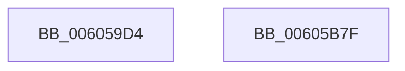

# McTemplateU0qqzr1qzr3qqqxqpqqqzr13q_EtwWriteTransfer

- RVA: `0x006059D4`–`0x00605B80` (길이 `428` bytes)
- VA: `0x00000001406059D4`
- 실행 섹션: `.text`
- PDB 이름 있음: `예`; PDB Function 태그: `아니요`
- unwind 정보 RVA: `0x000D06EC`
- 디코드: `80`개 명령, `428/428` bytes 표시
- 미해석 바이트: `0` (있으면 어셈블리에 `.byte`로 보존)

> 이 문서는 커널 이미지의 기계어와 PDB 기호를 분석해 생성했습니다. 4번과 5번은 함수 원형과 자료형을 바이너리 사용 방식에서 추정한 C 해석이며 원본 소스 복구 결과는 아닙니다.

## 1. Dependencies

- 직접 호출 지점: **2**; 고유 호출 대상: **2**
- 직접 호출자로 확인된 함수: **1**
- RIP 상대 이미지 참조: **3**

### Outgoing calls
- `0x00605B65` → [McGenEventWrite_EtwWriteTransfer](../42/McGenEventWrite_EtwWriteTransfer_function_00424FC8.md) (function, `0x00424FC8`)
- `0x00605B71` → [_security_check_cookie](../6A/_security_check_cookie_function_006AC640.md) (function, `0x006AC640`)

### Direct callers
- [Pdcv2EventWrite_ACTIVATION_CLIENT_CALLBACK](Pdcv2EventWrite_ACTIVATION_CLIENT_CALLBACK_function_00605D7C.md) at `0x00605EC3`

### Static image references
- `0x006059EB` → RVA `0x00E0A740` (`.data`; read)
- `0x00605A13` → RVA `0x00E08870` (`.data`; read)
- `0x00605A52` → RVA `0x00037798` (`.rdata`; read)

## 2. Other-region calls and transfers

- 다른 실행 섹션으로 향하는 call: **0**
- 별도 외부 분기/꼬리 이동을 확인하지 못했습니다.

## 3. Assembly (complete function range)

```asm
006059D4  44 89 4C 24 20                  mov dword ptr [rsp + 0x20], r9d
006059D9  44 89 44 24 18                  mov dword ptr [rsp + 0x18], r8d
006059DE  55                              push rbp
006059DF  48 8D 6C 24 A0                  lea rbp, [rsp - 0x60]
006059E4  48 81 EC 60 01 00 00            sub rsp, 0x160
006059EB  48 8B 05 4E 4D 80 00            mov rax, qword ptr [rip + 0x804d4e]
006059F2  48 33 C4                        xor rax, rsp
006059F5  48 89 45 50                     mov qword ptr [rbp + 0x50], rax
006059F9  33 D2                           xor edx, edx
006059FB  C7 44 24 30 02 00 00 00         mov dword ptr [rsp + 0x30], 2
00605A03  48 8D 85 80 00 00 00            lea rax, [rbp + 0x80]
00605A0A  89 54 24 7C                     mov dword ptr [rsp + 0x7c], edx
00605A0E  48 89 44 24 50                  mov qword ptr [rsp + 0x50], rax
00605A13  48 8D 0D 56 2E 80 00            lea rcx, [rip + 0x802e56]
00605A1A  48 8D 85 88 00 00 00            lea rax, [rbp + 0x88]
00605A21  89 55 9C                        mov dword ptr [rbp - 0x64], edx
00605A24  48 89 44 24 60                  mov qword ptr [rsp + 0x60], rax
00605A29  45 33 C0                        xor r8d, r8d
00605A2C  48 8B 85 90 00 00 00            mov rax, qword ptr [rbp + 0x90]
00605A33  48 89 44 24 70                  mov qword ptr [rsp + 0x70], rax
00605A38  43 8D 04 09                     lea eax, [r9 + r9]
00605A3C  89 44 24 78                     mov dword ptr [rsp + 0x78], eax
00605A40  44 8D 4A 11                     lea r9d, [rdx + 0x11]
00605A44  48 8D 85 98 00 00 00            lea rax, [rbp + 0x98]
00605A4B  89 55 3C                        mov dword ptr [rbp + 0x3c], edx
00605A4E  48 89 45 80                     mov qword ptr [rbp - 0x80], rax
00605A52  48 8D 15 3F 1D A3 FF            lea rdx, [rip - 0x5ce2c1]
00605A59  48 8B 85 A0 00 00 00            mov rax, qword ptr [rbp + 0xa0]
00605A60  48 89 45 90                     mov qword ptr [rbp - 0x70], rax
00605A64  8B 85 98 00 00 00               mov eax, dword ptr [rbp + 0x98]
00605A6A  03 C0                           add eax, eax
00605A6C  48 C7 44 24 58 04 00 00 00      mov qword ptr [rsp + 0x58], 4
00605A75  89 45 98                        mov dword ptr [rbp - 0x68], eax
00605A78  48 8D 85 A8 00 00 00            lea rax, [rbp + 0xa8]
00605A7F  48 89 45 A0                     mov qword ptr [rbp - 0x60], rax
00605A83  48 8D 85 B0 00 00 00            lea rax, [rbp + 0xb0]
00605A8A  48 89 45 B0                     mov qword ptr [rbp - 0x50], rax
00605A8E  48 8D 85 B8 00 00 00            lea rax, [rbp + 0xb8]
00605A95  48 89 45 C0                     mov qword ptr [rbp - 0x40], rax
00605A99  48 8D 85 C0 00 00 00            lea rax, [rbp + 0xc0]
00605AA0  48 89 45 D0                     mov qword ptr [rbp - 0x30], rax
00605AA4  48 8D 85 C8 00 00 00            lea rax, [rbp + 0xc8]
00605AAB  48 89 45 E0                     mov qword ptr [rbp - 0x20], rax
00605AAF  48 8D 85 D0 00 00 00            lea rax, [rbp + 0xd0]
00605AB6  48 89 45 F0                     mov qword ptr [rbp - 0x10], rax
00605ABA  48 8D 85 D8 00 00 00            lea rax, [rbp + 0xd8]
00605AC1  48 89 45 00                     mov qword ptr [rbp], rax
00605AC5  48 8D 44 24 30                  lea rax, [rsp + 0x30]
00605ACA  48 89 45 10                     mov qword ptr [rbp + 0x10], rax
00605ACE  48 8D 85 E8 00 00 00            lea rax, [rbp + 0xe8]
00605AD5  48 89 45 20                     mov qword ptr [rbp + 0x20], rax
00605AD9  48 8B 85 F0 00 00 00            mov rax, qword ptr [rbp + 0xf0]
00605AE0  48 89 45 30                     mov qword ptr [rbp + 0x30], rax
00605AE4  8B 85 E8 00 00 00               mov eax, dword ptr [rbp + 0xe8]
00605AEA  03 C0                           add eax, eax
00605AEC  48 C7 44 24 68 04 00 00 00      mov qword ptr [rsp + 0x68], 4
00605AF5  89 45 38                        mov dword ptr [rbp + 0x38], eax
00605AF8  48 8D 85 F8 00 00 00            lea rax, [rbp + 0xf8]
00605AFF  48 89 45 40                     mov qword ptr [rbp + 0x40], rax
00605B03  48 8D 44 24 40                  lea rax, [rsp + 0x40]
00605B08  48 89 44 24 20                  mov qword ptr [rsp + 0x20], rax
00605B0D  48 C7 45 88 04 00 00 00         mov qword ptr [rbp - 0x78], 4
00605B15  48 C7 45 A8 04 00 00 00         mov qword ptr [rbp - 0x58], 4
00605B1D  48 C7 45 B8 04 00 00 00         mov qword ptr [rbp - 0x48], 4
00605B25  48 C7 45 C8 04 00 00 00         mov qword ptr [rbp - 0x38], 4
00605B2D  48 C7 45 D8 08 00 00 00         mov qword ptr [rbp - 0x28], 8
00605B35  48 C7 45 E8 04 00 00 00         mov qword ptr [rbp - 0x18], 4
00605B3D  48 C7 45 F8 08 00 00 00         mov qword ptr [rbp - 8], 8
00605B45  48 C7 45 08 04 00 00 00         mov qword ptr [rbp + 8], 4
00605B4D  48 C7 45 18 04 00 00 00         mov qword ptr [rbp + 0x18], 4
00605B55  48 C7 45 28 04 00 00 00         mov qword ptr [rbp + 0x28], 4
00605B5D  48 C7 45 48 04 00 00 00         mov qword ptr [rbp + 0x48], 4
00605B65  E8 5E F4 E1 FF                  call 0x140424fc8
00605B6A  48 8B 4D 50                     mov rcx, qword ptr [rbp + 0x50]
00605B6E  48 33 CC                        xor rcx, rsp
00605B71  E8 CA 6A 0A 00                  call 0x1406ac640
00605B76  48 81 C4 60 01 00 00            add rsp, 0x160
00605B7D  5D                              pop rbp
00605B7E  C3                              ret
00605B7F  CC                              int3
```

## 4. C-style interpretation (structured pseudocode)

```c
__int64 __fastcall McTemplateU0qqzr1qzr3qqqxqpqqqzr13q_EtwWriteTransfer(__int64 a1, int a2, int a3, __int64 a4, __int64 a5, unsigned int a6, __int64 a7, __int64 a8, __int64 a9, __int64 a10, __int64 a11, __int64 a12, __int64 a13, __int64 a14, __int64 a15, unsigned int a16, __int64 a17, __int64 a18)
{
    __int64 result;
    __int64 v_rsp;
    unsigned __int64 v_stack_m100;
    unsigned __int64 v_stack_m108;
    unsigned __int64 v_stack_m110;
    unsigned __int64 v_stack_m118;
    unsigned __int64 v_stack_m128;
    unsigned int v_stack_m138;
    unsigned __int64 v_stack_m148;
    unsigned __int64 v_stack_m18;
    unsigned __int64 v_stack_m20;
    unsigned __int64 v_stack_m28;
    unsigned int v_stack_m2C;
    unsigned int v_stack_m30;
    unsigned __int64 v_stack_m38;
    unsigned __int64 v_stack_m40;
    unsigned __int64 v_stack_m48;
    unsigned __int64 v_stack_m50;
    unsigned __int64 v_stack_m58;
    unsigned __int64 v_stack_m60;
    unsigned __int64 v_stack_m68;
    unsigned __int64 v_stack_m70;
    unsigned __int64 v_stack_m78;
    unsigned __int64 v_stack_m80;
    unsigned __int64 v_stack_m88;
    unsigned __int64 v_stack_m90;
    unsigned __int64 v_stack_m98;
    unsigned __int64 v_stack_mA0;
    unsigned __int64 v_stack_mA8;
    unsigned __int64 v_stack_mB0;
    unsigned __int64 v_stack_mB8;
    unsigned __int64 v_stack_mC0;
    unsigned __int64 v_stack_mC8;
    unsigned int v_stack_mCC;
    unsigned int v_stack_mD0;
    unsigned __int64 v_stack_mD8;
    unsigned __int64 v_stack_mE0;
    unsigned __int64 v_stack_mE8;
    unsigned int v_stack_mEC;
    unsigned int v_stack_mF0;
    unsigned __int64 v_stack_mF8;
    unsigned int v_stack_p18;
    unsigned int v_stack_p20;

    v_stack_p20 = (unsigned int)(a4);
    v_stack_p18 = a3;
    v_rsp = (v_rsp) - (352);
    result = (*(unsigned __int64 *)(v_rip + 8408398)) ^ (v_rsp);
    v_stack_m18 = result;
    a2 = 0;
    v_stack_m138 = 2;
    v_stack_mEC = 0;
    v_stack_m118 = v_stack_p18;
    v_stack_mCC = 0;
    v_stack_m108 = v_stack_p20;
    a3 = 0;
    v_stack_mF8 = a5;
    v_stack_mF0 = (unsigned int)(a4 + a4 * 1);
    v_stack_m2C = 0;
    v_stack_mE8 = a6;
    v_stack_mD8 = a7;
    result = (unsigned int)(((unsigned int)(a6)) + ((unsigned int)((unsigned int)(a6))));
    v_stack_m110 = 4;
    v_stack_mD0 = (unsigned int)(result);
    v_stack_mC8 = a8;
    v_stack_mB8 = a9;
    v_stack_mA8 = a10;
    v_stack_m98 = a11;
    v_stack_m88 = a12;
    v_stack_m78 = a13;
    v_stack_m68 = a14;
    v_stack_m58 = v_stack_m138;
    v_stack_m48 = a16;
    v_stack_m38 = a17;
    result = (unsigned int)(((unsigned int)(a16)) + ((unsigned int)((unsigned int)(a16))));
    v_stack_m100 = 4;
    v_stack_m30 = (unsigned int)(result);
    v_stack_m28 = a18;
    v_stack_m148 = v_stack_m128;
    v_stack_mE0 = 4;
    v_stack_mC0 = 4;
    v_stack_mB0 = 4;
    v_stack_mA0 = 4;
    v_stack_m90 = 8;
    v_stack_m80 = 4;
    v_stack_m70 = 8;
    v_stack_m60 = 4;
    v_stack_m50 = 4;
    v_stack_m40 = 4;
    v_stack_m20 = 4;
    result = McGenEventWrite_EtwWriteTransfer(v_rip + 8400470, v_rip - 6087361, a3, a2 + 17);
    a1 = (v_stack_m18) ^ (v_rsp);
    result = _security_check_cookie(a1, v_rip - 6087361, a3, a2 + 17);
    v_rsp = (v_rsp) + (352);
    return result;
}
```

## 5. (Beta) C Style

```c
int64_t McTemplateU0qqzr1qzr3qqqxqpqqqzr13q_EtwWriteTransfer(int64_t Arg1, int32_t Arg2, int32_t Arg3, void *Arg4, int64_t Arg5, uint32_t Arg6, int64_t Arg7, int64_t Arg8, int64_t Arg9, int64_t Arg10, int64_t Arg11, int64_t Arg12, int64_t Arg13, int64_t Arg14, uint64_t Arg15, uint32_t Arg16, int64_t Arg17, int64_t Arg18)
{
    uint8_t *arg4 = (uint8_t *)Arg4;

    int64_t result;
    int64_t local_rsp;
    uint64_t v_stack_m100;
    uint64_t v_stack_m108;
    uint64_t v_stack_m110;
    uint64_t v_stack_m118;
    uint64_t v_stack_m128;
    uint32_t v_stack_m138;
    uint64_t v_stack_m148;
    uint64_t v_stack_m18;
    uint64_t v_stack_m20;
    uint64_t v_stack_m28;
    uint32_t v_stack_m2C;
    uint32_t v_stack_m30;
    uint64_t v_stack_m38;
    uint64_t v_stack_m40;
    uint64_t v_stack_m48;
    uint64_t v_stack_m50;
    uint64_t v_stack_m58;
    uint64_t v_stack_m60;
    uint64_t v_stack_m68;
    uint64_t v_stack_m70;
    uint64_t v_stack_m78;
    uint64_t v_stack_m80;
    uint64_t v_stack_m88;
    uint64_t v_stack_m90;
    uint64_t v_stack_m98;
    uint64_t v_stack_mA0;
    uint64_t v_stack_mA8;
    uint64_t v_stack_mB0;
    uint64_t v_stack_mB8;
    uint64_t v_stack_mC0;
    uint64_t v_stack_mC8;
    uint32_t v_stack_mCC;
    uint32_t v_stack_mD0;
    uint64_t v_stack_mD8;
    uint64_t v_stack_mE0;
    uint64_t v_stack_mE8;
    uint32_t v_stack_mEC;
    uint32_t v_stack_mF0;
    uint64_t v_stack_mF8;
    uint32_t v_stack_p18;
    uint32_t v_stack_p20;

    v_stack_p20 = (uint32_t)(Arg4);
    v_stack_p18 = Arg3;
    local_rsp = (local_rsp) - (352);
    result = (*(uint64_t *)(v_rip + 0x804D4E)) ^ (local_rsp);
    v_stack_m18 = result;
    Arg2 = 0;
    v_stack_m138 = 2;
    v_stack_mEC = 0;
    v_stack_m118 = v_stack_p18;
    v_stack_mCC = 0;
    v_stack_m108 = v_stack_p20;
    Arg3 = 0;
    v_stack_mF8 = Arg5;
    v_stack_mF0 = (uint32_t)(Arg4 + Arg4 * 1);
    v_stack_m2C = 0;
    v_stack_mE8 = Arg6;
    v_stack_mD8 = Arg7;
    result = (uint32_t)(((uint32_t)(Arg6)) + ((uint32_t)((uint32_t)(Arg6))));
    v_stack_m110 = 4;
    v_stack_mD0 = (uint32_t)(result);
    v_stack_mC8 = Arg8;
    v_stack_mB8 = Arg9;
    v_stack_mA8 = Arg10;
    v_stack_m98 = Arg11;
    v_stack_m88 = Arg12;
    v_stack_m78 = Arg13;
    v_stack_m68 = Arg14;
    v_stack_m58 = v_stack_m138;
    v_stack_m48 = Arg16;
    v_stack_m38 = Arg17;
    result = (uint32_t)(((uint32_t)(Arg16)) + ((uint32_t)((uint32_t)(Arg16))));
    v_stack_m100 = 4;
    v_stack_m30 = (uint32_t)(result);
    v_stack_m28 = Arg18;
    v_stack_m148 = v_stack_m128;
    v_stack_mE0 = 4;
    v_stack_mC0 = 4;
    v_stack_mB0 = 4;
    v_stack_mA0 = 4;
    v_stack_m90 = 8;
    v_stack_m80 = 4;
    v_stack_m70 = 8;
    v_stack_m60 = 4;
    v_stack_m50 = 4;
    v_stack_m40 = 4;
    v_stack_m20 = 4;
    result = McGenEventWrite_EtwWriteTransfer(v_rip + 8400470, v_rip - 6087361, Arg3, Arg2 + 17);
    Arg1 = (v_stack_m18) ^ (local_rsp);
    result = _security_check_cookie(Arg1, v_rip - 6087361, Arg3, Arg2 + 17);
    local_rsp = (local_rsp) + (352);
    return result;
}
```

### 관측된 메모리 오프셋

구조체 형식이 확인되지 않은 접근은 인자 기준의 오프셋으로만 기록했습니다.

| 기준 인자 | 오프셋 표현 | 폭 (bit) | 접근 |
|---|---:|---:|---|
| `Arg4` | `+ 0x0 + r9*1` | `32` | `R` |

## 6. Execution-region graph

[열기: 2D/3D 그래프와 함수 탐색 컨트롤 패널](../../../control-panel.html?section=text&rva=0x006059D4&view=graph)

- 2D 그래프는 위에서 아래로 흐르고, 3D 그래프는 빈 공간을 드래그해 회전합니다. Shift+드래그는 이동, 휠은 확대·축소, 함수 노드 선택은 대상 보고서 이동입니다.

### Static fallback


