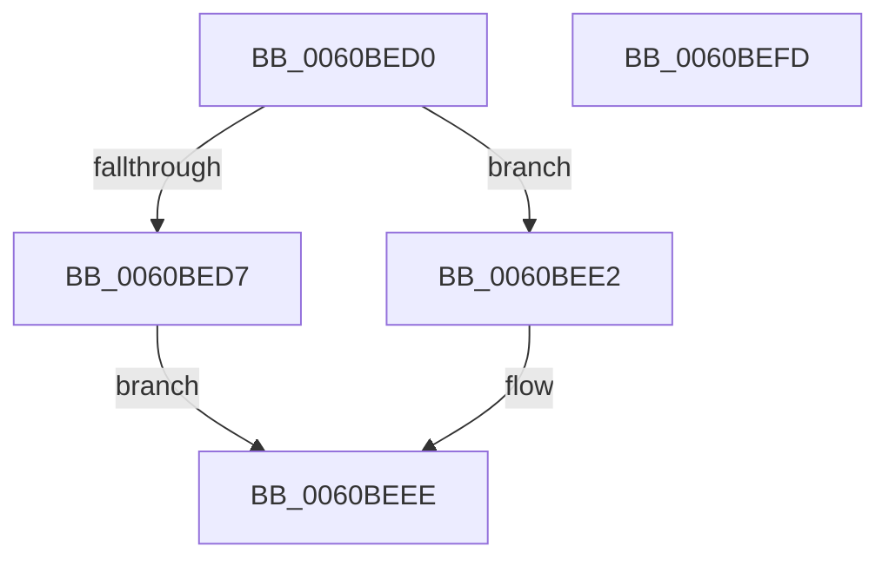

# NP_CONTEXT::NpGetResidentLeaf

- RVA: `0x0060BED0`–`0x0060BEFE` (길이 `46` bytes)
- VA: `0x000000014060BED0`
- 실행 섹션: `.text`
- PDB 이름 있음: `예`; PDB Function 태그: `아니요`
- unwind 정보 RVA: `0x000DB714`
- 디코드: `16`개 명령, `46/46` bytes 표시
- 미해석 바이트: `0` (있으면 어셈블리에 `.byte`로 보존)

> 이 문서는 커널 이미지의 기계어와 PDB 기호를 분석해 생성했습니다. 4번과 5번은 함수 원형과 자료형을 바이너리 사용 방식에서 추정한 C 해석이며 원본 소스 복구 결과는 아닙니다.

## 1. Dependencies

- 직접 호출 지점: **0**; 고유 호출 대상: **0**
- 직접 호출자로 확인된 함수: **4**
- RIP 상대 이미지 참조: **0**

### Outgoing calls
- 직접 디코드된 call 명령이 없습니다.

### Direct callers
- [NP_CONTEXT::NpLeafRefInternal](../3A/NP_CONTEXT_NpLeafRefInternal_function_003AA340.md) at `0x003AA385`
- [B_TREE&lt;unsigned long,ST_STORE&lt;SM_TRAITS&gt;::_ST_REGION_ENTRY,4096,NP_CONTEXT,ST_STORE&lt;SM_TRAITS&gt;::ST_REGION_ENTRY_COMPARATOR&gt;::BTreeSplitChild](../3A/B_TREE_unsigned_long_ST_STORE_SM_TRAITS__ST_REGION_ENTRY_4096_NP_CONTEXT_ST_STORE_SM_TRAITS_ST_REGIO_function_003AAAA4.md) at `0x003AAD46`
- [B_TREE&lt;unsigned long,ST_STORE&lt;SM_TRAITS&gt;::_ST_REGION_ENTRY,4096,NP_CONTEXT,ST_STORE&lt;SM_TRAITS&gt;::ST_REGION_ENTRY_COMPARATOR&gt;::BTreeSplitChild](../3A/B_TREE_unsigned_long_ST_STORE_SM_TRAITS__ST_REGION_ENTRY_4096_NP_CONTEXT_ST_STORE_SM_TRAITS_ST_REGIO_function_003AAAA4.md) at `0x003AAD50`
- [B_TREE&lt;_SM_PAGE_KEY,ST_STORE&lt;SM_TRAITS&gt;::_ST_PAGE_ENTRY,4096,NP_CONTEXT,B_TREE_KEY_COMPARATOR&lt;_SM_PAGE_KEY&gt; &gt;::BTreeSplitChild](../3A/B_TREE__SM_PAGE_KEY_ST_STORE_SM_TRAITS__ST_PAGE_ENTRY_4096_NP_CONTEXT_B_TREE_KEY_COMPARATOR__SM_PAGE_function_003AAF50.md) at `0x003AB1F2`
- [B_TREE&lt;_SM_PAGE_KEY,ST_STORE&lt;SM_TRAITS&gt;::_ST_PAGE_ENTRY,4096,NP_CONTEXT,B_TREE_KEY_COMPARATOR&lt;_SM_PAGE_KEY&gt; &gt;::BTreeSplitChild](../3A/B_TREE__SM_PAGE_KEY_ST_STORE_SM_TRAITS__ST_PAGE_ENTRY_4096_NP_CONTEXT_B_TREE_KEY_COMPARATOR__SM_PAGE_function_003AAF50.md) at `0x003AB1FC`
- [B_TREE&lt;unsigned long,ST_STORE&lt;SM_TRAITS&gt;::_ST_HASH_ENTRY,4096,NP_CONTEXT,ST_STORE&lt;SM_TRAITS&gt;::ST_HASH_ENTRY_COMPARATOR&gt;::BTreeSplitChild](../3A/B_TREE_unsigned_long_ST_STORE_SM_TRAITS__ST_HASH_ENTRY_4096_NP_CONTEXT_ST_STORE_SM_TRAITS_ST_HASH_EN_function_003AF610.md) at `0x003AF8B6`
- [B_TREE&lt;unsigned long,ST_STORE&lt;SM_TRAITS&gt;::_ST_HASH_ENTRY,4096,NP_CONTEXT,ST_STORE&lt;SM_TRAITS&gt;::ST_HASH_ENTRY_COMPARATOR&gt;::BTreeSplitChild](../3A/B_TREE_unsigned_long_ST_STORE_SM_TRAITS__ST_HASH_ENTRY_4096_NP_CONTEXT_ST_STORE_SM_TRAITS_ST_HASH_EN_function_003AF610.md) at `0x003AF8C3`

### Static image references
- 디코드된 RIP-relative 메모리 참조가 없습니다.

## 2. Other-region calls and transfers

- 다른 실행 섹션으로 향하는 call: **0**
- 별도 외부 분기/꼬리 이동을 확인하지 못했습니다.

## 3. Assembly (complete function range)

```asm
0060BED0  8B 0A                           mov ecx, dword ptr [rdx]
0060BED2  F6 C1 02                        test cl, 2
0060BED5  75 0B                           jne 0x14060bee2
0060BED7  81 E1 07 F0 FF FF               and ecx, 0xfffff007
0060BEDD  83 C9 06                        or ecx, 6
0060BEE0  EB 0C                           jmp 0x14060beee
0060BEE2  8D 41 04                        lea eax, [rcx + 4]
0060BEE5  33 C1                           xor eax, ecx
0060BEE7  25 FC 0F 00 00                  and eax, 0xffc
0060BEEC  33 C8                           xor ecx, eax
0060BEEE  48 8B C2                        mov rax, rdx
0060BEF1  89 0A                           mov dword ptr [rdx], ecx
0060BEF3  48 8B 02                        mov rax, qword ptr [rdx]
0060BEF6  48 25 00 F0 FF FF               and rax, 0xfffffffffffff000
0060BEFC  C3                              ret
0060BEFD  CC                              int3
```

## 4. C-style interpretation (structured pseudocode)

```c
__int64 __fastcall NP_CONTEXT__NpGetResidentLeaf(__int64 a1, __int64 a2)
{
    __int64 result;

    if ((((unsigned __int8)((unsigned int)(*(unsigned int *)(a2)))) & (2)) != 0) goto loc_0060BEE2;
    a1 = (unsigned int)(((unsigned int)(*(unsigned int *)(a2))) & (0xFFFFF007ULL));
    a1 = (unsigned int)((a1) | (6));
    goto loc_0060BEEE;
loc_0060BEE2:
    result = (unsigned int)((a1 + 4) ^ ((unsigned int)(a1)));
    result = (unsigned int)((result) & (0xFFCULL));
    a1 = (unsigned int)((a1) ^ ((unsigned int)(result)));
loc_0060BEEE:
    *(unsigned int *)(a2) = (unsigned int)(a1);
    result = (*(unsigned __int64 *)(a2)) & (0xFFFFFFFFFFFFF000ULL);
    return result;
}
```

## 5. (Beta) C Style

```c
int64_t NP_CONTEXT__NpGetResidentLeaf(int64_t Arg1, void *Arg2)
{
    uint8_t *arg2 = (uint8_t *)Arg2;

    int64_t result;

    if ((((uint8_t)((uint32_t)(*(uint32_t *)(arg2)))) & (2)) != 0) goto loc_0060BEE2;
    Arg1 = (uint32_t)(((uint32_t)(*(uint32_t *)(arg2))) & (0xFFFFF007ULL));
    Arg1 = (uint32_t)((Arg1) | (6));
    goto loc_0060BEEE;
loc_0060BEE2:
    result = (uint32_t)((Arg1 + 4) ^ ((uint32_t)(Arg1)));
    result = (uint32_t)((result) & (0xFFCULL));
    Arg1 = (uint32_t)((Arg1) ^ ((uint32_t)(result)));
loc_0060BEEE:
    *(uint32_t *)(arg2) = (uint32_t)(Arg1);
    result = (*(uint64_t *)(arg2)) & (0xFFFFFFFFFFFFF000ULL);
    return result;
}
```

### 관측된 메모리 오프셋

구조체 형식이 확인되지 않은 접근은 인자 기준의 오프셋으로만 기록했습니다.

| 기준 인자 | 오프셋 표현 | 폭 (bit) | 접근 |
|---|---:|---:|---|
| `Arg2` | `+ 0x0` | `32` | `R` |
| `Arg2` | `+ 0x0` | `32` | `W` |
| `Arg2` | `+ 0x0` | `64` | `R` |

## 6. Execution-region graph

[열기: 2D/3D 그래프와 함수 탐색 컨트롤 패널](../../../control-panel.html?section=text&rva=0x0060BED0&view=graph)

- 2D 그래프는 위에서 아래로 흐르고, 3D 그래프는 빈 공간을 드래그해 회전합니다. Shift+드래그는 이동, 휠은 확대·축소, 함수 노드 선택은 대상 보고서 이동입니다.

### Static fallback


