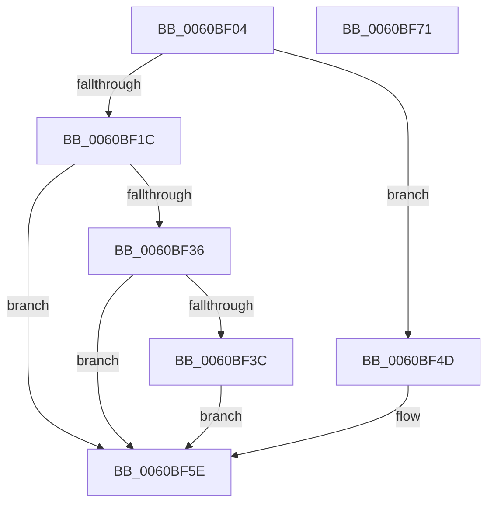

# NP_CONTEXT::NpLeafRemoveInternal

- RVA: `0x0060BF04`–`0x0060BF72` (길이 `110` bytes)
- VA: `0x000000014060BF04`
- 실행 섹션: `.text`
- PDB 이름 있음: `예`; PDB Function 태그: `아니요`
- unwind 정보 RVA: `0x00060BC4`
- 디코드: `35`개 명령, `110/110` bytes 표시
- 미해석 바이트: `0` (있으면 어셈블리에 `.byte`로 보존)

> 이 문서는 커널 이미지의 기계어와 PDB 기호를 분석해 생성했습니다. 4번과 5번은 함수 원형과 자료형을 바이너리 사용 방식에서 추정한 C 해석이며 원본 소스 복구 결과는 아닙니다.

## 1. Dependencies

- 직접 호출 지점: **2**; 고유 호출 대상: **1**
- 직접 호출자로 확인된 함수: **4**
- RIP 상대 이미지 참조: **0**

### Outgoing calls
- `0x0060BF40` → [guard_dispatch_icall](../6B/guard_dispatch_icall_function_006BAAD0.md) (function, `0x006BAAD0`)
- `0x0060BF57` → [guard_dispatch_icall](../6B/guard_dispatch_icall_function_006BAAD0.md) (function, `0x006BAAD0`)

### Direct callers
- [B_TREE&lt;unsigned long,ST_STORE&lt;SM_TRAITS&gt;::_ST_HASH_ENTRY,4096,NP_CONTEXT,ST_STORE&lt;SM_TRAITS&gt;::ST_HASH_ENTRY_COMPARATOR&gt;::BTreeMergeNodes](../3A/B_TREE_unsigned_long_ST_STORE_SM_TRAITS__ST_HASH_ENTRY_4096_NP_CONTEXT_ST_STORE_SM_TRAITS_ST_HASH_EN_function_003AA404.md) at `0x003AA586`
- [B_TREE&lt;_SM_PAGE_KEY,ST_STORE&lt;SM_TRAITS&gt;::_ST_PAGE_ENTRY,4096,NP_CONTEXT,B_TREE_KEY_COMPARATOR&lt;_SM_PAGE_KEY&gt; &gt;::BTreeMergeNodes](../3A/B_TREE__SM_PAGE_KEY_ST_STORE_SM_TRAITS__ST_PAGE_ENTRY_4096_NP_CONTEXT_B_TREE_KEY_COMPARATOR__SM_PAGE_function_003AADC4.md) at `0x003AAF3F`
- [B_TREE&lt;unsigned long,ST_STORE&lt;SM_TRAITS&gt;::_ST_REGION_ENTRY,4096,NP_CONTEXT,ST_STORE&lt;SM_TRAITS&gt;::ST_REGION_ENTRY_COMPARATOR&gt;::BTreeMergeNodes](../3A/B_TREE_unsigned_long_ST_STORE_SM_TRAITS__ST_REGION_ENTRY_4096_NP_CONTEXT_ST_STORE_SM_TRAITS_ST_REGIO_function_003AF47C.md) at `0x003AF5FE`
- [B_TREE&lt;_SM_PAGE_KEY,ST_STORE&lt;SM_TRAITS&gt;::_ST_PAGE_ENTRY,4096,NP_CONTEXT,B_TREE_KEY_COMPARATOR&lt;_SM_PAGE_KEY&gt; &gt;::BTreeNodeFree](../3A/B_TREE__SM_PAGE_KEY_ST_STORE_SM_TRAITS__ST_PAGE_ENTRY_4096_NP_CONTEXT_B_TREE_KEY_COMPARATOR__SM_PAGE_function_003AFED0.md) at `0x003AFF45`
- [B_TREE&lt;_SM_PAGE_KEY,ST_STORE&lt;SM_TRAITS&gt;::_ST_PAGE_ENTRY,4096,NP_CONTEXT,B_TREE_KEY_COMPARATOR&lt;_SM_PAGE_KEY&gt; &gt;::BTreeNodeFree](../3A/B_TREE__SM_PAGE_KEY_ST_STORE_SM_TRAITS__ST_PAGE_ENTRY_4096_NP_CONTEXT_B_TREE_KEY_COMPARATOR__SM_PAGE_function_003AFED0.md) at `0x003AFFB2`

### Static image references
- 디코드된 RIP-relative 메모리 참조가 없습니다.

## 2. Other-region calls and transfers

- 다른 실행 섹션으로 향하는 call: **0**
- 별도 외부 분기/꼬리 이동을 확인하지 못했습니다.

## 3. Assembly (complete function range)

```asm
0060BF04  48 89 5C 24 08                  mov qword ptr [rsp + 8], rbx
0060BF09  48 89 74 24 10                  mov qword ptr [rsp + 0x10], rsi
0060BF0E  57                              push rdi
0060BF0F  48 83 EC 20                     sub rsp, 0x20
0060BF13  8B 02                           mov eax, dword ptr [rdx]
0060BF15  48 8B 31                        mov rsi, qword ptr [rcx]
0060BF18  A8 01                           test al, 1
0060BF1A  74 31                           je 0x14060bf4d
0060BF1C  48 8B 1A                        mov rbx, qword ptr [rdx]
0060BF1F  48 81 E3 00 F0 FF FF            and rbx, 0xfffffffffffff000
0060BF26  48 8D 7B 0B                     lea rdi, [rbx + 0xb]
0060BF2A  48 83 E7 F8                     and rdi, 0xfffffffffffffff8
0060BF2E  48 8B 17                        mov rdx, qword ptr [rdi]
0060BF31  48 85 D2                        test rdx, rdx
0060BF34  74 28                           je 0x14060bf5e
0060BF36  8B C2                           mov eax, edx
0060BF38  A8 02                           test al, 2
0060BF3A  75 22                           jne 0x14060bf5e
0060BF3C  48 8B 46 20                     mov rax, qword ptr [rsi + 0x20]
0060BF40  E8 8B EB 0A 00                  call 0x1406baad0
0060BF45  83 0F 02                        or dword ptr [rdi], 2
0060BF48  FF 4E 30                        dec dword ptr [rsi + 0x30]
0060BF4B  EB 11                           jmp 0x14060bf5e
0060BF4D  FF 4E 2C                        dec dword ptr [rsi + 0x2c]
0060BF50  48 8B 12                        mov rdx, qword ptr [rdx]
0060BF53  48 8B 46 20                     mov rax, qword ptr [rsi + 0x20]
0060BF57  E8 74 EB 0A 00                  call 0x1406baad0
0060BF5C  33 DB                           xor ebx, ebx
0060BF5E  48 8B 74 24 38                  mov rsi, qword ptr [rsp + 0x38]
0060BF63  48 8B C3                        mov rax, rbx
0060BF66  48 8B 5C 24 30                  mov rbx, qword ptr [rsp + 0x30]
0060BF6B  48 83 C4 20                     add rsp, 0x20
0060BF6F  5F                              pop rdi
0060BF70  C3                              ret
0060BF71  CC                              int3
```

## 4. C-style interpretation (structured pseudocode)

```c
__int64 __fastcall NP_CONTEXT__NpLeafRemoveInternal(__int64 a1, __int64 a2)
{
    __int64 result;
    __int64 v_rbx;
    __int64 v_rdi;
    __int64 v_rsp;
    unsigned __int64 v_stack_p10;
    unsigned __int64 v_stack_p8;

    v_stack_p8 = v_rbx;
    v_stack_p10 = v_rsi;
    v_rsp = (v_rsp) - (32);
    if ((((unsigned __int8)((unsigned int)(*(unsigned int *)(a2)))) & (1)) == 0) goto loc_0060BF4D;
    v_rbx = (*(unsigned __int64 *)(a2)) & (0xFFFFFFFFFFFFF000ULL);
    v_rdi = (v_rbx + 11) & (-8);
    if (*(unsigned __int64 *)(v_rdi) == 0) goto loc_0060BF5E;
    if ((((unsigned __int8)((unsigned int)((unsigned int)(*(unsigned __int64 *)(v_rdi))))) & (2)) != 0) goto loc_0060BF5E;
    result = guard_dispatch_icall(a1, *(unsigned __int64 *)(v_rdi), a3, a4);
    goto loc_0060BF5E;
loc_0060BF4D:
    result = guard_dispatch_icall(a1, *(unsigned __int64 *)(*(unsigned __int64 *)(v_rdi)), a3, a4);
    v_rbx = 0;
loc_0060BF5E:
    v_rsp = (v_rsp) + (32);
    return 0;
}
```

## 5. (Beta) C Style

```c
int64_t NP_CONTEXT__NpLeafRemoveInternal(void *Arg1, void *Arg2)
{
    uint8_t *arg1 = (uint8_t *)Arg1;
    uint8_t *arg2 = (uint8_t *)Arg2;

    int64_t result;
    int64_t local_rbx;
    int64_t local_rdi;
    int64_t local_rsp;
    uint64_t v_stack_p10;
    uint64_t v_stack_p8;

    v_stack_p8 = local_rbx;
    v_stack_p10 = local_rsi;
    local_rsp = (local_rsp) - (32);
    if ((((uint8_t)((uint32_t)(*(uint32_t *)(arg2)))) & (1)) == 0) goto loc_0060BF4D;
    local_rbx = (*(uint64_t *)(arg2)) & (0xFFFFFFFFFFFFF000ULL);
    local_rdi = (local_rbx + 11) & (-8);
    if (*(uint64_t *)(local_rdi) == 0) goto loc_0060BF5E;
    if ((((uint8_t)((uint32_t)((uint32_t)(*(uint64_t *)(local_rdi))))) & (2)) != 0) goto loc_0060BF5E;
    result = guard_dispatch_icall(Arg1, *(uint64_t *)(local_rdi), a3, a4);
    goto loc_0060BF5E;
loc_0060BF4D:
    result = guard_dispatch_icall(Arg1, *(uint64_t *)(*(uint64_t *)(local_rdi)), a3, a4);
    local_rbx = 0;
loc_0060BF5E:
    local_rsp = (local_rsp) + (32);
    return 0;
}
```

### 관측된 메모리 오프셋

구조체 형식이 확인되지 않은 접근은 인자 기준의 오프셋으로만 기록했습니다.

| 기준 인자 | 오프셋 표현 | 폭 (bit) | 접근 |
|---|---:|---:|---|
| `Arg1` | `+ 0x0` | `64` | `R` |
| `Arg2` | `+ 0x0` | `32` | `R` |
| `Arg2` | `+ 0x0` | `64` | `R` |

## 6. Execution-region graph

[열기: 2D/3D 그래프와 함수 탐색 컨트롤 패널](../../../control-panel.html?section=text&rva=0x0060BF04&view=graph)

- 2D 그래프는 위에서 아래로 흐르고, 3D 그래프는 빈 공간을 드래그해 회전합니다. Shift+드래그는 이동, 휠은 확대·축소, 함수 노드 선택은 대상 보고서 이동입니다.

### Static fallback


