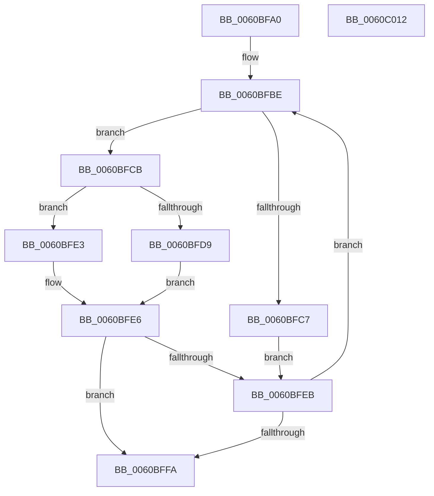

# NP_CONTEXT::NpiGetReservedBuffer

- RVA: `0x0060BFA0`–`0x0060C013` (길이 `115` bytes)
- VA: `0x000000014060BFA0`
- 실행 섹션: `.text`
- PDB 이름 있음: `예`; PDB Function 태그: `아니요`
- unwind 정보 RVA: `0x0006C8E8`
- 디코드: `37`개 명령, `115/115` bytes 표시
- 미해석 바이트: `0` (있으면 어셈블리에 `.byte`로 보존)

> 이 문서는 커널 이미지의 기계어와 PDB 기호를 분석해 생성했습니다. 4번과 5번은 함수 원형과 자료형을 바이너리 사용 방식에서 추정한 C 해석이며 원본 소스 복구 결과는 아닙니다.

## 1. Dependencies

- 직접 호출 지점: **1**; 고유 호출 대상: **1**
- 직접 호출자로 확인된 함수: **1**
- RIP 상대 이미지 참조: **0**

### Outgoing calls
- `0x0060BFF1` → [NP_CONTEXT::NpiPerformPageOut](NP_CONTEXT_NpiPerformPageOut_function_0060C0BC.md) (function, `0x0060C0BC`)

### Direct callers
- [NP_CONTEXT::NpNodeAllocate](../3A/NP_CONTEXT_NpNodeAllocate_function_003ABEEC.md) at `0x003ABF62`

### Static image references
- 디코드된 RIP-relative 메모리 참조가 없습니다.

## 2. Other-region calls and transfers

- 다른 실행 섹션으로 향하는 call: **0**
- 별도 외부 분기/꼬리 이동을 확인하지 못했습니다.

## 3. Assembly (complete function range)

```asm
0060BFA0  48 89 5C 24 10                  mov qword ptr [rsp + 0x10], rbx
0060BFA5  48 89 6C 24 18                  mov qword ptr [rsp + 0x18], rbp
0060BFAA  48 89 74 24 20                  mov qword ptr [rsp + 0x20], rsi
0060BFAF  57                              push rdi
0060BFB0  48 83 EC 20                     sub rsp, 0x20
0060BFB4  48 8B EA                        mov rbp, rdx
0060BFB7  48 8D 59 40                     lea rbx, [rcx + 0x40]
0060BFBB  48 8B F1                        mov rsi, rcx
0060BFBE  4C 8B 43 08                     mov r8, qword ptr [rbx + 8]
0060BFC2  4C 3B C3                        cmp r8, rbx
0060BFC5  75 04                           jne 0x14060bfcb
0060BFC7  33 FF                           xor edi, edi
0060BFC9  EB 20                           jmp 0x14060bfeb
0060BFCB  48 8B 3B                        mov rdi, qword ptr [rbx]
0060BFCE  48 8B 07                        mov rax, qword ptr [rdi]
0060BFD1  48 89 03                        mov qword ptr [rbx], rax
0060BFD4  49 3B F8                        cmp rdi, r8
0060BFD7  75 0A                           jne 0x14060bfe3
0060BFD9  48 83 23 00                     and qword ptr [rbx], 0
0060BFDD  48 89 5B 08                     mov qword ptr [rbx + 8], rbx
0060BFE1  EB 03                           jmp 0x14060bfe6
0060BFE3  49 FF 08                        dec qword ptr [r8]
0060BFE6  48 85 FF                        test rdi, rdi
0060BFE9  75 0F                           jne 0x14060bffa
0060BFEB  48 8B D5                        mov rdx, rbp
0060BFEE  48 8B CE                        mov rcx, rsi
0060BFF1  E8 C6 00 00 00                  call 0x14060c0bc
0060BFF6  85 C0                           test eax, eax
0060BFF8  79 C4                           jns 0x14060bfbe
0060BFFA  48 8B 5C 24 38                  mov rbx, qword ptr [rsp + 0x38]
0060BFFF  48 8B C7                        mov rax, rdi
0060C002  48 8B 6C 24 40                  mov rbp, qword ptr [rsp + 0x40]
0060C007  48 8B 74 24 48                  mov rsi, qword ptr [rsp + 0x48]
0060C00C  48 83 C4 20                     add rsp, 0x20
0060C010  5F                              pop rdi
0060C011  C3                              ret
0060C012  CC                              int3
```

## 4. C-style interpretation (structured pseudocode)

```c
__int64 __fastcall NP_CONTEXT__NpiGetReservedBuffer(__int64 a1, __int64 a2)
{
    __int64 result;
    __int64 v_rdi;
    __int64 v_rsp;
    unsigned __int64 v_stack_p10;
    unsigned __int64 v_stack_p18;
    unsigned __int64 v_stack_p20;

    v_stack_p10 = v_rbx;
    v_stack_p18 = v_rbp;
    v_stack_p20 = v_rsi;
    v_rsp = (v_rsp) - (32);
loc_0060BFBE:
    if ((*(unsigned __int64 *)(a1 + 64 + 8)) != (a1 + 64)) goto loc_0060BFCB;
    v_rdi = 0;
    goto loc_0060BFEB;
loc_0060BFCB:
    *(unsigned __int64 *)(a1 + 64) = *(unsigned __int64 *)(*(unsigned __int64 *)(a1 + 64));
    if ((*(unsigned __int64 *)(a1 + 64)) != (*(unsigned __int64 *)(a1 + 64 + 8))) goto loc_0060BFE3;
    *(unsigned __int64 *)(a1 + 64 + 8) = a1 + 64;
    goto loc_0060BFE6;
loc_0060BFE3:
loc_0060BFE6:
    if (*(unsigned __int64 *)(a1 + 64) != 0) goto loc_0060BFFA;
loc_0060BFEB:
    result = NP_CONTEXT__NpiPerformPageOut(a1, a2, *(unsigned __int64 *)(a1 + 64 + 8), a4);
    if (!sign_flag) goto loc_0060BFBE;
loc_0060BFFA:
    v_rsp = (v_rsp) + (32);
    return *(unsigned __int64 *)(a1 + 64);
}
```

## 5. (Beta) C Style

```c
int64_t NP_CONTEXT__NpiGetReservedBuffer(void *Arg1, int64_t Arg2)
{
    uint8_t *arg1 = (uint8_t *)Arg1;

    int64_t result;
    int64_t local_rdi;
    int64_t local_rsp;
    uint64_t v_stack_p10;
    uint64_t v_stack_p18;
    uint64_t v_stack_p20;

    v_stack_p10 = local_rbx;
    v_stack_p18 = local_rbp;
    v_stack_p20 = local_rsi;
    local_rsp = (local_rsp) - (32);
loc_0060BFBE:
    if ((*(uint64_t *)(arg1 + 0x40 + 0x8)) != (Arg1 + 64)) goto loc_0060BFCB;
    local_rdi = 0;
    goto loc_0060BFEB;
loc_0060BFCB:
    *(uint64_t *)(arg1 + 0x40) = *(uint64_t *)(*(uint64_t *)(arg1 + 0x40));
    if ((*(uint64_t *)(arg1 + 0x40)) != (*(uint64_t *)(arg1 + 0x40 + 0x8))) goto loc_0060BFE3;
    *(void **)(arg1 + 0x40 + 0x8) = Arg1 + 64;
    goto loc_0060BFE6;
loc_0060BFE3:
loc_0060BFE6:
    if (*(uint64_t *)(arg1 + 0x40) != 0) goto loc_0060BFFA;
loc_0060BFEB:
    result = NP_CONTEXT__NpiPerformPageOut(Arg1, Arg2, *(uint64_t *)(arg1 + 0x40 + 0x8), a4);
    if (!sign_flag) goto loc_0060BFBE;
loc_0060BFFA:
    local_rsp = (local_rsp) + (32);
    return *(uint64_t *)(arg1 + 0x40);
}
```

### 관측된 메모리 오프셋

구조체 형식이 확인되지 않은 접근은 인자 기준의 오프셋으로만 기록했습니다.

| 기준 인자 | 오프셋 표현 | 폭 (bit) | 접근 |
|---|---:|---:|---|
| `Arg1` | `+ 0x0` | `64` | `R` |
| `Arg1` | `+ 0x0` | `64` | `R/W` |
| `Arg1` | `+ 0x0` | `64` | `W` |
| `Arg1` | `+ 0x8` | `64` | `R` |
| `Arg1` | `+ 0x8` | `64` | `W` |
| `Arg1` | `+ 0x40` | `64` | `R` |

## 6. Execution-region graph

[열기: 2D/3D 그래프와 함수 탐색 컨트롤 패널](../../../control-panel.html?section=text&rva=0x0060BFA0&view=graph)

- 2D 그래프는 위에서 아래로 흐르고, 3D 그래프는 빈 공간을 드래그해 회전합니다. Shift+드래그는 이동, 휠은 확대·축소, 함수 노드 선택은 대상 보고서 이동입니다.

### Static fallback


