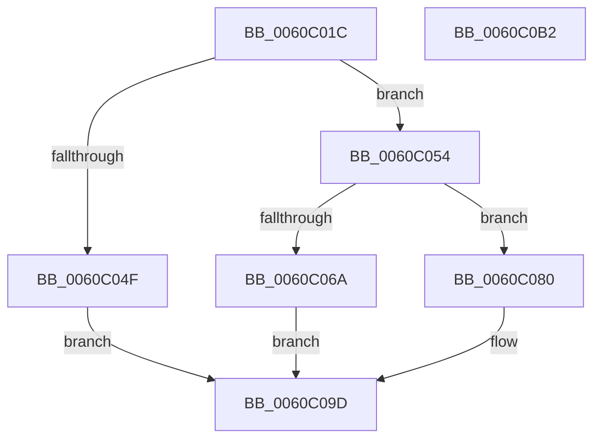

# NP_CONTEXT::NpiLeafPageIn

- RVA: `0x0060C01C`–`0x0060C0B3` (길이 `151` bytes)
- VA: `0x000000014060C01C`
- 실행 섹션: `.text`
- PDB 이름 있음: `예`; PDB Function 태그: `아니요`
- unwind 정보 RVA: `0x0005C954`
- 디코드: `45`개 명령, `151/151` bytes 표시
- 미해석 바이트: `0` (있으면 어셈블리에 `.byte`로 보존)

> 이 문서는 커널 이미지의 기계어와 PDB 기호를 분석해 생성했습니다. 4번과 5번은 함수 원형과 자료형을 바이너리 사용 방식에서 추정한 C 해석이며 원본 소스 복구 결과는 아닙니다.

## 1. Dependencies

- 직접 호출 지점: **3**; 고유 호출 대상: **3**
- 직접 호출자로 확인된 함수: **1**
- RIP 상대 이미지 참조: **0**

### Outgoing calls
- `0x0060C042` → [NP_CONTEXT::NpNodeAllocate](../3A/NP_CONTEXT_NpNodeAllocate_function_003ABEEC.md) (function, `0x003ABEEC`)
- `0x0060C061` → [guard_dispatch_icall](../6B/guard_dispatch_icall_function_006BAAD0.md) (function, `0x006BAAD0`)
- `0x0060C079` → [NP_CONTEXT::NpNodeFree](../3A/NP_CONTEXT_NpNodeFree_function_003AA5C0.md) (function, `0x003AA5C0`)

### Direct callers
- [NP_CONTEXT::NpLeafRefInternal](../3A/NP_CONTEXT_NpLeafRefInternal_function_003AA340.md) at `0x003AA377`

### Static image references
- 디코드된 RIP-relative 메모리 참조가 없습니다.

## 2. Other-region calls and transfers

- 다른 실행 섹션으로 향하는 call: **0**
- 별도 외부 분기/꼬리 이동을 확인하지 못했습니다.

## 3. Assembly (complete function range)

```asm
0060C01C  48 89 5C 24 08                  mov qword ptr [rsp + 8], rbx
0060C021  48 89 6C 24 10                  mov qword ptr [rsp + 0x10], rbp
0060C026  48 89 74 24 18                  mov qword ptr [rsp + 0x18], rsi
0060C02B  57                              push rdi
0060C02C  48 83 EC 20                     sub rsp, 0x20
0060C030  49 8B F8                        mov rdi, r8
0060C033  48 8B D9                        mov rbx, rcx
0060C036  41 B8 03 00 00 00               mov r8d, 3
0060C03C  48 8B CA                        mov rcx, rdx
0060C03F  48 8B EA                        mov rbp, rdx
0060C042  E8 A5 FE D9 FF                  call 0x1403abeec
0060C047  48 8B F0                        mov rsi, rax
0060C04A  48 85 C0                        test rax, rax
0060C04D  75 05                           jne 0x14060c054
0060C04F  FF 43 5C                        inc dword ptr [rbx + 0x5c]
0060C052  EB 49                           jmp 0x14060c09d
0060C054  48 8B 43 18                     mov rax, qword ptr [rbx + 0x18]
0060C058  48 8B D6                        mov rdx, rsi
0060C05B  4C 8B 07                        mov r8, qword ptr [rdi]
0060C05E  48 8B CD                        mov rcx, rbp
0060C061  E8 6A EA 0A 00                  call 0x1406baad0
0060C066  85 C0                           test eax, eax
0060C068  79 16                           jns 0x14060c080
0060C06A  FF 43 5C                        inc dword ptr [rbx + 0x5c]
0060C06D  41 B8 01 00 00 00               mov r8d, 1
0060C073  48 8B D6                        mov rdx, rsi
0060C076  48 8B CD                        mov rcx, rbp
0060C079  E8 42 E5 D9 FF                  call 0x1403aa5c0
0060C07E  EB 1D                           jmp 0x14060c09d
0060C080  FF 43 54                        inc dword ptr [rbx + 0x54]
0060C083  48 8D 4E 0B                     lea rcx, [rsi + 0xb]
0060C087  FF 4B 2C                        dec dword ptr [rbx + 0x2c]
0060C08A  48 83 E1 F8                     and rcx, 0xfffffffffffffff8
0060C08E  FF 43 30                        inc dword ptr [rbx + 0x30]
0060C091  48 8B 07                        mov rax, qword ptr [rdi]
0060C094  48 89 01                        mov qword ptr [rcx], rax
0060C097  48 89 37                        mov qword ptr [rdi], rsi
0060C09A  83 0F 01                        or dword ptr [rdi], 1
0060C09D  48 8B 5C 24 30                  mov rbx, qword ptr [rsp + 0x30]
0060C0A2  48 8B 6C 24 38                  mov rbp, qword ptr [rsp + 0x38]
0060C0A7  48 8B 74 24 40                  mov rsi, qword ptr [rsp + 0x40]
0060C0AC  48 83 C4 20                     add rsp, 0x20
0060C0B0  5F                              pop rdi
0060C0B1  C3                              ret
0060C0B2  CC                              int3
```

## 4. C-style interpretation (structured pseudocode)

```c
__int64 __fastcall NP_CONTEXT__NpiLeafPageIn(__int64 a1, __int64 a2, __int64 a3)
{
    __int64 result;
    __int64 v_rsp;
    unsigned __int64 v_stack_p10;
    unsigned __int64 v_stack_p18;
    unsigned __int64 v_stack_p8;

    v_stack_p8 = v_rbx;
    v_stack_p10 = v_rbp;
    v_stack_p18 = v_rsi;
    v_rsp = (v_rsp) - (32);
    result = NP_CONTEXT__NpNodeAllocate(a2, a2, 3, a4);
    if (result != 0) goto loc_0060C054;
    goto loc_0060C09D;
loc_0060C054:
    result = guard_dispatch_icall(a2, result, *(unsigned __int64 *)(a3), a4);
    if (!sign_flag) goto loc_0060C080;
    result = NP_CONTEXT__NpNodeFree(a2, result, 1, a4);
    goto loc_0060C09D;
loc_0060C080:
    a1 = (result + 11) & (-8);
    *(unsigned __int64 *)(a1) = *(unsigned __int64 *)(a3);
    *(unsigned __int64 *)(a3) = result;
loc_0060C09D:
    v_rsp = (v_rsp) + (32);
    return *(unsigned __int64 *)(a3);
}
```

## 5. (Beta) C Style

```c
int64_t NP_CONTEXT__NpiLeafPageIn(void *Arg1, int64_t Arg2, void *Arg3)
{
    uint8_t *arg1 = (uint8_t *)Arg1;
    uint8_t *arg3 = (uint8_t *)Arg3;

    int64_t result;
    int64_t local_rsp;
    uint64_t v_stack_p10;
    uint64_t v_stack_p18;
    uint64_t v_stack_p8;

    v_stack_p8 = local_rbx;
    v_stack_p10 = local_rbp;
    v_stack_p18 = local_rsi;
    local_rsp = (local_rsp) - (32);
    result = NP_CONTEXT__NpNodeAllocate(Arg2, Arg2, 3, a4);
    if (result != 0) goto loc_0060C054;
    goto loc_0060C09D;
loc_0060C054:
    result = guard_dispatch_icall(Arg2, result, *(uint64_t *)(arg3), a4);
    if (!sign_flag) goto loc_0060C080;
    result = NP_CONTEXT__NpNodeFree(Arg2, result, 1, a4);
    goto loc_0060C09D;
loc_0060C080:
    Arg1 = (result + 11) & (-8);
    *(uint64_t *)(arg1) = *(uint64_t *)(arg3);
    *(uint64_t *)(arg3) = result;
loc_0060C09D:
    local_rsp = (local_rsp) + (32);
    return *(uint64_t *)(arg3);
}
```

### 관측된 메모리 오프셋

구조체 형식이 확인되지 않은 접근은 인자 기준의 오프셋으로만 기록했습니다.

| 기준 인자 | 오프셋 표현 | 폭 (bit) | 접근 |
|---|---:|---:|---|
| `Arg1` | `+ 0x18` | `64` | `R` |
| `Arg1` | `+ 0x2C` | `32` | `R/W` |
| `Arg1` | `+ 0x30` | `32` | `R/W` |
| `Arg1` | `+ 0x54` | `32` | `R/W` |
| `Arg1` | `+ 0x5C` | `32` | `R/W` |
| `Arg3` | `+ 0x0` | `32` | `R/W` |
| `Arg3` | `+ 0x0` | `64` | `R` |
| `Arg3` | `+ 0x0` | `64` | `W` |

## 6. Execution-region graph

[열기: 2D/3D 그래프와 함수 탐색 컨트롤 패널](../../../control-panel.html?section=text&rva=0x0060C01C&view=graph)

- 2D 그래프는 위에서 아래로 흐르고, 3D 그래프는 빈 공간을 드래그해 회전합니다. Shift+드래그는 이동, 휠은 확대·축소, 함수 노드 선택은 대상 보고서 이동입니다.

### Static fallback


