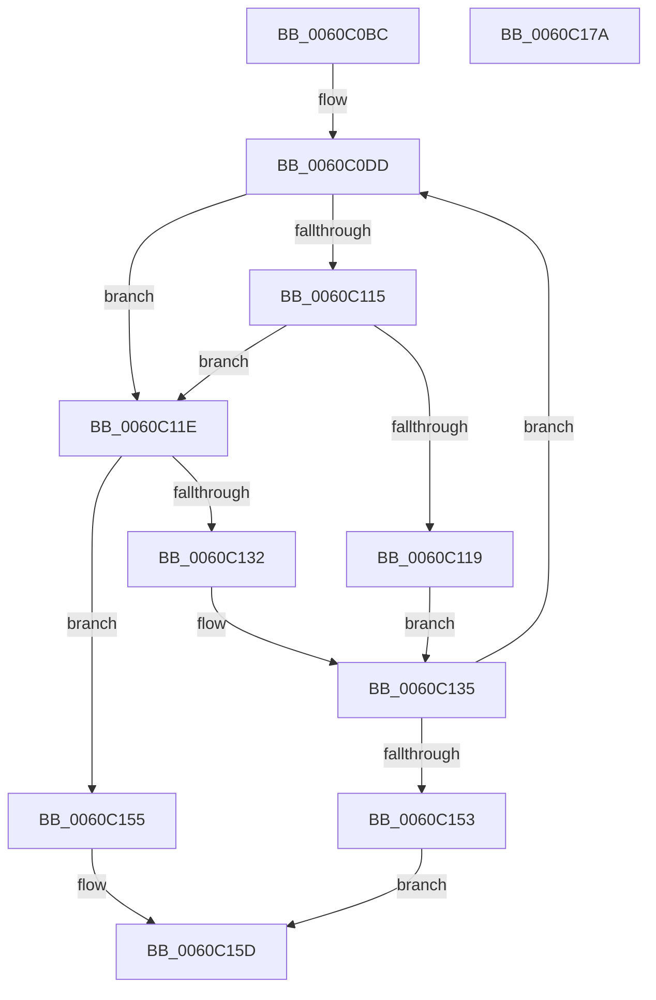

# NP_CONTEXT::NpiPerformPageOut

- RVA: `0x0060C0BC`–`0x0060C17B` (길이 `191` bytes)
- VA: `0x000000014060C0BC`
- 실행 섹션: `.text`
- PDB 이름 있음: `예`; PDB Function 태그: `아니요`
- unwind 정보 RVA: `0x0005E6B4`
- 디코드: `56`개 명령, `191/191` bytes 표시
- 미해석 바이트: `0` (있으면 어셈블리에 `.byte`로 보존)

> 이 문서는 커널 이미지의 기계어와 PDB 기호를 분석해 생성했습니다. 4번과 5번은 함수 원형과 자료형을 바이너리 사용 방식에서 추정한 C 해석이며 원본 소스 복구 결과는 아닙니다.

## 1. Dependencies

- 직접 호출 지점: **3**; 고유 호출 대상: **2**
- 직접 호출자로 확인된 함수: **3**
- RIP 상대 이미지 참조: **1**

### Outgoing calls
- `0x0060C0F2` → [guard_dispatch_icall](../6B/guard_dispatch_icall_function_006BAAD0.md) (function, `0x006BAAD0`)
- `0x0060C128` → [guard_dispatch_icall](../6B/guard_dispatch_icall_function_006BAAD0.md) (function, `0x006BAAD0`)
- `0x0060C147` → [NP_CONTEXT::NpNodeFree](../3A/NP_CONTEXT_NpNodeFree_function_003AA5C0.md) (function, `0x003AA5C0`)

### Direct callers
- [NP_CONTEXT::NpNodeAllocate](../3A/NP_CONTEXT_NpNodeAllocate_function_003ABEEC.md) at `0x003ABF77`
- [NP_CONTEXT::NpNodesPageOut](NP_CONTEXT_NpNodesPageOut_function_0060BF78.md) at `0x0060BF89`
- [NP_CONTEXT::NpiGetReservedBuffer](NP_CONTEXT_NpiGetReservedBuffer_function_0060BFA0.md) at `0x0060BFF1`

### Static image references
- `0x0060C0E1` → RVA `0x0060C1E0` (`NP_CONTEXT::NpiTreeWalkCallback`; read)

## 2. Other-region calls and transfers

- 다른 실행 섹션으로 향하는 call: **0**
- 별도 외부 분기/꼬리 이동을 확인하지 못했습니다.

## 3. Assembly (complete function range)

```asm
0060C0BC  48 8B C4                        mov rax, rsp
0060C0BF  48 89 58 08                     mov qword ptr [rax + 8], rbx
0060C0C3  48 89 68 10                     mov qword ptr [rax + 0x10], rbp
0060C0C7  48 89 70 18                     mov qword ptr [rax + 0x18], rsi
0060C0CB  48 89 78 20                     mov qword ptr [rax + 0x20], rdi
0060C0CF  41 56                           push r14
0060C0D1  48 83 EC 20                     sub rsp, 0x20
0060C0D5  48 8B F2                        mov rsi, rdx
0060C0D8  48 8B D9                        mov rbx, rcx
0060C0DB  33 FF                           xor edi, edi
0060C0DD  48 8B 43 08                     mov rax, qword ptr [rbx + 8]
0060C0E1  48 8D 15 F8 00 00 00            lea rdx, [rip + 0xf8]
0060C0E8  4C 8B C3                        mov r8, rbx
0060C0EB  48 89 7B 38                     mov qword ptr [rbx + 0x38], rdi
0060C0EF  48 8B CE                        mov rcx, rsi
0060C0F2  E8 D9 E9 0A 00                  call 0x1406baad0
0060C0F7  4C 8B 73 38                     mov r14, qword ptr [rbx + 0x38]
0060C0FB  49 8B 2E                        mov rbp, qword ptr [r14]
0060C0FE  48 81 E5 00 F0 FF FF            and rbp, 0xfffffffffffff000
0060C105  48 8D 45 0B                     lea rax, [rbp + 0xb]
0060C109  48 83 E0 F8                     and rax, 0xfffffffffffffff8
0060C10D  48 8B 00                        mov rax, qword ptr [rax]
0060C110  48 85 C0                        test rax, rax
0060C113  74 09                           je 0x14060c11e
0060C115  A8 02                           test al, 2
0060C117  75 05                           jne 0x14060c11e
0060C119  FF 4B 30                        dec dword ptr [rbx + 0x30]
0060C11C  EB 17                           jmp 0x14060c135
0060C11E  48 8B 43 10                     mov rax, qword ptr [rbx + 0x10]
0060C122  48 8B D5                        mov rdx, rbp
0060C125  48 8B CE                        mov rcx, rsi
0060C128  E8 A3 E9 0A 00                  call 0x1406baad0
0060C12D  48 85 C0                        test rax, rax
0060C130  74 23                           je 0x14060c155
0060C132  FF 43 50                        inc dword ptr [rbx + 0x50]
0060C135  FF 43 2C                        inc dword ptr [rbx + 0x2c]
0060C138  41 B8 01 00 00 00               mov r8d, 1
0060C13E  48 8B D5                        mov rdx, rbp
0060C141  49 89 06                        mov qword ptr [r14], rax
0060C144  48 8B CE                        mov rcx, rsi
0060C147  E8 74 E4 D9 FF                  call 0x1403aa5c0
0060C14C  8B 03                           mov eax, dword ptr [rbx]
0060C14E  39 43 28                        cmp dword ptr [rbx + 0x28], eax
0060C151  77 8A                           ja 0x14060c0dd
0060C153  EB 08                           jmp 0x14060c15d
0060C155  FF 43 58                        inc dword ptr [rbx + 0x58]
0060C158  BF 85 01 00 C0                  mov edi, 0xc0000185
0060C15D  48 8B 5C 24 30                  mov rbx, qword ptr [rsp + 0x30]
0060C162  8B C7                           mov eax, edi
0060C164  48 8B 7C 24 48                  mov rdi, qword ptr [rsp + 0x48]
0060C169  48 8B 6C 24 38                  mov rbp, qword ptr [rsp + 0x38]
0060C16E  48 8B 74 24 40                  mov rsi, qword ptr [rsp + 0x40]
0060C173  48 83 C4 20                     add rsp, 0x20
0060C177  41 5E                           pop r14
0060C179  C3                              ret
0060C17A  CC                              int3
```

## 4. C-style interpretation (structured pseudocode)

```c
__int64 __fastcall NP_CONTEXT__NpiPerformPageOut(__int64 a1, __int64 a2)
{
    __int64 result;
    __int64 v_rbp;
    __int64 v_rdi;
    __int64 v_rsp;
    unsigned __int64 v_stack_p10;
    unsigned __int64 v_stack_p18;
    unsigned __int64 v_stack_p20;
    unsigned __int64 v_stack_p8;

    *(unsigned __int64 *)(v_rsp + 8) = v_rbx;
    *(unsigned __int64 *)(v_rsp + 16) = v_rbp;
    *(unsigned __int64 *)(v_rsp + 24) = v_rsi;
    *(unsigned __int64 *)(v_rsp + 32) = v_rdi;
    v_rsp = (v_rsp) - (32);
    v_rdi = 0;
loc_0060C0DD:
    *(unsigned __int64 *)(a1 + 56) = 0;
    result = guard_dispatch_icall(a2, v_rip + 248, a1, a4);
    v_rbp = (*(unsigned __int64 *)(*(unsigned __int64 *)(a1 + 56))) & (0xFFFFFFFFFFFFF000ULL);
    result = (v_rbp + 11) & (-8);
    if (*(unsigned __int64 *)(result) == 0) goto loc_0060C11E;
    if ((((unsigned __int8)(*(unsigned __int64 *)(result))) & (2)) != 0) goto loc_0060C11E;
    goto loc_0060C135;
loc_0060C11E:
    result = guard_dispatch_icall(a2, v_rbp, a1, a4);
    if (result == 0) goto loc_0060C155;
loc_0060C135:
    *(unsigned __int64 *)(*(unsigned __int64 *)(a1 + 56)) = result;
    result = NP_CONTEXT__NpNodeFree(a2, v_rbp, 1, a4);
    if ((*(unsigned int *)(a1 + 40)) > ((unsigned int)((unsigned int)(*(unsigned int *)(a1))))) goto loc_0060C0DD;
    goto loc_0060C15D;
loc_0060C155:
loc_0060C15D:
    v_rsp = (v_rsp) + (32);
    return (unsigned int)((unsigned int)((unsigned int)(0xC0000185ULL)));
}
```

## 5. (Beta) C Style

```c
int64_t NP_CONTEXT__NpiPerformPageOut(void *Arg1, int64_t Arg2)
{
    uint8_t *arg1 = (uint8_t *)Arg1;

    int64_t result;
    int64_t local_rbp;
    int64_t local_rdi;
    int64_t local_rsp;
    uint64_t v_stack_p10;
    uint64_t v_stack_p18;
    uint64_t v_stack_p20;
    uint64_t v_stack_p8;

    *(uint64_t *)(local_rsp + 0x8) = local_rbx;
    *(uint64_t *)(local_rsp + 0x10) = local_rbp;
    *(uint64_t *)(local_rsp + 0x18) = local_rsi;
    *(uint64_t *)(local_rsp + 0x20) = local_rdi;
    local_rsp = (local_rsp) - (32);
    local_rdi = 0;
loc_0060C0DD:
    *(uint64_t *)(arg1 + 0x38) = 0;
    result = guard_dispatch_icall(Arg2, v_rip + 248, Arg1, a4);
    local_rbp = (*(uint64_t *)(*(uint64_t *)(arg1 + 0x38))) & (0xFFFFFFFFFFFFF000ULL);
    result = (local_rbp + 11) & (-8);
    if (*(uint64_t *)(result) == 0) goto loc_0060C11E;
    if ((((uint8_t)(*(uint64_t *)(result))) & (2)) != 0) goto loc_0060C11E;
    goto loc_0060C135;
loc_0060C11E:
    result = guard_dispatch_icall(Arg2, local_rbp, Arg1, a4);
    if (result == 0) goto loc_0060C155;
loc_0060C135:
    *(uint64_t *)(*(uint64_t *)(arg1 + 0x38)) = result;
    result = NP_CONTEXT__NpNodeFree(Arg2, local_rbp, 1, a4);
    if ((*(uint32_t *)(arg1 + 0x28)) > ((uint32_t)((uint32_t)(*(uint32_t *)(arg1))))) goto loc_0060C0DD;
    goto loc_0060C15D;
loc_0060C155:
loc_0060C15D:
    local_rsp = (local_rsp) + (32);
    return (uint32_t)((uint32_t)((uint32_t)(0xC0000185ULL)));
}
```

### 관측된 메모리 오프셋

구조체 형식이 확인되지 않은 접근은 인자 기준의 오프셋으로만 기록했습니다.

| 기준 인자 | 오프셋 표현 | 폭 (bit) | 접근 |
|---|---:|---:|---|
| `Arg1` | `+ 0x0` | `32` | `R` |
| `Arg1` | `+ 0x8` | `64` | `R` |
| `Arg1` | `+ 0x10` | `64` | `R` |
| `Arg1` | `+ 0x28` | `32` | `R` |
| `Arg1` | `+ 0x2C` | `32` | `R/W` |
| `Arg1` | `+ 0x30` | `32` | `R/W` |
| `Arg1` | `+ 0x38` | `64` | `R` |
| `Arg1` | `+ 0x38` | `64` | `W` |
| `Arg1` | `+ 0x50` | `32` | `R/W` |
| `Arg1` | `+ 0x58` | `32` | `R/W` |

## 6. Execution-region graph

[열기: 2D/3D 그래프와 함수 탐색 컨트롤 패널](../../../control-panel.html?section=text&rva=0x0060C0BC&view=graph)

- 2D 그래프는 위에서 아래로 흐르고, 3D 그래프는 빈 공간을 드래그해 회전합니다. Shift+드래그는 이동, 휠은 확대·축소, 함수 노드 선택은 대상 보고서 이동입니다.

### Static fallback


