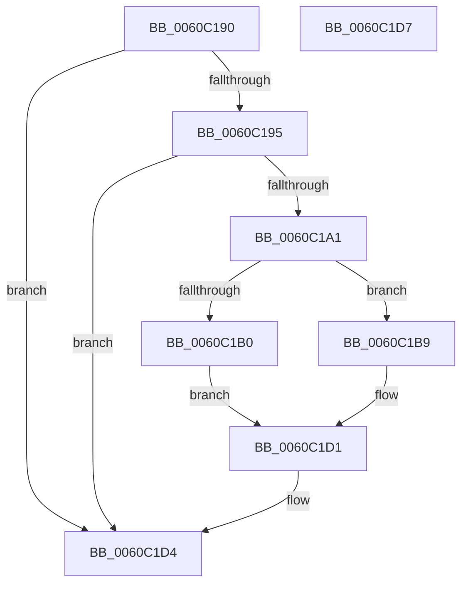

# NP_CONTEXT::NpiRebaseCallback

- RVA: `0x0060C190`–`0x0060C1D8` (길이 `72` bytes)
- VA: `0x000000014060C190`
- 실행 섹션: `.text`
- PDB 이름 있음: `예`; PDB Function 태그: `아니요`
- unwind 정보 RVA: `0x000DB714`
- 디코드: `24`개 명령, `72/72` bytes 표시
- 미해석 바이트: `0` (있으면 어셈블리에 `.byte`로 보존)

> 이 문서는 커널 이미지의 기계어와 PDB 기호를 분석해 생성했습니다. 4번과 5번은 함수 원형과 자료형을 바이너리 사용 방식에서 추정한 C 해석이며 원본 소스 복구 결과는 아닙니다.

## 1. Dependencies

- 직접 호출 지점: **0**; 고유 호출 대상: **0**
- 직접 호출자로 확인된 함수: **0**
- RIP 상대 이미지 참조: **0**

### Outgoing calls
- 직접 디코드된 call 명령이 없습니다.

### Direct callers
- 이 함수 시작 RVA로 연결되는 직접 call은 확인되지 않았습니다. 간접 호출은 완전히 역산할 수 없습니다.

### Static image references
- 디코드된 RIP-relative 메모리 참조가 없습니다.

## 2. Other-region calls and transfers

- 다른 실행 섹션으로 향하는 call: **0**
- 별도 외부 분기/꼬리 이동을 확인하지 못했습니다.

## 3. Assembly (complete function range)

```asm
0060C190  48 85 C9                        test rcx, rcx
0060C193  75 3F                           jne 0x14060c1d4
0060C195  45 8B 08                        mov r9d, dword ptr [r8]
0060C198  41 8B C1                        mov eax, r9d
0060C19B  24 03                           and al, 3
0060C19D  3C 01                           cmp al, 1
0060C19F  75 33                           jne 0x14060c1d4
0060C1A1  41 8B C1                        mov eax, r9d
0060C1A4  C1 E8 02                        shr eax, 2
0060C1A7  25 FF 03 00 00                  and eax, 0x3ff
0060C1AC  3B C2                           cmp eax, edx
0060C1AE  77 09                           ja 0x14060c1b9
0060C1B0  41 81 E1 03 F0 FF FF            and r9d, 0xfffff003
0060C1B7  EB 18                           jmp 0x14060c1d1
0060C1B9  41 8B C9                        mov ecx, r9d
0060C1BC  8D 04 95 00 00 00 00            lea eax, [rdx*4]
0060C1C3  2B C8                           sub ecx, eax
0060C1C5  41 33 C9                        xor ecx, r9d
0060C1C8  81 E1 FC 0F 00 00               and ecx, 0xffc
0060C1CE  44 33 C9                        xor r9d, ecx
0060C1D1  45 89 08                        mov dword ptr [r8], r9d
0060C1D4  33 C0                           xor eax, eax
0060C1D6  C3                              ret
0060C1D7  CC                              int3
```

## 4. C-style interpretation (structured pseudocode)

```c
__int64 __fastcall NP_CONTEXT__NpiRebaseCallback(__int64 a1, __int64 a2, __int64 a3)
{
    __int64 result;

    if (a1 != 0) goto loc_0060C1D4;
    result = (unsigned __int8)(((unsigned int)((unsigned int)((unsigned int)(*(unsigned int *)(a3))))) & (3));
    if (((unsigned __int8)(result)) != 1) goto loc_0060C1D4;
    result = (unsigned int)(((unsigned int)((unsigned int)((unsigned int)(*(unsigned int *)(a3))))) >> (2));
    result = (unsigned int)((result) & (0x3FFULL));
    if (((unsigned int)(result)) > ((unsigned int)(a2))) goto loc_0060C1B9;
    a4 = (unsigned int)(((unsigned int)(*(unsigned int *)(a3))) & (0xFFFFF003ULL));
    goto loc_0060C1D1;
loc_0060C1B9:
    a1 = (unsigned int)(((unsigned int)((unsigned int)(a4))) - ((unsigned int)(a2 * 4)));
    a1 = (unsigned int)((a1) ^ ((unsigned int)(a4)));
    a1 = (unsigned int)((a1) & (0xFFCULL));
    a4 = (unsigned int)((a4) ^ ((unsigned int)(a1)));
loc_0060C1D1:
    *(unsigned int *)(a3) = (unsigned int)(a4);
loc_0060C1D4:
    result = 0;
    return result;
}
```

## 5. (Beta) C Style

```c
int64_t NP_CONTEXT__NpiRebaseCallback(int64_t Arg1, int64_t Arg2, void *Arg3)
{
    uint8_t *arg3 = (uint8_t *)Arg3;

    int64_t result;

    if (Arg1 != 0) goto loc_0060C1D4;
    result = (uint8_t)(((uint32_t)((uint32_t)((uint32_t)(*(uint32_t *)(arg3))))) & (3));
    if (((uint8_t)(result)) != 1) goto loc_0060C1D4;
    result = (uint32_t)(((uint32_t)((uint32_t)((uint32_t)(*(uint32_t *)(arg3))))) >> (2));
    result = (uint32_t)((result) & (0x3FFULL));
    if (((uint32_t)(result)) > ((uint32_t)(Arg2))) goto loc_0060C1B9;
    a4 = (uint32_t)(((uint32_t)(*(uint32_t *)(arg3))) & (0xFFFFF003ULL));
    goto loc_0060C1D1;
loc_0060C1B9:
    Arg1 = (uint32_t)(((uint32_t)((uint32_t)(a4))) - ((uint32_t)(Arg2 * 4)));
    Arg1 = (uint32_t)((Arg1) ^ ((uint32_t)(a4)));
    Arg1 = (uint32_t)((Arg1) & (0xFFCULL));
    a4 = (uint32_t)((a4) ^ ((uint32_t)(Arg1)));
loc_0060C1D1:
    *(uint32_t *)(arg3) = (uint32_t)(a4);
loc_0060C1D4:
    result = 0;
    return result;
}
```

### 관측된 메모리 오프셋

구조체 형식이 확인되지 않은 접근은 인자 기준의 오프셋으로만 기록했습니다.

| 기준 인자 | 오프셋 표현 | 폭 (bit) | 접근 |
|---|---:|---:|---|
| `Arg3` | `+ 0x0` | `32` | `R` |
| `Arg3` | `+ 0x0` | `32` | `W` |

## 6. Execution-region graph

[열기: 2D/3D 그래프와 함수 탐색 컨트롤 패널](../../../control-panel.html?section=text&rva=0x0060C190&view=graph)

- 2D 그래프는 위에서 아래로 흐르고, 3D 그래프는 빈 공간을 드래그해 회전합니다. Shift+드래그는 이동, 휠은 확대·축소, 함수 노드 선택은 대상 보고서 이동입니다.

### Static fallback


