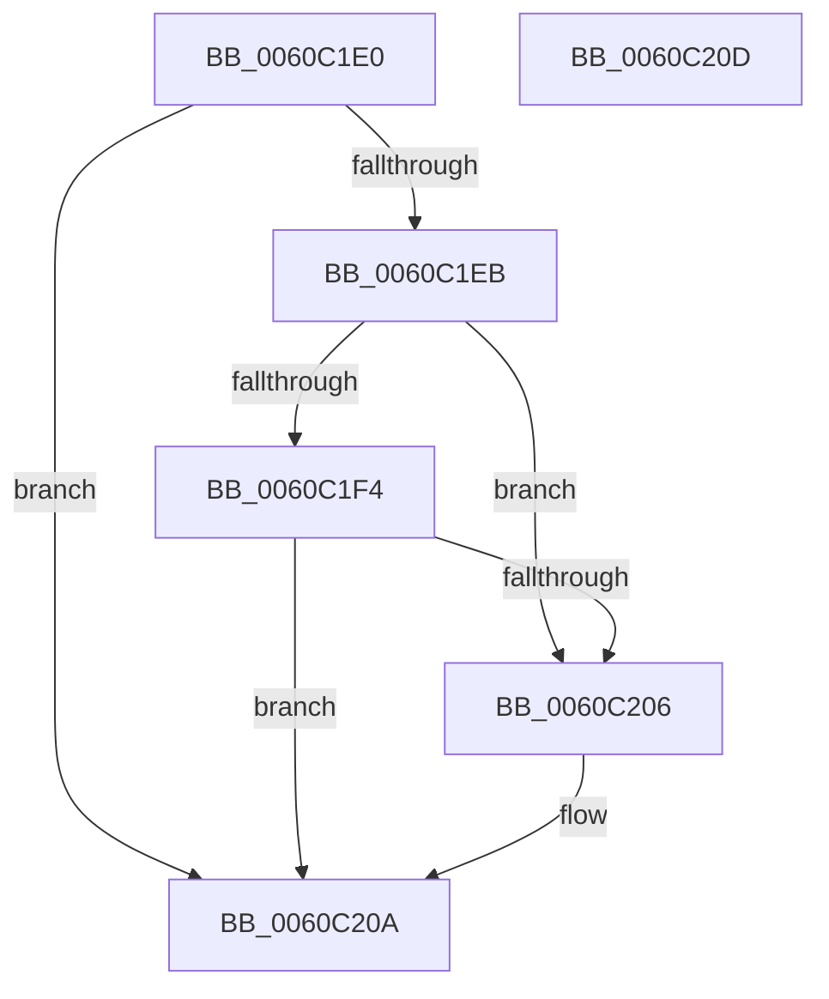

# NP_CONTEXT::NpiTreeWalkCallback

- RVA: `0x0060C1E0`–`0x0060C20E` (길이 `46` bytes)
- VA: `0x000000014060C1E0`
- 실행 섹션: `.text`
- PDB 이름 있음: `예`; PDB Function 태그: `아니요`
- unwind 정보 RVA: `0x000DB714`
- 디코드: `18`개 명령, `46/46` bytes 표시
- 미해석 바이트: `0` (있으면 어셈블리에 `.byte`로 보존)

> 이 문서는 커널 이미지의 기계어와 PDB 기호를 분석해 생성했습니다. 4번과 5번은 함수 원형과 자료형을 바이너리 사용 방식에서 추정한 C 해석이며 원본 소스 복구 결과는 아닙니다.

## 1. Dependencies

- 직접 호출 지점: **0**; 고유 호출 대상: **0**
- 직접 호출자로 확인된 함수: **0**
- RIP 상대 이미지 참조: **0**

### Outgoing calls
- 직접 디코드된 call 명령이 없습니다.

### Direct callers
- 이 함수 시작 RVA로 연결되는 직접 call은 확인되지 않았습니다. 간접 호출은 완전히 역산할 수 없습니다.

### Static image references
- 디코드된 RIP-relative 메모리 참조가 없습니다.

## 2. Other-region calls and transfers

- 다른 실행 섹션으로 향하는 call: **0**
- 별도 외부 분기/꼬리 이동을 확인하지 못했습니다.

## 3. Assembly (complete function range)

```asm
0060C1E0  41 8B 08                        mov ecx, dword ptr [r8]
0060C1E3  8B C1                           mov eax, ecx
0060C1E5  24 03                           and al, 3
0060C1E7  3C 01                           cmp al, 1
0060C1E9  75 1F                           jne 0x14060c20a
0060C1EB  48 8B 42 38                     mov rax, qword ptr [rdx + 0x38]
0060C1EF  48 85 C0                        test rax, rax
0060C1F2  74 12                           je 0x14060c206
0060C1F4  8B 00                           mov eax, dword ptr [rax]
0060C1F6  41 B9 FC 0F 00 00               mov r9d, 0xffc
0060C1FC  41 23 C1                        and eax, r9d
0060C1FF  41 23 C9                        and ecx, r9d
0060C202  3B C8                           cmp ecx, eax
0060C204  73 04                           jae 0x14060c20a
0060C206  4C 89 42 38                     mov qword ptr [rdx + 0x38], r8
0060C20A  33 C0                           xor eax, eax
0060C20C  C3                              ret
0060C20D  CC                              int3
```

## 4. C-style interpretation (structured pseudocode)

```c
__int64 __fastcall NP_CONTEXT__NpiTreeWalkCallback(__int64 a1, __int64 a2, __int64 a3)
{
    __int64 result;

    result = (unsigned __int8)(((unsigned int)((unsigned int)((unsigned int)(*(unsigned int *)(a3))))) & (3));
    if (((unsigned __int8)(result)) != 1) goto loc_0060C20A;
    if (*(unsigned __int64 *)(a2 + 56) == 0) goto loc_0060C206;
    result = (unsigned int)(((unsigned int)(*(unsigned int *)(*(unsigned __int64 *)(a2 + 56)))) & ((unsigned int)((unsigned int)(0xFFCULL))));
    a1 = (unsigned int)(((unsigned int)(*(unsigned int *)(a3))) & ((unsigned int)((unsigned int)(0xFFCULL))));
    if (((unsigned int)(a1)) < ((unsigned int)(result))) {
        *(unsigned __int64 *)(a2 + 56) = a3;
    }
    result = 0;
    return result;
}
```

## 5. (Beta) C Style

```c
int64_t NP_CONTEXT__NpiTreeWalkCallback(int64_t Arg1, void *Arg2, void *Arg3)
{
    uint8_t *arg2 = (uint8_t *)Arg2;
    uint8_t *arg3 = (uint8_t *)Arg3;

    int64_t result;

    result = (uint8_t)(((uint32_t)((uint32_t)((uint32_t)(*(uint32_t *)(arg3))))) & (3));
    if (((uint8_t)(result)) != 1) goto loc_0060C20A;
    if (*(uint64_t *)(arg2 + 0x38) == 0) goto loc_0060C206;
    result = (uint32_t)(((uint32_t)(*(uint32_t *)(*(uint64_t *)(arg2 + 0x38)))) & ((uint32_t)((uint32_t)(0xFFCULL))));
    Arg1 = (uint32_t)(((uint32_t)(*(uint32_t *)(arg3))) & ((uint32_t)((uint32_t)(0xFFCULL))));
    if (((uint32_t)(Arg1)) < ((uint32_t)(result))) {
        *(void **)(arg2 + 0x38) = Arg3;
    }
    result = 0;
    return result;
}
```

### 관측된 메모리 오프셋

구조체 형식이 확인되지 않은 접근은 인자 기준의 오프셋으로만 기록했습니다.

| 기준 인자 | 오프셋 표현 | 폭 (bit) | 접근 |
|---|---:|---:|---|
| `Arg2` | `+ 0x38` | `64` | `R` |
| `Arg2` | `+ 0x38` | `64` | `W` |
| `Arg3` | `+ 0x0` | `32` | `R` |

## 6. Execution-region graph

[열기: 2D/3D 그래프와 함수 탐색 컨트롤 패널](../../../control-panel.html?section=text&rva=0x0060C1E0&view=graph)

- 2D 그래프는 위에서 아래로 흐르고, 3D 그래프는 빈 공간을 드래그해 회전합니다. Shift+드래그는 이동, 휠은 확대·축소, 함수 노드 선택은 대상 보고서 이동입니다.

### Static fallback


