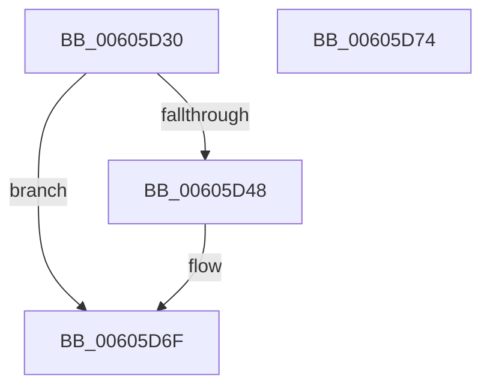

# PdcInitializeETW

- RVA: `0x00605D30`–`0x00605D75` (길이 `69` bytes)
- VA: `0x0000000140605D30`
- 실행 섹션: `.text`
- PDB 이름 있음: `예`; PDB Function 태그: `아니요`
- unwind 정보 RVA: `0x0005C788`
- 디코드: `17`개 명령, `69/69` bytes 표시
- 미해석 바이트: `0` (있으면 어셈블리에 `.byte`로 보존)

> 이 문서는 커널 이미지의 기계어와 PDB 기호를 분석해 생성했습니다. 4번과 5번은 함수 원형과 자료형을 바이너리 사용 방식에서 추정한 C 해석이며 원본 소스 복구 결과는 아닙니다.

## 1. Dependencies

- 직접 호출 지점: **2**; 고유 호출 대상: **2**
- 직접 호출자로 확인된 함수: **1**
- RIP 상대 이미지 참조: **4**

### Outgoing calls
- `0x00605D59` → [McGenEventRegister_EtwRegister](../57/McGenEventRegister_EtwRegister_function_0057EF04.md) (function, `0x0057EF04`)
- `0x00605D6A` → [TraceLoggingRegisterEx_EtwRegister_EtwSetInformation](../../page/92/TraceLoggingRegisterEx_EtwRegister_EtwSetInformation_function_009208A0.md) (function, `0x009208A0`)

### Direct callers
- [Pdcv2ActivationClientRegister](../../page/79/Pdcv2ActivationClientRegister_function_0079AF28.md) at `0x0079B083`

### Static image references
- `0x00605D39` → RVA `0x00E67B78` (`.data`; read/write)
- `0x00605D48` → RVA `0x00E08870` (`.data`; read)
- `0x00605D52` → RVA `0x00037788` (`.rdata`; read)
- `0x00605D61` → RVA `0x00E088B8` (`.data`; read)

## 2. Other-region calls and transfers

- 다른 실행 섹션으로 향하는 call: **1**
  - `0x00605D6A` → [TraceLoggingRegisterEx_EtwRegister_EtwSetInformation](../../page/92/TraceLoggingRegisterEx_EtwRegister_EtwSetInformation_function_009208A0.md) (`.text` → `PAGE`)
- 별도 외부 분기/꼬리 이동을 확인하지 못했습니다.

## 3. Assembly (complete function range)

```asm
00605D30  48 83 EC 28                     sub rsp, 0x28
00605D34  B8 01 00 00 00                  mov eax, 1
00605D39  F0 0F C1 05 37 1E 86 00         lock xadd dword ptr [rip + 0x861e37], eax
00605D41  FF C0                           inc eax
00605D43  83 F8 01                        cmp eax, 1
00605D46  75 27                           jne 0x140605d6f
00605D48  4C 8D 05 21 2B 80 00            lea r8, [rip + 0x802b21]
00605D4F  4D 8B C8                        mov r9, r8
00605D52  48 8D 0D 2F 1A A3 FF            lea rcx, [rip - 0x5ce5d1]
00605D59  E8 A6 91 F7 FF                  call 0x14057ef04
00605D5E  45 33 C0                        xor r8d, r8d
00605D61  48 8D 0D 50 2B 80 00            lea rcx, [rip + 0x802b50]
00605D68  33 D2                           xor edx, edx
00605D6A  E8 31 AB 31 00                  call 0x1409208a0
00605D6F  48 83 C4 28                     add rsp, 0x28
00605D73  C3                              ret
00605D74  CC                              int3
```

## 4. C-style interpretation (structured pseudocode)

```c
__int64 __fastcall PdcInitializeETW(__int64 a1, int a2)
{
    __int64 result;
    __int64 v_rsp;

    v_rsp = (v_rsp) - (40);
    result = (unsigned int)((1) + 1);
    if (((unsigned int)(result)) == 1) {
        a3 = v_rip + 8399649;
        a4 = a3;
        a1 = v_rip - 6088145;
        result = McGenEventRegister_EtwRegister(a1, a2, a3, a4);
        a3 = 0;
        a1 = v_rip + 8399696;
        a2 = 0;
        result = TraceLoggingRegisterEx_EtwRegister_EtwSetInformation(a1, a2, a3, a4);
    }
    v_rsp = (v_rsp) + (40);
    return result;
}
```

## 5. (Beta) C Style

```c
int64_t PdcInitializeETW(int64_t Arg1, int32_t Arg2)
{
    int64_t result;
    int64_t local_rsp;

    local_rsp = (local_rsp) - (40);
    result = (uint32_t)((1) + 1);
    if (((uint32_t)(result)) == 1) {
        a3 = v_rip + 8399649;
        a4 = a3;
        Arg1 = v_rip - 6088145;
        result = McGenEventRegister_EtwRegister(Arg1, Arg2, a3, a4);
        a3 = 0;
        Arg1 = v_rip + 8399696;
        Arg2 = 0;
        result = TraceLoggingRegisterEx_EtwRegister_EtwSetInformation(Arg1, Arg2, a3, a4);
    }
    local_rsp = (local_rsp) + (40);
    return result;
}
```

## 6. Execution-region graph

[열기: 2D/3D 그래프와 함수 탐색 컨트롤 패널](../../../control-panel.html?section=text&rva=0x00605D30&view=graph)

- 2D 그래프는 위에서 아래로 흐르고, 3D 그래프는 빈 공간을 드래그해 회전합니다. Shift+드래그는 이동, 휠은 확대·축소, 함수 노드 선택은 대상 보고서 이동입니다.

### Static fallback


