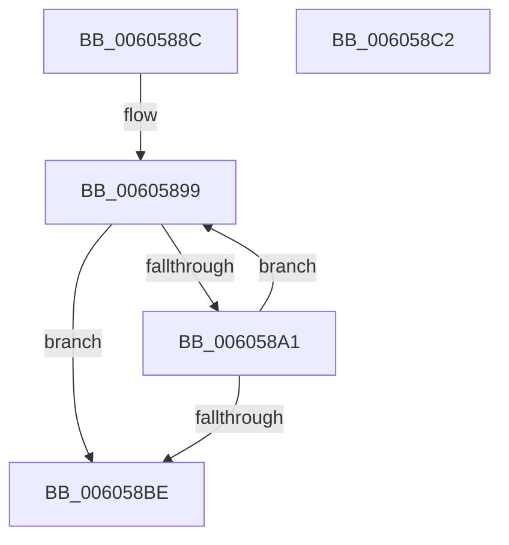

# PdcpResizeDiagnosticContext

- RVA: `0x0060588C`–`0x006058C3` (길이 `55` bytes)
- VA: `0x000000014060588C`
- 실행 섹션: `.text`
- PDB 이름 있음: `예`; PDB Function 태그: `아니요`
- unwind 정보 RVA: `0x000DB714`
- 디코드: `18`개 명령, `55/55` bytes 표시
- 미해석 바이트: `0` (있으면 어셈블리에 `.byte`로 보존)

> 이 문서는 커널 이미지의 기계어와 PDB 기호를 분석해 생성했습니다. 4번과 5번은 함수 원형과 자료형을 바이너리 사용 방식에서 추정한 C 해석이며 원본 소스 복구 결과는 아닙니다.

## 1. Dependencies

- 직접 호출 지점: **0**; 고유 호출 대상: **0**
- 직접 호출자로 확인된 함수: **2**
- RIP 상대 이미지 참조: **0**

### Outgoing calls
- 직접 디코드된 call 명령이 없습니다.

### Direct callers
- [Pdcv2ActivationClientRenewActivation](../../page/79/Pdcv2ActivationClientRenewActivation_function_0079B0F0.md) at `0x0079B21C`
- [Pdcv2ActivationClientActivate](../../page/95/Pdcv2ActivationClientActivate_function_00953C70.md) at `0x00954095`

### Static image references
- 디코드된 RIP-relative 메모리 참조가 없습니다.

## 2. Other-region calls and transfers

- 다른 실행 섹션으로 향하는 call: **0**
- 별도 외부 분기/꼬리 이동을 확인하지 못했습니다.

## 3. Assembly (complete function range)

```asm
0060588C  45 33 C0                        xor r8d, r8d
0060588F  4C 8D 4A 10                     lea r9, [rdx + 0x10]
00605893  4C 8B D1                        mov r10, rcx
00605896  4C 2B D2                        sub r10, rdx
00605899  41 8B C0                        mov eax, r8d
0060589C  48 3B 01                        cmp rax, qword ptr [rcx]
0060589F  73 1D                           jae 0x1406058be
006058A1  4B 8B 04 0A                     mov rax, qword ptr [r10 + r9]
006058A5  41 FF C0                        inc r8d
006058A8  49 89 01                        mov qword ptr [r9], rax
006058AB  4B 8B 44 0A F8                  mov rax, qword ptr [r10 + r9 - 8]
006058B0  49 89 41 F8                     mov qword ptr [r9 - 8], rax
006058B4  49 83 C1 10                     add r9, 0x10
006058B8  41 83 F8 0A                     cmp r8d, 0xa
006058BC  72 DB                           jb 0x140605899
006058BE  44 89 02                        mov dword ptr [rdx], r8d
006058C1  C3                              ret
006058C2  CC                              int3
```

## 4. C-style interpretation (structured pseudocode)

```c
__int64 __fastcall PdcpResizeDiagnosticContext(__int64 a1, __int64 a2, int a3)
{
    __int64 v_r10;

    a3 = 0;
    v_r10 = (a1) - (a2);
loc_00605899:
    if (0 >= (*(unsigned __int64 *)(a1))) goto loc_006058BE;
    a3 = (unsigned int)((a3) + 1);
    *(unsigned __int64 *)(a2 + 16) = *(unsigned __int64 *)(v_r10 + a2 + 16 * 1);
    *(unsigned __int64 *)(a2 + 16 - 8) = *(unsigned __int64 *)(v_r10 + a2 + 16 * 1 - 8);
    a4 = (a2 + 16) + (16);
    if (a3 < 10) goto loc_00605899;
loc_006058BE:
    *(unsigned int *)(a2) = a3;
    return *(unsigned __int64 *)(v_r10 + a2 + 16 * 1 - 8);
}
```

## 5. (Beta) C Style

```c
int64_t PdcpResizeDiagnosticContext(void *Arg1, void *Arg2, int32_t Arg3)
{
    uint8_t *arg1 = (uint8_t *)Arg1;
    uint8_t *arg2 = (uint8_t *)Arg2;

    int64_t local_r10;

    Arg3 = 0;
    local_r10 = (Arg1) - (Arg2);
loc_00605899:
    if (0 >= (*(uint64_t *)(arg1))) goto loc_006058BE;
    Arg3 = (uint32_t)((Arg3) + 1);
    *(uint64_t *)(arg2 + 0x10) = *(uint64_t *)(local_r10 + arg2 + 0x10 * 1);
    *(uint64_t *)(arg2 + 0x10 - 0x8) = *(uint64_t *)(local_r10 + arg2 + 0x10 * 1 - 0x8);
    a4 = (Arg2 + 16) + (16);
    if (Arg3 < 10) goto loc_00605899;
loc_006058BE:
    *(uint32_t *)(arg2) = Arg3;
    return *(uint64_t *)(local_r10 + arg2 + 0x10 * 1 - 0x8);
}
```

### 관측된 메모리 오프셋

구조체 형식이 확인되지 않은 접근은 인자 기준의 오프셋으로만 기록했습니다.

| 기준 인자 | 오프셋 표현 | 폭 (bit) | 접근 |
|---|---:|---:|---|
| `Arg1` | `- 0x8 + r9*1` | `64` | `R` |
| `Arg1` | `+ 0x0` | `64` | `R` |
| `Arg1` | `+ 0x0 + r9*1` | `64` | `R` |
| `Arg2` | `- 0x8` | `64` | `W` |
| `Arg2` | `+ 0x0` | `32` | `W` |
| `Arg2` | `+ 0x0` | `64` | `W` |
| `Arg2` | `+ 0x10` | `64` | `R` |

## 6. Execution-region graph

[열기: 2D/3D 그래프와 함수 탐색 컨트롤 패널](../../../control-panel.html?section=text&rva=0x0060588C&view=graph)

- 2D 그래프는 위에서 아래로 흐르고, 3D 그래프는 빈 공간을 드래그해 회전합니다. Shift+드래그는 이동, 휠은 확대·축소, 함수 노드 선택은 대상 보고서 이동입니다.

### Static fallback


