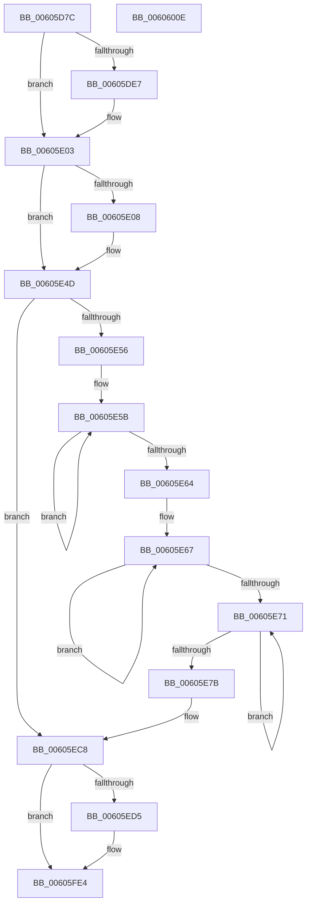

# Pdcv2EventWrite_ACTIVATION_CLIENT_CALLBACK

- RVA: `0x00605D7C`–`0x0060600F` (길이 `659` bytes)
- VA: `0x0000000140605D7C`
- 실행 섹션: `.text`
- PDB 이름 있음: `예`; PDB Function 태그: `아니요`
- unwind 정보 RVA: `0x000D0704`
- 디코드: `155`개 명령, `659/659` bytes 표시
- 미해석 바이트: `0` (있으면 어셈블리에 `.byte`로 보존)

> 이 문서는 커널 이미지의 기계어와 PDB 기호를 분석해 생성했습니다. 4번과 5번은 함수 원형과 자료형을 바이너리 사용 방식에서 추정한 C 해석이며 원본 소스 복구 결과는 아닙니다.

## 1. Dependencies

- 직접 호출 지점: **6**; 고유 호출 대상: **4**
- 직접 호출자로 확인된 함수: **1**
- RIP 상대 이미지 참조: **5**

### Outgoing calls
- `0x00605EC3` → [McTemplateU0qqzr1qzr3qqqxqpqqqzr13q_EtwWriteTransfer](McTemplateU0qqzr1qzr3qqqxqpqqqzr13q_EtwWriteTransfer_function_006059D4.md) (function, `0x006059D4`)
- `0x00605EF2` → [tlgCreate1Sz_wchar_t](../42/tlgCreate1Sz_wchar_t_function_00426198.md) (function, `0x00426198`)
- `0x00605EFE` → [tlgCreate1Sz_wchar_t](../42/tlgCreate1Sz_wchar_t_function_00426198.md) (function, `0x00426198`)
- `0x00605FB5` → [tlgCreate1Sz_wchar_t](../42/tlgCreate1Sz_wchar_t_function_00426198.md) (function, `0x00426198`)
- `0x00605FDF` → [tlgWriteTransfer_EtwWriteTransfer](../42/tlgWriteTransfer_EtwWriteTransfer_function_004260E0.md) (function, `0x004260E0`)
- `0x00605FEE` → [_security_check_cookie](../6A/_security_check_cookie_function_006AC640.md) (function, `0x006AC640`)

### Direct callers
- [Pdcv2pActivationClientCallback](../../page/79/Pdcv2pActivationClientCallback_function_0079B2C0.md) at `0x0079B3BE`
- [Pdcv2pActivationClientCallback](../../page/79/Pdcv2pActivationClientCallback_function_0079B2C0.md) at `0x0079B3E0`

### Static image references
- `0x00605D9B` → RVA `0x00E0A740` (`.data`; read)
- `0x00605DC3` → RVA `0x00013F90` (`.rdata`; read)
- `0x00605E4D` → RVA `0x00F05882` (`.data`; read)
- `0x00605EC8` → RVA `0x00E088B8` (`.data`; read)
- `0x00605FC6` → RVA `0x00052E46` (`.rdata`; read)

## 2. Other-region calls and transfers

- 다른 실행 섹션으로 향하는 call: **0**
- 별도 외부 분기/꼬리 이동을 확인하지 못했습니다.

## 3. Assembly (complete function range)

```asm
00605D7C  48 89 5C 24 18                  mov qword ptr [rsp + 0x18], rbx
00605D81  55                              push rbp
00605D82  56                              push rsi
00605D83  57                              push rdi
00605D84  41 54                           push r12
00605D86  41 55                           push r13
00605D88  41 56                           push r14
00605D8A  41 57                           push r15
00605D8C  48 8D AC 24 60 FF FF FF         lea rbp, [rsp - 0xa0]
00605D94  48 81 EC B0 01 00 00            sub rsp, 0x1b0
00605D9B  48 8B 05 9E 49 80 00            mov rax, qword ptr [rip + 0x80499e]
00605DA2  48 33 C4                        xor rax, rsp
00605DA5  48 89 85 90 00 00 00            mov qword ptr [rbp + 0x90], rax
00605DAC  83 CE FF                        or esi, 0xffffffff
00605DAF  44 89 4D 8C                     mov dword ptr [rbp - 0x74], r9d
00605DB3  49 83 C9 FF                     or r9, 0xffffffffffffffff
00605DB7  44 89 45 84                     mov dword ptr [rbp - 0x7c], r8d
00605DBB  33 C0                           xor eax, eax
00605DBD  89 75 80                        mov dword ptr [rbp - 0x80], esi
00605DC0  89 75 88                        mov dword ptr [rbp - 0x78], esi
00605DC3  48 8D 3D C6 E1 A0 FF            lea rdi, [rip - 0x5f1e3a]
00605DCA  48 8B D9                        mov rbx, rcx
00605DCD  4D 8B F1                        mov r14, r9
00605DD0  44 8B EE                        mov r13d, esi
00605DD3  44 8B D8                        mov r11d, eax
00605DD6  44 8B C6                        mov r8d, esi
00605DD9  44 8B D6                        mov r10d, esi
00605DDC  4C 8B FF                        mov r15, rdi
00605DDF  4C 8B E7                        mov r12, rdi
00605DE2  48 85 D2                        test rdx, rdx
00605DE5  74 1C                           je 0x140605e03
00605DE7  44 8B 42 20                     mov r8d, dword ptr [rdx + 0x20]
00605DEB  48 8D BA 80 00 00 00            lea rdi, [rdx + 0x80]
00605DF2  44 8B AA 00 01 00 00            mov r13d, dword ptr [rdx + 0x100]
00605DF9  8B B2 04 01 00 00               mov esi, dword ptr [rdx + 0x104]
00605DFF  44 89 45 80                     mov dword ptr [rbp - 0x80], r8d
00605E03  48 85 DB                        test rbx, rbx
00605E06  74 45                           je 0x140605e4d
00605E08  44 8B 51 48                     mov r10d, dword ptr [rcx + 0x48]
00605E0C  4C 8D 61 50                     lea r12, [rcx + 0x50]
00605E10  48 B8 04 00 00 00 80 F7 FF FF   movabs rax, 0xfffff78000000004
00605E1A  44 89 55 88                     mov dword ptr [rbp - 0x78], r10d
00605E1E  4C 8D B9 50 01 00 00            lea r15, [rcx + 0x150]
00605E25  8B 08                           mov ecx, dword ptr [rax]
00605E27  48 B8 20 03 00 00 80 F7 FF FF   movabs rax, 0xfffff78000000320
00605E31  48 C1 E1 20                     shl rcx, 0x20
00605E35  48 8B 00                        mov rax, qword ptr [rax]
00605E38  44 8B 9B 50 02 00 00            mov r11d, dword ptr [rbx + 0x250]
00605E3F  48 C1 E0 08                     shl rax, 8
00605E43  48 F7 E1                        mul rcx
00605E46  4C 8B F2                        mov r14, rdx
00605E49  4C 2B 73 30                     sub r14, qword ptr [rbx + 0x30]
00605E4D  F6 05 2E FA 8F 00 40            test byte ptr [rip + 0x8ffa2e], 0x40
00605E54  74 72                           je 0x140605ec8
00605E56  49 8B C9                        mov rcx, r9
00605E59  33 D2                           xor edx, edx
00605E5B  48 FF C1                        inc rcx
00605E5E  66 39 14 4F                     cmp word ptr [rdi + rcx*2], dx
00605E62  75 F7                           jne 0x140605e5b
00605E64  49 8B C1                        mov rax, r9
00605E67  48 FF C0                        inc rax
00605E6A  66 41 39 14 47                  cmp word ptr [r15 + rax*2], dx
00605E6F  75 F6                           jne 0x140605e67
00605E71  49 FF C1                        inc r9
00605E74  66 43 39 14 4C                  cmp word ptr [r12 + r9*2], dx
00605E79  75 F6                           jne 0x140605e71
00605E7B  44 89 9C 24 88 00 00 00         mov dword ptr [rsp + 0x88], r11d
00605E83  48 89 BC 24 80 00 00 00         mov qword ptr [rsp + 0x80], rdi
00605E8B  89 4C 24 78                     mov dword ptr [rsp + 0x78], ecx
00605E8F  8B 4D 8C                        mov ecx, dword ptr [rbp - 0x74]
00605E92  44 89 54 24 68                  mov dword ptr [rsp + 0x68], r10d
00605E97  48 89 5C 24 60                  mov qword ptr [rsp + 0x60], rbx
00605E9C  89 4C 24 58                     mov dword ptr [rsp + 0x58], ecx
00605EA0  8B 4D 84                        mov ecx, dword ptr [rbp - 0x7c]
00605EA3  4C 89 74 24 50                  mov qword ptr [rsp + 0x50], r14
00605EA8  44 89 6C 24 48                  mov dword ptr [rsp + 0x48], r13d
00605EAD  89 74 24 40                     mov dword ptr [rsp + 0x40], esi
00605EB1  89 4C 24 38                     mov dword ptr [rsp + 0x38], ecx
00605EB5  4C 89 7C 24 30                  mov qword ptr [rsp + 0x30], r15
00605EBA  89 44 24 28                     mov dword ptr [rsp + 0x28], eax
00605EBE  4C 89 64 24 20                  mov qword ptr [rsp + 0x20], r12
00605EC3  E8 0C FB FF FF                  call 0x1406059d4
00605EC8  83 3D E9 29 80 00 05            cmp dword ptr [rip + 0x8029e9], 5
00605ECF  0F 86 0F 01 00 00               jbe 0x140605fe4
00605ED5  8B 45 80                        mov eax, dword ptr [rbp - 0x80]
00605ED8  48 8D 4D E0                     lea rcx, [rbp - 0x20]
00605EDC  89 45 80                        mov dword ptr [rbp - 0x80], eax
00605EDF  49 8B D4                        mov rdx, r12
00605EE2  48 8D 45 80                     lea rax, [rbp - 0x80]
00605EE6  48 C7 45 D8 04 00 00 00         mov qword ptr [rbp - 0x28], 4
00605EEE  48 89 45 D0                     mov qword ptr [rbp - 0x30], rax
00605EF2  E8 A1 02 E2 FF                  call 0x140426198
00605EF7  49 8B D7                        mov rdx, r15
00605EFA  48 8D 4D F0                     lea rcx, [rbp - 0x10]
00605EFE  E8 95 02 E2 FF                  call 0x140426198
00605F03  8B 45 84                        mov eax, dword ptr [rbp - 0x7c]
00605F06  48 8D 8D 80 00 00 00            lea rcx, [rbp + 0x80]
00605F0D  89 45 84                        mov dword ptr [rbp - 0x7c], eax
00605F10  48 8B D7                        mov rdx, rdi
00605F13  48 8D 45 84                     lea rax, [rbp - 0x7c]
00605F17  48 C7 45 08 04 00 00 00         mov qword ptr [rbp + 8], 4
00605F1F  48 89 45 00                     mov qword ptr [rbp], rax
00605F23  48 8D 45 90                     lea rax, [rbp - 0x70]
00605F27  48 89 45 10                     mov qword ptr [rbp + 0x10], rax
00605F2B  48 8D 45 94                     lea rax, [rbp - 0x6c]
00605F2F  48 89 45 20                     mov qword ptr [rbp + 0x20], rax
00605F33  8B 45 88                        mov eax, dword ptr [rbp - 0x78]
00605F36  89 45 88                        mov dword ptr [rbp - 0x78], eax
00605F39  48 8D 45 88                     lea rax, [rbp - 0x78]
00605F3D  48 89 45 30                     mov qword ptr [rbp + 0x30], rax
00605F41  48 8D 45 A0                     lea rax, [rbp - 0x60]
00605F45  48 89 45 40                     mov qword ptr [rbp + 0x40], rax
00605F49  48 8D 45 A8                     lea rax, [rbp - 0x58]
00605F4D  48 89 45 50                     mov qword ptr [rbp + 0x50], rax
00605F51  8B 45 8C                        mov eax, dword ptr [rbp - 0x74]
00605F54  89 45 8C                        mov dword ptr [rbp - 0x74], eax
00605F57  48 8D 45 8C                     lea rax, [rbp - 0x74]
00605F5B  48 89 45 60                     mov qword ptr [rbp + 0x60], rax
00605F5F  48 8D 45 98                     lea rax, [rbp - 0x68]
00605F63  48 89 45 70                     mov qword ptr [rbp + 0x70], rax
00605F67  89 75 90                        mov dword ptr [rbp - 0x70], esi
00605F6A  48 C7 45 18 04 00 00 00         mov qword ptr [rbp + 0x18], 4
00605F72  44 89 6D 94                     mov dword ptr [rbp - 0x6c], r13d
00605F76  48 C7 45 28 04 00 00 00         mov qword ptr [rbp + 0x28], 4
00605F7E  48 C7 45 38 04 00 00 00         mov qword ptr [rbp + 0x38], 4
00605F86  4C 89 75 A0                     mov qword ptr [rbp - 0x60], r14
00605F8A  48 C7 45 48 08 00 00 00         mov qword ptr [rbp + 0x48], 8
00605F92  48 89 5D A8                     mov qword ptr [rbp - 0x58], rbx
00605F96  48 C7 45 58 08 00 00 00         mov qword ptr [rbp + 0x58], 8
00605F9E  48 C7 45 68 04 00 00 00         mov qword ptr [rbp + 0x68], 4
00605FA6  C7 45 98 02 00 00 00            mov dword ptr [rbp - 0x68], 2
00605FAD  48 C7 45 78 04 00 00 00         mov qword ptr [rbp + 0x78], 4
00605FB5  E8 DE 01 E2 FF                  call 0x140426198
00605FBA  48 8D 4D B0                     lea rcx, [rbp - 0x50]
00605FBE  45 33 C9                        xor r9d, r9d
00605FC1  48 89 4C 24 28                  mov qword ptr [rsp + 0x28], rcx
00605FC6  48 8D 15 79 CE A4 FF            lea rdx, [rip - 0x5b3187]
00605FCD  48 8D 0D E4 28 80 00            lea rcx, [rip + 0x8028e4]
00605FD4  C7 44 24 20 0E 00 00 00         mov dword ptr [rsp + 0x20], 0xe
00605FDC  45 33 C0                        xor r8d, r8d
00605FDF  E8 FC 00 E2 FF                  call 0x1404260e0
00605FE4  48 8B 8D 90 00 00 00            mov rcx, qword ptr [rbp + 0x90]
00605FEB  48 33 CC                        xor rcx, rsp
00605FEE  E8 4D 66 0A 00                  call 0x1406ac640
00605FF3  48 8B 9C 24 00 02 00 00         mov rbx, qword ptr [rsp + 0x200]
00605FFB  48 81 C4 B0 01 00 00            add rsp, 0x1b0
00606002  41 5F                           pop r15
00606004  41 5E                           pop r14
00606006  41 5D                           pop r13
00606008  41 5C                           pop r12
0060600A  5F                              pop rdi
0060600B  5E                              pop rsi
0060600C  5D                              pop rbp
0060600D  C3                              ret
0060600E  CC                              int3
```

## 4. C-style interpretation (structured pseudocode)

```c
__int64 __fastcall Pdcv2EventWrite_ACTIVATION_CLIENT_CALLBACK(__int64 a1, __int64 a2, int a3, __int64 a4)
{
    __int64 result;
    __int64 v_r10;
    __int64 v_r11;
    __int64 v_r12;
    __int64 v_r13;
    __int64 v_r14;
    __int64 v_r15;
    __int64 v_rdi;
    __int64 v_rsi;
    __int64 v_rsp;
    unsigned __int64 v_stack_m100;
    unsigned __int64 v_stack_m108;
    unsigned __int64 v_stack_m128;
    unsigned __int64 v_stack_m130;
    unsigned __int64 v_stack_m138;
    unsigned __int64 v_stack_m140;
    unsigned __int64 v_stack_m144;
    unsigned __int64 v_stack_m148;
    unsigned int v_stack_m14C;
    unsigned int v_stack_m150;
    unsigned int v_stack_m154;
    unsigned int v_stack_m158;
    unsigned int v_stack_m160;
    unsigned __int64 v_stack_m168;
    unsigned int v_stack_m170;
    unsigned int v_stack_m180;
    unsigned __int64 v_stack_m188;
    unsigned int v_stack_m190;
    unsigned __int64 v_stack_m198;
    unsigned int v_stack_m1A0;
    unsigned int v_stack_m1A8;
    unsigned int v_stack_m1B0;
    unsigned __int64 v_stack_m1B8;
    unsigned int v_stack_m1C0;
    unsigned __int64 v_stack_m1C8;
    unsigned __int64 v_stack_m48;
    unsigned __int64 v_stack_m58;
    unsigned __int64 v_stack_m60;
    unsigned __int64 v_stack_m68;
    unsigned __int64 v_stack_m70;
    unsigned __int64 v_stack_m78;
    unsigned __int64 v_stack_m80;
    unsigned __int64 v_stack_m88;
    unsigned __int64 v_stack_m90;
    unsigned __int64 v_stack_m98;
    unsigned __int64 v_stack_mA0;
    unsigned __int64 v_stack_mA8;
    unsigned __int64 v_stack_mB0;
    unsigned __int64 v_stack_mB8;
    unsigned __int64 v_stack_mC0;
    unsigned __int64 v_stack_mC8;
    unsigned __int64 v_stack_mD0;
    unsigned __int64 v_stack_mD8;
    unsigned __int64 v_stack_mE8;
    unsigned __int64 v_stack_mF8;
    unsigned __int64 v_stack_p18;

    v_stack_p18 = v_rbx;
    v_rsp = (v_rsp) - (432);
    result = (*(unsigned __int64 *)(v_rip + 8407454)) ^ (v_rsp);
    v_stack_m48 = result;
    v_rsi = (unsigned int)((v_rsi) | (0xFFFFFFFFULL));
    v_stack_m14C = (unsigned int)(a4);
    a4 = (a4) | (-1);
    v_stack_m154 = a3;
    result = 0;
    v_stack_m158 = (unsigned int)(v_rsi);
    v_stack_m150 = (unsigned int)(v_rsi);
    v_rdi = v_rip - 6233658;
    v_r13 = (unsigned int)((unsigned int)(v_rsi));
    if (a2 != 0) {
        a3 = *(unsigned int *)(a2 + 32);
        v_rdi = a2 + 128;
        v_r13 = *(unsigned int *)(a2 + 256);
        v_rsi = *(unsigned int *)(a2 + 260);
        v_stack_m158 = a3;
    }
    v_r10 = (unsigned int)((unsigned int)(v_rsi));
    v_r11 = 0;
    v_r12 = v_rip - 6233658;
    v_r14 = a4;
    v_r15 = v_rip - 6233658;
    if (a1 != 0) {
        v_r10 = *(unsigned int *)(a1 + 72);
        v_r12 = a1 + 80;
        v_stack_m150 = (unsigned int)(v_r10);
        v_r15 = a1 + 336;
        a1 = *(unsigned int *)(result);
        a1 = (a1) << (32);
        result = *(unsigned __int64 *)(result);
        v_r11 = *(unsigned int *)(a1 + 592);
        result = (result) << (8);
        v_r14 = a2;
        v_r14 = (v_r14) - (*(unsigned __int64 *)(a1 + 48));
    }
    if (((*(unsigned __int8 *)(v_rip + 9435694)) & (64)) == 0) goto loc_00605EC8;
    a2 = 0;
loc_00605E5B:
    a1 = (a4) + 1;
    if ((*(unsigned __int16 *)(v_rdi + a1 * 2)) != 0) goto loc_00605E5B;
loc_00605E67:
    result = (a4) + 1;
    if ((*(unsigned __int16 *)(v_r15 + result * 2)) != 0) goto loc_00605E67;
loc_00605E71:
    a4 = (a4) + 1;
    if ((*(unsigned __int16 *)(v_r12 + a4 * 2)) != 0) goto loc_00605E71;
    v_stack_m160 = (unsigned int)(v_r11);
    v_stack_m168 = v_rdi;
    v_stack_m170 = (unsigned int)(a1);
    v_stack_m180 = (unsigned int)(v_r10);
    v_stack_m188 = a1;
    v_stack_m190 = (unsigned int)((unsigned int)(v_stack_m14C));
    v_stack_m198 = v_r14;
    v_stack_m1A0 = (unsigned int)(v_r13);
    v_stack_m1A8 = (unsigned int)(v_rsi);
    v_stack_m1B0 = (unsigned int)((unsigned int)(v_stack_m154));
    v_stack_m1B8 = v_r15;
    v_stack_m1C0 = (unsigned int)(result);
    v_stack_m1C8 = v_r12;
    result = McTemplateU0qqzr1qzr3qqqxqpqqqzr13q_EtwWriteTransfer((unsigned int)(v_stack_m154), a2, a3, a4);
loc_00605EC8:
    if ((*(unsigned int *)(v_rip + 8399337)) >= = 5) {
        result = v_stack_m158;
        a1 = v_stack_mF8;
        v_stack_m158 = (unsigned int)(result);
        a2 = v_r12;
        result = v_stack_m158;
        v_stack_m100 = 4;
        v_stack_m108 = result;
        result = tlgCreate1Sz_wchar_t(a1, a2, a3, a4);
        a2 = v_r15;
        a1 = v_stack_mE8;
        result = tlgCreate1Sz_wchar_t(a1, a2, a3, a4);
        result = v_stack_m154;
        a1 = v_stack_m58;
        v_stack_m154 = (unsigned int)(result);
        a2 = v_rdi;
        result = v_stack_m154;
        v_stack_mD0 = 4;
        v_stack_mD8 = result;
        result = v_stack_m148;
        v_stack_mC8 = result;
        result = v_stack_m144;
        v_stack_mB8 = result;
        result = v_stack_m150;
        v_stack_m150 = (unsigned int)(result);
        result = v_stack_m150;
        v_stack_mA8 = result;
        result = v_stack_m138;
        v_stack_m98 = result;
        result = v_stack_m130;
        v_stack_m88 = result;
        result = v_stack_m14C;
        v_stack_m14C = (unsigned int)(result);
        result = v_stack_m14C;
        v_stack_m78 = result;
        result = v_stack_m140;
        v_stack_m68 = result;
        v_stack_m148 = (unsigned int)(v_rsi);
        v_stack_mC0 = 4;
        v_stack_m144 = (unsigned int)(v_r13);
        v_stack_mB0 = 4;
        v_stack_mA0 = 4;
        v_stack_m138 = v_r14;
        v_stack_m90 = 8;
        v_stack_m130 = a1;
        v_stack_m80 = 8;
        v_stack_m70 = 4;
        v_stack_m140 = 2;
        v_stack_m60 = 4;
        result = tlgCreate1Sz_wchar_t(a1, a2, a3, a4);
        a1 = v_stack_m128;
        a4 = 0;
        v_stack_m1C0 = a1;
        a2 = v_rip - 5976455;
        a1 = v_rip + 8399076;
        v_stack_m1C8 = 14;
        a3 = 0;
        result = tlgWriteTransfer_EtwWriteTransfer(a1, a2, a3, a4);
    }
    a1 = (v_stack_m48) ^ (v_rsp);
    result = _security_check_cookie(a1, a2, a3, a4);
    v_rsp = (v_rsp) + (432);
    return result;
}
```

## 5. (Beta) C Style

```c
int64_t Pdcv2EventWrite_ACTIVATION_CLIENT_CALLBACK(void *Arg1, int64_t Arg2, int32_t Arg3, int64_t Arg4)
{
    uint8_t *arg1 = (uint8_t *)Arg1;

    int64_t result;
    int64_t local_r10;
    int64_t local_r11;
    int64_t local_r12;
    int64_t local_r13;
    int64_t local_r14;
    int64_t local_r15;
    int64_t local_rdi;
    int64_t local_rsi;
    int64_t local_rsp;
    uint64_t v_stack_m100;
    uint64_t v_stack_m108;
    uint64_t v_stack_m128;
    uint64_t v_stack_m130;
    uint64_t v_stack_m138;
    uint64_t v_stack_m140;
    uint64_t v_stack_m144;
    uint64_t v_stack_m148;
    uint32_t v_stack_m14C;
    uint32_t v_stack_m150;
    uint32_t v_stack_m154;
    uint32_t v_stack_m158;
    uint32_t v_stack_m160;
    uint64_t v_stack_m168;
    uint32_t v_stack_m170;
    uint32_t v_stack_m180;
    uint64_t v_stack_m188;
    uint32_t v_stack_m190;
    uint64_t v_stack_m198;
    uint32_t v_stack_m1A0;
    uint32_t v_stack_m1A8;
    uint32_t v_stack_m1B0;
    uint64_t v_stack_m1B8;
    uint32_t v_stack_m1C0;
    uint64_t v_stack_m1C8;
    uint64_t v_stack_m48;
    uint64_t v_stack_m58;
    uint64_t v_stack_m60;
    uint64_t v_stack_m68;
    uint64_t v_stack_m70;
    uint64_t v_stack_m78;
    uint64_t v_stack_m80;
    uint64_t v_stack_m88;
    uint64_t v_stack_m90;
    uint64_t v_stack_m98;
    uint64_t v_stack_mA0;
    uint64_t v_stack_mA8;
    uint64_t v_stack_mB0;
    uint64_t v_stack_mB8;
    uint64_t v_stack_mC0;
    uint64_t v_stack_mC8;
    uint64_t v_stack_mD0;
    uint64_t v_stack_mD8;
    uint64_t v_stack_mE8;
    uint64_t v_stack_mF8;
    uint64_t v_stack_p18;

    v_stack_p18 = local_rbx;
    local_rsp = (local_rsp) - (432);
    result = (*(uint64_t *)(v_rip + 0x80499E)) ^ (local_rsp);
    v_stack_m48 = result;
    local_rsi = (uint32_t)((local_rsi) | (0xFFFFFFFFULL));
    v_stack_m14C = (uint32_t)(Arg4);
    Arg4 = (Arg4) | (-1);
    v_stack_m154 = Arg3;
    result = 0;
    v_stack_m158 = (uint32_t)(local_rsi);
    v_stack_m150 = (uint32_t)(local_rsi);
    local_rdi = v_rip - 6233658;
    local_r13 = (uint32_t)((uint32_t)(local_rsi));
    if (Arg2 != 0) {
        Arg3 = *(uint32_t *)(Arg2 + 0x20);
        local_rdi = Arg2 + 128;
        local_r13 = *(uint32_t *)(Arg2 + 0x100);
        local_rsi = *(uint32_t *)(Arg2 + 0x104);
        v_stack_m158 = Arg3;
    }
    local_r10 = (uint32_t)((uint32_t)(local_rsi));
    local_r11 = 0;
    local_r12 = v_rip - 6233658;
    local_r14 = Arg4;
    local_r15 = v_rip - 6233658;
    if (Arg1 != NULL) {
        local_r10 = *(uint32_t *)(arg1 + 0x48);
        local_r12 = Arg1 + 80;
        v_stack_m150 = (uint32_t)(local_r10);
        local_r15 = Arg1 + 336;
        Arg1 = *(uint32_t *)(result);
        Arg1 = (Arg1) << (32);
        result = *(uint64_t *)(result);
        local_r11 = *(uint32_t *)(arg1 + 0x250);
        result = (result) << (8);
        local_r14 = Arg2;
        local_r14 = (local_r14) - (*(uint64_t *)(arg1 + 0x30));
    }
    if (((*(uint8_t *)(v_rip + 0x8FFA2E)) & (64)) == 0) goto loc_00605EC8;
    Arg2 = 0;
loc_00605E5B:
    Arg1 = (Arg4) + 1;
    if ((*(uint16_t *)(local_rdi + arg1 * 2)) != 0) goto loc_00605E5B;
loc_00605E67:
    result = (Arg4) + 1;
    if ((*(uint16_t *)(local_r15 + result * 2)) != 0) goto loc_00605E67;
loc_00605E71:
    Arg4 = (Arg4) + 1;
    if ((*(uint16_t *)(local_r12 + Arg4 * 2)) != 0) goto loc_00605E71;
    v_stack_m160 = (uint32_t)(local_r11);
    v_stack_m168 = local_rdi;
    v_stack_m170 = (uint32_t)(Arg1);
    v_stack_m180 = (uint32_t)(local_r10);
    v_stack_m188 = Arg1;
    v_stack_m190 = (uint32_t)((uint32_t)(v_stack_m14C));
    v_stack_m198 = local_r14;
    v_stack_m1A0 = (uint32_t)(local_r13);
    v_stack_m1A8 = (uint32_t)(local_rsi);
    v_stack_m1B0 = (uint32_t)((uint32_t)(v_stack_m154));
    v_stack_m1B8 = local_r15;
    v_stack_m1C0 = (uint32_t)(result);
    v_stack_m1C8 = local_r12;
    result = McTemplateU0qqzr1qzr3qqqxqpqqqzr13q_EtwWriteTransfer((uint32_t)(v_stack_m154), Arg2, Arg3, Arg4);
loc_00605EC8:
    if ((*(uint32_t *)(v_rip + 0x8029E9)) >= = 5) {
        result = v_stack_m158;
        Arg1 = v_stack_mF8;
        v_stack_m158 = (uint32_t)(result);
        Arg2 = local_r12;
        result = v_stack_m158;
        v_stack_m100 = 4;
        v_stack_m108 = result;
        result = tlgCreate1Sz_wchar_t(Arg1, Arg2, Arg3, Arg4);
        Arg2 = local_r15;
        Arg1 = v_stack_mE8;
        result = tlgCreate1Sz_wchar_t(Arg1, Arg2, Arg3, Arg4);
        result = v_stack_m154;
        Arg1 = v_stack_m58;
        v_stack_m154 = (uint32_t)(result);
        Arg2 = local_rdi;
        result = v_stack_m154;
        v_stack_mD0 = 4;
        v_stack_mD8 = result;
        result = v_stack_m148;
        v_stack_mC8 = result;
        result = v_stack_m144;
        v_stack_mB8 = result;
        result = v_stack_m150;
        v_stack_m150 = (uint32_t)(result);
        result = v_stack_m150;
        v_stack_mA8 = result;
        result = v_stack_m138;
        v_stack_m98 = result;
        result = v_stack_m130;
        v_stack_m88 = result;
        result = v_stack_m14C;
        v_stack_m14C = (uint32_t)(result);
        result = v_stack_m14C;
        v_stack_m78 = result;
        result = v_stack_m140;
        v_stack_m68 = result;
        v_stack_m148 = (uint32_t)(local_rsi);
        v_stack_mC0 = 4;
        v_stack_m144 = (uint32_t)(local_r13);
        v_stack_mB0 = 4;
        v_stack_mA0 = 4;
        v_stack_m138 = local_r14;
        v_stack_m90 = 8;
        v_stack_m130 = Arg1;
        v_stack_m80 = 8;
        v_stack_m70 = 4;
        v_stack_m140 = 2;
        v_stack_m60 = 4;
        result = tlgCreate1Sz_wchar_t(Arg1, Arg2, Arg3, Arg4);
        Arg1 = v_stack_m128;
        Arg4 = 0;
        v_stack_m1C0 = Arg1;
        Arg2 = v_rip - 5976455;
        Arg1 = v_rip + 8399076;
        v_stack_m1C8 = 14;
        Arg3 = 0;
        result = tlgWriteTransfer_EtwWriteTransfer(Arg1, Arg2, Arg3, Arg4);
    }
    Arg1 = (v_stack_m48) ^ (local_rsp);
    result = _security_check_cookie(Arg1, Arg2, Arg3, Arg4);
    local_rsp = (local_rsp) + (432);
    return result;
}
```

### 관측된 메모리 오프셋

구조체 형식이 확인되지 않은 접근은 인자 기준의 오프셋으로만 기록했습니다.

| 기준 인자 | 오프셋 표현 | 폭 (bit) | 접근 |
|---|---:|---:|---|
| `Arg1` | `+ 0x48` | `32` | `R` |
| `Arg1` | `+ 0x50` | `64` | `R` |
| `Arg1` | `+ 0x150` | `64` | `R` |

## 6. Execution-region graph

[열기: 2D/3D 그래프와 함수 탐색 컨트롤 패널](../../../control-panel.html?section=text&rva=0x00605D7C&view=graph)

- 2D 그래프는 위에서 아래로 흐르고, 3D 그래프는 빈 공간을 드래그해 회전합니다. Shift+드래그는 이동, 휠은 확대·축소, 함수 노드 선택은 대상 보고서 이동입니다.

### Static fallback


