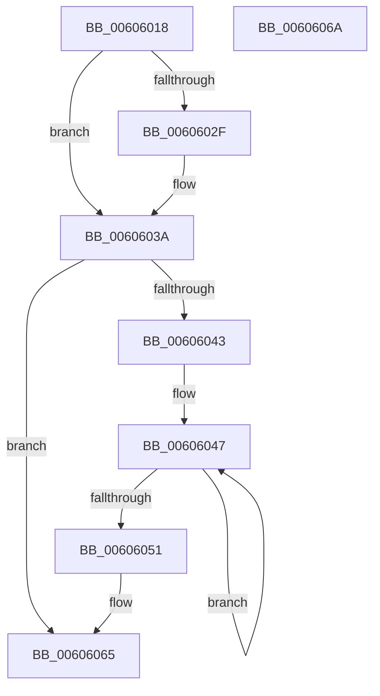

# Pdcv2EventWrite_ACTIVATION_CLIENT_REGISTER

- RVA: `0x00606018`–`0x0060606B` (길이 `83` bytes)
- VA: `0x0000000140606018`
- 실행 섹션: `.text`
- PDB 이름 있음: `예`; PDB Function 태그: `아니요`
- unwind 정보 RVA: `0x00063458`
- 디코드: `22`개 명령, `83/83` bytes 표시
- 미해석 바이트: `0` (있으면 어셈블리에 `.byte`로 보존)

> 이 문서는 커널 이미지의 기계어와 PDB 기호를 분석해 생성했습니다. 4번과 5번은 함수 원형과 자료형을 바이너리 사용 방식에서 추정한 C 해석이며 원본 소스 복구 결과는 아닙니다.

## 1. Dependencies

- 직접 호출 지점: **1**; 고유 호출 대상: **1**
- 직접 호출자로 확인된 함수: **1**
- RIP 상대 이미지 참조: **2**

### Outgoing calls
- `0x00606060` → [McTemplateU0qqqqzr3_EtwWriteTransfer](McTemplateU0qqqqzr3_EtwWriteTransfer_function_00605914.md) (function, `0x00605914`)

### Direct callers
- [Pdcv2ActivationClientRegister](../../page/79/Pdcv2ActivationClientRegister_function_0079AF28.md) at `0x0079B08D`

### Static image references
- `0x00606020` → RVA `0x00013F90` (`.rdata`; read)
- `0x0060603A` → RVA `0x00F05882` (`.data`; read)

## 2. Other-region calls and transfers

- 다른 실행 섹션으로 향하는 call: **0**
- 별도 외부 분기/꼬리 이동을 확인하지 못했습니다.

## 3. Assembly (complete function range)

```asm
00606018  48 83 EC 48                     sub rsp, 0x48
0060601C  41 83 CA FF                     or r10d, 0xffffffff
00606020  4C 8D 05 69 DF A0 FF            lea r8, [rip - 0x5f2097]
00606027  45 33 C9                        xor r9d, r9d
0060602A  48 85 C9                        test rcx, rcx
0060602D  74 0B                           je 0x14060603a
0060602F  44 8B 51 20                     mov r10d, dword ptr [rcx + 0x20]
00606033  4C 8D 81 80 00 00 00            lea r8, [rcx + 0x80]
0060603A  F6 05 41 F8 8F 00 40            test byte ptr [rip + 0x8ff841], 0x40
00606041  74 22                           je 0x140606065
00606043  48 83 C8 FF                     or rax, 0xffffffffffffffff
00606047  48 FF C0                        inc rax
0060604A  66 45 39 0C 40                  cmp word ptr [r8 + rax*2], r9w
0060604F  75 F6                           jne 0x140606047
00606051  4C 89 44 24 30                  mov qword ptr [rsp + 0x30], r8
00606056  44 8B CA                        mov r9d, edx
00606059  45 8B C2                        mov r8d, r10d
0060605C  89 44 24 28                     mov dword ptr [rsp + 0x28], eax
00606060  E8 AF F8 FF FF                  call 0x140605914
00606065  48 83 C4 48                     add rsp, 0x48
00606069  C3                              ret
0060606A  CC                              int3
```

## 4. C-style interpretation (structured pseudocode)

```c
__int64 __fastcall Pdcv2EventWrite_ACTIVATION_CLIENT_REGISTER(__int64 a1, int a2, __int64 a3, int a4)
{
    __int64 result;
    __int64 v_r10;
    __int64 v_rsp;
    unsigned __int64 v_stack_m18;
    unsigned int v_stack_m20;

    v_rsp = (v_rsp) - (72);
    v_r10 = (unsigned int)((v_r10) | (0xFFFFFFFFULL));
    a4 = 0;
    if (a1 != 0) {
        v_r10 = *(unsigned int *)(a1 + 32);
        a3 = a1 + 128;
    }
    if (((*(unsigned __int8 *)(v_rip + 9435201)) & (64)) == 0) goto loc_00606065;
    result = (result) | (-1);
loc_00606047:
    result = (result) + 1;
    if ((*(unsigned __int16 *)(a3 + result * 2)) != 0) goto loc_00606047;
    v_stack_m18 = a3;
    v_stack_m20 = (unsigned int)(result);
    result = McTemplateU0qqqqzr3_EtwWriteTransfer(a1, a2, (unsigned int)((unsigned int)(v_r10)), (unsigned int)(a2));
loc_00606065:
    v_rsp = (v_rsp) + (72);
    return result;
}
```

## 5. (Beta) C Style

```c
int64_t Pdcv2EventWrite_ACTIVATION_CLIENT_REGISTER(int64_t Arg1, int32_t Arg2, int64_t Arg3, int32_t Arg4)
{
    int64_t result;
    int64_t local_r10;
    int64_t local_rsp;
    uint64_t v_stack_m18;
    uint32_t v_stack_m20;

    local_rsp = (local_rsp) - (72);
    local_r10 = (uint32_t)((local_r10) | (0xFFFFFFFFULL));
    Arg4 = 0;
    if (Arg1 != 0) {
        local_r10 = *(uint32_t *)(Arg1 + 0x20);
        Arg3 = Arg1 + 128;
    }
    if (((*(uint8_t *)(v_rip + 0x8FF841)) & (64)) == 0) goto loc_00606065;
    result = (result) | (-1);
loc_00606047:
    result = (result) + 1;
    if ((*(uint16_t *)(Arg3 + result * 2)) != 0) goto loc_00606047;
    v_stack_m18 = Arg3;
    v_stack_m20 = (uint32_t)(result);
    result = McTemplateU0qqqqzr3_EtwWriteTransfer(Arg1, Arg2, (uint32_t)((uint32_t)(local_r10)), (uint32_t)(Arg2));
loc_00606065:
    local_rsp = (local_rsp) + (72);
    return result;
}
```

## 6. Execution-region graph

[열기: 2D/3D 그래프와 함수 탐색 컨트롤 패널](../../../control-panel.html?section=text&rva=0x00606018&view=graph)

- 2D 그래프는 위에서 아래로 흐르고, 3D 그래프는 빈 공간을 드래그해 회전합니다. Shift+드래그는 이동, 휠은 확대·축소, 함수 노드 선택은 대상 보고서 이동입니다.

### Static fallback


