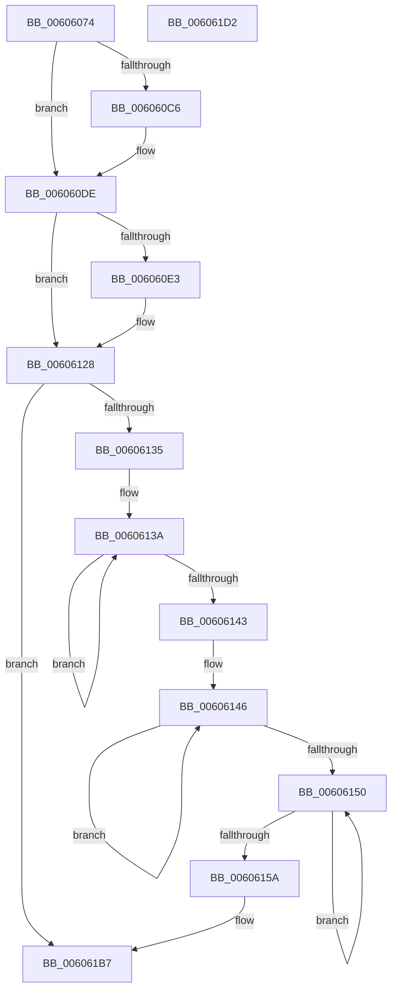

# Pdcv2EventWrite_ACTIVATION_CLIENT_RENEW_ACTIVATION

- RVA: `0x00606074`–`0x006061D3` (길이 `351` bytes)
- VA: `0x0000000140606074`
- 실행 섹션: `.text`
- PDB 이름 있음: `예`; PDB Function 태그: `아니요`
- unwind 정보 RVA: `0x000D072C`
- 디코드: `89`개 명령, `351/351` bytes 표시
- 미해석 바이트: `0` (있으면 어셈블리에 `.byte`로 보존)

> 이 문서는 커널 이미지의 기계어와 PDB 기호를 분석해 생성했습니다. 4번과 5번은 함수 원형과 자료형을 바이너리 사용 방식에서 추정한 C 해석이며 원본 소스 복구 결과는 아닙니다.

## 1. Dependencies

- 직접 호출 지점: **1**; 고유 호출 대상: **1**
- 직접 호출자로 확인된 함수: **1**
- RIP 상대 이미지 참조: **2**

### Outgoing calls
- `0x006061B2` → [McTemplateU0qqzr1qzr3qqqxqqqpqzr13q_EtwWriteTransfer](McTemplateU0qqzr1qzr3qqqxqqqpqzr13q_EtwWriteTransfer_function_00605B88.md) (function, `0x00605B88`)

### Direct callers
- [Pdcv2ActivationClientRenewActivation](../../page/79/Pdcv2ActivationClientRenewActivation_function_0079B0F0.md) at `0x0079B276`

### Static image references
- `0x00606099` → RVA `0x00013F90` (`.rdata`; read)
- `0x00606128` → RVA `0x00F05882` (`.data`; read)

## 2. Other-region calls and transfers

- 다른 실행 섹션으로 향하는 call: **0**
- 별도 외부 분기/꼬리 이동을 확인하지 못했습니다.

## 3. Assembly (complete function range)

```asm
00606074  48 89 5C 24 08                  mov qword ptr [rsp + 8], rbx
00606079  44 89 4C 24 20                  mov dword ptr [rsp + 0x20], r9d
0060607E  44 89 44 24 18                  mov dword ptr [rsp + 0x18], r8d
00606083  55                              push rbp
00606084  56                              push rsi
00606085  57                              push rdi
00606086  41 54                           push r12
00606088  41 55                           push r13
0060608A  41 56                           push r14
0060608C  41 57                           push r15
0060608E  48 81 EC 90 00 00 00            sub rsp, 0x90
00606095  41 83 CB FF                     or r11d, 0xffffffff
00606099  48 8D 1D F0 DE A0 FF            lea rbx, [rip - 0x5f2110]
006060A0  49 83 C9 FF                     or r9, 0xffffffffffffffff
006060A4  33 C0                           xor eax, eax
006060A6  4C 8B D1                        mov r10, rcx
006060A9  41 8B EB                        mov ebp, r11d
006060AC  49 8B F1                        mov rsi, r9
006060AF  44 8B F8                        mov r15d, eax
006060B2  45 8B F3                        mov r14d, r11d
006060B5  45 8B E3                        mov r12d, r11d
006060B8  45 8B EB                        mov r13d, r11d
006060BB  4C 8B C3                        mov r8, rbx
006060BE  48 8B FB                        mov rdi, rbx
006060C1  48 85 D2                        test rdx, rdx
006060C4  74 18                           je 0x1406060de
006060C6  44 8B 72 20                     mov r14d, dword ptr [rdx + 0x20]
006060CA  48 8D 9A 80 00 00 00            lea rbx, [rdx + 0x80]
006060D1  8B AA 00 01 00 00               mov ebp, dword ptr [rdx + 0x100]
006060D7  44 8B 9A 04 01 00 00            mov r11d, dword ptr [rdx + 0x104]
006060DE  4D 85 D2                        test r10, r10
006060E1  74 45                           je 0x140606128
006060E3  44 8B 61 3C                     mov r12d, dword ptr [rcx + 0x3c]
006060E7  48 8D 79 50                     lea rdi, [rcx + 0x50]
006060EB  48 B8 04 00 00 00 80 F7 FF FF   movabs rax, 0xfffff78000000004
006060F5  4C 8D 81 50 01 00 00            lea r8, [rcx + 0x150]
006060FC  8B 08                           mov ecx, dword ptr [rax]
006060FE  48 B8 20 03 00 00 80 F7 FF FF   movabs rax, 0xfffff78000000320
00606108  48 C1 E1 20                     shl rcx, 0x20
0060610C  48 8B 00                        mov rax, qword ptr [rax]
0060610F  45 8B 6A 48                     mov r13d, dword ptr [r10 + 0x48]
00606113  45 8B BA 50 02 00 00            mov r15d, dword ptr [r10 + 0x250]
0060611A  48 C1 E0 08                     shl rax, 8
0060611E  48 F7 E1                        mul rcx
00606121  48 8B F2                        mov rsi, rdx
00606124  49 2B 72 30                     sub rsi, qword ptr [r10 + 0x30]
00606128  F6 05 53 F7 8F 00 40            test byte ptr [rip + 0x8ff753], 0x40
0060612F  0F 84 82 00 00 00               je 0x1406061b7
00606135  49 8B C9                        mov rcx, r9
00606138  33 D2                           xor edx, edx
0060613A  48 FF C1                        inc rcx
0060613D  66 39 14 4B                     cmp word ptr [rbx + rcx*2], dx
00606141  75 F7                           jne 0x14060613a
00606143  49 8B C1                        mov rax, r9
00606146  48 FF C0                        inc rax
00606149  66 41 39 14 40                  cmp word ptr [r8 + rax*2], dx
0060614E  75 F6                           jne 0x140606146
00606150  49 FF C1                        inc r9
00606153  66 42 39 14 4F                  cmp word ptr [rdi + r9*2], dx
00606158  75 F6                           jne 0x140606150
0060615A  44 89 BC 24 88 00 00 00         mov dword ptr [rsp + 0x88], r15d
00606162  48 89 9C 24 80 00 00 00         mov qword ptr [rsp + 0x80], rbx
0060616A  89 4C 24 78                     mov dword ptr [rsp + 0x78], ecx
0060616E  8B 8C 24 E8 00 00 00            mov ecx, dword ptr [rsp + 0xe8]
00606175  4C 89 54 24 70                  mov qword ptr [rsp + 0x70], r10
0060617A  89 4C 24 68                     mov dword ptr [rsp + 0x68], ecx
0060617E  8B 8C 24 E0 00 00 00            mov ecx, dword ptr [rsp + 0xe0]
00606185  89 4C 24 60                     mov dword ptr [rsp + 0x60], ecx
00606189  44 89 6C 24 58                  mov dword ptr [rsp + 0x58], r13d
0060618E  48 89 74 24 50                  mov qword ptr [rsp + 0x50], rsi
00606193  89 6C 24 48                     mov dword ptr [rsp + 0x48], ebp
00606197  44 89 5C 24 40                  mov dword ptr [rsp + 0x40], r11d
0060619C  44 89 64 24 38                  mov dword ptr [rsp + 0x38], r12d
006061A1  4C 89 44 24 30                  mov qword ptr [rsp + 0x30], r8
006061A6  45 8B C6                        mov r8d, r14d
006061A9  89 44 24 28                     mov dword ptr [rsp + 0x28], eax
006061AD  48 89 7C 24 20                  mov qword ptr [rsp + 0x20], rdi
006061B2  E8 D1 F9 FF FF                  call 0x140605b88
006061B7  48 8B 9C 24 D0 00 00 00         mov rbx, qword ptr [rsp + 0xd0]
006061BF  48 81 C4 90 00 00 00            add rsp, 0x90
006061C6  41 5F                           pop r15
006061C8  41 5E                           pop r14
006061CA  41 5D                           pop r13
006061CC  41 5C                           pop r12
006061CE  5F                              pop rdi
006061CF  5E                              pop rsi
006061D0  5D                              pop rbp
006061D1  C3                              ret
006061D2  CC                              int3
```

## 4. C-style interpretation (structured pseudocode)

```c
__int64 __fastcall Pdcv2EventWrite_ACTIVATION_CLIENT_RENEW_ACTIVATION(__int64 a1, __int64 a2, int a3, __int64 a4)
{
    __int64 result;
    __int64 v_r11;
    __int64 v_r12;
    __int64 v_r13;
    __int64 v_r14;
    __int64 v_r15;
    __int64 v_rbp;
    __int64 v_rbx;
    __int64 v_rdi;
    __int64 v_rsi;
    __int64 v_rsp;
    unsigned int v_stack_m40;
    unsigned __int64 v_stack_m48;
    unsigned int v_stack_m50;
    unsigned __int64 v_stack_m58;
    unsigned int v_stack_m60;
    unsigned int v_stack_m68;
    unsigned int v_stack_m70;
    unsigned __int64 v_stack_m78;
    unsigned int v_stack_m80;
    unsigned int v_stack_m88;
    unsigned int v_stack_m90;
    unsigned __int64 v_stack_m98;
    unsigned int v_stack_mA0;
    unsigned __int64 v_stack_mA8;
    unsigned int v_stack_p18;
    unsigned int v_stack_p20;
    unsigned __int64 v_stack_p8;

    v_stack_p8 = v_rbx;
    v_stack_p20 = (unsigned int)(a4);
    v_stack_p18 = a3;
    v_rsp = (v_rsp) - (144);
    v_r11 = (unsigned int)((v_r11) | (0xFFFFFFFFULL));
    a4 = (a4) | (-1);
    result = 0;
    v_rbx = v_rip - 6234384;
    v_rbp = (unsigned int)((unsigned int)(v_r11));
    v_r14 = (unsigned int)((unsigned int)(v_r11));
    if (a2 != 0) {
        v_r14 = *(unsigned int *)(a2 + 32);
        v_rbx = a2 + 128;
        v_rbp = *(unsigned int *)(a2 + 256);
        v_r11 = *(unsigned int *)(a2 + 260);
    }
    v_rsi = a4;
    v_rdi = v_rip - 6234384;
    v_r12 = (unsigned int)((unsigned int)(v_r11));
    v_r13 = (unsigned int)((unsigned int)(v_r11));
    v_r15 = 0;
    if (a1 != 0) {
        v_r12 = *(unsigned int *)(a1 + 60);
        v_rdi = a1 + 80;
        a3 = a1 + 336;
        a1 = *(unsigned int *)(result);
        a1 = (a1) << (32);
        result = *(unsigned __int64 *)(result);
        v_r13 = *(unsigned int *)(a1 + 72);
        v_r15 = *(unsigned int *)(a1 + 592);
        result = (result) << (8);
        v_rsi = a2;
        v_rsi = (v_rsi) - (*(unsigned __int64 *)(a1 + 48));
    }
    if (((*(unsigned __int8 *)(v_rip + 9434963)) & (64)) == 0) goto loc_006061B7;
    a2 = 0;
loc_0060613A:
    a1 = (a4) + 1;
    if ((*(unsigned __int16 *)(v_rbx + a1 * 2)) != 0) goto loc_0060613A;
loc_00606146:
    result = (a4) + 1;
    if ((*(unsigned __int16 *)(a3 + result * 2)) != 0) goto loc_00606146;
loc_00606150:
    a4 = (a4) + 1;
    if ((*(unsigned __int16 *)(v_rdi + a4 * 2)) != 0) goto loc_00606150;
    v_stack_m40 = (unsigned int)(v_r15);
    v_stack_m48 = v_rbx;
    v_stack_m50 = (unsigned int)(a1);
    v_stack_m58 = a1;
    v_stack_m60 = (unsigned int)((unsigned int)(v_stack_p20));
    v_stack_m68 = (unsigned int)((unsigned int)(v_stack_p18));
    v_stack_m70 = (unsigned int)(v_r13);
    v_stack_m78 = v_rsi;
    v_stack_m80 = (unsigned int)(v_rbp);
    v_stack_m88 = (unsigned int)(v_r11);
    v_stack_m90 = (unsigned int)(v_r12);
    v_stack_m98 = a3;
    v_stack_mA0 = (unsigned int)(result);
    v_stack_mA8 = v_rdi;
    result = McTemplateU0qqzr1qzr3qqqxqqqpqzr13q_EtwWriteTransfer((unsigned int)(v_stack_p18), a2, (unsigned int)((unsigned int)(v_r14)), a4);
loc_006061B7:
    v_rsp = (v_rsp) + (144);
    return result;
}
```

## 5. (Beta) C Style

```c
int64_t Pdcv2EventWrite_ACTIVATION_CLIENT_RENEW_ACTIVATION(void *Arg1, int64_t Arg2, int32_t Arg3, int64_t Arg4)
{
    uint8_t *arg1 = (uint8_t *)Arg1;

    int64_t result;
    int64_t local_r11;
    int64_t local_r12;
    int64_t local_r13;
    int64_t local_r14;
    int64_t local_r15;
    int64_t local_rbp;
    int64_t local_rbx;
    int64_t local_rdi;
    int64_t local_rsi;
    int64_t local_rsp;
    uint32_t v_stack_m40;
    uint64_t v_stack_m48;
    uint32_t v_stack_m50;
    uint64_t v_stack_m58;
    uint32_t v_stack_m60;
    uint32_t v_stack_m68;
    uint32_t v_stack_m70;
    uint64_t v_stack_m78;
    uint32_t v_stack_m80;
    uint32_t v_stack_m88;
    uint32_t v_stack_m90;
    uint64_t v_stack_m98;
    uint32_t v_stack_mA0;
    uint64_t v_stack_mA8;
    uint32_t v_stack_p18;
    uint32_t v_stack_p20;
    uint64_t v_stack_p8;

    v_stack_p8 = local_rbx;
    v_stack_p20 = (uint32_t)(Arg4);
    v_stack_p18 = Arg3;
    local_rsp = (local_rsp) - (144);
    local_r11 = (uint32_t)((local_r11) | (0xFFFFFFFFULL));
    Arg4 = (Arg4) | (-1);
    result = 0;
    local_rbx = v_rip - 6234384;
    local_rbp = (uint32_t)((uint32_t)(local_r11));
    local_r14 = (uint32_t)((uint32_t)(local_r11));
    if (Arg2 != 0) {
        local_r14 = *(uint32_t *)(Arg2 + 0x20);
        local_rbx = Arg2 + 128;
        local_rbp = *(uint32_t *)(Arg2 + 0x100);
        local_r11 = *(uint32_t *)(Arg2 + 0x104);
    }
    local_rsi = Arg4;
    local_rdi = v_rip - 6234384;
    local_r12 = (uint32_t)((uint32_t)(local_r11));
    local_r13 = (uint32_t)((uint32_t)(local_r11));
    local_r15 = 0;
    if (Arg1 != NULL) {
        local_r12 = *(uint32_t *)(arg1 + 0x3C);
        local_rdi = Arg1 + 80;
        Arg3 = Arg1 + 336;
        Arg1 = *(uint32_t *)(result);
        Arg1 = (Arg1) << (32);
        result = *(uint64_t *)(result);
        local_r13 = *(uint32_t *)(arg1 + 0x48);
        local_r15 = *(uint32_t *)(arg1 + 0x250);
        result = (result) << (8);
        local_rsi = Arg2;
        local_rsi = (local_rsi) - (*(uint64_t *)(arg1 + 0x30));
    }
    if (((*(uint8_t *)(v_rip + 0x8FF753)) & (64)) == 0) goto loc_006061B7;
    Arg2 = 0;
loc_0060613A:
    Arg1 = (Arg4) + 1;
    if ((*(uint16_t *)(local_rbx + arg1 * 2)) != 0) goto loc_0060613A;
loc_00606146:
    result = (Arg4) + 1;
    if ((*(uint16_t *)(Arg3 + result * 2)) != 0) goto loc_00606146;
loc_00606150:
    Arg4 = (Arg4) + 1;
    if ((*(uint16_t *)(local_rdi + Arg4 * 2)) != 0) goto loc_00606150;
    v_stack_m40 = (uint32_t)(local_r15);
    v_stack_m48 = local_rbx;
    v_stack_m50 = (uint32_t)(Arg1);
    v_stack_m58 = Arg1;
    v_stack_m60 = (uint32_t)((uint32_t)(v_stack_p20));
    v_stack_m68 = (uint32_t)((uint32_t)(v_stack_p18));
    v_stack_m70 = (uint32_t)(local_r13);
    v_stack_m78 = local_rsi;
    v_stack_m80 = (uint32_t)(local_rbp);
    v_stack_m88 = (uint32_t)(local_r11);
    v_stack_m90 = (uint32_t)(local_r12);
    v_stack_m98 = Arg3;
    v_stack_mA0 = (uint32_t)(result);
    v_stack_mA8 = local_rdi;
    result = McTemplateU0qqzr1qzr3qqqxqqqpqzr13q_EtwWriteTransfer((uint32_t)(v_stack_p18), Arg2, (uint32_t)((uint32_t)(local_r14)), Arg4);
loc_006061B7:
    local_rsp = (local_rsp) + (144);
    return result;
}
```

### 관측된 메모리 오프셋

구조체 형식이 확인되지 않은 접근은 인자 기준의 오프셋으로만 기록했습니다.

| 기준 인자 | 오프셋 표현 | 폭 (bit) | 접근 |
|---|---:|---:|---|
| `Arg1` | `+ 0x3C` | `32` | `R` |
| `Arg1` | `+ 0x50` | `64` | `R` |
| `Arg1` | `+ 0x150` | `64` | `R` |

## 6. Execution-region graph

[열기: 2D/3D 그래프와 함수 탐색 컨트롤 패널](../../../control-panel.html?section=text&rva=0x00606074&view=graph)

- 2D 그래프는 위에서 아래로 흐르고, 3D 그래프는 빈 공간을 드래그해 회전합니다. Shift+드래그는 이동, 휠은 확대·축소, 함수 노드 선택은 대상 보고서 이동입니다.

### Static fallback


