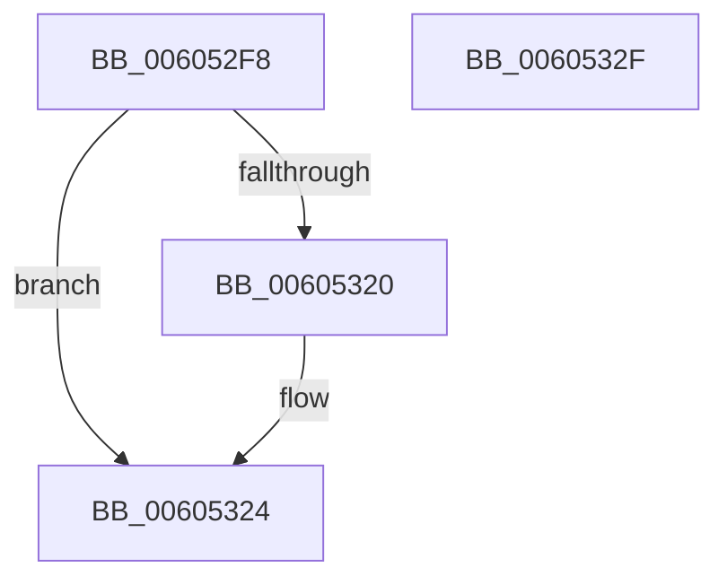

# RtlCSparseBitmapInitialize

- RVA: `0x006052F8`–`0x00605330` (길이 `56` bytes)
- VA: `0x00000001406052F8`
- 실행 섹션: `.text`
- PDB 이름 있음: `예`; PDB Function 태그: `아니요`
- unwind 정보 RVA: `0x0005CAAC`
- 디코드: `19`개 명령, `56/56` bytes 표시
- 미해석 바이트: `0` (있으면 어셈블리에 `.byte`로 보존)

> 이 문서는 커널 이미지의 기계어와 PDB 기호를 분석해 생성했습니다. 4번과 5번은 함수 원형과 자료형을 바이너리 사용 방식에서 추정한 C 해석이며 원본 소스 복구 결과는 아닙니다.

## 1. Dependencies

- 직접 호출 지점: **1**; 고유 호출 대상: **1**
- 직접 호출자로 확인된 함수: **1**
- RIP 상대 이미지 참조: **0**

### Outgoing calls
- `0x0060530C` → [memset](../6C/memset_function_006C6C40.md) (function, `0x006C6C40`)

### Direct callers
- [RtlHpHeapManagerInitialize](../5F/RtlHpHeapManagerInitialize_function_005F0B20.md) at `0x005F0B6E`
- [RtlHpHeapManagerInitialize](../5F/RtlHpHeapManagerInitialize_function_005F0B20.md) at `0x005F0B9F`

### Static image references
- 디코드된 RIP-relative 메모리 참조가 없습니다.

## 2. Other-region calls and transfers

- 다른 실행 섹션으로 향하는 call: **0**
- 별도 외부 분기/꼬리 이동을 확인하지 못했습니다.

## 3. Assembly (complete function range)

```asm
006052F8  48 89 5C 24 08                  mov qword ptr [rsp + 8], rbx
006052FD  57                              push rdi
006052FE  48 83 EC 20                     sub rsp, 0x20
00605302  8B DA                           mov ebx, edx
00605304  48 8B F9                        mov rdi, rcx
00605307  44 8B C2                        mov r8d, edx
0060530A  33 D2                           xor edx, edx
0060530C  E8 2F 19 0C 00                  call 0x1406c6c40
00605311  48 83 4F 20 FF                  or qword ptr [rdi + 0x20], 0xffffffffffffffff
00605316  8D 43 C8                        lea eax, [rbx - 0x38]
00605319  89 47 34                        mov dword ptr [rdi + 0x34], eax
0060531C  3B C3                           cmp eax, ebx
0060531E  76 04                           jbe 0x140605324
00605320  83 67 34 00                     and dword ptr [rdi + 0x34], 0
00605324  48 8B 5C 24 30                  mov rbx, qword ptr [rsp + 0x30]
00605329  48 83 C4 20                     add rsp, 0x20
0060532D  5F                              pop rdi
0060532E  C3                              ret
0060532F  CC                              int3
```

## 4. C-style interpretation (structured pseudocode)

```c
__int64 __fastcall RtlCSparseBitmapInitialize(__int64 a1, int a2)
{
    __int64 result;
    __int64 v_rsp;
    unsigned __int64 v_stack_p8;

    v_stack_p8 = v_rbx;
    v_rsp = (v_rsp) - (32);
    a2 = 0;
    result = memset(a1, a2, (unsigned int)(a2), a4);
    *(unsigned int *)(a1 + 52) = (unsigned int)((unsigned int)(a2) - 56);
    if (((unsigned int)((unsigned int)(a2) - 56)) >= = ((unsigned int)((unsigned int)(a2)))) {
    }
    v_rsp = (v_rsp) + (32);
    return (unsigned int)(a2) - 56;
}
```

## 5. (Beta) C Style

```c
int64_t RtlCSparseBitmapInitialize(void *Arg1, void *Arg2)
{
    uint8_t *arg1 = (uint8_t *)Arg1;
    uint8_t *arg2 = (uint8_t *)Arg2;

    int64_t result;
    int64_t local_rsp;
    uint64_t v_stack_p8;

    v_stack_p8 = local_rbx;
    local_rsp = (local_rsp) - (32);
    Arg2 = 0;
    result = memset(Arg1, Arg2, (uint32_t)(Arg2), a4);
    *(uint32_t *)(arg1 + 0x34) = (uint32_t)((uint32_t)(Arg2) - 56);
    if (((uint32_t)((uint32_t)(Arg2) - 56)) >= = ((uint32_t)((uint32_t)(Arg2)))) {
    }
    local_rsp = (local_rsp) + (32);
    return (uint32_t)(Arg2) - 56;
}
```

### 관측된 메모리 오프셋

구조체 형식이 확인되지 않은 접근은 인자 기준의 오프셋으로만 기록했습니다.

| 기준 인자 | 오프셋 표현 | 폭 (bit) | 접근 |
|---|---:|---:|---|
| `Arg1` | `+ 0x20` | `64` | `R/W` |
| `Arg1` | `+ 0x34` | `32` | `R/W` |
| `Arg1` | `+ 0x34` | `32` | `W` |
| `Arg2` | `- 0x38` | `32` | `R` |

## 6. Execution-region graph

[열기: 2D/3D 그래프와 함수 탐색 컨트롤 패널](../../../control-panel.html?section=text&rva=0x006052F8&view=graph)

- 2D 그래프는 위에서 아래로 흐르고, 3D 그래프는 빈 공간을 드래그해 회전합니다. Shift+드래그는 이동, 휠은 확대·축소, 함수 노드 선택은 대상 보고서 이동입니다.

### Static fallback


