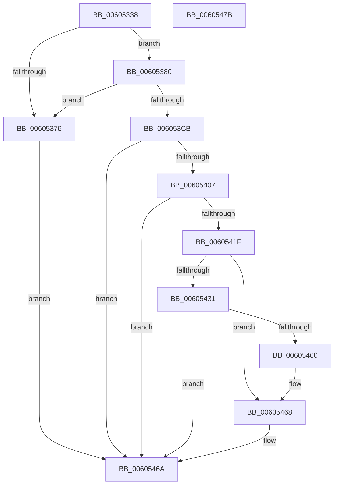

# RtlCSparseBitmapStart

- RVA: `0x00605338`–`0x0060547C` (길이 `324` bytes)
- VA: `0x0000000140605338`
- 실행 섹션: `.text`
- PDB 이름 있음: `예`; PDB Function 태그: `아니요`
- unwind 정보 RVA: `0x000D0638`
- 디코드: `85`개 명령, `324/324` bytes 표시
- 미해석 바이트: `0` (있으면 어셈블리에 `.byte`로 보존)

> 이 문서는 커널 이미지의 기계어와 PDB 기호를 분석해 생성했습니다. 4번과 5번은 함수 원형과 자료형을 바이너리 사용 방식에서 추정한 C 해석이며 원본 소스 복구 결과는 아닙니다.

## 1. Dependencies

- 직접 호출 지점: **3**; 고유 호출 대상: **2**
- 직접 호출자로 확인된 함수: **2**
- RIP 상대 이미지 참조: **0**

### Outgoing calls
- `0x006053FE` → [RtlpHpEnvAllocVA](../32/RtlpHpEnvAllocVA_function_00328F50.md) (function, `0x00328F50`)
- `0x00605416` → [RtlpEnvRegisterFaultRange](RtlpEnvRegisterFaultRange_function_00605864.md) (function, `0x00605864`)
- `0x00605457` → [RtlpHpEnvAllocVA](../32/RtlpHpEnvAllocVA_function_00328F50.md) (function, `0x00328F50`)

### Direct callers
- [RtlpHpVaMgrCtxStart](RtlpHpVaMgrCtxStart_function_00603E2C.md) at `0x00603E8C`
- [RtlHpKInitializeHeapManager](../65/RtlHpKInitializeHeapManager_function_0065C9A0.md) at `0x0065CA19`

### Static image references
- 디코드된 RIP-relative 메모리 참조가 없습니다.

## 2. Other-region calls and transfers

- 다른 실행 섹션으로 향하는 call: **0**
- 별도 외부 분기/꼬리 이동을 확인하지 못했습니다.

## 3. Assembly (complete function range)

```asm
00605338  48 89 5C 24 20                  mov qword ptr [rsp + 0x20], rbx
0060533D  56                              push rsi
0060533E  57                              push rdi
0060533F  41 56                           push r14
00605341  48 83 EC 50                     sub rsp, 0x50
00605345  48 83 61 18 00                  and qword ptr [rcx + 0x18], 0
0060534A  48 8B D9                        mov rbx, rcx
0060534D  48 83 61 28 00                  and qword ptr [rcx + 0x28], 0
00605352  45 85 C9                        test r9d, r9d
00605355  C6 41 31 01                     mov byte ptr [rcx + 0x31], 1
00605359  44 88 49 32                     mov byte ptr [rcx + 0x32], r9b
0060535D  0F 95 C0                        setne al
00605360  48 89 51 10                     mov qword ptr [rcx + 0x10], rdx
00605364  88 41 30                        mov byte ptr [rcx + 0x30], al
00605367  48 B8 FF FF FF FF FF FF FF 7F   movabs rax, 0x7fffffffffffffff
00605371  48 3B D0                        cmp rdx, rax
00605374  76 0A                           jbe 0x140605380
00605376  B8 05 00 00 80                  mov eax, 0x80000005
0060537B  E9 EA 00 00 00                  jmp 0x14060546a
00605380  B9 FF 0F 00 00                  mov ecx, 0xfff
00605385  48 8D 72 07                     lea rsi, [rdx + 7]
00605389  48 C1 EE 03                     shr rsi, 3
0060538D  48 C7 C0 00 F0 FF FF            mov rax, 0xfffffffffffff000
00605394  48 03 F1                        add rsi, rcx
00605397  48 23 F0                        and rsi, rax
0060539A  48 8B FE                        mov rdi, rsi
0060539D  48 C1 EF 0C                     shr rdi, 0xc
006053A1  48 83 C7 07                     add rdi, 7
006053A5  48 C1 EF 03                     shr rdi, 3
006053A9  48 03 F9                        add rdi, rcx
006053AC  48 23 F8                        and rdi, rax
006053AF  8B 43 34                        mov eax, dword ptr [rbx + 0x34]
006053B2  48 8B CF                        mov rcx, rdi
006053B5  48 89 7C 24 78                  mov qword ptr [rsp + 0x78], rdi
006053BA  48 C1 E9 0C                     shr rcx, 0xc
006053BE  48 83 C1 07                     add rcx, 7
006053C2  48 C1 E9 03                     shr rcx, 3
006053C6  48 3B C8                        cmp rcx, rax
006053C9  77 AB                           ja 0x140605376
006053CB  83 64 24 40 00                  and dword ptr [rsp + 0x40], 0
006053D0  48 8D 04 37                     lea rax, [rdi + rsi]
006053D4  48 89 44 24 70                  mov qword ptr [rsp + 0x70], rax
006053D9  4C 8D 73 08                     lea r14, [rbx + 8]
006053DD  41 0F B6 C1                     movzx eax, r9b
006053E1  48 8D 54 24 70                  lea rdx, [rsp + 0x70]
006053E6  89 44 24 30                     mov dword ptr [rsp + 0x30], eax
006053EA  41 B9 00 20 10 00               mov r9d, 0x102000
006053F0  45 33 C0                        xor r8d, r8d
006053F3  C7 44 24 20 04 00 00 00         mov dword ptr [rsp + 0x20], 4
006053FB  49 8B CE                        mov rcx, r14
006053FE  E8 4D 3B D2 FF                  call 0x140328f50
00605403  85 C0                           test eax, eax
00605405  78 63                           js 0x14060546a
00605407  48 0F BC 44 24 70               bsf rax, qword ptr [rsp + 0x70]
0060540D  49 8B 0E                        mov rcx, qword ptr [r14]
00605410  48 8B D6                        mov rdx, rsi
00605413  88 43 33                        mov byte ptr [rbx + 0x33], al
00605416  E8 49 04 00 00                  call 0x140605864
0060541B  85 C0                           test eax, eax
0060541D  78 4B                           js 0x14060546a
0060541F  49 8B 0E                        mov rcx, qword ptr [r14]
00605422  48 03 CE                        add rcx, rsi
00605425  48 89 0B                        mov qword ptr [rbx], rcx
00605428  48 81 FF 00 10 00 00            cmp rdi, 0x1000
0060542F  77 37                           ja 0x140605468
00605431  0F B6 43 32                     movzx eax, byte ptr [rbx + 0x32]
00605435  48 8D 54 24 78                  lea rdx, [rsp + 0x78]
0060543A  83 64 24 40 00                  and dword ptr [rsp + 0x40], 0
0060543F  41 B9 00 10 00 40               mov r9d, 0x40001000
00605445  89 44 24 30                     mov dword ptr [rsp + 0x30], eax
00605449  45 33 C0                        xor r8d, r8d
0060544C  48 8B CB                        mov rcx, rbx
0060544F  C7 44 24 20 04 00 00 00         mov dword ptr [rsp + 0x20], 4
00605457  E8 F4 3A D2 FF                  call 0x140328f50
0060545C  85 C0                           test eax, eax
0060545E  78 0A                           js 0x14060546a
00605460  48 C7 43 38 01 00 00 00         mov qword ptr [rbx + 0x38], 1
00605468  33 C0                           xor eax, eax
0060546A  48 8B 9C 24 88 00 00 00         mov rbx, qword ptr [rsp + 0x88]
00605472  48 83 C4 50                     add rsp, 0x50
00605476  41 5E                           pop r14
00605478  5F                              pop rdi
00605479  5E                              pop rsi
0060547A  C3                              ret
0060547B  CC                              int3
```

## 4. C-style interpretation (structured pseudocode)

```c
__int64 __fastcall RtlCSparseBitmapStart(__int64 a1, __int64 a2, int a3, int a4)
{
    __int64 result;
    __int64 v_rdi;
    __int64 v_rsi;
    __int64 v_rsp;
    unsigned int v_stack_m28;
    unsigned int v_stack_m38;
    unsigned int v_stack_m48;
    unsigned __int64 v_stack_p10;
    unsigned __int64 v_stack_p20;
    unsigned __int64 v_stack_p8;

    v_stack_p20 = v_rbx;
    v_rsp = (v_rsp) - (80);
    *(unsigned __int8 *)(a1 + 49) = 1;
    *(unsigned __int8 *)(a1 + 50) = (unsigned __int8)(a4);
    result = (a4 != 0) ? 1 : 0;
    *(unsigned __int64 *)(a1 + 16) = a2;
    *(unsigned __int8 *)(a1 + 48) = (unsigned __int8)(result);
    if (a2 <= result) goto loc_00605380;
loc_00605376:
    goto loc_0060546A;
loc_00605380:
    v_rsi = (a2 + 7) >> (3);
    v_rsi = (v_rsi) + ((unsigned int)(0xFFFULL));
    v_rsi = (v_rsi) & (0xFFFFFFFFFFFFF000ULL);
    v_rdi = (v_rsi) >> (12);
    v_rdi = (v_rdi) + (7);
    v_rdi = (v_rdi) >> (3);
    v_rdi = (v_rdi) + ((unsigned int)(0xFFFULL));
    v_rdi = (v_rdi) & (0xFFFFFFFFFFFFF000ULL);
    v_stack_p10 = v_rdi;
    a1 = (v_rdi) >> (12);
    a1 = (a1) + (7);
    a1 = (a1) >> (3);
    if (a1 > ((unsigned int)(*(unsigned int *)(a1 + 52)))) goto loc_00605376;
    v_stack_p8 = v_rdi + v_rsi * 1;
    v_stack_m38 = (unsigned int)((unsigned __int8)(a4));
    a3 = 0;
    v_stack_m48 = 4;
    result = RtlpHpEnvAllocVA(a1 + 8, v_stack_p8, a3, (unsigned int)(0x102000ULL));
    if (sign_flag) goto loc_0060546A;
    *(unsigned __int8 *)(a1 + 51) = (unsigned __int8)(result);
    result = RtlpEnvRegisterFaultRange(*(unsigned __int64 *)(a1 + 8), v_rsi, a3, (unsigned int)(0x102000ULL));
    if (sign_flag) goto loc_0060546A;
    a1 = (*(unsigned __int64 *)(a1 + 8)) + (v_rsi);
    *(unsigned __int64 *)(a1) = a1;
    if (v_rdi > 0x1000ULL) goto loc_00605468;
    v_stack_m38 = (unsigned int)(*(unsigned __int8 *)(a1 + 50));
    a3 = 0;
    v_stack_m48 = 4;
    result = RtlpHpEnvAllocVA(a1, v_stack_p10, a3, (unsigned int)(0x40001000ULL));
    if (sign_flag) goto loc_0060546A;
    *(unsigned __int64 *)(a1 + 56) = 1;
loc_00605468:
    result = 0;
loc_0060546A:
    v_rsp = (v_rsp) + (80);
    return result;
}
```

## 5. (Beta) C Style

```c
int64_t RtlCSparseBitmapStart(void *Arg1, int64_t Arg2, int32_t Arg3, int32_t Arg4)
{
    uint8_t *arg1 = (uint8_t *)Arg1;

    int64_t result;
    int64_t local_rdi;
    int64_t local_rsi;
    int64_t local_rsp;
    uint32_t v_stack_m28;
    uint32_t v_stack_m38;
    uint32_t v_stack_m48;
    uint64_t v_stack_p10;
    uint64_t v_stack_p20;
    uint64_t v_stack_p8;

    v_stack_p20 = local_rbx;
    local_rsp = (local_rsp) - (80);
    *(uint8_t *)(arg1 + 0x31) = 1;
    *(uint8_t *)(arg1 + 0x32) = (uint8_t)(Arg4);
    result = (Arg4 != 0) ? 1 : 0;
    *(uint64_t *)(arg1 + 0x10) = Arg2;
    *(uint8_t *)(arg1 + 0x30) = (uint8_t)(result);
    if (Arg2 <= result) goto loc_00605380;
loc_00605376:
    goto loc_0060546A;
loc_00605380:
    local_rsi = (Arg2 + 7) >> (3);
    local_rsi = (local_rsi) + ((uint32_t)(0xFFFULL));
    local_rsi = (local_rsi) & (0xFFFFFFFFFFFFF000ULL);
    local_rdi = (local_rsi) >> (12);
    local_rdi = (local_rdi) + (7);
    local_rdi = (local_rdi) >> (3);
    local_rdi = (local_rdi) + ((uint32_t)(0xFFFULL));
    local_rdi = (local_rdi) & (0xFFFFFFFFFFFFF000ULL);
    v_stack_p10 = local_rdi;
    Arg1 = (local_rdi) >> (12);
    Arg1 = (Arg1) + (7);
    Arg1 = (Arg1) >> (3);
    if (Arg1 > ((uint32_t)(*(uint32_t *)(arg1 + 0x34)))) goto loc_00605376;
    v_stack_p8 = local_rdi + local_rsi * 1;
    v_stack_m38 = (uint32_t)((uint8_t)(Arg4));
    Arg3 = 0;
    v_stack_m48 = 4;
    result = RtlpHpEnvAllocVA(Arg1 + 8, v_stack_p8, Arg3, (uint32_t)(0x102000ULL));
    if (sign_flag) goto loc_0060546A;
    *(uint8_t *)(arg1 + 0x33) = (uint8_t)(result);
    result = RtlpEnvRegisterFaultRange(*(uint64_t *)(arg1 + 0x8), local_rsi, Arg3, (uint32_t)(0x102000ULL));
    if (sign_flag) goto loc_0060546A;
    Arg1 = (*(uint64_t *)(arg1 + 0x8)) + (local_rsi);
    *(void **)(arg1) = Arg1;
    if (local_rdi > 0x1000ULL) goto loc_00605468;
    v_stack_m38 = (uint32_t)(*(uint8_t *)(arg1 + 0x32));
    Arg3 = 0;
    v_stack_m48 = 4;
    result = RtlpHpEnvAllocVA(Arg1, v_stack_p10, Arg3, (uint32_t)(0x40001000ULL));
    if (sign_flag) goto loc_0060546A;
    *(uint64_t *)(arg1 + 0x38) = 1;
loc_00605468:
    result = 0;
loc_0060546A:
    local_rsp = (local_rsp) + (80);
    return result;
}
```

### 관측된 메모리 오프셋

구조체 형식이 확인되지 않은 접근은 인자 기준의 오프셋으로만 기록했습니다.

| 기준 인자 | 오프셋 표현 | 폭 (bit) | 접근 |
|---|---:|---:|---|
| `Arg1` | `+ 0x0` | `64` | `R` |
| `Arg1` | `+ 0x0` | `64` | `W` |
| `Arg1` | `+ 0x8` | `64` | `R` |
| `Arg1` | `+ 0x10` | `64` | `W` |
| `Arg1` | `+ 0x18` | `64` | `R/W` |
| `Arg1` | `+ 0x28` | `64` | `R/W` |
| `Arg1` | `+ 0x30` | `8` | `W` |
| `Arg1` | `+ 0x31` | `8` | `W` |
| `Arg1` | `+ 0x32` | `8` | `R` |
| `Arg1` | `+ 0x32` | `8` | `W` |
| `Arg1` | `+ 0x33` | `8` | `W` |
| `Arg1` | `+ 0x34` | `32` | `R` |
| `Arg1` | `+ 0x38` | `64` | `W` |

## 6. Execution-region graph

[열기: 2D/3D 그래프와 함수 탐색 컨트롤 패널](../../../control-panel.html?section=text&rva=0x00605338&view=graph)

- 2D 그래프는 위에서 아래로 흐르고, 3D 그래프는 빈 공간을 드래그해 회전합니다. Shift+드래그는 이동, 휠은 확대·축소, 함수 노드 선택은 대상 보고서 이동입니다.

### Static fallback


