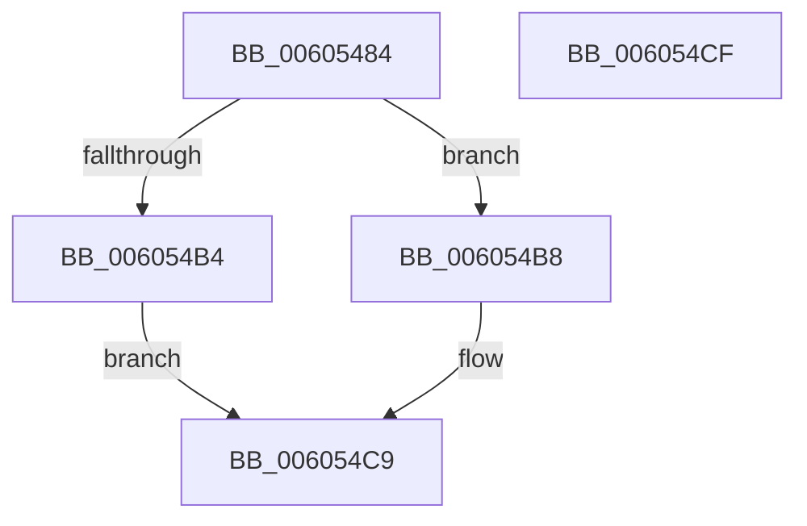

# RtlSparseArrayElementFindCapped

- RVA: `0x00605484`–`0x006054D0` (길이 `76` bytes)
- VA: `0x0000000140605484`
- 실행 섹션: `.text`
- PDB 이름 있음: `예`; PDB Function 태그: `아니요`
- unwind 정보 RVA: `0x0005CF00`
- 디코드: `24`개 명령, `76/76` bytes 표시
- 미해석 바이트: `0` (있으면 어셈블리에 `.byte`로 보존)

> 이 문서는 커널 이미지의 기계어와 PDB 기호를 분석해 생성했습니다. 4번과 5번은 함수 원형과 자료형을 바이너리 사용 방식에서 추정한 C 해석이며 원본 소스 복구 결과는 아닙니다.

## 1. Dependencies

- 직접 호출 지점: **1**; 고유 호출 대상: **1**
- 직접 호출자로 확인된 함수: **1**
- RIP 상대 이미지 참조: **0**

### Outgoing calls
- `0x006054A9` → [RtlCSparseBitmapFindBitSetCapped](../32/RtlCSparseBitmapFindBitSetCapped_function_003274AC.md) (function, `0x003274AC`)

### Direct callers
- [RtlpHpVaMgrCtxFree](../2E/RtlpHpVaMgrCtxFree_function_002ED734.md) at `0x002ED9A9`

### Static image references
- 디코드된 RIP-relative 메모리 참조가 없습니다.

## 2. Other-region calls and transfers

- 다른 실행 섹션으로 향하는 call: **0**
- 별도 외부 분기/꼬리 이동을 확인하지 못했습니다.

## 3. Assembly (complete function range)

```asm
00605484  40 53                           push rbx
00605486  48 83 EC 20                     sub rsp, 0x20
0060548A  48 8B D9                        mov rbx, rcx
0060548D  8B 49 08                        mov ecx, dword ptr [rcx + 8]
00605490  49 D3 E0                        shl r8, cl
00605493  49 C1 E0 03                     shl r8, 3
00605497  48 FF C2                        inc rdx
0060549A  48 D3 E2                        shl rdx, cl
0060549D  48 8D 4B 10                     lea rcx, [rbx + 0x10]
006054A1  48 8D 14 D5 FF FF FF FF         lea rdx, [rdx*8 - 1]
006054A9  E8 FE 1F D2 FF                  call 0x1403274ac
006054AE  48 83 F8 FF                     cmp rax, -1
006054B2  75 04                           jne 0x1406054b8
006054B4  33 C0                           xor eax, eax
006054B6  EB 11                           jmp 0x1406054c9
006054B8  8B 4B 08                        mov ecx, dword ptr [rbx + 8]
006054BB  48 C1 E8 03                     shr rax, 3
006054BF  48 D3 E8                        shr rax, cl
006054C2  48 D3 E0                        shl rax, cl
006054C5  48 03 43 18                     add rax, qword ptr [rbx + 0x18]
006054C9  48 83 C4 20                     add rsp, 0x20
006054CD  5B                              pop rbx
006054CE  C3                              ret
006054CF  CC                              int3
```

## 4. C-style interpretation (structured pseudocode)

```c
__int64 __fastcall RtlSparseArrayElementFindCapped(__int64 a1, __int64 a2, __int64 a3)
{
    __int64 result;
    __int64 v_rsp;

    v_rsp = (v_rsp) - (32);
    a3 = (a3) << ((unsigned __int8)((unsigned int)(*(unsigned int *)(a1 + 8))));
    a3 = (a3) << (3);
    a2 = (a2) + 1;
    a2 = (a2) << ((unsigned __int8)((unsigned int)(*(unsigned int *)(a1 + 8))));
    result = RtlCSparseBitmapFindBitSetCapped(a1 + 16, a2 * 8 - 1, a3, a4);
    if (result != -1) goto loc_006054B8;
    result = 0;
    goto loc_006054C9;
loc_006054B8:
    result = (result) >> (3);
    result = (result) >> ((unsigned __int8)((unsigned int)(*(unsigned int *)(a1 + 8))));
    result = (result) << ((unsigned __int8)((unsigned int)(*(unsigned int *)(a1 + 8))));
    result = (result) + (*(unsigned __int64 *)(a1 + 24));
loc_006054C9:
    v_rsp = (v_rsp) + (32);
    return result;
}
```

## 5. (Beta) C Style

```c
int64_t RtlSparseArrayElementFindCapped(void *Arg1, int64_t Arg2, int64_t Arg3)
{
    uint8_t *arg1 = (uint8_t *)Arg1;

    int64_t result;
    int64_t local_rsp;

    local_rsp = (local_rsp) - (32);
    Arg3 = (Arg3) << ((uint8_t)((uint32_t)(*(uint32_t *)(arg1 + 0x8))));
    Arg3 = (Arg3) << (3);
    Arg2 = (Arg2) + 1;
    Arg2 = (Arg2) << ((uint8_t)((uint32_t)(*(uint32_t *)(arg1 + 0x8))));
    result = RtlCSparseBitmapFindBitSetCapped(Arg1 + 16, Arg2 * 8 - 1, Arg3, a4);
    if (result != -1) goto loc_006054B8;
    result = 0;
    goto loc_006054C9;
loc_006054B8:
    result = (result) >> (3);
    result = (result) >> ((uint8_t)((uint32_t)(*(uint32_t *)(arg1 + 0x8))));
    result = (result) << ((uint8_t)((uint32_t)(*(uint32_t *)(arg1 + 0x8))));
    result = (result) + (*(uint64_t *)(arg1 + 0x18));
loc_006054C9:
    local_rsp = (local_rsp) + (32);
    return result;
}
```

### 관측된 메모리 오프셋

구조체 형식이 확인되지 않은 접근은 인자 기준의 오프셋으로만 기록했습니다.

| 기준 인자 | 오프셋 표현 | 폭 (bit) | 접근 |
|---|---:|---:|---|
| `Arg1` | `+ 0x8` | `32` | `R` |
| `Arg1` | `+ 0x10` | `64` | `R` |
| `Arg1` | `+ 0x18` | `64` | `R` |

## 6. Execution-region graph

[열기: 2D/3D 그래프와 함수 탐색 컨트롤 패널](../../../control-panel.html?section=text&rva=0x00605484&view=graph)

- 2D 그래프는 위에서 아래로 흐르고, 3D 그래프는 빈 공간을 드래그해 회전합니다. Shift+드래그는 이동, 휠은 확대·축소, 함수 노드 선택은 대상 보고서 이동입니다.

### Static fallback


