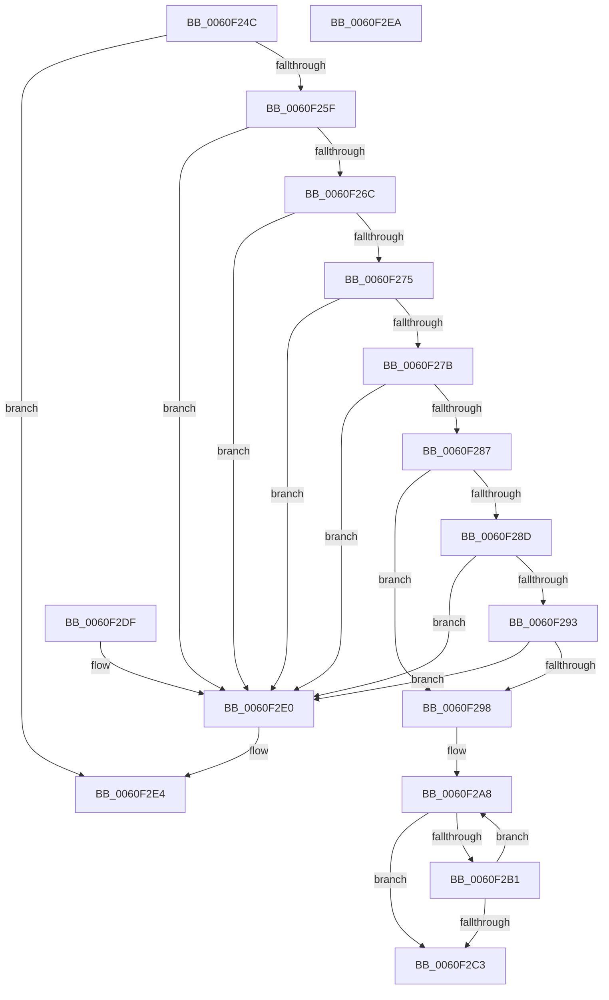

# RtlStringCbCopyUnicodeString

- RVA: `0x0060F24C`–`0x0060F2EB` (길이 `159` bytes)
- VA: `0x000000014060F24C`
- 실행 섹션: `.text`
- PDB 이름 있음: `예`; PDB Function 태그: `아니요`
- unwind 정보 RVA: `0x000DB714`
- 디코드: `49`개 명령, `159/159` bytes 표시
- 미해석 바이트: `0` (있으면 어셈블리에 `.byte`로 보존)

> 이 문서는 커널 이미지의 기계어와 PDB 기호를 분석해 생성했습니다. 4번과 5번은 함수 원형과 자료형을 바이너리 사용 방식에서 추정한 C 해석이며 원본 소스 복구 결과는 아닙니다.

## 1. Dependencies

- 직접 호출 지점: **0**; 고유 호출 대상: **0**
- 직접 호출자로 확인된 함수: **1**
- RIP 상대 이미지 참조: **0**

### Outgoing calls
- 직접 디코드된 call 명령이 없습니다.

### Direct callers
- [SmKmKeyGenStart](../../page/7A/SmKmKeyGenStart_function_007A8BA0.md) at `0x007A8BF4`

### Static image references
- 디코드된 RIP-relative 메모리 참조가 없습니다.

## 2. Other-region calls and transfers

- 다른 실행 섹션으로 향하는 call: **0**
- 별도 외부 분기/꼬리 이동을 확인하지 못했습니다.

## 3. Assembly (complete function range)

```asm
0060F24C  48 D1 EA                        shr rdx, 1
0060F24F  48 8D 42 FF                     lea rax, [rdx - 1]
0060F253  48 3D FE 7F 00 00               cmp rax, 0x7ffe
0060F259  0F 87 85 00 00 00               ja 0x14060f2e4
0060F25F  45 0F B7 08                     movzx r9d, word ptr [r8]
0060F263  45 33 DB                        xor r11d, r11d
0060F266  41 F6 C1 01                     test r9b, 1
0060F26A  75 74                           jne 0x14060f2e0
0060F26C  41 0F B7 40 02                  movzx eax, word ptr [r8 + 2]
0060F271  A8 01                           test al, 1
0060F273  75 6B                           jne 0x14060f2e0
0060F275  66 44 3B C8                     cmp r9w, ax
0060F279  77 65                           ja 0x14060f2e0
0060F27B  41 BA FE FF 00 00               mov r10d, 0xfffe
0060F281  66 41 3B C2                     cmp ax, r10w
0060F285  77 59                           ja 0x14060f2e0
0060F287  4D 39 58 08                     cmp qword ptr [r8 + 8], r11
0060F28B  75 0B                           jne 0x14060f298
0060F28D  66 45 85 C9                     test r9w, r9w
0060F291  75 4D                           jne 0x14060f2e0
0060F293  66 85 C0                        test ax, ax
0060F296  75 48                           jne 0x14060f2e0
0060F298  4D 8B 50 08                     mov r10, qword ptr [r8 + 8]
0060F29C  4D 8B C1                        mov r8, r9
0060F29F  49 D1 E8                        shr r8, 1
0060F2A2  4C 2B C2                        sub r8, rdx
0060F2A5  4C 2B D1                        sub r10, rcx
0060F2A8  49 8D 04 10                     lea rax, [r8 + rdx]
0060F2AC  48 85 C0                        test rax, rax
0060F2AF  74 12                           je 0x14060f2c3
0060F2B1  41 0F B7 04 0A                  movzx eax, word ptr [r10 + rcx]
0060F2B6  66 89 01                        mov word ptr [rcx], ax
0060F2B9  48 83 C1 02                     add rcx, 2
0060F2BD  48 83 EA 01                     sub rdx, 1
0060F2C1  75 E5                           jne 0x14060f2a8
0060F2C3  48 85 D2                        test rdx, rdx
0060F2C6  48 8D 41 FE                     lea rax, [rcx - 2]
0060F2CA  48 0F 45 C1                     cmovne rax, rcx
0060F2CE  48 F7 DA                        neg rdx
0060F2D1  66 44 89 18                     mov word ptr [rax], r11w
0060F2D5  1B C0                           sbb eax, eax
0060F2D7  F7 D0                           not eax
0060F2D9  25 05 00 00 80                  and eax, 0x80000005
0060F2DE  C3                              ret
0060F2DF  CC                              int3
0060F2E0  66 44 89 19                     mov word ptr [rcx], r11w
0060F2E4  B8 0D 00 00 C0                  mov eax, 0xc000000d
0060F2E9  C3                              ret
0060F2EA  CC                              int3
```

## 4. C-style interpretation (structured pseudocode)

```c
__int64 __fastcall RtlStringCbCopyUnicodeString(__int64 a1, __int64 a2, __int64 a3)
{
    __int64 result;
    __int64 v_r10;
    __int64 v_r11;

    a2 = (a2) >> (1);
    if ((a2 - 1) > 0x7FFEULL) goto loc_0060F2E4;
    v_r11 = 0;
    if ((((unsigned __int8)(*(unsigned __int16 *)(a3))) & (1)) != 0) goto loc_0060F2E0;
    if ((((unsigned __int8)(*(unsigned __int16 *)(a3 + 2))) & (1)) != 0) goto loc_0060F2E0;
    if (((unsigned __int16)(*(unsigned __int16 *)(a3))) > ((unsigned __int16)(*(unsigned __int16 *)(a3 + 2)))) goto loc_0060F2E0;
    if (((unsigned __int16)(*(unsigned __int16 *)(a3 + 2))) > ((unsigned __int16)((unsigned int)(0xFFFEULL)))) goto loc_0060F2E0;
    if ((*(unsigned __int64 *)(a3 + 8)) != 0) goto loc_0060F298;
    if ((unsigned __int16)(*(unsigned __int16 *)(a3)) != 0) goto loc_0060F2E0;
    if ((unsigned __int16)(*(unsigned __int16 *)(a3 + 2)) != 0) goto loc_0060F2E0;
loc_0060F298:
    a3 = (*(unsigned __int16 *)(a3)) >> (1);
    a3 = (a3) - (a2);
    v_r10 = (*(unsigned __int64 *)(a3 + 8)) - (a1);
loc_0060F2A8:
    if (a3 + a2 * 1 == 0) goto loc_0060F2C3;
    *(unsigned __int16 *)(a1) = (unsigned __int16)(*(unsigned __int16 *)(v_r10 + a1 * 1));
    a1 = (a1) + (2);
    a2 = (a2) - (1);
    if (condition_is_not_equal) goto loc_0060F2A8;
loc_0060F2C3:
    result = a1 - 2;
    if (a2 != 0) { result = a1; }
    a2 = -(a2);
    *(unsigned __int16 *)(result) = 0;
    result = (unsigned int)(~(result));
    result = (unsigned int)((result) & (0x80000005ULL));
    return result;
loc_0060F2E0:
    *(unsigned __int16 *)(a1) = 0;
loc_0060F2E4:
    return (unsigned int)(0xC000000DULL);
}
```

## 5. (Beta) C Style

```c
int64_t RtlStringCbCopyUnicodeString(void *Arg1, int64_t Arg2, void *Arg3)
{
    uint8_t *arg1 = (uint8_t *)Arg1;
    uint8_t *arg3 = (uint8_t *)Arg3;

    int64_t result;
    int64_t local_r10;
    int64_t local_r11;

    Arg2 = (Arg2) >> (1);
    if ((Arg2 - 1) > 0x7FFEULL) goto loc_0060F2E4;
    local_r11 = 0;
    if ((((uint8_t)(*(uint16_t *)(arg3))) & (1)) != 0) goto loc_0060F2E0;
    if ((((uint8_t)(*(uint16_t *)(arg3 + 0x2))) & (1)) != 0) goto loc_0060F2E0;
    if (((uint16_t)(*(uint16_t *)(arg3))) > ((uint16_t)(*(uint16_t *)(arg3 + 0x2)))) goto loc_0060F2E0;
    if (((uint16_t)(*(uint16_t *)(arg3 + 0x2))) > ((uint16_t)((uint32_t)(0xFFFEULL)))) goto loc_0060F2E0;
    if ((*(uint64_t *)(arg3 + 0x8)) != 0) goto loc_0060F298;
    if ((uint16_t)(*(uint16_t *)(arg3)) != 0) goto loc_0060F2E0;
    if ((uint16_t)(*(uint16_t *)(arg3 + 0x2)) != 0) goto loc_0060F2E0;
loc_0060F298:
    Arg3 = (*(uint16_t *)(arg3)) >> (1);
    Arg3 = (Arg3) - (Arg2);
    local_r10 = (*(uint64_t *)(arg3 + 0x8)) - (Arg1);
loc_0060F2A8:
    if (Arg3 + Arg2 * 1 == 0) goto loc_0060F2C3;
    *(uint16_t *)(arg1) = (uint16_t)(*(uint16_t *)(local_r10 + arg1 * 1));
    Arg1 = (Arg1) + (2);
    Arg2 = (Arg2) - (1);
    if (condition_is_not_equal) goto loc_0060F2A8;
loc_0060F2C3:
    result = Arg1 - 2;
    if (Arg2 != 0) { result = Arg1; }
    Arg2 = -(Arg2);
    *(uint16_t *)(result) = 0;
    result = (uint32_t)(~(result));
    result = (uint32_t)((result) & (0x80000005ULL));
    return result;
loc_0060F2E0:
    *(uint16_t *)(arg1) = 0;
loc_0060F2E4:
    return (uint32_t)(0xC000000DULL);
}
```

### 관측된 메모리 오프셋

구조체 형식이 확인되지 않은 접근은 인자 기준의 오프셋으로만 기록했습니다.

| 기준 인자 | 오프셋 표현 | 폭 (bit) | 접근 |
|---|---:|---:|---|
| `Arg1` | `- 0x2` | `64` | `R` |
| `Arg1` | `+ 0x0` | `16` | `W` |
| `Arg3` | `+ 0x0` | `16` | `R` |
| `Arg3` | `+ 0x2` | `16` | `R` |
| `Arg3` | `+ 0x8` | `64` | `R` |

## 6. Execution-region graph

[열기: 2D/3D 그래프와 함수 탐색 컨트롤 패널](../../../control-panel.html?section=text&rva=0x0060F24C&view=graph)

- 2D 그래프는 위에서 아래로 흐르고, 3D 그래프는 빈 공간을 드래그해 회전합니다. Shift+드래그는 이동, 휠은 확대·축소, 함수 노드 선택은 대상 보고서 이동입니다.

### Static fallback


