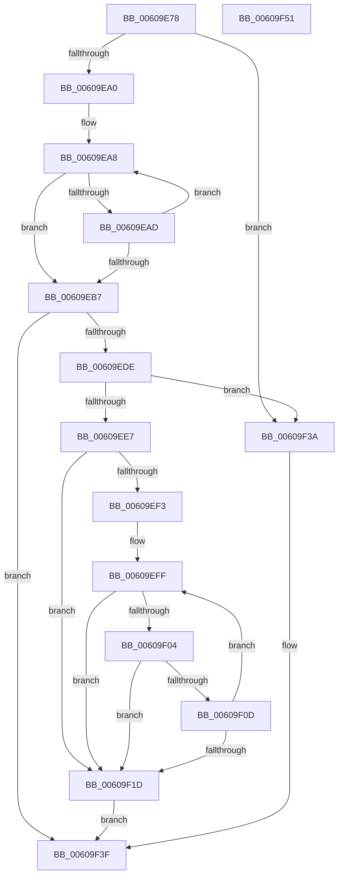

# RtlStringCchCatNW

- RVA: `0x00609E78`–`0x00609F52` (길이 `218` bytes)
- VA: `0x0000000140609E78`
- 실행 섹션: `.text`
- PDB 이름 있음: `예`; PDB Function 태그: `아니요`
- unwind 정보 RVA: `0x00069588`
- 디코드: `66`개 명령, `218/218` bytes 표시
- 미해석 바이트: `0` (있으면 어셈블리에 `.byte`로 보존)

> 이 문서는 커널 이미지의 기계어와 PDB 기호를 분석해 생성했습니다. 4번과 5번은 함수 원형과 자료형을 바이너리 사용 방식에서 추정한 C 해석이며 원본 소스 복구 결과는 아닙니다.

## 1. Dependencies

- 직접 호출 지점: **0**; 고유 호출 대상: **0**
- 직접 호출자로 확인된 함수: **2**
- RIP 상대 이미지 참조: **0**

### Outgoing calls
- 직접 디코드된 call 명령이 없습니다.

### Direct callers
- [SepRmFetchGlobalSacl](../../page/7A/SepRmFetchGlobalSacl_function_007A298C.md) at `0x007A2A07`
- [SdbpSafeAllocAndConcatW](../../page/81/SdbpSafeAllocAndConcatW_function_00813198.md) at `0x008132D8`

### Static image references
- 디코드된 RIP-relative 메모리 참조가 없습니다.

## 2. Other-region calls and transfers

- 다른 실행 섹션으로 향하는 call: **0**
- 별도 외부 분기/꼬리 이동을 확인하지 못했습니다.

## 3. Assembly (complete function range)

```asm
00609E78  48 89 5C 24 08                  mov qword ptr [rsp + 8], rbx
00609E7D  48 89 74 24 10                  mov qword ptr [rsp + 0x10], rsi
00609E82  48 89 7C 24 18                  mov qword ptr [rsp + 0x18], rdi
00609E87  48 8D 42 FF                     lea rax, [rdx - 1]
00609E8B  49 8B D8                        mov rbx, r8
00609E8E  4C 8B D2                        mov r10, rdx
00609E91  48 8B F9                        mov rdi, rcx
00609E94  48 3D FE FF FF 7F               cmp rax, 0x7ffffffe
00609E9A  0F 87 9A 00 00 00               ja 0x140609f3a
00609EA0  4C 8B DA                        mov r11, rdx
00609EA3  48 8B C1                        mov rax, rcx
00609EA6  33 F6                           xor esi, esi
00609EA8  66 39 30                        cmp word ptr [rax], si
00609EAB  74 0A                           je 0x140609eb7
00609EAD  48 83 C0 02                     add rax, 2
00609EB1  49 83 EB 01                     sub r11, 1
00609EB5  75 F1                           jne 0x140609ea8
00609EB7  49 8B C3                        mov rax, r11
00609EBA  49 8B CA                        mov rcx, r10
00609EBD  48 F7 D8                        neg rax
00609EC0  49 8B C3                        mov rax, r11
00609EC3  1B D2                           sbb edx, edx
00609EC5  49 2B CB                        sub rcx, r11
00609EC8  F7 D2                           not edx
00609ECA  81 E2 0D 00 00 C0               and edx, 0xc000000d
00609ED0  48 F7 D8                        neg rax
00609ED3  4D 1B C0                        sbb r8, r8
00609ED6  4C 23 C1                        and r8, rcx
00609ED9  4D 85 DB                        test r11, r11
00609EDC  74 61                           je 0x140609f3f
00609EDE  49 81 F9 FE FF FF 7F            cmp r9, 0x7ffffffe
00609EE5  77 53                           ja 0x140609f3a
00609EE7  49 8B CA                        mov rcx, r10
00609EEA  4A 8D 14 47                     lea rdx, [rdi + r8*2]
00609EEE  49 2B C8                        sub rcx, r8
00609EF1  74 2A                           je 0x140609f1d
00609EF3  4D 2B C2                        sub r8, r10
00609EF6  4C 03 C1                        add r8, rcx
00609EF9  4D 03 C1                        add r8, r9
00609EFC  48 2B DA                        sub rbx, rdx
00609EFF  4D 85 C0                        test r8, r8
00609F02  74 19                           je 0x140609f1d
00609F04  0F B7 04 13                     movzx eax, word ptr [rbx + rdx]
00609F08  66 85 C0                        test ax, ax
00609F0B  74 10                           je 0x140609f1d
00609F0D  66 89 02                        mov word ptr [rdx], ax
00609F10  49 FF C8                        dec r8
00609F13  48 83 C2 02                     add rdx, 2
00609F17  48 83 E9 01                     sub rcx, 1
00609F1B  75 E2                           jne 0x140609eff
00609F1D  48 8D 42 FE                     lea rax, [rdx - 2]
00609F21  48 85 C9                        test rcx, rcx
00609F24  48 0F 45 C2                     cmovne rax, rdx
00609F28  48 F7 D9                        neg rcx
00609F2B  1B D2                           sbb edx, edx
00609F2D  F7 D2                           not edx
00609F2F  81 E2 05 00 00 80               and edx, 0x80000005
00609F35  66 89 30                        mov word ptr [rax], si
00609F38  EB 05                           jmp 0x140609f3f
00609F3A  BA 0D 00 00 C0                  mov edx, 0xc000000d
00609F3F  48 8B 5C 24 08                  mov rbx, qword ptr [rsp + 8]
00609F44  8B C2                           mov eax, edx
00609F46  48 8B 74 24 10                  mov rsi, qword ptr [rsp + 0x10]
00609F4B  48 8B 7C 24 18                  mov rdi, qword ptr [rsp + 0x18]
00609F50  C3                              ret
00609F51  CC                              int3
```

## 4. C-style interpretation (structured pseudocode)

```c
__int64 __fastcall RtlStringCchCatNW(__int64 a1, __int64 a2, __int64 a3, __int64 a4)
{
    __int64 result;
    __int64 v_r11;
    __int64 v_rbx;
    __int64 v_rsi;
    unsigned __int64 v_stack_p10;
    unsigned __int64 v_stack_p18;
    unsigned __int64 v_stack_p8;

    v_stack_p8 = v_rbx;
    v_stack_p10 = v_rsi;
    v_stack_p18 = v_rdi;
    if ((a2 - 1) > 0x7FFFFFFEULL) goto loc_00609F3A;
    v_rsi = 0;
loc_00609EA8:
    if ((*(unsigned __int16 *)(a1)) == 0) goto loc_00609EB7;
    result = (a1) + (2);
    v_r11 = (a2) - (1);
    if (condition_is_not_equal) goto loc_00609EA8;
loc_00609EB7:
    result = -(v_r11);
    a1 = (a2) - (v_r11);
    a2 = (unsigned int)(~(a2));
    a2 = (unsigned int)((a2) & (0xC000000DULL));
    result = -(v_r11);
    a3 = (a3) & (a1);
    if (v_r11 == 0) goto loc_00609F3F;
    if (a4 > 0x7FFFFFFEULL) goto loc_00609F3A;
    a1 = (a2) - (a3);
    if (condition_is_equal) goto loc_00609F1D;
    a3 = (a3) - (a2);
    a3 = (a3) + (a1);
    a3 = (a3) + (a4);
    v_rbx = (a3) - (a1 + a3 * 2);
loc_00609EFF:
    if (a3 == 0) goto loc_00609F1D;
    if ((unsigned __int16)(*(unsigned __int16 *)(v_rbx + a1 + a3 * 2 * 1)) == 0) goto loc_00609F1D;
    *(unsigned __int16 *)(a1 + a3 * 2) = (unsigned __int16)(*(unsigned __int16 *)(v_rbx + a1 + a3 * 2 * 1));
    a3 = (a3) - 1;
    a2 = (a1 + a3 * 2) + (2);
    a1 = (a1) - (1);
    if (condition_is_not_equal) goto loc_00609EFF;
loc_00609F1D:
    result = a2 - 2;
    if (a1 != 0) { result = a2; }
    a1 = -(a1);
    a2 = (unsigned int)(~(a2));
    a2 = (unsigned int)((a2) & (0x80000005ULL));
    *(unsigned __int16 *)(result) = 0;
    goto loc_00609F3F;
loc_00609F3A:
loc_00609F3F:
    return (unsigned int)((unsigned int)((unsigned int)(0xC000000DULL)));
}
```

## 5. (Beta) C Style

```c
int64_t RtlStringCchCatNW(void *Arg1, void *Arg2, void *Arg3, int64_t Arg4)
{
    uint8_t *arg1 = (uint8_t *)Arg1;
    uint8_t *arg2 = (uint8_t *)Arg2;
    uint8_t *arg3 = (uint8_t *)Arg3;

    int64_t result;
    int64_t local_r11;
    int64_t local_rbx;
    int64_t local_rsi;
    uint64_t v_stack_p10;
    uint64_t v_stack_p18;
    uint64_t v_stack_p8;

    v_stack_p8 = local_rbx;
    v_stack_p10 = local_rsi;
    v_stack_p18 = local_rdi;
    if ((Arg2 - 1) > 0x7FFFFFFEULL) goto loc_00609F3A;
    local_rsi = 0;
loc_00609EA8:
    if ((*(uint16_t *)(arg1)) == 0) goto loc_00609EB7;
    result = (Arg1) + (2);
    local_r11 = (Arg2) - (1);
    if (condition_is_not_equal) goto loc_00609EA8;
loc_00609EB7:
    result = -(local_r11);
    Arg1 = (Arg2) - (local_r11);
    Arg2 = (uint32_t)(~(Arg2));
    Arg2 = (uint32_t)((Arg2) & (0xC000000DULL));
    result = -(local_r11);
    Arg3 = (Arg3) & (Arg1);
    if (local_r11 == 0) goto loc_00609F3F;
    if (Arg4 > 0x7FFFFFFEULL) goto loc_00609F3A;
    Arg1 = (Arg2) - (Arg3);
    if (condition_is_equal) goto loc_00609F1D;
    Arg3 = (Arg3) - (Arg2);
    Arg3 = (Arg3) + (Arg1);
    Arg3 = (Arg3) + (Arg4);
    local_rbx = (Arg3) - (Arg1 + Arg3 * 2);
loc_00609EFF:
    if (Arg3 == NULL) goto loc_00609F1D;
    if ((uint16_t)(*(uint16_t *)(local_rbx + arg1 + arg3 * 2 * 1)) == 0) goto loc_00609F1D;
    *(uint16_t *)(arg1 + arg3 * 2) = (uint16_t)(*(uint16_t *)(local_rbx + arg1 + arg3 * 2 * 1));
    Arg3 = (Arg3) - 1;
    Arg2 = (Arg1 + Arg3 * 2) + (2);
    Arg1 = (Arg1) - (1);
    if (condition_is_not_equal) goto loc_00609EFF;
loc_00609F1D:
    result = Arg2 - 2;
    if (Arg1 != NULL) { result = Arg2; }
    Arg1 = -(Arg1);
    Arg2 = (uint32_t)(~(Arg2));
    Arg2 = (uint32_t)((Arg2) & (0x80000005ULL));
    *(uint16_t *)(result) = 0;
    goto loc_00609F3F;
loc_00609F3A:
loc_00609F3F:
    return (uint32_t)((uint32_t)((uint32_t)(0xC000000DULL)));
}
```

### 관측된 메모리 오프셋

구조체 형식이 확인되지 않은 접근은 인자 기준의 오프셋으로만 기록했습니다.

| 기준 인자 | 오프셋 표현 | 폭 (bit) | 접근 |
|---|---:|---:|---|
| `Arg1` | `- 0x2` | `64` | `R` |
| `Arg1` | `+ 0x0` | `16` | `R` |
| `Arg1` | `+ 0x0` | `16` | `W` |
| `Arg1` | `+ 0x0 + r8*2` | `64` | `R` |
| `Arg2` | `- 0x1` | `64` | `R` |
| `Arg3` | `+ 0x0 + rdx*1` | `16` | `R` |

## 6. Execution-region graph

[열기: 2D/3D 그래프와 함수 탐색 컨트롤 패널](../../../control-panel.html?section=text&rva=0x00609E78&view=graph)

- 2D 그래프는 위에서 아래로 흐르고, 3D 그래프는 빈 공간을 드래그해 회전합니다. Shift+드래그는 이동, 휠은 확대·축소, 함수 노드 선택은 대상 보고서 이동입니다.

### Static fallback


