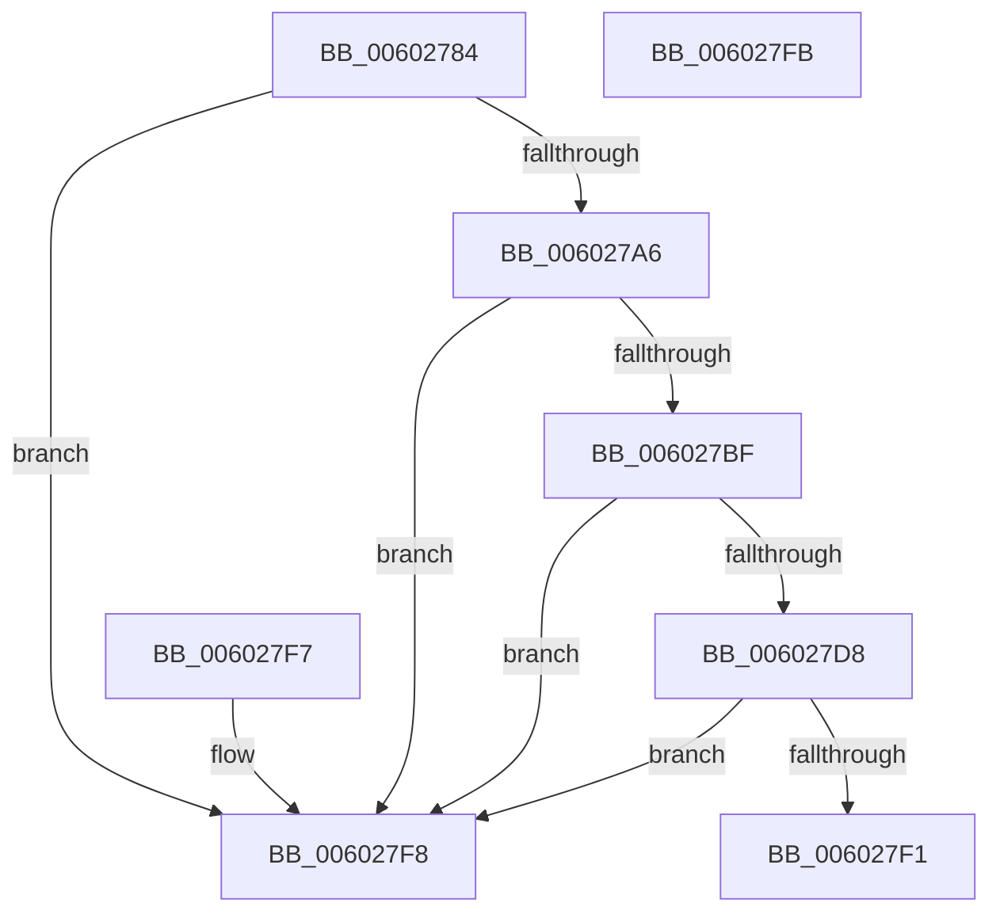

# RtlpHpCustomVaCallbacksEncodedComparison

- RVA: `0x00602784`–`0x006027FC` (길이 `120` bytes)
- VA: `0x0000000140602784`
- 실행 섹션: `.text`
- PDB 이름 있음: `예`; PDB Function 태그: `아니요`
- unwind 정보 RVA: `0x000DB714`
- 디코드: `40`개 명령, `120/120` bytes 표시
- 미해석 바이트: `0` (있으면 어셈블리에 `.byte`로 보존)

> 이 문서는 커널 이미지의 기계어와 PDB 기호를 분석해 생성했습니다. 4번과 5번은 함수 원형과 자료형을 바이너리 사용 방식에서 추정한 C 해석이며 원본 소스 복구 결과는 아닙니다.

## 1. Dependencies

- 직접 호출 지점: **0**; 고유 호출 대상: **0**
- 직접 호출자로 확인된 함수: **1**
- RIP 상대 이미지 참조: **1**

### Outgoing calls
- 직접 디코드된 call 명령이 없습니다.

### Direct callers
- [RtlpHpCustomVaCallbacksRegistrarRegister](RtlpHpCustomVaCallbacksRegistrarRegister_function_00602804.md) at `0x00602A20`

### Static image references
- `0x00602784` → RVA `0x00E28300` (`.data`; read)

## 2. Other-region calls and transfers

- 다른 실행 섹션으로 향하는 call: **0**
- 별도 외부 분기/꼬리 이동을 확인하지 못했습니다.

## 3. Assembly (complete function range)

```asm
00602784  4C 8B 05 75 5B 82 00            mov r8, qword ptr [rip + 0x825b75]
0060278B  4C 8D 49 10                     lea r9, [rcx + 0x10]
0060278F  49 8B 09                        mov rcx, qword ptr [r9]
00602792  48 8B 02                        mov rax, qword ptr [rdx]
00602795  49 33 C8                        xor rcx, r8
00602798  49 33 C0                        xor rax, r8
0060279B  49 33 C9                        xor rcx, r9
0060279E  48 33 C2                        xor rax, rdx
006027A1  48 3B C8                        cmp rcx, rax
006027A4  75 52                           jne 0x1406027f8
006027A6  49 8B 49 08                     mov rcx, qword ptr [r9 + 8]
006027AA  48 8B 42 08                     mov rax, qword ptr [rdx + 8]
006027AE  49 33 C8                        xor rcx, r8
006027B1  49 33 C0                        xor rax, r8
006027B4  49 33 C9                        xor rcx, r9
006027B7  48 33 C2                        xor rax, rdx
006027BA  48 3B C8                        cmp rcx, rax
006027BD  75 39                           jne 0x1406027f8
006027BF  49 8B 49 10                     mov rcx, qword ptr [r9 + 0x10]
006027C3  48 8B 42 10                     mov rax, qword ptr [rdx + 0x10]
006027C7  49 33 C8                        xor rcx, r8
006027CA  49 33 C0                        xor rax, r8
006027CD  49 33 C9                        xor rcx, r9
006027D0  48 33 C2                        xor rax, rdx
006027D3  48 3B C8                        cmp rcx, rax
006027D6  75 20                           jne 0x1406027f8
006027D8  49 8B 49 18                     mov rcx, qword ptr [r9 + 0x18]
006027DC  48 8B 42 18                     mov rax, qword ptr [rdx + 0x18]
006027E0  49 33 C8                        xor rcx, r8
006027E3  49 33 C0                        xor rax, r8
006027E6  49 33 C9                        xor rcx, r9
006027E9  48 33 C2                        xor rax, rdx
006027EC  48 3B C8                        cmp rcx, rax
006027EF  75 07                           jne 0x1406027f8
006027F1  B8 01 00 00 00                  mov eax, 1
006027F6  C3                              ret
006027F7  CC                              int3
006027F8  33 C0                           xor eax, eax
006027FA  C3                              ret
006027FB  CC                              int3
```

## 4. C-style interpretation (structured pseudocode)

```c
__int64 __fastcall RtlpHpCustomVaCallbacksEncodedComparison(__int64 a1, __int64 a2)
{
    __int64 result;

    a1 = (*(unsigned __int64 *)(a1 + 16)) ^ (*(unsigned __int64 *)(v_rip + 8543093));
    result = (*(unsigned __int64 *)(a2)) ^ (*(unsigned __int64 *)(v_rip + 8543093));
    a1 = (a1) ^ (a1 + 16);
    result = (result) ^ (a2);
    if (a1 != result) goto loc_006027F8;
    a1 = (*(unsigned __int64 *)(a1 + 16 + 8)) ^ (*(unsigned __int64 *)(v_rip + 8543093));
    result = (*(unsigned __int64 *)(a2 + 8)) ^ (*(unsigned __int64 *)(v_rip + 8543093));
    a1 = (a1) ^ (a1 + 16);
    result = (result) ^ (a2);
    if (a1 != result) goto loc_006027F8;
    a1 = (*(unsigned __int64 *)(a1 + 16 + 16)) ^ (*(unsigned __int64 *)(v_rip + 8543093));
    result = (*(unsigned __int64 *)(a2 + 16)) ^ (*(unsigned __int64 *)(v_rip + 8543093));
    a1 = (a1) ^ (a1 + 16);
    result = (result) ^ (a2);
    if (a1 != result) goto loc_006027F8;
    a1 = (*(unsigned __int64 *)(a1 + 16 + 24)) ^ (*(unsigned __int64 *)(v_rip + 8543093));
    result = (*(unsigned __int64 *)(a2 + 24)) ^ (*(unsigned __int64 *)(v_rip + 8543093));
    a1 = (a1) ^ (a1 + 16);
    result = (result) ^ (a2);
    if (a1 != result) goto loc_006027F8;
    return 1;
loc_006027F8:
    result = 0;
    return result;
}
```

## 5. (Beta) C Style

```c
int64_t RtlpHpCustomVaCallbacksEncodedComparison(void *Arg1, void *Arg2)
{
    uint8_t *arg1 = (uint8_t *)Arg1;
    uint8_t *arg2 = (uint8_t *)Arg2;

    int64_t result;

    Arg1 = (*(uint64_t *)(arg1 + 0x10)) ^ (*(uint64_t *)(v_rip + 0x825B75));
    result = (*(uint64_t *)(arg2)) ^ (*(uint64_t *)(v_rip + 0x825B75));
    Arg1 = (Arg1) ^ (Arg1 + 16);
    result = (result) ^ (Arg2);
    if (Arg1 != result) goto loc_006027F8;
    Arg1 = (*(uint64_t *)(arg1 + 0x10 + 0x8)) ^ (*(uint64_t *)(v_rip + 0x825B75));
    result = (*(uint64_t *)(arg2 + 0x8)) ^ (*(uint64_t *)(v_rip + 0x825B75));
    Arg1 = (Arg1) ^ (Arg1 + 16);
    result = (result) ^ (Arg2);
    if (Arg1 != result) goto loc_006027F8;
    Arg1 = (*(uint64_t *)(arg1 + 0x10 + 0x10)) ^ (*(uint64_t *)(v_rip + 0x825B75));
    result = (*(uint64_t *)(arg2 + 0x10)) ^ (*(uint64_t *)(v_rip + 0x825B75));
    Arg1 = (Arg1) ^ (Arg1 + 16);
    result = (result) ^ (Arg2);
    if (Arg1 != result) goto loc_006027F8;
    Arg1 = (*(uint64_t *)(arg1 + 0x10 + 0x18)) ^ (*(uint64_t *)(v_rip + 0x825B75));
    result = (*(uint64_t *)(arg2 + 0x18)) ^ (*(uint64_t *)(v_rip + 0x825B75));
    Arg1 = (Arg1) ^ (Arg1 + 16);
    result = (result) ^ (Arg2);
    if (Arg1 != result) goto loc_006027F8;
    return 1;
loc_006027F8:
    result = 0;
    return result;
}
```

### 관측된 메모리 오프셋

구조체 형식이 확인되지 않은 접근은 인자 기준의 오프셋으로만 기록했습니다.

| 기준 인자 | 오프셋 표현 | 폭 (bit) | 접근 |
|---|---:|---:|---|
| `Arg1` | `+ 0x0` | `64` | `R` |
| `Arg1` | `+ 0x8` | `64` | `R` |
| `Arg1` | `+ 0x10` | `64` | `R` |
| `Arg1` | `+ 0x18` | `64` | `R` |
| `Arg2` | `+ 0x0` | `64` | `R` |
| `Arg2` | `+ 0x8` | `64` | `R` |
| `Arg2` | `+ 0x10` | `64` | `R` |
| `Arg2` | `+ 0x18` | `64` | `R` |

## 6. Execution-region graph

[열기: 2D/3D 그래프와 함수 탐색 컨트롤 패널](../../../control-panel.html?section=text&rva=0x00602784&view=graph)

- 2D 그래프는 위에서 아래로 흐르고, 3D 그래프는 빈 공간을 드래그해 회전합니다. Shift+드래그는 이동, 휠은 확대·축소, 함수 노드 선택은 대상 보고서 이동입니다.

### Static fallback


