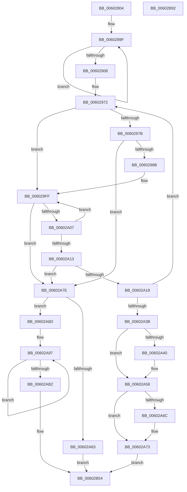

# RtlpHpCustomVaCallbacksRegistrarRegister

- RVA: `0x00602804`–`0x00602B93` (길이 `911` bytes)
- VA: `0x0000000140602804`
- 실행 섹션: `.text`
- PDB 이름 있음: `예`; PDB Function 태그: `아니요`
- unwind 정보 RVA: `0x000D055C`
- 디코드: `242`개 명령, `911/911` bytes 표시
- 미해석 바이트: `0` (있으면 어셈블리에 `.byte`로 보존)

> 이 문서는 커널 이미지의 기계어와 PDB 기호를 분석해 생성했습니다. 4번과 5번은 함수 원형과 자료형을 바이너리 사용 방식에서 추정한 C 해석이며 원본 소스 복구 결과는 아닙니다.

## 1. Dependencies

- 직접 호출 지점: **6**; 고유 호출 대상: **6**
- 직접 호출자로 확인된 함수: **1**
- RIP 상대 이미지 참조: **2**

### Outgoing calls
- `0x00602921` → [RtlpHpMetadataAlloc](../2E/RtlpHpMetadataAlloc_function_002EC180.md) (function, `0x002EC180`)
- `0x0060293F` → [RtlpHpAcquireLockExclusive](../32/RtlpHpAcquireLockExclusive_function_003246B0.md) (function, `0x003246B0`)
- `0x00602A20` → [RtlpHpCustomVaCallbacksEncodedComparison](RtlpHpCustomVaCallbacksEncodedComparison_function_00602784.md) (function, `0x00602784`)
- `0x00602A53` → [RtlpHpMetadataFree](../2E/RtlpHpMetadataFree_function_002ECA64.md) (function, `0x002ECA64`)
- `0x00602B68` → [RtlpHpReleaseLockExclusive](../32/RtlpHpReleaseLockExclusive_function_00324230.md) (function, `0x00324230`)
- `0x00602B7A` → [_security_check_cookie](../6A/_security_check_cookie_function_006AC640.md) (function, `0x006AC640`)

### Direct callers
- [RtlpHpRegisterEnvironment](RtlpHpRegisterEnvironment_function_006036C0.md) at `0x0060370D`

### Static image references
- `0x00602819` → RVA `0x00E0A740` (`.data`; read)
- `0x0060282B` → RVA `0x00E28300` (`.data`; read)

## 2. Other-region calls and transfers

- 다른 실행 섹션으로 향하는 call: **0**
- 별도 외부 분기/꼬리 이동을 확인하지 못했습니다.

## 3. Assembly (complete function range)

```asm
00602804  4C 8B DC                        mov r11, rsp
00602807  53                              push rbx
00602808  56                              push rsi
00602809  57                              push rdi
0060280A  41 54                           push r12
0060280C  41 55                           push r13
0060280E  41 56                           push r14
00602810  41 57                           push r15
00602812  48 81 EC A0 00 00 00            sub rsp, 0xa0
00602819  48 8B 05 20 7F 80 00            mov rax, qword ptr [rip + 0x807f20]
00602820  48 33 C4                        xor rax, rsp
00602823  48 89 84 24 90 00 00 00         mov qword ptr [rsp + 0x90], rax
0060282B  4C 8B 15 CE 5A 82 00            mov r10, qword ptr [rip + 0x825ace]
00602832  48 8B D9                        mov rbx, rcx
00602835  48 8B 02                        mov rax, qword ptr [rdx]
00602838  41 BC 04 00 00 00               mov r12d, 4
0060283E  49 33 C2                        xor rax, r10
00602841  48 89 4C 24 38                  mov qword ptr [rsp + 0x38], rcx
00602846  49 8D 4B 98                     lea rcx, [r11 - 0x68]
0060284A  4C 89 44 24 50                  mov qword ptr [rsp + 0x50], r8
0060284F  48 33 C1                        xor rax, rcx
00602852  4D 8D 43 98                     lea r8, [r11 - 0x68]
00602856  49 89 43 98                     mov qword ptr [r11 - 0x68], rax
0060285A  49 8D 4B 98                     lea rcx, [r11 - 0x68]
0060285E  48 8B 42 08                     mov rax, qword ptr [rdx + 8]
00602862  4D 8B E9                        mov r13, r9
00602865  49 33 C2                        xor rax, r10
00602868  48 8B F2                        mov rsi, rdx
0060286B  48 33 C1                        xor rax, rcx
0060286E  41 BF 2F CB 04 00               mov r15d, 0x4cb2f
00602874  49 89 43 A0                     mov qword ptr [r11 - 0x60], rax
00602878  49 8D 4B 98                     lea rcx, [r11 - 0x68]
0060287C  48 8B 42 10                     mov rax, qword ptr [rdx + 0x10]
00602880  45 8B CC                        mov r9d, r12d
00602883  49 33 C2                        xor rax, r10
00602886  48 33 C1                        xor rax, rcx
00602889  49 8D 4B 98                     lea rcx, [r11 - 0x68]
0060288D  49 89 43 A8                     mov qword ptr [r11 - 0x58], rax
00602891  48 8B 42 18                     mov rax, qword ptr [rdx + 0x18]
00602895  49 33 C2                        xor rax, r10
00602898  48 33 C1                        xor rax, rcx
0060289B  49 89 43 B0                     mov qword ptr [r11 - 0x50], rax
0060289F  41 0F B6 00                     movzx eax, byte ptr [r8]
006028A3  4D 8D 40 08                     lea r8, [r8 + 8]
006028A7  49 6B CF 25                     imul rcx, r15, 0x25
006028AB  48 03 C8                        add rcx, rax
006028AE  41 0F B6 40 F9                  movzx eax, byte ptr [r8 - 7]
006028B3  48 6B D1 25                     imul rdx, rcx, 0x25
006028B7  48 03 D0                        add rdx, rax
006028BA  41 0F B6 40 FA                  movzx eax, byte ptr [r8 - 6]
006028BF  48 6B CA 25                     imul rcx, rdx, 0x25
006028C3  48 03 C8                        add rcx, rax
006028C6  41 0F B6 40 FB                  movzx eax, byte ptr [r8 - 5]
006028CB  48 6B D1 25                     imul rdx, rcx, 0x25
006028CF  48 03 D0                        add rdx, rax
006028D2  41 0F B6 40 FC                  movzx eax, byte ptr [r8 - 4]
006028D7  48 6B CA 25                     imul rcx, rdx, 0x25
006028DB  48 03 C8                        add rcx, rax
006028DE  41 0F B6 40 FD                  movzx eax, byte ptr [r8 - 3]
006028E3  48 6B D1 25                     imul rdx, rcx, 0x25
006028E7  48 03 D0                        add rdx, rax
006028EA  41 0F B6 40 FE                  movzx eax, byte ptr [r8 - 2]
006028EF  48 6B CA 25                     imul rcx, rdx, 0x25
006028F3  48 03 C8                        add rcx, rax
006028F6  41 0F B6 40 FF                  movzx eax, byte ptr [r8 - 1]
006028FB  4C 6B F9 25                     imul r15, rcx, 0x25
006028FF  4C 03 F8                        add r15, rax
00602902  49 83 E9 01                     sub r9, 1
00602906  75 97                           jne 0x14060289f
00602908  41 0F 10 45 00                  movups xmm0, xmmword ptr [r13]
0060290D  45 33 C0                        xor r8d, r8d
00602910  4C 8D 4C 24 60                  lea r9, [rsp + 0x60]
00602915  F3 0F 7F 44 24 60               movdqu xmmword ptr [rsp + 0x60], xmm0
0060291B  41 8D 48 38                     lea ecx, [r8 + 0x38]
0060291F  8B D1                           mov edx, ecx
00602921  E8 5A 98 CE FF                  call 0x1402ec180
00602926  41 8B 4D 00                     mov ecx, dword ptr [r13]
0060292A  4C 8B F0                        mov r14, rax
0060292D  48 8D 43 10                     lea rax, [rbx + 0x10]
00602931  0F B6 D1                        movzx edx, cl
00602934  83 E2 01                        and edx, 1
00602937  48 89 44 24 58                  mov qword ptr [rsp + 0x58], rax
0060293C  48 8B C8                        mov rcx, rax
0060293F  E8 6C 1D D2 FF                  call 0x1403246b0
00602944  4C 8B 54 24 38                  mov r10, qword ptr [rsp + 0x38]
00602949  48 83 CA FF                     or rdx, 0xffffffffffffffff
0060294D  33 FF                           xor edi, edi
0060294F  88 44 24 20                     mov byte ptr [rsp + 0x20], al
00602953  8B DF                           mov ebx, edi
00602955  41 8B 42 04                     mov eax, dword ptr [r10 + 4]
00602959  8B C8                           mov ecx, eax
0060295B  83 E1 1F                        and ecx, 0x1f
0060295E  89 44 24 30                     mov dword ptr [rsp + 0x30], eax
00602962  48 D3 E2                        shl rdx, cl
00602965  4C 23 FA                        and r15, rdx
00602968  48 89 54 24 40                  mov qword ptr [rsp + 0x40], rdx
0060296D  4C 89 7C 24 28                  mov qword ptr [rsp + 0x28], r15
00602972  48 85 DB                        test rbx, rbx
00602975  0F 85 84 00 00 00               jne 0x1406029ff
0060297B  44 8B C8                        mov r9d, eax
0060297E  41 C1 E9 05                     shr r9d, 5
00602982  45 85 C9                        test r9d, r9d
00602985  0F 84 F3 00 00 00               je 0x140602a7e
0060298B  41 0F B6 C7                     movzx eax, r15b
0060298F  48 05 CB 5D B1 00               add rax, 0xb15dcb
00602995  48 6B C8 25                     imul rcx, rax, 0x25
00602999  0F B6 44 24 29                  movzx eax, byte ptr [rsp + 0x29]
0060299E  48 03 C8                        add rcx, rax
006029A1  0F B6 44 24 2A                  movzx eax, byte ptr [rsp + 0x2a]
006029A6  48 6B D1 25                     imul rdx, rcx, 0x25
006029AA  48 03 D0                        add rdx, rax
006029AD  0F B6 44 24 2B                  movzx eax, byte ptr [rsp + 0x2b]
006029B2  48 6B CA 25                     imul rcx, rdx, 0x25
006029B6  48 03 C8                        add rcx, rax
006029B9  0F B6 44 24 2C                  movzx eax, byte ptr [rsp + 0x2c]
006029BE  48 6B D1 25                     imul rdx, rcx, 0x25
006029C2  48 03 D0                        add rdx, rax
006029C5  0F B6 44 24 2D                  movzx eax, byte ptr [rsp + 0x2d]
006029CA  48 6B CA 25                     imul rcx, rdx, 0x25
006029CE  48 03 C8                        add rcx, rax
006029D1  0F B6 44 24 2E                  movzx eax, byte ptr [rsp + 0x2e]
006029D6  48 6B D1 25                     imul rdx, rcx, 0x25
006029DA  41 8D 49 FF                     lea ecx, [r9 - 1]
006029DE  48 03 D0                        add rdx, rax
006029E1  0F B6 44 24 2F                  movzx eax, byte ptr [rsp + 0x2f]
006029E6  4C 6B C2 25                     imul r8, rdx, 0x25
006029EA  48 8B 54 24 40                  mov rdx, qword ptr [rsp + 0x40]
006029EF  49 03 C0                        add rax, r8
006029F2  8B C0                           mov eax, eax
006029F4  48 23 C8                        and rcx, rax
006029F7  49 8B 42 08                     mov rax, qword ptr [r10 + 8]
006029FB  48 8D 1C C8                     lea rbx, [rax + rcx*8]
006029FF  48 8B 1B                        mov rbx, qword ptr [rbx]
00602A02  F6 C3 01                        test bl, 1
00602A05  75 77                           jne 0x140602a7e
00602A07  48 8B 43 08                     mov rax, qword ptr [rbx + 8]
00602A0B  48 23 C2                        and rax, rdx
00602A0E  4C 3B F8                        cmp r15, rax
00602A11  75 EC                           jne 0x1406029ff
00602A13  48 85 DB                        test rbx, rbx
00602A16  74 66                           je 0x140602a7e
00602A18  48 8D 54 24 70                  lea rdx, [rsp + 0x70]
00602A1D  48 8B CB                        mov rcx, rbx
00602A20  E8 5F FD FF FF                  call 0x140602784
00602A25  4C 8B 54 24 38                  mov r10, qword ptr [rsp + 0x38]
00602A2A  85 C0                           test eax, eax
00602A2C  8B 44 24 30                     mov eax, dword ptr [rsp + 0x30]
00602A30  48 8B 54 24 40                  mov rdx, qword ptr [rsp + 0x40]
00602A35  0F 84 37 FF FF FF               je 0x140602972
00602A3B  4D 85 F6                        test r14, r14
00602A3E  74 18                           je 0x140602a58
00602A40  41 0F 10 45 00                  movups xmm0, xmmword ptr [r13]
00602A45  48 8D 54 24 40                  lea rdx, [rsp + 0x40]
00602A4A  49 8B CE                        mov rcx, r14
00602A4D  F3 0F 7F 44 24 40               movdqu xmmword ptr [rsp + 0x40], xmm0
00602A53  E8 0C A0 CE FF                  call 0x1402eca64
00602A58  B8 01 00 00 00                  mov eax, 1
00602A5D  F0 48 0F C1 43 30               lock xadd qword ptr [rbx + 0x30], rax
00602A63  48 FF C0                        inc rax
00602A66  48 83 F8 01                     cmp rax, 1
00602A6A  7F 07                           jg 0x140602a73
00602A6C  B9 0E 00 00 00                  mov ecx, 0xe
00602A71  CD 29                           int 0x29
00602A73  8B F7                           mov esi, edi
00602A75  48 8D 7B 10                     lea rdi, [rbx + 0x10]
00602A79  E9 D6 00 00 00                  jmp 0x140602b54
00602A7E  4D 85 F6                        test r14, r14
00602A81  75 0A                           jne 0x140602a8d
00602A83  BE 17 00 00 C0                  mov esi, 0xc0000017
00602A88  E9 C7 00 00 00                  jmp 0x140602b54
00602A8D  4D 8D 4E 10                     lea r9, [r14 + 0x10]
00602A91  49 8B C9                        mov rcx, r9
00602A94  49 2B F1                        sub rsi, r9
00602A97  48 8B 04 0E                     mov rax, qword ptr [rsi + rcx]
00602A9B  48 33 05 5E 58 82 00            xor rax, qword ptr [rip + 0x82585e]
00602AA2  49 33 C1                        xor rax, r9
00602AA5  48 89 01                        mov qword ptr [rcx], rax
00602AA8  48 8D 49 08                     lea rcx, [rcx + 8]
00602AAC  49 83 EC 01                     sub r12, 1
00602AB0  75 E5                           jne 0x140602a97
00602AB2  48 83 CA FF                     or rdx, 0xffffffffffffffff
00602AB6  49 C7 46 30 01 00 00 00         mov qword ptr [r14 + 0x30], 1
00602ABE  41 8B 4A 04                     mov ecx, dword ptr [r10 + 4]
00602AC2  8B F7                           mov esi, edi
00602AC4  44 8B C1                        mov r8d, ecx
00602AC7  49 8B F9                        mov rdi, r9
00602ACA  83 E1 1F                        and ecx, 0x1f
00602ACD  41 C1 E8 05                     shr r8d, 5
00602AD1  48 D3 E2                        shl rdx, cl
00602AD4  41 FF C8                        dec r8d
00602AD7  49 23 56 08                     and rdx, qword ptr [r14 + 8]
00602ADB  48 89 54 24 28                  mov qword ptr [rsp + 0x28], rdx
00602AE0  0F B6 C2                        movzx eax, dl
00602AE3  48 05 CB 5D B1 00               add rax, 0xb15dcb
00602AE9  48 6B C8 25                     imul rcx, rax, 0x25
00602AED  0F B6 44 24 29                  movzx eax, byte ptr [rsp + 0x29]
00602AF2  48 03 C8                        add rcx, rax
00602AF5  0F B6 44 24 2A                  movzx eax, byte ptr [rsp + 0x2a]
00602AFA  48 6B D1 25                     imul rdx, rcx, 0x25
00602AFE  48 03 D0                        add rdx, rax
00602B01  0F B6 44 24 2B                  movzx eax, byte ptr [rsp + 0x2b]
00602B06  48 6B CA 25                     imul rcx, rdx, 0x25
00602B0A  48 03 C8                        add rcx, rax
00602B0D  0F B6 44 24 2C                  movzx eax, byte ptr [rsp + 0x2c]
00602B12  48 6B D1 25                     imul rdx, rcx, 0x25
00602B16  48 03 D0                        add rdx, rax
00602B19  0F B6 44 24 2D                  movzx eax, byte ptr [rsp + 0x2d]
00602B1E  48 6B CA 25                     imul rcx, rdx, 0x25
00602B22  48 03 C8                        add rcx, rax
00602B25  0F B6 44 24 2E                  movzx eax, byte ptr [rsp + 0x2e]
00602B2A  48 6B D1 25                     imul rdx, rcx, 0x25
00602B2E  48 03 D0                        add rdx, rax
00602B31  0F B6 44 24 2F                  movzx eax, byte ptr [rsp + 0x2f]
00602B36  48 6B CA 25                     imul rcx, rdx, 0x25
00602B3A  49 8B 52 08                     mov rdx, qword ptr [r10 + 8]
00602B3E  48 03 C1                        add rax, rcx
00602B41  8B C0                           mov eax, eax
00602B43  4C 23 C0                        and r8, rax
00602B46  4A 8B 04 C2                     mov rax, qword ptr [rdx + r8*8]
00602B4A  49 89 06                        mov qword ptr [r14], rax
00602B4D  4E 89 34 C2                     mov qword ptr [rdx + r8*8], r14
00602B51  41 FF 02                        inc dword ptr [r10]
00602B54  48 8B 44 24 50                  mov rax, qword ptr [rsp + 0x50]
00602B59  33 D2                           xor edx, edx
00602B5B  44 8A 44 24 20                  mov r8b, byte ptr [rsp + 0x20]
00602B60  48 8B 4C 24 58                  mov rcx, qword ptr [rsp + 0x58]
00602B65  48 89 38                        mov qword ptr [rax], rdi
00602B68  E8 C3 16 D2 FF                  call 0x140324230
00602B6D  8B C6                           mov eax, esi
00602B6F  48 8B 8C 24 90 00 00 00         mov rcx, qword ptr [rsp + 0x90]
00602B77  48 33 CC                        xor rcx, rsp
00602B7A  E8 C1 9A 0A 00                  call 0x1406ac640
00602B7F  48 81 C4 A0 00 00 00            add rsp, 0xa0
00602B86  41 5F                           pop r15
00602B88  41 5E                           pop r14
00602B8A  41 5D                           pop r13
00602B8C  41 5C                           pop r12
00602B8E  5F                              pop rdi
00602B8F  5E                              pop rsi
00602B90  5B                              pop rbx
00602B91  C3                              ret
00602B92  CC                              int3
```

## 4. C-style interpretation (structured pseudocode)

```c
__int64 __fastcall RtlpHpCustomVaCallbacksRegistrarRegister(__int64 a1, __int64 a2, __int64 a3, __int64 a4)
{
    __int64 result;
    __int64 v_r12;
    __int64 v_r15;
    __int64 v_rdi;
    __int64 v_rsi;
    __int64 v_rsp;
    unsigned __int64 v_stack_m48;
    unsigned __int64 v_stack_m68;
    unsigned __int64 v_stack_m78;
    unsigned __int64 v_stack_m80;
    unsigned __int64 v_stack_m88;
    unsigned __int64 v_stack_m98;
    unsigned __int64 v_stack_mA0;
    unsigned int v_stack_mA8;
    unsigned __int8 v_stack_mA9;
    unsigned __int8 v_stack_mAA;
    unsigned __int8 v_stack_mAB;
    unsigned __int8 v_stack_mAC;
    unsigned __int8 v_stack_mAD;
    unsigned __int8 v_stack_mAE;
    unsigned __int8 v_stack_mAF;
    unsigned __int64 v_stack_mB0;
    unsigned __int8 v_stack_mB8;

    v_rsp = (v_rsp) - (160);
    result = (*(unsigned __int64 *)(v_rip + 8421152)) ^ (v_rsp);
    v_stack_m48 = result;
    result = (*(unsigned __int64 *)(a2)) ^ (*(unsigned __int64 *)(v_rip + 8542926));
    v_stack_mA0 = a1;
    v_stack_m88 = a3;
    result = (result) ^ (v_rsp - 104);
    *(unsigned __int64 *)(v_rsp - 104) = result;
    result = (*(unsigned __int64 *)(a2 + 8)) ^ (*(unsigned __int64 *)(v_rip + 8542926));
    result = (result) ^ (v_rsp - 104);
    *(unsigned __int64 *)(v_rsp - 96) = result;
    result = (*(unsigned __int64 *)(a2 + 16)) ^ (*(unsigned __int64 *)(v_rip + 8542926));
    result = (result) ^ (v_rsp - 104);
    *(unsigned __int64 *)(v_rsp - 88) = result;
    result = (*(unsigned __int64 *)(a2 + 24)) ^ (*(unsigned __int64 *)(v_rip + 8542926));
    result = (result) ^ (v_rsp - 104);
    *(unsigned __int64 *)(v_rsp - 80) = result;
loc_0060289F:
    a1 = (v_rsp - 104) * ((unsigned int)(0x4CB2FULL));
    a1 = (a1) + (*(unsigned __int8 *)(v_rsp - 104));
    a2 = (a2) * (a1);
    a2 = (a2) + (*(unsigned __int8 *)(v_rsp - 104 + 8 - 7));
    a1 = (a1) * (a2);
    a1 = (a1) + (*(unsigned __int8 *)(v_rsp - 104 + 8 - 6));
    a2 = (a2) * (a1);
    a2 = (a2) + (*(unsigned __int8 *)(v_rsp - 104 + 8 - 5));
    a1 = (a1) * (a2);
    a1 = (a1) + (*(unsigned __int8 *)(v_rsp - 104 + 8 - 4));
    a2 = (a2) * (a1);
    a2 = (a2) + (*(unsigned __int8 *)(v_rsp - 104 + 8 - 3));
    a1 = (a1) * (a2);
    a1 = (a1) + (*(unsigned __int8 *)(v_rsp - 104 + 8 - 2));
    v_r15 = ((unsigned int)(0x4CB2FULL)) * (a1);
    v_r15 = (v_r15) + (*(unsigned __int8 *)(v_rsp - 104 + 8 - 1));
    a4 = (4) - (1);
    if (condition_is_not_equal) goto loc_0060289F;
    a3 = 0;
    v_stack_m78 = v_xmm0;
    result = RtlpHpMetadataAlloc(a3 + 56, (unsigned int)((unsigned int)(a3 + 56)), a3, v_stack_m78);
    a2 = (unsigned int)(((unsigned __int8)((unsigned int)(*(unsigned int *)(a4)))) & (1));
    v_stack_m80 = a1 + 16;
    result = RtlpHpAcquireLockExclusive(a1 + 16, a2, a3, v_stack_m78);
    a2 = (a2) | (-1);
    v_rdi = 0;
    v_stack_mB8 = (unsigned __int8)(result);
    a1 = (unsigned int)(((unsigned int)((unsigned int)((unsigned int)(*(unsigned int *)(v_stack_mA0 + 4))))) & (31));
    v_stack_mA8 = (unsigned int)((unsigned int)(*(unsigned int *)(v_stack_mA0 + 4)));
    a2 = (a2) << ((unsigned __int8)(a1));
    v_r15 = (v_r15) & (a2);
    v_stack_m98 = a2;
    v_stack_mB0 = v_r15;
loc_00602972:
    if (0 != 0) goto loc_006029FF;
    a4 = (unsigned int)(((unsigned int)((unsigned int)((unsigned int)(*(unsigned int *)(v_stack_mA0 + 4))))) >> (5));
    if ((unsigned int)(a4) == 0) goto loc_00602A7E;
    result = ((unsigned __int8)(v_r15)) + (0xB15DCBULL);
    a1 = (a1) * (result);
    a1 = (a1) + (v_stack_mAF);
    a2 = (a2) * (a1);
    a2 = (a2) + (v_stack_mAE);
    a1 = (a1) * (a2);
    a1 = (a1) + (v_stack_mAD);
    a2 = (a2) * (a1);
    a2 = (a2) + (v_stack_mAC);
    a1 = (a1) * (a2);
    a1 = (a1) + (v_stack_mAB);
    a2 = (a2) * (a1);
    a2 = (a2) + (v_stack_mAA);
    a3 = (a3) * (a2);
    result = (v_stack_mA9) + (a3);
    a1 = (a4 - 1) & ((unsigned int)((unsigned int)(result)));
loc_006029FF:
    if ((((unsigned __int8)(*(unsigned __int64 *)(*(unsigned __int64 *)(v_stack_mA0 + 8) + a1 * 8))) & (1)) != 0) goto loc_00602A7E;
    result = (*(unsigned __int64 *)(*(unsigned __int64 *)(*(unsigned __int64 *)(v_stack_mA0 + 8) + a1 * 8) + 8)) & (v_stack_m98);
    if (v_r15 != result) goto loc_006029FF;
    if (*(unsigned __int64 *)(*(unsigned __int64 *)(v_stack_mA0 + 8) + a1 * 8) == 0) goto loc_00602A7E;
    result = RtlpHpCustomVaCallbacksEncodedComparison(*(unsigned __int64 *)(*(unsigned __int64 *)(v_stack_mA0 + 8) + a1 * 8), v_stack_m68, a3, a4);
    if ((unsigned int)(result) == 0) goto loc_00602972;
    result = (unsigned int)(v_stack_mA8);
    if (result != 0) {
        a2 = v_stack_m98;
        a1 = result;
        v_stack_m98 = v_xmm0;
        result = RtlpHpMetadataFree(a1, a2, a3, a4);
    }
    result = (1) + 1;
    if (result <= 1) {
        a1 = 14;
    }
    goto loc_00602B54;
loc_00602A7E:
    if (result != 0) goto loc_00602A8D;
    goto loc_00602B54;
loc_00602A8D:
    v_rsi = ((unsigned int)(0xC0000017ULL)) - (result + 16);
loc_00602A97:
    result = (*(unsigned __int64 *)(v_rsi + result + 16 * 1)) ^ (*(unsigned __int64 *)(v_rip + 8542302));
    result = (result) ^ (result + 16);
    *(unsigned __int64 *)(result + 16) = result;
    v_r12 = (4) - (1);
    if (condition_is_not_equal) goto loc_00602A97;
    a2 = (a2) | (-1);
    *(unsigned __int64 *)(result + 48) = 1;
    a1 = (unsigned int)(((unsigned int)(*(unsigned int *)(v_stack_mA0 + 4))) & (31));
    a3 = (unsigned int)(((unsigned int)((unsigned int)((unsigned int)(*(unsigned int *)(v_stack_mA0 + 4))))) >> (5));
    a2 = (a2) << ((unsigned __int8)(a1));
    a3 = (unsigned int)((a3) - 1);
    a2 = (a2) & (*(unsigned __int64 *)(result + 8));
    v_stack_mB0 = a2;
    result = ((unsigned __int8)(a2)) + (0xB15DCBULL);
    a1 = (a1) * (result);
    a1 = (a1) + (v_stack_mAF);
    a2 = (a2) * (a1);
    a2 = (a2) + (v_stack_mAE);
    a1 = (a1) * (a2);
    a1 = (a1) + (v_stack_mAD);
    a2 = (a2) * (a1);
    a2 = (a2) + (v_stack_mAC);
    a1 = (a1) * (a2);
    a1 = (a1) + (v_stack_mAB);
    a2 = (a2) * (a1);
    a2 = (a2) + (v_stack_mAA);
    a1 = (a1) * (a2);
    result = (v_stack_mA9) + (a1);
    a3 = (a3) & ((unsigned int)((unsigned int)(result)));
    *(unsigned __int64 *)(result) = *(unsigned __int64 *)(*(unsigned __int64 *)(v_stack_mA0 + 8) + a3 * 8);
    *(unsigned __int64 *)(*(unsigned __int64 *)(v_stack_mA0 + 8) + a3 * 8) = result;
loc_00602B54:
    a2 = 0;
    *(unsigned __int64 *)(v_stack_m88) = result + 16;
    result = RtlpHpReleaseLockExclusive(v_stack_m80, a2, v_stack_mB8, result + 16);
    a1 = (v_stack_m48) ^ (v_rsp);
    result = _security_check_cookie(a1, a2, v_stack_mB8, result + 16);
    v_rsp = (v_rsp) + (160);
    return result;
}
```

## 5. (Beta) C Style

```c
int64_t RtlpHpCustomVaCallbacksRegistrarRegister(void *Arg1, void *Arg2, int64_t Arg3, void *Arg4)
{
    uint8_t *arg1 = (uint8_t *)Arg1;
    uint8_t *arg2 = (uint8_t *)Arg2;
    uint8_t *arg4 = (uint8_t *)Arg4;

    int64_t result;
    int64_t local_r12;
    int64_t local_r15;
    int64_t local_rdi;
    int64_t local_rsi;
    int64_t local_rsp;
    uint64_t v_stack_m48;
    uint64_t v_stack_m68;
    uint64_t v_stack_m78;
    uint64_t v_stack_m80;
    uint64_t v_stack_m88;
    uint64_t v_stack_m98;
    uint64_t v_stack_mA0;
    uint32_t v_stack_mA8;
    uint8_t v_stack_mA9;
    uint8_t v_stack_mAA;
    uint8_t v_stack_mAB;
    uint8_t v_stack_mAC;
    uint8_t v_stack_mAD;
    uint8_t v_stack_mAE;
    uint8_t v_stack_mAF;
    uint64_t v_stack_mB0;
    uint8_t v_stack_mB8;

    local_rsp = (local_rsp) - (160);
    result = (*(uint64_t *)(v_rip + 0x807F20)) ^ (local_rsp);
    v_stack_m48 = result;
    result = (*(uint64_t *)(arg2)) ^ (*(uint64_t *)(v_rip + 0x825ACE));
    v_stack_mA0 = Arg1;
    v_stack_m88 = Arg3;
    result = (result) ^ (local_rsp - 104);
    *(uint64_t *)(local_rsp - 0x68) = result;
    result = (*(uint64_t *)(arg2 + 0x8)) ^ (*(uint64_t *)(v_rip + 0x825ACE));
    result = (result) ^ (local_rsp - 104);
    *(uint64_t *)(local_rsp - 0x60) = result;
    result = (*(uint64_t *)(arg2 + 0x10)) ^ (*(uint64_t *)(v_rip + 0x825ACE));
    result = (result) ^ (local_rsp - 104);
    *(uint64_t *)(local_rsp - 0x58) = result;
    result = (*(uint64_t *)(arg2 + 0x18)) ^ (*(uint64_t *)(v_rip + 0x825ACE));
    result = (result) ^ (local_rsp - 104);
    *(uint64_t *)(local_rsp - 0x50) = result;
loc_0060289F:
    Arg1 = (local_rsp - 104) * ((uint32_t)(0x4CB2FULL));
    Arg1 = (Arg1) + (*(uint8_t *)(local_rsp - 0x68));
    Arg2 = (Arg2) * (Arg1);
    Arg2 = (Arg2) + (*(uint8_t *)(local_rsp - 0x68 + 0x8 - 0x7));
    Arg1 = (Arg1) * (Arg2);
    Arg1 = (Arg1) + (*(uint8_t *)(local_rsp - 0x68 + 0x8 - 0x6));
    Arg2 = (Arg2) * (Arg1);
    Arg2 = (Arg2) + (*(uint8_t *)(local_rsp - 0x68 + 0x8 - 0x5));
    Arg1 = (Arg1) * (Arg2);
    Arg1 = (Arg1) + (*(uint8_t *)(local_rsp - 0x68 + 0x8 - 0x4));
    Arg2 = (Arg2) * (Arg1);
    Arg2 = (Arg2) + (*(uint8_t *)(local_rsp - 0x68 + 0x8 - 0x3));
    Arg1 = (Arg1) * (Arg2);
    Arg1 = (Arg1) + (*(uint8_t *)(local_rsp - 0x68 + 0x8 - 0x2));
    local_r15 = ((uint32_t)(0x4CB2FULL)) * (Arg1);
    local_r15 = (local_r15) + (*(uint8_t *)(local_rsp - 0x68 + 0x8 - 0x1));
    Arg4 = (4) - (1);
    if (condition_is_not_equal) goto loc_0060289F;
    Arg3 = 0;
    v_stack_m78 = v_xmm0;
    result = RtlpHpMetadataAlloc(Arg3 + 56, (uint32_t)((uint32_t)(Arg3 + 56)), Arg3, v_stack_m78);
    Arg2 = (uint32_t)(((uint8_t)((uint32_t)(*(uint32_t *)(arg4)))) & (1));
    v_stack_m80 = Arg1 + 16;
    result = RtlpHpAcquireLockExclusive(Arg1 + 16, Arg2, Arg3, v_stack_m78);
    Arg2 = (Arg2) | (-1);
    local_rdi = 0;
    v_stack_mB8 = (uint8_t)(result);
    Arg1 = (uint32_t)(((uint32_t)((uint32_t)((uint32_t)(*(uint32_t *)(v_stack_mA0 + 0x4))))) & (31));
    v_stack_mA8 = (uint32_t)((uint32_t)(*(uint32_t *)(v_stack_mA0 + 0x4)));
    Arg2 = (Arg2) << ((uint8_t)(Arg1));
    local_r15 = (local_r15) & (Arg2);
    v_stack_m98 = Arg2;
    v_stack_mB0 = local_r15;
loc_00602972:
    if (0 != 0) goto loc_006029FF;
    Arg4 = (uint32_t)(((uint32_t)((uint32_t)((uint32_t)(*(uint32_t *)(v_stack_mA0 + 0x4))))) >> (5));
    if ((uint32_t)(Arg4) == 0) goto loc_00602A7E;
    result = ((uint8_t)(local_r15)) + (0xB15DCBULL);
    Arg1 = (Arg1) * (result);
    Arg1 = (Arg1) + (v_stack_mAF);
    Arg2 = (Arg2) * (Arg1);
    Arg2 = (Arg2) + (v_stack_mAE);
    Arg1 = (Arg1) * (Arg2);
    Arg1 = (Arg1) + (v_stack_mAD);
    Arg2 = (Arg2) * (Arg1);
    Arg2 = (Arg2) + (v_stack_mAC);
    Arg1 = (Arg1) * (Arg2);
    Arg1 = (Arg1) + (v_stack_mAB);
    Arg2 = (Arg2) * (Arg1);
    Arg2 = (Arg2) + (v_stack_mAA);
    Arg3 = (Arg3) * (Arg2);
    result = (v_stack_mA9) + (Arg3);
    Arg1 = (Arg4 - 1) & ((uint32_t)((uint32_t)(result)));
loc_006029FF:
    if ((((uint8_t)(*(uint64_t *)(*(uint64_t *)(v_stack_mA0 + 0x8) + arg1 * 8))) & (1)) != 0) goto loc_00602A7E;
    result = (*(uint64_t *)(*(uint64_t *)(*(uint64_t *)(v_stack_mA0 + 0x8) + arg1 * 8) + 0x8)) & (v_stack_m98);
    if (local_r15 != result) goto loc_006029FF;
    if (*(uint64_t *)(*(uint64_t *)(v_stack_mA0 + 0x8) + arg1 * 8) == 0) goto loc_00602A7E;
    result = RtlpHpCustomVaCallbacksEncodedComparison(*(uint64_t *)(*(uint64_t *)(v_stack_mA0 + 0x8) + arg1 * 8), v_stack_m68, Arg3, Arg4);
    if ((uint32_t)(result) == 0) goto loc_00602972;
    result = (uint32_t)(v_stack_mA8);
    if (result != 0) {
        Arg2 = v_stack_m98;
        Arg1 = result;
        v_stack_m98 = v_xmm0;
        result = RtlpHpMetadataFree(Arg1, Arg2, Arg3, Arg4);
    }
    result = (1) + 1;
    if (result <= 1) {
        Arg1 = 14;
    }
    goto loc_00602B54;
loc_00602A7E:
    if (result != 0) goto loc_00602A8D;
    goto loc_00602B54;
loc_00602A8D:
    local_rsi = ((uint32_t)(0xC0000017ULL)) - (result + 16);
loc_00602A97:
    result = (*(uint64_t *)(local_rsi + result + 0x10 * 1)) ^ (*(uint64_t *)(v_rip + 0x82585E));
    result = (result) ^ (result + 16);
    *(uint64_t *)(result + 0x10) = result;
    local_r12 = (4) - (1);
    if (condition_is_not_equal) goto loc_00602A97;
    Arg2 = (Arg2) | (-1);
    *(uint64_t *)(result + 0x30) = 1;
    Arg1 = (uint32_t)(((uint32_t)(*(uint32_t *)(v_stack_mA0 + 0x4))) & (31));
    Arg3 = (uint32_t)(((uint32_t)((uint32_t)((uint32_t)(*(uint32_t *)(v_stack_mA0 + 0x4))))) >> (5));
    Arg2 = (Arg2) << ((uint8_t)(Arg1));
    Arg3 = (uint32_t)((Arg3) - 1);
    Arg2 = (Arg2) & (*(uint64_t *)(result + 0x8));
    v_stack_mB0 = Arg2;
    result = ((uint8_t)(Arg2)) + (0xB15DCBULL);
    Arg1 = (Arg1) * (result);
    Arg1 = (Arg1) + (v_stack_mAF);
    Arg2 = (Arg2) * (Arg1);
    Arg2 = (Arg2) + (v_stack_mAE);
    Arg1 = (Arg1) * (Arg2);
    Arg1 = (Arg1) + (v_stack_mAD);
    Arg2 = (Arg2) * (Arg1);
    Arg2 = (Arg2) + (v_stack_mAC);
    Arg1 = (Arg1) * (Arg2);
    Arg1 = (Arg1) + (v_stack_mAB);
    Arg2 = (Arg2) * (Arg1);
    Arg2 = (Arg2) + (v_stack_mAA);
    Arg1 = (Arg1) * (Arg2);
    result = (v_stack_mA9) + (Arg1);
    Arg3 = (Arg3) & ((uint32_t)((uint32_t)(result)));
    *(uint64_t *)(result) = *(uint64_t *)(*(uint64_t *)(v_stack_mA0 + 0x8) + Arg3 * 8);
    *(uint64_t *)(*(uint64_t *)(v_stack_mA0 + 0x8) + Arg3 * 8) = result;
loc_00602B54:
    Arg2 = 0;
    *(uint64_t *)(v_stack_m88) = result + 16;
    result = RtlpHpReleaseLockExclusive(v_stack_m80, Arg2, v_stack_mB8, result + 16);
    Arg1 = (v_stack_m48) ^ (local_rsp);
    result = _security_check_cookie(Arg1, Arg2, v_stack_mB8, result + 16);
    local_rsp = (local_rsp) + (160);
    return result;
}
```

### 관측된 메모리 오프셋

구조체 형식이 확인되지 않은 접근은 인자 기준의 오프셋으로만 기록했습니다.

| 기준 인자 | 오프셋 표현 | 폭 (bit) | 접근 |
|---|---:|---:|---|
| `Arg1` | `+ 0x10` | `64` | `R` |
| `Arg2` | `+ 0x0` | `64` | `R` |
| `Arg2` | `+ 0x0 + rcx*1` | `64` | `R` |
| `Arg2` | `+ 0x8` | `64` | `R` |
| `Arg2` | `+ 0x10` | `64` | `R` |
| `Arg2` | `+ 0x18` | `64` | `R` |
| `Arg4` | `+ 0x0` | `32` | `R` |
| `Arg4` | `+ 0x0` | `128` | `R` |

## 6. Execution-region graph

[열기: 2D/3D 그래프와 함수 탐색 컨트롤 패널](../../../control-panel.html?section=text&rva=0x00602804&view=graph)

- 2D 그래프는 위에서 아래로 흐르고, 3D 그래프는 빈 공간을 드래그해 회전합니다. Shift+드래그는 이동, 휠은 확대·축소, 함수 노드 선택은 대상 보고서 이동입니다.

### Static fallback


