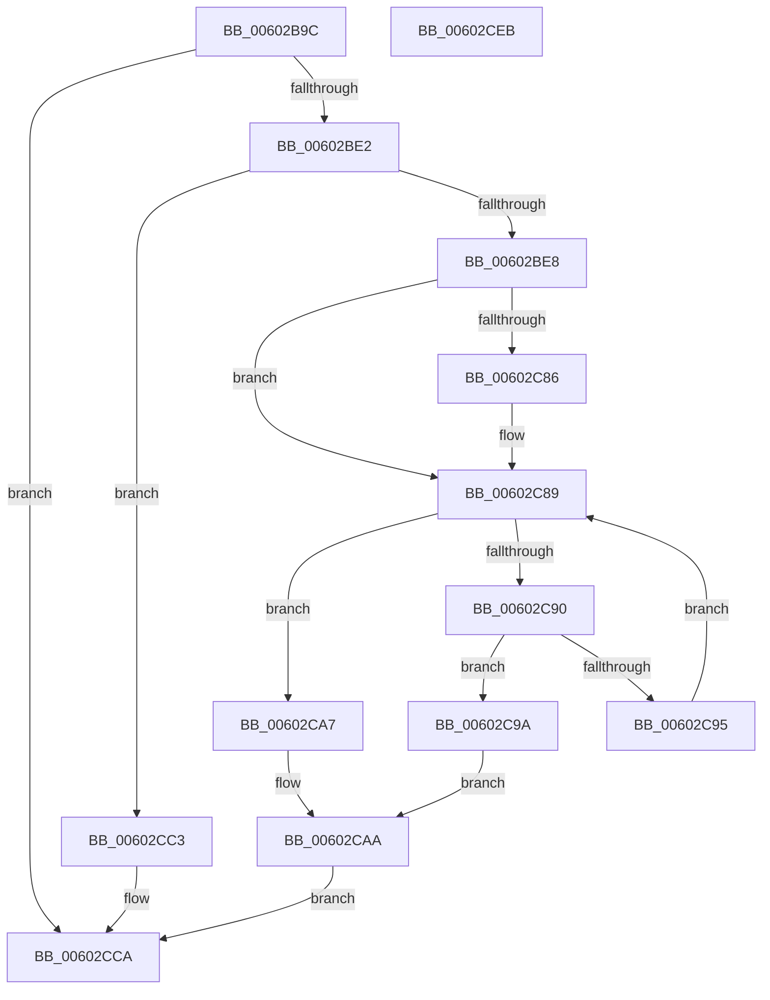

# RtlpHpCustomVaCallbacksRegistrarUnregister

- RVA: `0x00602B9C`–`0x00602CEC` (길이 `336` bytes)
- VA: `0x0000000140602B9C`
- 실행 섹션: `.text`
- PDB 이름 있음: `예`; PDB Function 태그: `아니요`
- unwind 정보 RVA: `0x000B8D7C`
- 디코드: `95`개 명령, `336/336` bytes 표시
- 미해석 바이트: `0` (있으면 어셈블리에 `.byte`로 보존)

> 이 문서는 커널 이미지의 기계어와 PDB 기호를 분석해 생성했습니다. 4번과 5번은 함수 원형과 자료형을 바이너리 사용 방식에서 추정한 C 해석이며 원본 소스 복구 결과는 아닙니다.

## 1. Dependencies

- 직접 호출 지점: **3**; 고유 호출 대상: **3**
- 직접 호출자로 확인된 함수: **1**
- RIP 상대 이미지 참조: **0**

### Outgoing calls
- `0x00602BBE` → [RtlpHpAcquireLockExclusive](../32/RtlpHpAcquireLockExclusive_function_003246B0.md) (function, `0x003246B0`)
- `0x00602CBC` → [RtlpHpMetadataFree](../2E/RtlpHpMetadataFree_function_002ECA64.md) (function, `0x002ECA64`)
- `0x00602CD3` → [RtlpHpReleaseLockExclusive](../32/RtlpHpReleaseLockExclusive_function_00324230.md) (function, `0x00324230`)

### Direct callers
- [RtlpHpRegisterEnvironment](RtlpHpRegisterEnvironment_function_006036C0.md) at `0x00603794`
- [RtlpHpRegisterEnvironment](RtlpHpRegisterEnvironment_function_006036C0.md) at `0x00603843`

### Static image references
- 디코드된 RIP-relative 메모리 참조가 없습니다.

## 2. Other-region calls and transfers

- 다른 실행 섹션으로 향하는 call: **0**
- 별도 외부 분기/꼬리 이동을 확인하지 못했습니다.

## 3. Assembly (complete function range)

```asm
00602B9C  48 89 5C 24 10                  mov qword ptr [rsp + 0x10], rbx
00602BA1  48 89 6C 24 18                  mov qword ptr [rsp + 0x18], rbp
00602BA6  56                              push rsi
00602BA7  57                              push rdi
00602BA8  41 56                           push r14
00602BAA  48 83 EC 30                     sub rsp, 0x30
00602BAE  48 8B F9                        mov rdi, rcx
00602BB1  48 8D 5A F0                     lea rbx, [rdx - 0x10]
00602BB5  33 D2                           xor edx, edx
00602BB7  48 83 C1 10                     add rcx, 0x10
00602BBB  4D 8B F0                        mov r14, r8
00602BBE  E8 ED 1A D2 FF                  call 0x1403246b0
00602BC3  49 83 CA FF                     or r10, 0xffffffffffffffff
00602BC7  40 8A E8                        mov bpl, al
00602BCA  49 8B D2                        mov rdx, r10
00602BCD  F0 48 0F C1 53 30               lock xadd qword ptr [rbx + 0x30], rdx
00602BD3  49 03 D2                        add rdx, r10
00602BD6  45 33 DB                        xor r11d, r11d
00602BD9  48 85 D2                        test rdx, rdx
00602BDC  0F 8F E8 00 00 00               jg 0x140602cca
00602BE2  0F 85 DB 00 00 00               jne 0x140602cc3
00602BE8  44 8B 4F 04                     mov r9d, dword ptr [rdi + 4]
00602BEC  41 8B C9                        mov ecx, r9d
00602BEF  83 E1 1F                        and ecx, 0x1f
00602BF2  41 C1 E9 05                     shr r9d, 5
00602BF6  49 D3 E2                        shl r10, cl
00602BF9  4C 23 53 08                     and r10, qword ptr [rbx + 8]
00602BFD  4C 89 54 24 50                  mov qword ptr [rsp + 0x50], r10
00602C02  41 0F B6 C2                     movzx eax, r10b
00602C06  48 05 CB 5D B1 00               add rax, 0xb15dcb
00602C0C  48 6B C8 25                     imul rcx, rax, 0x25
00602C10  0F B6 44 24 51                  movzx eax, byte ptr [rsp + 0x51]
00602C15  48 03 C8                        add rcx, rax
00602C18  0F B6 44 24 52                  movzx eax, byte ptr [rsp + 0x52]
00602C1D  48 6B D1 25                     imul rdx, rcx, 0x25
00602C21  48 03 D0                        add rdx, rax
00602C24  0F B6 44 24 53                  movzx eax, byte ptr [rsp + 0x53]
00602C29  48 6B CA 25                     imul rcx, rdx, 0x25
00602C2D  48 03 C8                        add rcx, rax
00602C30  0F B6 44 24 54                  movzx eax, byte ptr [rsp + 0x54]
00602C35  48 6B D1 25                     imul rdx, rcx, 0x25
00602C39  48 03 D0                        add rdx, rax
00602C3C  0F B6 44 24 55                  movzx eax, byte ptr [rsp + 0x55]
00602C41  48 6B CA 25                     imul rcx, rdx, 0x25
00602C45  48 03 C8                        add rcx, rax
00602C48  0F B6 44 24 56                  movzx eax, byte ptr [rsp + 0x56]
00602C4D  48 6B D1 25                     imul rdx, rcx, 0x25
00602C51  41 8D 49 FF                     lea ecx, [r9 - 1]
00602C55  48 03 D0                        add rdx, rax
00602C58  0F B6 44 24 57                  movzx eax, byte ptr [rsp + 0x57]
00602C5D  4C 6B C2 25                     imul r8, rdx, 0x25
00602C61  49 03 C0                        add rax, r8
00602C64  8B C0                           mov eax, eax
00602C66  48 23 C8                        and rcx, rax
00602C69  48 8B 47 08                     mov rax, qword ptr [rdi + 8]
00602C6D  48 8D 14 C8                     lea rdx, [rax + rcx*8]
00602C71  48 8B 03                        mov rax, qword ptr [rbx]
00602C74  48 B9 02 00 00 00 00 00 00 80   movabs rcx, 0x8000000000000002
00602C7E  48 23 C1                        and rax, rcx
00602C81  48 3B C1                        cmp rax, rcx
00602C84  75 03                           jne 0x140602c89
00602C86  49 8B 03                        mov rax, qword ptr [r11]
00602C89  48 8B 02                        mov rax, qword ptr [rdx]
00602C8C  A8 01                           test al, 1
00602C8E  75 17                           jne 0x140602ca7
00602C90  48 3B C3                        cmp rax, rbx
00602C93  74 05                           je 0x140602c9a
00602C95  48 8B D0                        mov rdx, rax
00602C98  EB EF                           jmp 0x140602c89
00602C9A  48 8B 03                        mov rax, qword ptr [rbx]
00602C9D  48 89 02                        mov qword ptr [rdx], rax
00602CA0  FF 0F                           dec dword ptr [rdi]
00602CA2  48 09 0B                        or qword ptr [rbx], rcx
00602CA5  EB 03                           jmp 0x140602caa
00602CA7  49 8B 03                        mov rax, qword ptr [r11]
00602CAA  41 0F 10 06                     movups xmm0, xmmword ptr [r14]
00602CAE  48 8D 54 24 20                  lea rdx, [rsp + 0x20]
00602CB3  48 8B CB                        mov rcx, rbx
00602CB6  F3 0F 7F 44 24 20               movdqu xmmword ptr [rsp + 0x20], xmm0
00602CBC  E8 A3 9D CE FF                  call 0x1402eca64
00602CC1  EB 07                           jmp 0x140602cca
00602CC3  B9 0E 00 00 00                  mov ecx, 0xe
00602CC8  CD 29                           int 0x29
00602CCA  44 8A C5                        mov r8b, bpl
00602CCD  48 8D 4F 10                     lea rcx, [rdi + 0x10]
00602CD1  33 D2                           xor edx, edx
00602CD3  E8 58 15 D2 FF                  call 0x140324230
00602CD8  48 8B 5C 24 58                  mov rbx, qword ptr [rsp + 0x58]
00602CDD  48 8B 6C 24 60                  mov rbp, qword ptr [rsp + 0x60]
00602CE2  48 83 C4 30                     add rsp, 0x30
00602CE6  41 5E                           pop r14
00602CE8  5F                              pop rdi
00602CE9  5E                              pop rsi
00602CEA  C3                              ret
00602CEB  CC                              int3
```

## 4. C-style interpretation (structured pseudocode)

```c
__int64 __fastcall RtlpHpCustomVaCallbacksRegistrarUnregister(__int64 a1, __int64 a2, __int64 a3)
{
    __int64 result;
    __int64 v_r10;
    __int64 v_r11;
    __int64 v_rsp;
    unsigned __int64 v_stack_m28;
    unsigned __int64 v_stack_p10;
    unsigned __int64 v_stack_p18;
    unsigned __int64 v_stack_p8;
    unsigned __int8 v_stack_p9;
    unsigned __int8 v_stack_pA;
    unsigned __int8 v_stack_pB;
    unsigned __int8 v_stack_pC;
    unsigned __int8 v_stack_pD;
    unsigned __int8 v_stack_pE;
    unsigned __int8 v_stack_pF;

    v_stack_p10 = v_rbx;
    v_stack_p18 = v_rbp;
    v_rsp = (v_rsp) - (48);
    a2 = 0;
    a1 = (a1) + (16);
    result = RtlpHpAcquireLockExclusive(a1, a2, a3, a4);
    v_r10 = (v_r10) | (-1);
    a2 = (v_r10) + (v_r10);
    v_r11 = 0;
    if (condition_is_greater) goto loc_00602CCA;
    if (a2 != 0) goto loc_00602CC3;
    a1 = (unsigned int)(((unsigned int)((unsigned int)((unsigned int)(*(unsigned int *)(a1 + 4))))) & (31));
    a4 = (unsigned int)(((unsigned int)(*(unsigned int *)(a1 + 4))) >> (5));
    v_r10 = (v_r10) << ((unsigned __int8)(a1));
    v_r10 = (v_r10) & (*(unsigned __int64 *)(a2 - 16 + 8));
    v_stack_p8 = v_r10;
    result = ((unsigned __int8)(v_r10)) + (0xB15DCBULL);
    a1 = (a1) * (result);
    a1 = (a1) + (v_stack_p9);
    a2 = (a2) * (a1);
    a2 = (a2) + (v_stack_pA);
    a1 = (a1) * (a2);
    a1 = (a1) + (v_stack_pB);
    a2 = (a2) * (a1);
    a2 = (a2) + (v_stack_pC);
    a1 = (a1) * (a2);
    a1 = (a1) + (v_stack_pD);
    a2 = (a2) * (a1);
    a2 = (a2) + (v_stack_pE);
    a3 = (a3) * (a2);
    result = (v_stack_pF) + (a3);
    a1 = (a4 - 1) & ((unsigned int)((unsigned int)(result)));
    result = (*(unsigned __int64 *)(a2 - 16)) & (a1);
    if (result == a1) {
        result = *(unsigned __int64 *)(v_r11);
    }
    if ((((unsigned __int8)(*(unsigned __int64 *)(*(unsigned __int64 *)(a1 + 8) + a1 * 8))) & (1)) != 0) goto loc_00602CA7;
    if ((*(unsigned __int64 *)(*(unsigned __int64 *)(a1 + 8) + a1 * 8)) == (a2 - 16)) goto loc_00602C9A;
    goto loc_00602C89;
loc_00602C9A:
    *(unsigned __int64 *)(*(unsigned __int64 *)(*(unsigned __int64 *)(a1 + 8) + a1 * 8)) = *(unsigned __int64 *)(a2 - 16);
    goto loc_00602CAA;
loc_00602CA7:
loc_00602CAA:
    v_stack_m28 = v_xmm0;
    result = RtlpHpMetadataFree(a2 - 16, v_stack_m28, a3, a4);
    goto loc_00602CCA;
loc_00602CC3:
loc_00602CCA:
    a2 = 0;
    result = RtlpHpReleaseLockExclusive(a1 + 16, a2, (unsigned __int8)((unsigned __int8)(result)), a4);
    v_rsp = (v_rsp) + (48);
    return result;
}
```

## 5. (Beta) C Style

```c
int64_t RtlpHpCustomVaCallbacksRegistrarUnregister(void *Arg1, void *Arg2, void *Arg3)
{
    uint8_t *arg1 = (uint8_t *)Arg1;
    uint8_t *arg2 = (uint8_t *)Arg2;
    uint8_t *arg3 = (uint8_t *)Arg3;

    int64_t result;
    int64_t local_r10;
    int64_t local_r11;
    int64_t local_rsp;
    uint64_t v_stack_m28;
    uint64_t v_stack_p10;
    uint64_t v_stack_p18;
    uint64_t v_stack_p8;
    uint8_t v_stack_p9;
    uint8_t v_stack_pA;
    uint8_t v_stack_pB;
    uint8_t v_stack_pC;
    uint8_t v_stack_pD;
    uint8_t v_stack_pE;
    uint8_t v_stack_pF;

    v_stack_p10 = local_rbx;
    v_stack_p18 = local_rbp;
    local_rsp = (local_rsp) - (48);
    Arg2 = 0;
    Arg1 = (Arg1) + (16);
    result = RtlpHpAcquireLockExclusive(Arg1, Arg2, Arg3, a4);
    local_r10 = (local_r10) | (-1);
    Arg2 = (local_r10) + (local_r10);
    local_r11 = 0;
    if (condition_is_greater) goto loc_00602CCA;
    if (Arg2 != NULL) goto loc_00602CC3;
    Arg1 = (uint32_t)(((uint32_t)((uint32_t)((uint32_t)(*(uint32_t *)(arg1 + 0x4))))) & (31));
    a4 = (uint32_t)(((uint32_t)(*(uint32_t *)(arg1 + 0x4))) >> (5));
    local_r10 = (local_r10) << ((uint8_t)(Arg1));
    local_r10 = (local_r10) & (*(uint64_t *)(arg2 - 0x10 + 0x8));
    v_stack_p8 = local_r10;
    result = ((uint8_t)(local_r10)) + (0xB15DCBULL);
    Arg1 = (Arg1) * (result);
    Arg1 = (Arg1) + (v_stack_p9);
    Arg2 = (Arg2) * (Arg1);
    Arg2 = (Arg2) + (v_stack_pA);
    Arg1 = (Arg1) * (Arg2);
    Arg1 = (Arg1) + (v_stack_pB);
    Arg2 = (Arg2) * (Arg1);
    Arg2 = (Arg2) + (v_stack_pC);
    Arg1 = (Arg1) * (Arg2);
    Arg1 = (Arg1) + (v_stack_pD);
    Arg2 = (Arg2) * (Arg1);
    Arg2 = (Arg2) + (v_stack_pE);
    Arg3 = (Arg3) * (Arg2);
    result = (v_stack_pF) + (Arg3);
    Arg1 = (a4 - 1) & ((uint32_t)((uint32_t)(result)));
    result = (*(uint64_t *)(arg2 - 0x10)) & (Arg1);
    if (result == Arg1) {
        result = *(uint64_t *)(local_r11);
    }
    if ((((uint8_t)(*(uint64_t *)(*(uint64_t *)(arg1 + 0x8) + arg1 * 8))) & (1)) != 0) goto loc_00602CA7;
    if ((*(uint64_t *)(*(uint64_t *)(arg1 + 0x8) + arg1 * 8)) == (Arg2 - 16)) goto loc_00602C9A;
    goto loc_00602C89;
loc_00602C9A:
    *(uint64_t *)(*(uint64_t *)(*(uint64_t *)(arg1 + 0x8) + arg1 * 8)) = *(uint64_t *)(arg2 - 0x10);
    goto loc_00602CAA;
loc_00602CA7:
loc_00602CAA:
    v_stack_m28 = v_xmm0;
    result = RtlpHpMetadataFree(Arg2 - 16, v_stack_m28, Arg3, a4);
    goto loc_00602CCA;
loc_00602CC3:
loc_00602CCA:
    Arg2 = 0;
    result = RtlpHpReleaseLockExclusive(Arg1 + 16, Arg2, (uint8_t)((uint8_t)(result)), a4);
    local_rsp = (local_rsp) + (48);
    return result;
}
```

### 관측된 메모리 오프셋

구조체 형식이 확인되지 않은 접근은 인자 기준의 오프셋으로만 기록했습니다.

| 기준 인자 | 오프셋 표현 | 폭 (bit) | 접근 |
|---|---:|---:|---|
| `Arg1` | `+ 0x0` | `32` | `R/W` |
| `Arg1` | `+ 0x4` | `32` | `R` |
| `Arg1` | `+ 0x8` | `64` | `R` |
| `Arg1` | `+ 0x10` | `64` | `R` |
| `Arg2` | `- 0x10` | `64` | `R` |
| `Arg2` | `+ 0x0` | `64` | `R` |
| `Arg2` | `+ 0x0` | `64` | `R/W` |
| `Arg2` | `+ 0x8` | `64` | `R` |
| `Arg2` | `+ 0x30` | `64` | `R/W` |
| `Arg3` | `+ 0x0` | `128` | `R` |

## 6. Execution-region graph

[열기: 2D/3D 그래프와 함수 탐색 컨트롤 패널](../../../control-panel.html?section=text&rva=0x00602B9C&view=graph)

- 2D 그래프는 위에서 아래로 흐르고, 3D 그래프는 빈 공간을 드래그해 회전합니다. Shift+드래그는 이동, 휠은 확대·축소, 함수 노드 선택은 대상 보고서 이동입니다.

### Static fallback


