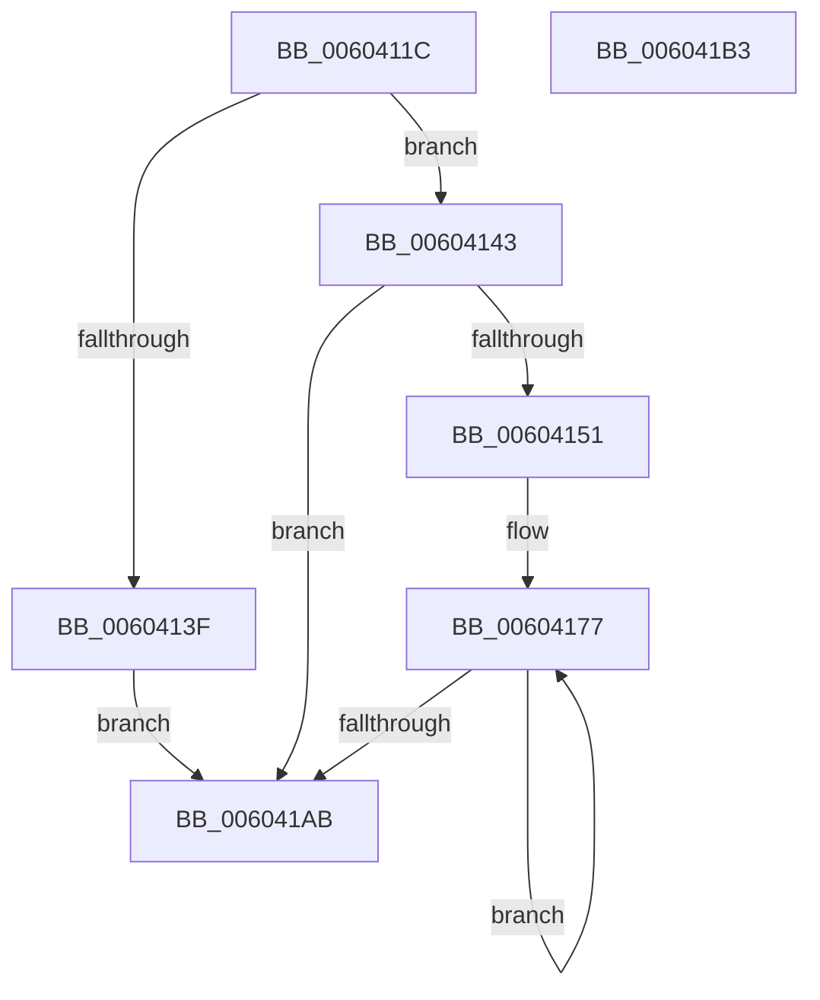

# RtlpHpEnvTlsAlloc

- RVA: `0x0060411C`–`0x006041B4` (길이 `152` bytes)
- VA: `0x000000014060411C`
- 실행 섹션: `.text`
- PDB 이름 있음: `예`; PDB Function 태그: `아니요`
- unwind 정보 RVA: `0x000805BC`
- 디코드: `43`개 명령, `152/152` bytes 표시
- 미해석 바이트: `0` (있으면 어셈블리에 `.byte`로 보존)

> 이 문서는 커널 이미지의 기계어와 PDB 기호를 분석해 생성했습니다. 4번과 5번은 함수 원형과 자료형을 바이너리 사용 방식에서 추정한 C 해석이며 원본 소스 복구 결과는 아닙니다.

## 1. Dependencies

- 직접 호출 지점: **2**; 고유 호출 대상: **2**
- 직접 호출자로 확인된 함수: **1**
- RIP 상대 이미지 참조: **1**

### Outgoing calls
- `0x00604131` → [ExSaAllocate](../3B/ExSaAllocate_function_003B3FB0.md) (function, `0x003B3FB0`)
- `0x00604148` → [KeQueryMaximumProcessorCountEx](../26/KeQueryMaximumProcessorCountEx_function_00264D60.md) (function, `0x00264D60`)

### Direct callers
- [RtlpHpLfhContextEnable](RtlpHpLfhContextEnable_function_0060484C.md) at `0x0060485C`

### Static image references
- `0x00604151` → RVA `0x00EFA278` (`.data`; read)

## 2. Other-region calls and transfers

- 다른 실행 섹션으로 향하는 call: **0**
- 별도 외부 분기/꼬리 이동을 확인하지 못했습니다.

## 3. Assembly (complete function range)

```asm
0060411C  48 89 54 24 10                  mov qword ptr [rsp + 0x10], rdx
00604121  53                              push rbx
00604122  48 83 EC 20                     sub rsp, 0x20
00604126  33 D2                           xor edx, edx
00604128  41 B8 45 78 48 70               mov r8d, 0x70487845
0060412E  8D 4A 08                        lea ecx, [rdx + 8]
00604131  E8 7A FE DA FF                  call 0x1403b3fb0
00604136  48 8B D8                        mov rbx, rax
00604139  48 83 F8 FF                     cmp rax, -1
0060413D  75 04                           jne 0x140604143
0060413F  33 DB                           xor ebx, ebx
00604141  EB 68                           jmp 0x1406041ab
00604143  B9 FF FF 00 00                  mov ecx, 0xffff
00604148  E8 13 0C C6 FF                  call 0x140264d60
0060414D  85 C0                           test eax, eax
0060414F  74 5A                           je 0x1406041ab
00604151  4C 8B 15 20 61 8F 00            mov r10, qword ptr [rip + 0x8f6120]
00604158  44 8B CB                        mov r9d, ebx
0060415B  41 C1 E9 0D                     shr r9d, 0xd
0060415F  44 8B C3                        mov r8d, ebx
00604162  41 81 E1 FF FF 03 00            and r9d, 0x3ffff
00604169  49 C1 E8 04                     shr r8, 4
0060416D  41 81 E0 FF 01 00 00            and r8d, 0x1ff
00604174  44 8B D8                        mov r11d, eax
00604177  83 64 24 38 00                  and dword ptr [rsp + 0x38], 0
0060417C  BA 01 00 00 00                  mov edx, 1
00604181  41 0F BD C9                     bsr ecx, r9d
00604185  41 8B C1                        mov eax, r9d
00604188  D3 E2                           shl edx, cl
0060418A  83 C1 FE                        add ecx, -2
0060418D  48 33 D0                        xor rdx, rax
00604190  49 8B 02                        mov rax, qword ptr [r10]
00604193  4D 8D 52 08                     lea r10, [r10 + 8]
00604197  48 8B 0C C8                     mov rcx, qword ptr [rax + rcx*8]
0060419B  48 8B 44 D1 08                  mov rax, qword ptr [rcx + rdx*8 + 8]
006041A0  4A 83 24 C0 00                  and qword ptr [rax + r8*8], 0
006041A5  49 83 EB 01                     sub r11, 1
006041A9  75 CC                           jne 0x140604177
006041AB  8B C3                           mov eax, ebx
006041AD  48 83 C4 20                     add rsp, 0x20
006041B1  5B                              pop rbx
006041B2  C3                              ret
006041B3  CC                              int3
```

## 4. C-style interpretation (structured pseudocode)

```c
__int64 __fastcall RtlpHpEnvTlsAlloc(__int64 a1, __int64 a2)
{
    __int64 result;
    __int64 v_r11;
    __int64 v_rbx;
    __int64 v_rsp;
    unsigned __int64 v_stack_p10;

    v_stack_p10 = a2;
    v_rsp = (v_rsp) - (32);
    a2 = 0;
    result = ExSaAllocate(a2 + 8, a2, (unsigned int)(0x70487845ULL), a4);
    if (result != -1) goto loc_00604143;
    v_rbx = 0;
    goto loc_006041AB;
loc_00604143:
    result = KeQueryMaximumProcessorCountEx((unsigned int)(0xFFFFULL), a2, (unsigned int)(0x70487845ULL), a4);
    if ((unsigned int)(result) == 0) goto loc_006041AB;
    a4 = (unsigned int)((0) >> (13));
    a4 = (unsigned int)((a4) & (0x3FFFFULL));
    a3 = (0) >> (4);
    a3 = (unsigned int)((a3) & (511));
loc_00604177:
    a2 = (unsigned int)((1) << ((unsigned __int8)((unsigned int)(0xFFFFULL))));
    a1 = (unsigned int)(((unsigned int)(0xFFFFULL)) + (-2));
    a2 = (a2) ^ ((unsigned int)((unsigned int)(a4)));
    v_r11 = ((unsigned int)((unsigned int)(result))) - (1);
    if (condition_is_not_equal) goto loc_00604177;
loc_006041AB:
    v_rsp = (v_rsp) + (32);
    return 0;
}
```

## 5. (Beta) C Style

```c
int64_t RtlpHpEnvTlsAlloc(int64_t Arg1, int64_t Arg2)
{
    int64_t result;
    int64_t local_r11;
    int64_t local_rbx;
    int64_t local_rsp;
    uint64_t v_stack_p10;

    v_stack_p10 = Arg2;
    local_rsp = (local_rsp) - (32);
    Arg2 = 0;
    result = ExSaAllocate(Arg2 + 8, Arg2, (uint32_t)(0x70487845ULL), a4);
    if (result != -1) goto loc_00604143;
    local_rbx = 0;
    goto loc_006041AB;
loc_00604143:
    result = KeQueryMaximumProcessorCountEx((uint32_t)(0xFFFFULL), Arg2, (uint32_t)(0x70487845ULL), a4);
    if ((uint32_t)(result) == 0) goto loc_006041AB;
    a4 = (uint32_t)((0) >> (13));
    a4 = (uint32_t)((a4) & (0x3FFFFULL));
    a3 = (0) >> (4);
    a3 = (uint32_t)((a3) & (511));
loc_00604177:
    Arg2 = (uint32_t)((1) << ((uint8_t)((uint32_t)(0xFFFFULL))));
    Arg1 = (uint32_t)(((uint32_t)(0xFFFFULL)) + (-2));
    Arg2 = (Arg2) ^ ((uint32_t)((uint32_t)(a4)));
    local_r11 = ((uint32_t)((uint32_t)(result))) - (1);
    if (condition_is_not_equal) goto loc_00604177;
loc_006041AB:
    local_rsp = (local_rsp) + (32);
    return 0;
}
```

## 6. Execution-region graph

[열기: 2D/3D 그래프와 함수 탐색 컨트롤 패널](../../../control-panel.html?section=text&rva=0x0060411C&view=graph)

- 2D 그래프는 위에서 아래로 흐르고, 3D 그래프는 빈 공간을 드래그해 회전합니다. Shift+드래그는 이동, 휠은 확대·축소, 함수 노드 선택은 대상 보고서 이동입니다.

### Static fallback


