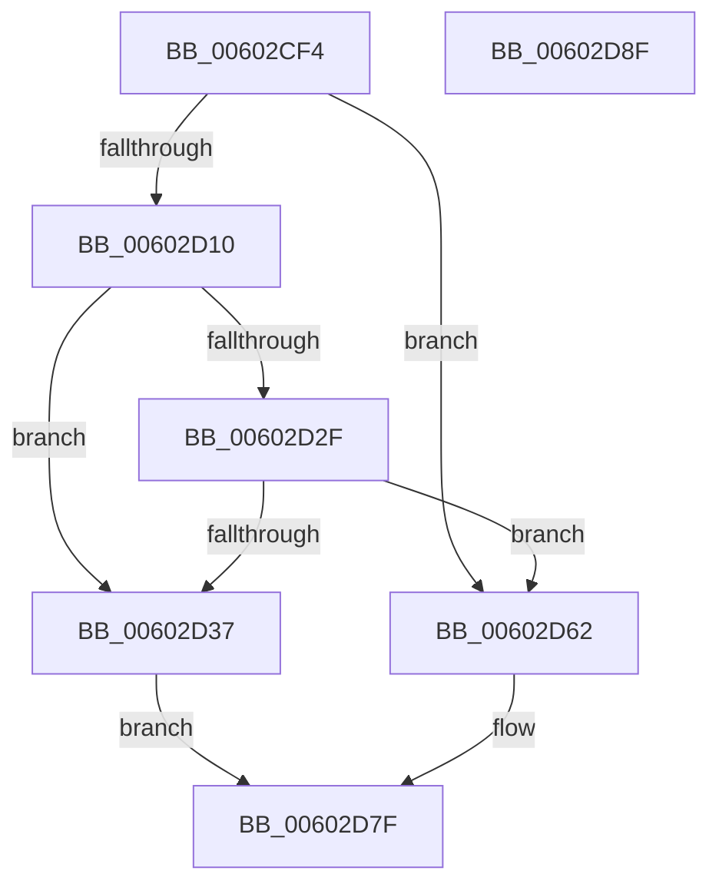

# RtlpHpExtrasSetPresent

- RVA: `0x00602CF4`–`0x00602D90` (길이 `156` bytes)
- VA: `0x0000000140602CF4`
- 실행 섹션: `.text`
- PDB 이름 있음: `예`; PDB Function 태그: `아니요`
- unwind 정보 RVA: `0x00060BC4`
- 디코드: `44`개 명령, `156/156` bytes 표시
- 미해석 바이트: `0` (있으면 어셈블리에 `.byte`로 보존)

> 이 문서는 커널 이미지의 기계어와 PDB 기호를 분석해 생성했습니다. 4번과 5번은 함수 원형과 자료형을 바이너리 사용 방식에서 추정한 C 해석이며 원본 소스 복구 결과는 아닙니다.

## 1. Dependencies

- 직접 호출 지점: **5**; 고유 호출 대상: **5**
- 직접 호출자로 확인된 함수: **1**
- RIP 상대 이미지 참조: **2**

### Outgoing calls
- `0x00602D25` → [RtlCSparseBitmapBitmaskRead](../36/RtlCSparseBitmapBitmaskRead_function_0036190C.md) (function, `0x0036190C`)
- `0x00602D3A` → [RtlpHpLargeLockAcquireShared](../4F/RtlpHpLargeLockAcquireShared_function_004FC78C.md) (function, `0x004FC78C`)
- `0x00602D48` → [RtlpHpLargeAllocGetMetadata](../2E/RtlpHpLargeAllocGetMetadata_function_002EC9E4.md) (function, `0x002EC9E4`)
- `0x00602D56` → [RtlpHpLargeLockReleaseShared](../4F/RtlpHpLargeLockReleaseShared_function_004FC518.md) (function, `0x004FC518`)
- `0x00602D7A` → [RtlpHpSegSetExtraPresent](RtlpHpSegSetExtraPresent_function_00604428.md) (function, `0x00604428`)

### Direct callers
- [RtlpHpExtrasAppend](../4D/RtlpHpExtrasAppend_function_004DB1B8.md) at `0x004DB232`

### Static image references
- `0x00602D10` → RVA `0x00E68608` (`.data`; read)
- `0x00602D17` → RVA `0x00E68610` (`.data`; read)

## 2. Other-region calls and transfers

- 다른 실행 섹션으로 향하는 call: **0**
- 별도 외부 분기/꼬리 이동을 확인하지 못했습니다.

## 3. Assembly (complete function range)

```asm
00602CF4  48 89 5C 24 08                  mov qword ptr [rsp + 8], rbx
00602CF9  48 89 74 24 10                  mov qword ptr [rsp + 0x10], rsi
00602CFE  57                              push rdi
00602CFF  48 83 EC 20                     sub rsp, 0x20
00602D03  33 DB                           xor ebx, ebx
00602D05  48 8B FA                        mov rdi, rdx
00602D08  48 8B F1                        mov rsi, rcx
00602D0B  66 85 D2                        test dx, dx
00602D0E  75 52                           jne 0x140602d62
00602D10  48 2B 15 F1 58 86 00            sub rdx, qword ptr [rip + 0x8658f1]
00602D17  48 8D 0D F2 58 86 00            lea rcx, [rip + 0x8658f2]
00602D1E  48 C1 EA 14                     shr rdx, 0x14
00602D22  48 03 D2                        add rdx, rdx
00602D25  E8 E2 EB D5 FF                  call 0x14036190c
00602D2A  48 85 C0                        test rax, rax
00602D2D  74 08                           je 0x140602d37
00602D2F  8D 58 FF                        lea ebx, [rax - 1]
00602D32  83 FB 02                        cmp ebx, 2
00602D35  75 2B                           jne 0x140602d62
00602D37  48 8B CE                        mov rcx, rsi
00602D3A  E8 4D 9A EF FF                  call 0x1404fc78c
00602D3F  48 8B D7                        mov rdx, rdi
00602D42  48 8B CE                        mov rcx, rsi
00602D45  44 8A C8                        mov r9b, al
00602D48  E8 97 9C CE FF                  call 0x1402ec9e4
00602D4D  41 8A D1                        mov dl, r9b
00602D50  48 8B CE                        mov rcx, rsi
00602D53  48 8B D8                        mov rbx, rax
00602D56  E8 BD 97 EF FF                  call 0x1404fc518
00602D5B  48 83 4B 20 01                  or qword ptr [rbx + 0x20], 1
00602D60  EB 1D                           jmp 0x140602d7f
00602D62  48 63 C3                        movsxd rax, ebx
00602D65  48 8B D7                        mov rdx, rdi
00602D68  48 8D 0C 40                     lea rcx, [rax + rax*2]
00602D6C  48 C1 E1 06                     shl rcx, 6
00602D70  48 81 C1 40 01 00 00            add rcx, 0x140
00602D77  48 03 CE                        add rcx, rsi
00602D7A  E8 A9 16 00 00                  call 0x140604428
00602D7F  48 8B 5C 24 30                  mov rbx, qword ptr [rsp + 0x30]
00602D84  48 8B 74 24 38                  mov rsi, qword ptr [rsp + 0x38]
00602D89  48 83 C4 20                     add rsp, 0x20
00602D8D  5F                              pop rdi
00602D8E  C3                              ret
00602D8F  CC                              int3
```

## 4. C-style interpretation (structured pseudocode)

```c
__int64 __fastcall RtlpHpExtrasSetPresent(__int64 a1, __int64 a2)
{
    __int64 result;
    __int64 v_rbx;
    __int64 v_rsp;
    unsigned __int64 v_stack_p10;
    unsigned __int64 v_stack_p8;

    v_stack_p8 = v_rbx;
    v_stack_p10 = v_rsi;
    v_rsp = (v_rsp) - (32);
    v_rbx = 0;
    if ((unsigned __int16)(a2) != 0) goto loc_00602D62;
    a2 = (a2) - (*(unsigned __int64 *)(v_rip + 8804593));
    a2 = (a2) >> (20);
    a2 = (a2) + (a2);
    result = RtlCSparseBitmapBitmaskRead(v_rip + 8804594, a2, a3, a4);
    if (result == 0) goto loc_00602D37;
    if (((unsigned int)(result - 1)) != 2) goto loc_00602D62;
loc_00602D37:
    result = RtlpHpLargeLockAcquireShared(a1, a2, a3, a4);
    result = RtlpHpLargeAllocGetMetadata(a1, a2, a3, (unsigned __int8)(result));
    result = RtlpHpLargeLockReleaseShared(a1, (unsigned __int8)((unsigned __int8)(result)), a3, (unsigned __int8)(result));
    goto loc_00602D7F;
loc_00602D62:
    a1 = ((int)((unsigned int)(result)) + (int)((unsigned int)(result)) * 2) << (6);
    a1 = (a1) + (320);
    a1 = (a1) + (a1);
    result = RtlpHpSegSetExtraPresent(a1, a2, a3, (unsigned __int8)(result));
loc_00602D7F:
    v_rsp = (v_rsp) + (32);
    return result;
}
```

## 5. (Beta) C Style

```c
int64_t RtlpHpExtrasSetPresent(int64_t Arg1, int64_t Arg2)
{
    int64_t result;
    int64_t local_rbx;
    int64_t local_rsp;
    uint64_t v_stack_p10;
    uint64_t v_stack_p8;

    v_stack_p8 = local_rbx;
    v_stack_p10 = local_rsi;
    local_rsp = (local_rsp) - (32);
    local_rbx = 0;
    if ((uint16_t)(Arg2) != 0) goto loc_00602D62;
    Arg2 = (Arg2) - (*(uint64_t *)(v_rip + 0x8658F1));
    Arg2 = (Arg2) >> (20);
    Arg2 = (Arg2) + (Arg2);
    result = RtlCSparseBitmapBitmaskRead(v_rip + 8804594, Arg2, a3, a4);
    if (result == 0) goto loc_00602D37;
    if (((uint32_t)(result - 1)) != 2) goto loc_00602D62;
loc_00602D37:
    result = RtlpHpLargeLockAcquireShared(Arg1, Arg2, a3, a4);
    result = RtlpHpLargeAllocGetMetadata(Arg1, Arg2, a3, (uint8_t)(result));
    result = RtlpHpLargeLockReleaseShared(Arg1, (uint8_t)((uint8_t)(result)), a3, (uint8_t)(result));
    goto loc_00602D7F;
loc_00602D62:
    Arg1 = ((int32_t)((uint32_t)(result)) + (int32_t)((uint32_t)(result)) * 2) << (6);
    Arg1 = (Arg1) + (320);
    Arg1 = (Arg1) + (Arg1);
    result = RtlpHpSegSetExtraPresent(Arg1, Arg2, a3, (uint8_t)(result));
loc_00602D7F:
    local_rsp = (local_rsp) + (32);
    return result;
}
```

## 6. Execution-region graph

[열기: 2D/3D 그래프와 함수 탐색 컨트롤 패널](../../../control-panel.html?section=text&rva=0x00602CF4&view=graph)

- 2D 그래프는 위에서 아래로 흐르고, 3D 그래프는 빈 공간을 드래그해 회전합니다. Shift+드래그는 이동, 휠은 확대·축소, 함수 노드 선택은 대상 보고서 이동입니다.

### Static fallback


