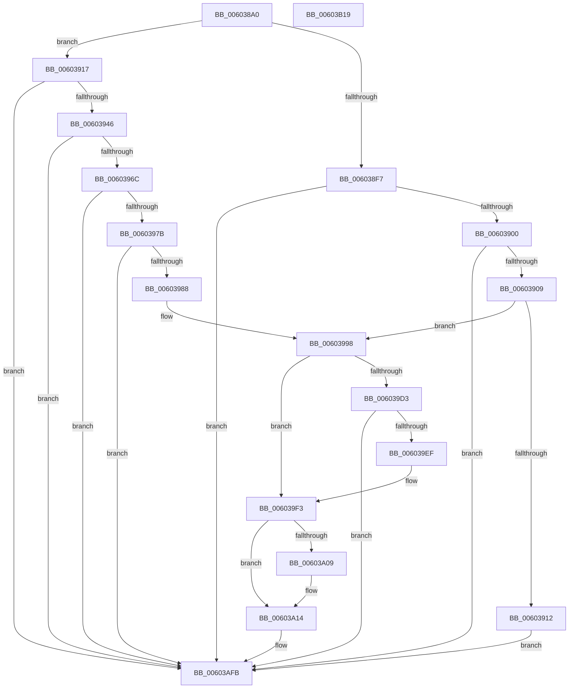

# RtlpHpFixedHeapCreate

- RVA: `0x006038A0`–`0x00603B1A` (길이 `634` bytes)
- VA: `0x00000001406038A0`
- 실행 섹션: `.text`
- PDB 이름 있음: `예`; PDB Function 태그: `아니요`
- unwind 정보 RVA: `0x000D05A8`
- 디코드: `156`개 명령, `634/634` bytes 표시
- 미해석 바이트: `0` (있으면 어셈블리에 `.byte`로 보존)

> 이 문서는 커널 이미지의 기계어와 PDB 기호를 분석해 생성했습니다. 4번과 5번은 함수 원형과 자료형을 바이너리 사용 방식에서 추정한 C 해석이며 원본 소스 복구 결과는 아닙니다.

## 1. Dependencies

- 직접 호출 지점: **8**; 고유 호출 대상: **7**
- 직접 호출자로 확인된 함수: **1**
- RIP 상대 이미지 참조: **7**

### Outgoing calls
- `0x00603939` → [ZwQueryVirtualMemory](../6A/ZwQueryVirtualMemory_function_006AD530.md) (function, `0x006AD530`)
- `0x0060395F` → [ZwQueryVirtualMemory](../6A/ZwQueryVirtualMemory_function_006AD530.md) (function, `0x006AD530`)
- `0x006039E2` → [guard_dispatch_icall](../6B/guard_dispatch_icall_function_006BAAD0.md) (function, `0x006BAAD0`)
- `0x006039FF` → [memset](../6C/memset_function_006C6C40.md) (function, `0x006C6C40`)
- `0x00603A27` → [RtlpHpInitializeLock](../2E/RtlpHpInitializeLock_function_002E8054.md) (function, `0x002E8054`)
- `0x00603A64` → [RtlSetBitsEx](../3B/RtlSetBitsEx_function_003B6570.md) (function, `0x003B6570`)
- `0x00603AE4` → [RtlpHpVsContextInitialize](../4D/RtlpHpVsContextInitialize_function_004D4030.md) (function, `0x004D4030`)
- `0x00603AED` → [RtlpHpVsContextStart](RtlpHpVsContextStart_function_006056F0.md) (function, `0x006056F0`)

### Direct callers
- [RtlpCreateHeap](../4E/RtlpCreateHeap_function_004E1904.md) at `0x004E1ABE`

### Static image references
- `0x0060399B` → RVA `0x00603870` (`RtlpHpFixedHeapCommitRoutine`; read)
- `0x00603A09` → RVA `0x00E28300` (`.data`; read)
- `0x00603A6D` → RVA `0x003B47F0` (`RtlpHpFixedVsAllocate`; read)
- `0x00603A9A` → RVA `0x004A7FE0` (`RtlpHpFixedVsFree`; read)
- `0x00603AA5` → RVA `0x004A9C30` (`RtlpHpFixedVsCommit`; read)
- `0x00603AB0` → RVA `0x0049E550` (`EmpCheckErrataList`; read)
- `0x00603ABB` → RVA `0x00603B20` (`RtlpHpFixedVsExtend`; read)

## 2. Other-region calls and transfers

- 다른 실행 섹션으로 향하는 call: **0**
- 별도 외부 분기/꼬리 이동을 확인하지 못했습니다.

## 3. Assembly (complete function range)

```asm
006038A0  48 89 5C 24 18                  mov qword ptr [rsp + 0x18], rbx
006038A5  48 89 4C 24 08                  mov qword ptr [rsp + 8], rcx
006038AA  55                              push rbp
006038AB  56                              push rsi
006038AC  57                              push rdi
006038AD  41 54                           push r12
006038AF  41 55                           push r13
006038B1  41 56                           push r14
006038B3  41 57                           push r15
006038B5  48 8D 6C 24 E9                  lea rbp, [rsp - 0x17]
006038BA  48 81 EC F0 00 00 00            sub rsp, 0xf0
006038C1  0F 57 C0                        xorps xmm0, xmm0
006038C4  0F 57 C9                        xorps xmm1, xmm1
006038C7  33 F6                           xor esi, esi
006038C9  49 8B F9                        mov rdi, r9
006038CC  48 89 75 D7                     mov qword ptr [rbp - 0x29], rsi
006038D0  4D 8B E0                        mov r12, r8
006038D3  48 8B DA                        mov rbx, rdx
006038D6  4C 8B F1                        mov r14, rcx
006038D9  0F 11 45 DF                     movups xmmword ptr [rbp - 0x21], xmm0
006038DD  0F 11 45 EF                     movups xmmword ptr [rbp - 0x11], xmm0
006038E1  0F 11 45 FF                     movups xmmword ptr [rbp - 1], xmm0
006038E5  0F 11 4C 24 58                  movups xmmword ptr [rsp + 0x58], xmm1
006038EA  0F 11 4D 8F                     movups xmmword ptr [rbp - 0x71], xmm1
006038EE  0F 11 4D 9F                     movups xmmword ptr [rbp - 0x61], xmm1
006038F2  48 85 D2                        test rdx, rdx
006038F5  74 20                           je 0x140603917
006038F7  4D 85 C9                        test r9, r9
006038FA  0F 84 FB 01 00 00               je 0x140603afb
00603900  4D 85 C0                        test r8, r8
00603903  0F 84 F2 01 00 00               je 0x140603afb
00603909  4D 3B C8                        cmp r9, r8
0060390C  0F 86 86 00 00 00               jbe 0x140603998
00603912  E9 E4 01 00 00                  jmp 0x140603afb
00603917  41 BF 30 00 00 00               mov r15d, 0x30
0060391D  48 89 74 24 28                  mov qword ptr [rsp + 0x28], rsi
00603922  48 8B D1                        mov rdx, rcx
00603925  4C 89 7C 24 20                  mov qword ptr [rsp + 0x20], r15
0060392A  49 83 CE FF                     or r14, 0xffffffffffffffff
0060392E  4C 8D 4D DF                     lea r9, [rbp - 0x21]
00603932  49 8B CE                        mov rcx, r14
00603935  45 8D 47 D3                     lea r8d, [r15 - 0x2d]
00603939  E8 F2 9B 0A 00                  call 0x1406ad530
0060393E  85 C0                           test eax, eax
00603940  0F 88 B5 01 00 00               js 0x140603afb
00603946  48 8B 55 57                     mov rdx, qword ptr [rbp + 0x57]
0060394A  4C 8D 4C 24 58                  lea r9, [rsp + 0x58]
0060394F  48 89 74 24 28                  mov qword ptr [rsp + 0x28], rsi
00603954  45 33 C0                        xor r8d, r8d
00603957  49 8B CE                        mov rcx, r14
0060395A  4C 89 7C 24 20                  mov qword ptr [rsp + 0x20], r15
0060395F  E8 CC 9B 0A 00                  call 0x1406ad530
00603964  85 C0                           test eax, eax
00603966  0F 88 8F 01 00 00               js 0x140603afb
0060396C  4C 8B 75 57                     mov r14, qword ptr [rbp + 0x57]
00603970  4C 39 74 24 58                  cmp qword ptr [rsp + 0x58], r14
00603975  0F 85 80 01 00 00               jne 0x140603afb
0060397B  81 7D 9F 00 00 01 00            cmp dword ptr [rbp - 0x61], 0x10000
00603982  0F 84 73 01 00 00               je 0x140603afb
00603988  81 7D 9F 00 10 00 00            cmp dword ptr [rbp - 0x61], 0x1000
0060398F  4C 8B 65 EF                     mov r12, qword ptr [rbp - 0x11]
00603993  48 0F 44 7D 97                  cmove rdi, qword ptr [rbp - 0x69]
00603998  48 85 DB                        test rbx, rbx
0060399B  4C 8D 3D CE FE FF FF            lea r15, [rip - 0x132]
006039A2  4C 0F 45 FB                     cmovne r15, rbx
006039A6  49 C1 EC 0C                     shr r12, 0xc
006039AA  49 8B DC                        mov rbx, r12
006039AD  48 C1 EB 03                     shr rbx, 3
006039B1  48 83 C3 07                     add rbx, 7
006039B5  48 83 E3 F8                     and rbx, 0xfffffffffffffff8
006039B9  4C 8D AB 7F 11 00 00            lea r13, [rbx + 0x117f]
006039C0  49 8B C5                        mov rax, r13
006039C3  48 25 00 F0 FF FF               and rax, 0xfffffffffffff000
006039C9  48 89 44 24 40                  mov qword ptr [rsp + 0x40], rax
006039CE  48 3B F8                        cmp rdi, rax
006039D1  73 20                           jae 0x1406039f3
006039D3  4C 8D 44 24 40                  lea r8, [rsp + 0x40]
006039D8  49 8B CE                        mov rcx, r14
006039DB  48 8D 55 57                     lea rdx, [rbp + 0x57]
006039DF  49 8B C7                        mov rax, r15
006039E2  E8 E9 70 0B 00                  call 0x1406baad0
006039E7  85 C0                           test eax, eax
006039E9  0F 88 0C 01 00 00               js 0x140603afb
006039EF  4C 8B 75 57                     mov r14, qword ptr [rbp + 0x57]
006039F3  4C 8D 83 80 01 00 00            lea r8, [rbx + 0x180]
006039FA  33 D2                           xor edx, edx
006039FC  49 8B CE                        mov rcx, r14
006039FF  E8 3C 32 0C 00                  call 0x1406c6c40
00603A04  4D 85 FF                        test r15, r15
00603A07  74 0B                           je 0x140603a14
00603A09  4C 33 3D F0 48 82 00            xor r15, qword ptr [rip + 0x8248f0]
00603A10  4D 89 7E 08                     mov qword ptr [r14 + 8], r15
00603A14  48 8B 45 7F                     mov rax, qword ptr [rbp + 0x7f]
00603A18  49 8D 4E 18                     lea rcx, [r14 + 0x18]
00603A1C  8B 00                           mov eax, dword ptr [rax]
00603A1E  24 01                           and al, 1
00603A20  0F B6 D0                        movzx edx, al
00603A23  41 88 56 20                     mov byte ptr [r14 + 0x20], dl
00603A27  E8 28 46 CE FF                  call 0x1402e8054
00603A2C  8B 7D 77                        mov edi, dword ptr [rbp + 0x77]
00603A2F  49 8D 9E 80 01 00 00            lea rbx, [r14 + 0x180]
00603A36  8B C7                           mov eax, edi
00603A38  49 C1 ED 0C                     shr r13, 0xc
00603A3C  25 02 20 00 18                  and eax, 0x18002002
00603A41  41 C7 46 10 DD CC DD CC         mov dword ptr [r14 + 0x10], 0xccddccdd
00603A49  4D 8B C5                        mov r8, r13
00603A4C  41 89 46 14                     mov dword ptr [r14 + 0x14], eax
00603A50  33 D2                           xor edx, edx
00603A52  4D 89 26                        mov qword ptr [r14], r12
00603A55  48 8D 4C 24 48                  lea rcx, [rsp + 0x48]
00603A5A  4C 89 64 24 48                  mov qword ptr [rsp + 0x48], r12
00603A5F  48 89 5C 24 50                  mov qword ptr [rsp + 0x50], rbx
00603A64  E8 07 2B DB FF                  call 0x1403b6570
00603A69  4D 89 66 30                     mov qword ptr [r14 + 0x30], r12
00603A6D  48 8D 05 7C 0D DB FF            lea rax, [rip - 0x24f284]
00603A74  48 89 74 24 38                  mov qword ptr [rsp + 0x38], rsi
00603A79  4C 8D 45 AF                     lea r8, [rbp - 0x51]
00603A7D  49 33 DE                        xor rbx, r14
00603A80  49 8D 4E 40                     lea rcx, [r14 + 0x40]
00603A84  49 89 5E 38                     mov qword ptr [r14 + 0x38], rbx
00603A88  81 E7 00 00 00 08               and edi, 0x8000000
00603A8E  45 0F B6 4E 20                  movzx r9d, byte ptr [r14 + 0x20]
00603A93  49 8B D6                        mov rdx, r14
00603A96  48 89 45 AF                     mov qword ptr [rbp - 0x51], rax
00603A9A  48 8D 05 3F 45 EA FF            lea rax, [rip - 0x15bac1]
00603AA1  48 89 45 B7                     mov qword ptr [rbp - 0x49], rax
00603AA5  48 8D 05 84 61 EA FF            lea rax, [rip - 0x159e7c]
00603AAC  48 89 45 BF                     mov qword ptr [rbp - 0x41], rax
00603AB0  48 8D 05 99 AA E9 FF            lea rax, [rip - 0x165567]
00603AB7  48 89 45 C7                     mov qword ptr [rbp - 0x39], rax
00603ABB  48 8D 05 5E 00 00 00            lea rax, [rip + 0x5e]
00603AC2  48 89 45 CF                     mov qword ptr [rbp - 0x31], rax
00603AC6  48 8D 45 5F                     lea rax, [rbp + 0x5f]
00603ACA  48 89 44 24 30                  mov qword ptr [rsp + 0x30], rax
00603ACF  89 7C 24 28                     mov dword ptr [rsp + 0x28], edi
00603AD3  C7 44 24 20 01 00 00 00         mov dword ptr [rsp + 0x20], 1
00603ADB  41 C6 46 21 03                  mov byte ptr [r14 + 0x21], 3
00603AE0  40 88 75 5F                     mov byte ptr [rbp + 0x5f], sil
00603AE4  E8 47 05 ED FF                  call 0x1404d4030
00603AE9  49 8D 4E 40                     lea rcx, [r14 + 0x40]
00603AED  E8 FE 1B 00 00                  call 0x1406056f0
00603AF2  85 C0                           test eax, eax
00603AF4  4C 0F 48 F6                     cmovs r14, rsi
00603AF8  49 8B F6                        mov rsi, r14
00603AFB  48 8B 9C 24 40 01 00 00         mov rbx, qword ptr [rsp + 0x140]
00603B03  48 8B C6                        mov rax, rsi
00603B06  48 81 C4 F0 00 00 00            add rsp, 0xf0
00603B0D  41 5F                           pop r15
00603B0F  41 5E                           pop r14
00603B11  41 5D                           pop r13
00603B13  41 5C                           pop r12
00603B15  5F                              pop rdi
00603B16  5E                              pop rsi
00603B17  5D                              pop rbp
00603B18  C3                              ret
00603B19  CC                              int3
```

## 4. C-style interpretation (structured pseudocode)

```c
__int64 __fastcall RtlpHpFixedHeapCreate(__int64 a1, __int64 a2, __int64 a3, __int64 a4, unsigned int a5, __int64 a6)
{
    __int64 result;
    __int64 v_r12;
    __int64 v_r13;
    __int64 v_r14;
    __int64 v_r15;
    __int64 v_rbx;
    __int64 v_rdi;
    __int64 v_rsi;
    __int64 v_rsp;
    unsigned __int64 v_stack_m100;
    unsigned __int64 v_stack_m108;
    unsigned __int64 v_stack_m4F;
    unsigned __int64 v_stack_m50;
    unsigned __int64 v_stack_m60;
    unsigned __int64 v_stack_m70;
    unsigned __int64 v_stack_m78;
    unsigned __int64 v_stack_m80;
    unsigned __int64 v_stack_m88;
    unsigned __int64 v_stack_m90;
    unsigned __int64 v_stack_m98;
    unsigned __int64 v_stack_mA0;
    unsigned __int64 v_stack_mB0;
    unsigned __int64 v_stack_mB8;
    unsigned __int64 v_stack_mC0;
    unsigned __int64 v_stack_mD0;
    unsigned __int64 v_stack_mD8;
    unsigned __int64 v_stack_mE0;
    unsigned __int64 v_stack_mE8;
    unsigned __int64 v_stack_mF0;
    unsigned __int64 v_stack_mF8;
    unsigned __int64 v_stack_p10;
    unsigned __int64 v_stack_p18;
    unsigned __int64 v_stack_p8;

    v_stack_p18 = v_rbx;
    v_stack_p8 = a1;
    v_rsp = (v_rsp) - (240);
    v_rsi = 0;
    v_stack_m78 = 0;
    v_stack_m70 = v_xmm0;
    v_stack_m60 = v_xmm0;
    v_stack_m50 = v_xmm0;
    v_stack_mD0 = v_xmm1;
    v_stack_mC0 = v_xmm1;
    v_stack_mB0 = v_xmm1;
    if (a2 == 0) goto loc_00603917;
    if (a4 == 0) goto loc_00603AFB;
    if (a3 == 0) goto loc_00603AFB;
    if (a4 <= a3) goto loc_00603998;
    goto loc_00603AFB;
loc_00603917:
    v_stack_m100 = 0;
    v_stack_m108 = 48;
    v_r14 = (a1) | (-1);
    result = ZwQueryVirtualMemory(v_r14, a1, 48 - 45, v_stack_m70);
    if (sign_flag) goto loc_00603AFB;
    v_stack_m100 = 0;
    a3 = 0;
    v_stack_m108 = 48;
    result = ZwQueryVirtualMemory(v_r14, v_stack_p8, a3, v_stack_mD0);
    if (sign_flag) goto loc_00603AFB;
    if (v_stack_mD0 != v_stack_p8) goto loc_00603AFB;
    if (v_stack_mB0 == 0x10000ULL) goto loc_00603AFB;
    if (v_stack_mB0 == 0x1000ULL) { a4 = v_stack_mB8; }
loc_00603998:
    v_r15 = v_rip - 306;
    if (a2 != 0) { v_r15 = a2; }
    v_r12 = (v_stack_m60) >> (12);
    v_rbx = (v_r12) >> (3);
    v_rbx = (v_rbx) + (7);
    v_rbx = (v_rbx) & (-8);
    result = (v_rbx + 4479) & (0xFFFFFFFFFFFFF000ULL);
    v_stack_mE8 = result;
    if (a4 >= result) goto loc_006039F3;
    result = guard_dispatch_icall(v_stack_p8, v_stack_p8, v_stack_mE8, v_stack_mD0);
    if (sign_flag) goto loc_00603AFB;
loc_006039F3:
    a2 = 0;
    result = memset(v_stack_p8, a2, v_rbx + 384, v_stack_mD0);
    if (v_r15 != 0) {
        v_r15 = (v_r15) ^ (*(unsigned __int64 *)(v_rip + 8538352));
        *(unsigned __int64 *)(v_stack_p8 + 8) = v_r15;
    }
    result = (unsigned __int8)(((unsigned int)(*(unsigned int *)(a6))) & (1));
    *(unsigned __int8 *)(v_stack_p8 + 32) = (unsigned __int8)((unsigned __int8)(result));
    result = RtlpHpInitializeLock(v_stack_p8 + 24, (unsigned __int8)(result), v_rbx + 384, v_stack_mD0);
    v_r13 = (v_rbx + 4479) >> (12);
    result = (unsigned int)(((unsigned int)((unsigned int)((unsigned int)(a5)))) & (0x18002002ULL));
    *(unsigned int *)(v_stack_p8 + 16) = 0xCCDDCCDDULL;
    *(unsigned int *)(v_stack_p8 + 20) = (unsigned int)(result);
    a2 = 0;
    *(unsigned __int64 *)(v_stack_p8) = v_r12;
    v_stack_mE0 = v_r12;
    v_stack_mD8 = v_stack_p8 + 384;
    result = RtlSetBitsEx(v_stack_mE0, a2, v_r13, v_stack_mD0);
    *(unsigned __int64 *)(v_stack_p8 + 48) = v_r12;
    v_stack_mF0 = 0;
    v_rbx = (v_stack_p8 + 384) ^ (v_stack_p8);
    *(unsigned __int64 *)(v_stack_p8 + 56) = v_rbx;
    v_rdi = (unsigned int)(((unsigned int)(a5)) & (0x8000000ULL));
    v_stack_mA0 = v_rip - 2421380;
    v_stack_m98 = v_rip - 1424065;
    v_stack_m90 = v_rip - 1416828;
    v_stack_m88 = v_rip - 1463655;
    v_stack_m80 = v_rip + 94;
    v_stack_mF8 = v_stack_p10;
    v_stack_m100 = (unsigned int)(v_rdi);
    v_stack_m108 = 1;
    *(unsigned __int8 *)(v_stack_p8 + 33) = 3;
    v_stack_p10 = 0;
    result = RtlpHpVsContextInitialize(v_stack_p8 + 64, v_stack_p8, v_stack_mA0, *(unsigned __int8 *)(v_stack_p8 + 32));
    result = RtlpHpVsContextStart(v_stack_p8 + 64, v_stack_p8, v_stack_mA0, *(unsigned __int8 *)(v_stack_p8 + 32));
    v_r14 = v_stack_p8;
    if (sign_flag) { v_r14 = 0; }
loc_00603AFB:
    v_rsp = (v_rsp) + (240);
    return v_r14;
}
```

## 5. (Beta) C Style

```c
int64_t RtlpHpFixedHeapCreate(int64_t Arg1, int64_t Arg2, int64_t Arg3, int64_t Arg4, uint32_t Arg5, void *Arg6)
{
    uint8_t *arg6 = (uint8_t *)Arg6;

    int64_t result;
    int64_t local_r12;
    int64_t local_r13;
    int64_t local_r14;
    int64_t local_r15;
    int64_t local_rbx;
    int64_t local_rdi;
    int64_t local_rsi;
    int64_t local_rsp;
    uint64_t v_stack_m100;
    uint64_t v_stack_m108;
    uint64_t v_stack_m4F;
    uint64_t v_stack_m50;
    uint64_t v_stack_m60;
    uint64_t v_stack_m70;
    uint64_t v_stack_m78;
    uint64_t v_stack_m80;
    uint64_t v_stack_m88;
    uint64_t v_stack_m90;
    uint64_t v_stack_m98;
    uint64_t v_stack_mA0;
    uint64_t v_stack_mB0;
    uint64_t v_stack_mB8;
    uint64_t v_stack_mC0;
    uint64_t v_stack_mD0;
    uint64_t v_stack_mD8;
    uint64_t v_stack_mE0;
    uint64_t v_stack_mE8;
    uint64_t v_stack_mF0;
    uint64_t v_stack_mF8;
    uint64_t v_stack_p10;
    uint64_t v_stack_p18;
    uint64_t v_stack_p8;

    v_stack_p18 = local_rbx;
    v_stack_p8 = Arg1;
    local_rsp = (local_rsp) - (240);
    local_rsi = 0;
    v_stack_m78 = 0;
    v_stack_m70 = v_xmm0;
    v_stack_m60 = v_xmm0;
    v_stack_m50 = v_xmm0;
    v_stack_mD0 = v_xmm1;
    v_stack_mC0 = v_xmm1;
    v_stack_mB0 = v_xmm1;
    if (Arg2 == 0) goto loc_00603917;
    if (Arg4 == 0) goto loc_00603AFB;
    if (Arg3 == 0) goto loc_00603AFB;
    if (Arg4 <= Arg3) goto loc_00603998;
    goto loc_00603AFB;
loc_00603917:
    v_stack_m100 = 0;
    v_stack_m108 = 48;
    local_r14 = (Arg1) | (-1);
    result = ZwQueryVirtualMemory(local_r14, Arg1, 48 - 45, v_stack_m70);
    if (sign_flag) goto loc_00603AFB;
    v_stack_m100 = 0;
    Arg3 = 0;
    v_stack_m108 = 48;
    result = ZwQueryVirtualMemory(local_r14, v_stack_p8, Arg3, v_stack_mD0);
    if (sign_flag) goto loc_00603AFB;
    if (v_stack_mD0 != v_stack_p8) goto loc_00603AFB;
    if (v_stack_mB0 == 0x10000ULL) goto loc_00603AFB;
    if (v_stack_mB0 == 0x1000ULL) { Arg4 = v_stack_mB8; }
loc_00603998:
    local_r15 = v_rip - 306;
    if (Arg2 != 0) { local_r15 = Arg2; }
    local_r12 = (v_stack_m60) >> (12);
    local_rbx = (local_r12) >> (3);
    local_rbx = (local_rbx) + (7);
    local_rbx = (local_rbx) & (-8);
    result = (local_rbx + 4479) & (0xFFFFFFFFFFFFF000ULL);
    v_stack_mE8 = result;
    if (Arg4 >= result) goto loc_006039F3;
    result = guard_dispatch_icall(v_stack_p8, v_stack_p8, v_stack_mE8, v_stack_mD0);
    if (sign_flag) goto loc_00603AFB;
loc_006039F3:
    Arg2 = 0;
    result = memset(v_stack_p8, Arg2, local_rbx + 384, v_stack_mD0);
    if (local_r15 != 0) {
        local_r15 = (local_r15) ^ (*(uint64_t *)(v_rip + 0x8248F0));
        *(uint64_t *)(v_stack_p8 + 0x8) = local_r15;
    }
    result = (uint8_t)(((uint32_t)(*(uint32_t *)(arg6))) & (1));
    *(uint8_t *)(v_stack_p8 + 0x20) = (uint8_t)((uint8_t)(result));
    result = RtlpHpInitializeLock(v_stack_p8 + 24, (uint8_t)(result), local_rbx + 384, v_stack_mD0);
    local_r13 = (local_rbx + 4479) >> (12);
    result = (uint32_t)(((uint32_t)((uint32_t)((uint32_t)(Arg5)))) & (0x18002002ULL));
    *(uint32_t *)(v_stack_p8 + 0x10) = 0xCCDDCCDDULL;
    *(uint32_t *)(v_stack_p8 + 0x14) = (uint32_t)(result);
    Arg2 = 0;
    *(uint64_t *)(v_stack_p8) = local_r12;
    v_stack_mE0 = local_r12;
    v_stack_mD8 = v_stack_p8 + 384;
    result = RtlSetBitsEx(v_stack_mE0, Arg2, local_r13, v_stack_mD0);
    *(uint64_t *)(v_stack_p8 + 0x30) = local_r12;
    v_stack_mF0 = 0;
    local_rbx = (v_stack_p8 + 384) ^ (v_stack_p8);
    *(uint64_t *)(v_stack_p8 + 0x38) = local_rbx;
    local_rdi = (uint32_t)(((uint32_t)(Arg5)) & (0x8000000ULL));
    v_stack_mA0 = v_rip - 2421380;
    v_stack_m98 = v_rip - 1424065;
    v_stack_m90 = v_rip - 1416828;
    v_stack_m88 = v_rip - 1463655;
    v_stack_m80 = v_rip + 94;
    v_stack_mF8 = v_stack_p10;
    v_stack_m100 = (uint32_t)(local_rdi);
    v_stack_m108 = 1;
    *(uint8_t *)(v_stack_p8 + 0x21) = 3;
    v_stack_p10 = 0;
    result = RtlpHpVsContextInitialize(v_stack_p8 + 64, v_stack_p8, v_stack_mA0, *(uint8_t *)(v_stack_p8 + 0x20));
    result = RtlpHpVsContextStart(v_stack_p8 + 64, v_stack_p8, v_stack_mA0, *(uint8_t *)(v_stack_p8 + 0x20));
    local_r14 = v_stack_p8;
    if (sign_flag) { local_r14 = 0; }
loc_00603AFB:
    local_rsp = (local_rsp) + (240);
    return local_r14;
}
```

### 관측된 메모리 오프셋

구조체 형식이 확인되지 않은 접근은 인자 기준의 오프셋으로만 기록했습니다.

| 기준 인자 | 오프셋 표현 | 폭 (bit) | 접근 |
|---|---:|---:|---|
| `Arg6` | `+ 0x0` | `32` | `R` |

## 6. Execution-region graph

[열기: 2D/3D 그래프와 함수 탐색 컨트롤 패널](../../../control-panel.html?section=text&rva=0x006038A0&view=graph)

- 2D 그래프는 위에서 아래로 흐르고, 3D 그래프는 빈 공간을 드래그해 회전합니다. Shift+드래그는 이동, 휠은 확대·축소, 함수 노드 선택은 대상 보고서 이동입니다.

### Static fallback


