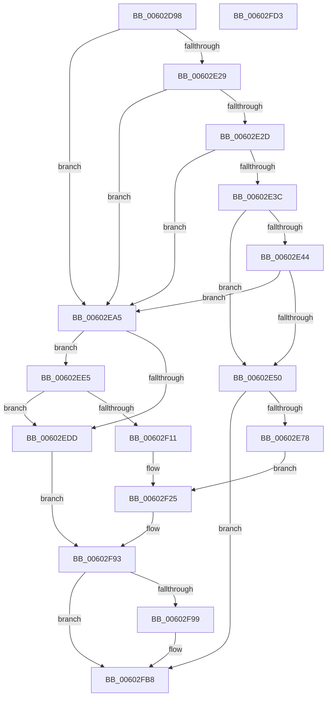

# RtlpHpHeapAllocate

- RVA: `0x00602D98`–`0x00602FD4` (길이 `572` bytes)
- VA: `0x0000000140602D98`
- 실행 섹션: `.text`
- PDB 이름 있음: `예`; PDB Function 태그: `아니요`
- unwind 정보 RVA: `0x000C4D9C`
- 디코드: `155`개 명령, `572/572` bytes 표시
- 미해석 바이트: `0` (있으면 어셈블리에 `.byte`로 보존)

> 이 문서는 커널 이미지의 기계어와 PDB 기호를 분석해 생성했습니다. 4번과 5번은 함수 원형과 자료형을 바이너리 사용 방식에서 추정한 C 해석이며 원본 소스 복구 결과는 아닙니다.

## 1. Dependencies

- 직접 호출 지점: **8**; 고유 호출 대상: **7**
- 직접 호출자로 확인된 함수: **1**
- RIP 상대 이미지 참조: **0**

### Outgoing calls
- `0x00602DBF` → [RtlpHpLfhContextMaximumExtension](RtlpHpLfhContextMaximumExtension_function_00604A70.md) (function, `0x00604A70`)
- `0x00602DC9` → [RtlpHpVsCalculateAffinitySlotCount](../4F/RtlpHpVsCalculateAffinitySlotCount_function_004F6F34.md) (function, `0x004F6F34`)
- `0x00602E67` → [RtlpHpMetadataAlloc](../2E/RtlpHpMetadataAlloc_function_002EC180.md) (function, `0x002EC180`)
- `0x00602E9B` → [RtlpHpMetadataCommit](RtlpHpMetadataCommit_function_00603540.md) (function, `0x00603540`)
- `0x00602ED4` → [RtlpHpAllocVA](../32/RtlpHpAllocVA_function_003276A0.md) (function, `0x003276A0`)
- `0x00602F08` → [RtlpHpAllocVA](../32/RtlpHpAllocVA_function_003276A0.md) (function, `0x003276A0`)
- `0x00602F30` → [memset](../6C/memset_function_006C6C40.md) (function, `0x006C6C40`)
- `0x00602FB3` → [RtlpHpFreeVA](../2C/RtlpHpFreeVA_function_002C0FD4.md) (function, `0x002C0FD4`)

### Direct callers
- [RtlpHpHeapCreate](RtlpHpHeapCreate_function_00602FDC.md) at `0x00603063`

### Static image references
- 디코드된 RIP-relative 메모리 참조가 없습니다.

## 2. Other-region calls and transfers

- 다른 실행 섹션으로 향하는 call: **0**
- 별도 외부 분기/꼬리 이동을 확인하지 못했습니다.

## 3. Assembly (complete function range)

```asm
00602D98  48 89 5C 24 08                  mov qword ptr [rsp + 8], rbx
00602D9D  55                              push rbp
00602D9E  56                              push rsi
00602D9F  57                              push rdi
00602DA0  41 54                           push r12
00602DA2  41 55                           push r13
00602DA4  41 56                           push r14
00602DA6  41 57                           push r15
00602DA8  48 8B EC                        mov rbp, rsp
00602DAB  48 83 EC 70                     sub rsp, 0x70
00602DAF  8B F1                           mov esi, ecx
00602DB1  45 33 ED                        xor r13d, r13d
00602DB4  8B CA                           mov ecx, edx
00602DB6  4C 89 6D 50                     mov qword ptr [rbp + 0x50], r13
00602DBA  49 8B F8                        mov rdi, r8
00602DBD  8B DA                           mov ebx, edx
00602DBF  E8 AC 1C 00 00                  call 0x140604a70
00602DC4  8B CB                           mov ecx, ebx
00602DC6  4C 8B D0                        mov r10, rax
00602DC9  E8 66 41 EF FF                  call 0x1404f6f34
00602DCE  0F 10 07                        movups xmm0, xmmword ptr [rdi]
00602DD1  44 8B C8                        mov r9d, eax
00602DD4  41 BE 00 10 00 00               mov r14d, 0x1000
00602DDA  C1 E0 07                        shl eax, 7
00602DDD  8B D0                           mov edx, eax
00602DDF  4C 89 75 58                     mov qword ptr [rbp + 0x58], r14
00602DE3  4A 8D 0C 8D FF FF FF FF         lea rcx, [r9*4 - 1]
00602DEB  83 E1 3F                        and ecx, 0x3f
00602DEE  4E 8D 24 8D 3F 09 00 00         lea r12, [r9*4 + 0x93f]
00602DF6  48 2B D1                        sub rdx, rcx
00602DF9  B9 FF 0F 00 00                  mov ecx, 0xfff
00602DFE  49 03 D2                        add rdx, r10
00602E01  4C 03 E2                        add r12, rdx
00602E04  BA 00 00 00 40                  mov edx, 0x40000000
00602E09  F3 0F 7F 45 C8                  movdqu xmmword ptr [rbp - 0x38], xmm0
00602E0E  49 8D 44 24 FF                  lea rax, [r12 - 1]
00602E13  48 23 C1                        and rax, rcx
00602E16  48 2B C8                        sub rcx, rax
00602E19  4C 03 E1                        add r12, rcx
00602E1C  4C 89 65 C0                     mov qword ptr [rbp - 0x40], r12
00602E20  4D 8B FC                        mov r15, r12
00602E23  0F BA E6 19                     bt esi, 0x19
00602E27  72 7C                           jb 0x140602ea5
00602E29  85 F2                           test edx, esi
00602E2B  75 78                           jne 0x140602ea5
00602E2D  48 8B 4D C8                     mov rcx, qword ptr [rbp - 0x38]
00602E31  48 8B C1                        mov rax, rcx
00602E34  48 C1 E8 10                     shr rax, 0x10
00602E38  84 C0                           test al, al
00602E3A  75 69                           jne 0x140602ea5
00602E3C  8A C1                           mov al, cl
00602E3E  24 06                           and al, 6
00602E40  3C 06                           cmp al, 6
00602E42  74 0C                           je 0x140602e50
00602E44  48 C1 E9 08                     shr rcx, 8
00602E48  80 E9 02                        sub cl, 2
00602E4B  80 F9 02                        cmp cl, 2
00602E4E  77 55                           ja 0x140602ea5
00602E50  BE 01 00 00 00                  mov esi, 1
00602E55  4C 8D 4D E0                     lea r9, [rbp - 0x20]
00602E59  44 8B C6                        mov r8d, esi
00602E5C  49 8B D6                        mov rdx, r14
00602E5F  49 8B CC                        mov rcx, r12
00602E62  F3 0F 7F 45 E0                  movdqu xmmword ptr [rbp - 0x20], xmm0
00602E67  E8 14 93 CE FF                  call 0x1402ec180
00602E6C  48 8B D8                        mov rbx, rax
00602E6F  48 85 C0                        test rax, rax
00602E72  0F 84 40 01 00 00               je 0x140602fb8
00602E78  0F 10 07                        movups xmm0, xmmword ptr [rdi]
00602E7B  4D 8D 84 24 00 F0 FF FF         lea r8, [r12 - 0x1000]
00602E83  44 89 6C 24 20                  mov dword ptr [rsp + 0x20], r13d
00602E88  48 8D 90 00 10 00 00            lea rdx, [rax + 0x1000]
00602E8F  48 8B C8                        mov rcx, rax
00602E92  4C 8D 4D F0                     lea r9, [rbp - 0x10]
00602E96  F3 0F 7F 45 F0                  movdqu xmmword ptr [rbp - 0x10], xmm0
00602E9B  E8 A0 06 00 00                  call 0x140603540
00602EA0  E9 80 00 00 00                  jmp 0x140602f25
00602EA5  23 F2                           and esi, edx
00602EA7  48 8D 45 F0                     lea rax, [rbp - 0x10]
00602EAB  48 89 44 24 28                  mov qword ptr [rsp + 0x28], rax
00602EB0  48 8D 55 C0                     lea rdx, [rbp - 0x40]
00602EB4  F7 DE                           neg esi
00602EB6  48 8D 4D 50                     lea rcx, [rbp + 0x50]
00602EBA  41 B9 00 20 00 00               mov r9d, 0x2000
00602EC0  1B DB                           sbb ebx, ebx
00602EC2  45 33 C0                        xor r8d, r8d
00602EC5  83 E3 3C                        and ebx, 0x3c
00602EC8  83 C3 04                        add ebx, 4
00602ECB  89 5C 24 20                     mov dword ptr [rsp + 0x20], ebx
00602ECF  F3 0F 7F 45 F0                  movdqu xmmword ptr [rbp - 0x10], xmm0
00602ED4  E8 C7 47 D2 FF                  call 0x1403276a0
00602ED9  85 C0                           test eax, eax
00602EDB  79 08                           jns 0x140602ee5
00602EDD  49 8B DD                        mov rbx, r13
00602EE0  E9 AE 00 00 00                  jmp 0x140602f93
00602EE5  0F 10 07                        movups xmm0, xmmword ptr [rdi]
00602EE8  48 8D 45 E0                     lea rax, [rbp - 0x20]
00602EEC  45 8B CE                        mov r9d, r14d
00602EEF  48 89 44 24 28                  mov qword ptr [rsp + 0x28], rax
00602EF4  48 8D 55 58                     lea rdx, [rbp + 0x58]
00602EF8  45 33 C0                        xor r8d, r8d
00602EFB  89 5C 24 20                     mov dword ptr [rsp + 0x20], ebx
00602EFF  48 8D 4D 50                     lea rcx, [rbp + 0x50]
00602F03  F3 0F 7F 45 E0                  movdqu xmmword ptr [rbp - 0x20], xmm0
00602F08  E8 93 47 D2 FF                  call 0x1403276a0
00602F0D  85 C0                           test eax, eax
00602F0F  78 CC                           js 0x140602edd
00602F11  48 8B 5D 50                     mov rbx, qword ptr [rbp + 0x50]
00602F15  41 0F B7 F5                     movzx esi, r13w
00602F19  4C 8B 7D C0                     mov r15, qword ptr [rbp - 0x40]
00602F1D  4C 8B 75 58                     mov r14, qword ptr [rbp + 0x58]
00602F21  4C 89 6D 50                     mov qword ptr [rbp + 0x50], r13
00602F25  33 D2                           xor edx, edx
00602F27  41 B8 00 09 00 00               mov r8d, 0x900
00602F2D  48 8B CB                        mov rcx, rbx
00602F30  E8 0B 3D 0C 00                  call 0x1406c6c40
00602F35  48 8D 83 00 09 00 00            lea rax, [rbx + 0x900]
00602F3C  B9 FE FF 00 00                  mov ecx, 0xfffe
00602F41  48 89 83 F0 00 00 00            mov qword ptr [rbx + 0xf0], rax
00602F48  4A 8D 04 33                     lea rax, [rbx + r14]
00602F4C  48 89 83 F8 00 00 00            mov qword ptr [rbx + 0xf8], rax
00602F53  49 8D 04 1C                     lea rax, [r12 + rbx]
00602F57  48 89 83 00 01 00 00            mov qword ptr [rbx + 0x100], rax
00602F5E  4A 8D 04 3B                     lea rax, [rbx + r15]
00602F62  48 89 83 08 01 00 00            mov qword ptr [rbx + 0x108], rax
00602F69  0F B7 43 1E                     movzx eax, word ptr [rbx + 0x1e]
00602F6D  66 23 C1                        and ax, cx
00602F70  66 0B C6                        or ax, si
00602F73  66 89 43 1E                     mov word ptr [rbx + 0x1e], ax
00602F77  49 C1 EF 0C                     shr r15, 0xc
00602F7B  F0 4C 01 BB 80 00 00 00         lock add qword ptr [rbx + 0x80], r15
00602F83  48 8B 45 58                     mov rax, qword ptr [rbp + 0x58]
00602F87  48 C1 E8 0C                     shr rax, 0xc
00602F8B  F0 48 01 83 88 00 00 00         lock add qword ptr [rbx + 0x88], rax
00602F93  4C 39 6D 50                     cmp qword ptr [rbp + 0x50], r13
00602F97  74 1F                           je 0x140602fb8
00602F99  0F 10 07                        movups xmm0, xmmword ptr [rdi]
00602F9C  4C 8D 4D F0                     lea r9, [rbp - 0x10]
00602FA0  41 B8 00 80 00 00               mov r8d, 0x8000
00602FA6  48 8D 55 C0                     lea rdx, [rbp - 0x40]
00602FAA  48 8D 4D 50                     lea rcx, [rbp + 0x50]
00602FAE  F3 0F 7F 45 F0                  movdqu xmmword ptr [rbp - 0x10], xmm0
00602FB3  E8 1C E0 CB FF                  call 0x1402c0fd4
00602FB8  48 8B C3                        mov rax, rbx
00602FBB  48 8B 9C 24 B0 00 00 00         mov rbx, qword ptr [rsp + 0xb0]
00602FC3  48 83 C4 70                     add rsp, 0x70
00602FC7  41 5F                           pop r15
00602FC9  41 5E                           pop r14
00602FCB  41 5D                           pop r13
00602FCD  41 5C                           pop r12
00602FCF  5F                              pop rdi
00602FD0  5E                              pop rsi
00602FD1  5D                              pop rbp
00602FD2  C3                              ret
00602FD3  CC                              int3
```

## 4. C-style interpretation (structured pseudocode)

```c
__int64 __fastcall RtlpHpHeapAllocate(int a1, int a2, __int64 a3)
{
    __int64 result;
    __int64 v_r12;
    __int64 v_r13;
    __int64 v_r15;
    __int64 v_rbx;
    __int64 v_rsi;
    __int64 v_rsp;
    unsigned __int64 v_stack_m48;
    unsigned __int64 v_stack_m58;
    unsigned __int64 v_stack_m70;
    unsigned __int64 v_stack_m78;
    unsigned __int64 v_stack_m80;
    unsigned int v_stack_m88;
    unsigned __int64 v_stack_p18;
    unsigned __int64 v_stack_p20;
    unsigned __int64 v_stack_p8;

    v_stack_p8 = v_rbx;
    v_rsp = (v_rsp) - (112);
    v_r13 = 0;
    v_stack_p18 = 0;
    result = RtlpHpLfhContextMaximumExtension((unsigned int)(a2), a2, a3, a4);
    result = RtlpHpVsCalculateAffinitySlotCount((unsigned int)((unsigned int)((unsigned int)(a2))), a2, a3, a4);
    result = (unsigned int)((result) << (7));
    v_stack_p20 = (unsigned int)(0x1000ULL);
    a1 = (unsigned int)(((unsigned int)((unsigned int)(result)) * 4 - 1) & (63));
    a2 = ((unsigned int)((unsigned int)(result))) - (a1);
    a2 = (a2) + (result);
    v_r12 = ((unsigned int)((unsigned int)(result)) * 4 + 2367) + (a2);
    v_stack_m70 = v_xmm0;
    result = (v_r12 - 1) & ((unsigned int)(0xFFFULL));
    a1 = ((unsigned int)(0xFFFULL)) - (result);
    v_r12 = (v_r12) + (a1);
    v_stack_m78 = v_r12;
    if (condition_is_below) goto loc_00602EA5;
    if ((((unsigned int)((unsigned int)(0x40000000ULL))) & ((unsigned int)((unsigned int)(a1)))) != 0) goto loc_00602EA5;
    result = (v_stack_m70) >> (16);
    if ((unsigned __int8)(result) != 0) goto loc_00602EA5;
    result = (unsigned __int8)(((unsigned __int8)(v_stack_m70)) & (6));
    if (((unsigned __int8)(result)) == 6) goto loc_00602E50;
    a1 = (v_stack_m70) >> (8);
    a1 = (unsigned __int8)((a1) - (2));
    if (((unsigned __int8)(a1)) > 2) goto loc_00602EA5;
loc_00602E50:
    v_stack_m58 = v_xmm0;
    result = RtlpHpMetadataAlloc(v_r12, (unsigned int)(0x1000ULL), 1, v_stack_m58);
    if (result == 0) goto loc_00602FB8;
    v_stack_m88 = 0;
    v_stack_m48 = v_xmm0;
    result = RtlpHpMetadataCommit(result, result + 4096, v_r12 - 4096, v_stack_m48);
    goto loc_00602F25;
loc_00602EA5:
    v_rsi = (unsigned int)((1) & ((unsigned int)(result + 4096)));
    v_stack_m80 = v_stack_m48;
    v_rsi = (unsigned int)(-(v_rsi));
    a3 = 0;
    v_rbx = (unsigned int)((result) & (60));
    v_rbx = (unsigned int)((v_rbx) + (4));
    v_stack_m88 = (unsigned int)(v_rbx);
    v_stack_m48 = v_xmm0;
    result = RtlpHpAllocVA(v_stack_p18, v_stack_m78, a3, (unsigned int)(0x2000ULL));
    if (!sign_flag) goto loc_00602EE5;
loc_00602EDD:
    goto loc_00602F93;
loc_00602EE5:
    v_stack_m80 = v_stack_m58;
    a3 = 0;
    v_stack_m88 = 0;
    v_stack_m58 = v_xmm0;
    result = RtlpHpAllocVA(v_stack_p18, v_stack_p20, a3, (unsigned int)((unsigned int)((unsigned int)(0x1000ULL))));
    if (sign_flag) goto loc_00602EDD;
    v_stack_p18 = 0;
loc_00602F25:
    a2 = 0;
    result = memset(v_stack_p18, a2, (unsigned int)(0x900ULL), (unsigned int)((unsigned int)((unsigned int)(0x1000ULL))));
    *(unsigned __int64 *)(v_stack_p18 + 240) = v_stack_p18 + 2304;
    *(unsigned __int64 *)(v_stack_p18 + 248) = v_stack_p18 + v_stack_p20 * 1;
    *(unsigned __int64 *)(v_stack_p18 + 256) = v_r12 + v_stack_p18 * 1;
    *(unsigned __int64 *)(v_stack_p18 + 264) = v_stack_p18 + v_stack_m78 * 1;
    result = (unsigned __int16)((*(unsigned __int16 *)(v_stack_p18 + 30)) & ((unsigned __int16)((unsigned int)(0xFFFEULL))));
    result = (unsigned __int16)((result) | (0));
    *(unsigned __int16 *)(v_stack_p18 + 30) = (unsigned __int16)(result);
    v_r15 = (v_stack_m78) >> (12);
    result = (v_stack_p20) >> (12);
loc_00602F93:
    if (v_stack_p18 != 0) {
        a4 = v_stack_m48;
        a3 = 0x8000ULL;
        a2 = v_stack_m78;
        a1 = v_stack_p18;
        v_stack_m48 = v_xmm0;
        result = RtlpHpFreeVA(a1, a2, a3, a4);
    }
    v_rsp = (v_rsp) + (112);
    return v_stack_p18;
}
```

## 5. (Beta) C Style

```c
int64_t RtlpHpHeapAllocate(int32_t Arg1, int32_t Arg2, void *Arg3)
{
    uint8_t *arg3 = (uint8_t *)Arg3;

    int64_t result;
    int64_t local_r12;
    int64_t local_r13;
    int64_t local_r15;
    int64_t local_rbx;
    int64_t local_rsi;
    int64_t local_rsp;
    uint64_t v_stack_m48;
    uint64_t v_stack_m58;
    uint64_t v_stack_m70;
    uint64_t v_stack_m78;
    uint64_t v_stack_m80;
    uint32_t v_stack_m88;
    uint64_t v_stack_p18;
    uint64_t v_stack_p20;
    uint64_t v_stack_p8;

    v_stack_p8 = local_rbx;
    local_rsp = (local_rsp) - (112);
    local_r13 = 0;
    v_stack_p18 = 0;
    result = RtlpHpLfhContextMaximumExtension((uint32_t)(Arg2), Arg2, Arg3, a4);
    result = RtlpHpVsCalculateAffinitySlotCount((uint32_t)((uint32_t)((uint32_t)(Arg2))), Arg2, Arg3, a4);
    result = (uint32_t)((result) << (7));
    v_stack_p20 = (uint32_t)(0x1000ULL);
    Arg1 = (uint32_t)(((uint32_t)((uint32_t)(result)) * 4 - 1) & (63));
    Arg2 = ((uint32_t)((uint32_t)(result))) - (Arg1);
    Arg2 = (Arg2) + (result);
    local_r12 = ((uint32_t)((uint32_t)(result)) * 4 + 2367) + (Arg2);
    v_stack_m70 = v_xmm0;
    result = (local_r12 - 1) & ((uint32_t)(0xFFFULL));
    Arg1 = ((uint32_t)(0xFFFULL)) - (result);
    local_r12 = (local_r12) + (Arg1);
    v_stack_m78 = local_r12;
    if (condition_is_below) goto loc_00602EA5;
    if ((((uint32_t)((uint32_t)(0x40000000ULL))) & ((uint32_t)((uint32_t)(Arg1)))) != 0) goto loc_00602EA5;
    result = (v_stack_m70) >> (16);
    if ((uint8_t)(result) != 0) goto loc_00602EA5;
    result = (uint8_t)(((uint8_t)(v_stack_m70)) & (6));
    if (((uint8_t)(result)) == 6) goto loc_00602E50;
    Arg1 = (v_stack_m70) >> (8);
    Arg1 = (uint8_t)((Arg1) - (2));
    if (((uint8_t)(Arg1)) > 2) goto loc_00602EA5;
loc_00602E50:
    v_stack_m58 = v_xmm0;
    result = RtlpHpMetadataAlloc(local_r12, (uint32_t)(0x1000ULL), 1, v_stack_m58);
    if (result == 0) goto loc_00602FB8;
    v_stack_m88 = 0;
    v_stack_m48 = v_xmm0;
    result = RtlpHpMetadataCommit(result, result + 4096, local_r12 - 4096, v_stack_m48);
    goto loc_00602F25;
loc_00602EA5:
    local_rsi = (uint32_t)((1) & ((uint32_t)(result + 4096)));
    v_stack_m80 = v_stack_m48;
    local_rsi = (uint32_t)(-(local_rsi));
    Arg3 = 0;
    local_rbx = (uint32_t)((result) & (60));
    local_rbx = (uint32_t)((local_rbx) + (4));
    v_stack_m88 = (uint32_t)(local_rbx);
    v_stack_m48 = v_xmm0;
    result = RtlpHpAllocVA(v_stack_p18, v_stack_m78, Arg3, (uint32_t)(0x2000ULL));
    if (!sign_flag) goto loc_00602EE5;
loc_00602EDD:
    goto loc_00602F93;
loc_00602EE5:
    v_stack_m80 = v_stack_m58;
    Arg3 = 0;
    v_stack_m88 = 0;
    v_stack_m58 = v_xmm0;
    result = RtlpHpAllocVA(v_stack_p18, v_stack_p20, Arg3, (uint32_t)((uint32_t)((uint32_t)(0x1000ULL))));
    if (sign_flag) goto loc_00602EDD;
    v_stack_p18 = 0;
loc_00602F25:
    Arg2 = 0;
    result = memset(v_stack_p18, Arg2, (uint32_t)(0x900ULL), (uint32_t)((uint32_t)((uint32_t)(0x1000ULL))));
    *(uint64_t *)(v_stack_p18 + 0xF0) = v_stack_p18 + 2304;
    *(uint64_t *)(v_stack_p18 + 0xF8) = v_stack_p18 + v_stack_p20 * 1;
    *(uint64_t *)(v_stack_p18 + 0x100) = local_r12 + v_stack_p18 * 1;
    *(uint64_t *)(v_stack_p18 + 0x108) = v_stack_p18 + v_stack_m78 * 1;
    result = (uint16_t)((*(uint16_t *)(v_stack_p18 + 0x1E)) & ((uint16_t)((uint32_t)(0xFFFEULL))));
    result = (uint16_t)((result) | (0));
    *(uint16_t *)(v_stack_p18 + 0x1E) = (uint16_t)(result);
    local_r15 = (v_stack_m78) >> (12);
    result = (v_stack_p20) >> (12);
loc_00602F93:
    if (v_stack_p18 != 0) {
        a4 = v_stack_m48;
        Arg3 = 0x8000ULL;
        Arg2 = v_stack_m78;
        Arg1 = v_stack_p18;
        v_stack_m48 = v_xmm0;
        result = RtlpHpFreeVA(Arg1, Arg2, Arg3, a4);
    }
    local_rsp = (local_rsp) + (112);
    return v_stack_p18;
}
```

### 관측된 메모리 오프셋

구조체 형식이 확인되지 않은 접근은 인자 기준의 오프셋으로만 기록했습니다.

| 기준 인자 | 오프셋 표현 | 폭 (bit) | 접근 |
|---|---:|---:|---|
| `Arg3` | `+ 0x0` | `128` | `R` |

## 6. Execution-region graph

[열기: 2D/3D 그래프와 함수 탐색 컨트롤 패널](../../../control-panel.html?section=text&rva=0x00602D98&view=graph)

- 2D 그래프는 위에서 아래로 흐르고, 3D 그래프는 빈 공간을 드래그해 회전합니다. Shift+드래그는 이동, 휠은 확대·축소, 함수 노드 선택은 대상 보고서 이동입니다.

### Static fallback


